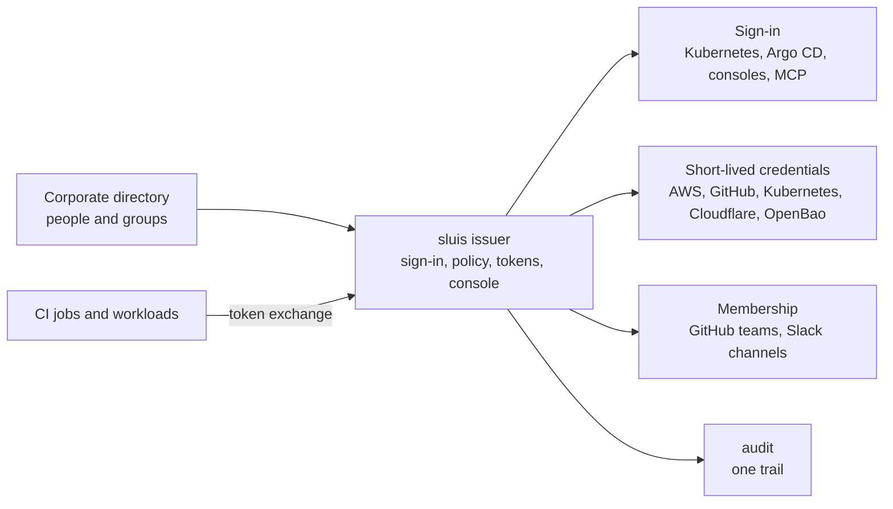

# sluis

sluis is an OpenID Connect issuer for workforce access. It signs people in against your corporate directory, turns groups into tokens under one reviewed policy file, and trades the proofs CI jobs and workloads already hold for short-lived credentials. One audit trail records every decision.

[](https://github.com/truvity/sluis/actions/workflows/ci.yaml)
[](https://github.com/truvity/sluis/releases)
[](LICENSE)

## What you get

| Capability | What it does | Read |
|---|---|---|
| One issuer, one policy | One `iss`, one policy file in git, one flat `groups` claim. `git log` is the history of access. | [why sluis exists](docs/concepts/sluis/why.md) |
| Sign-in through your directory | People sign in with Google Workspace and receive their groups. Passwords and MFA stay with the directory. | [Google Workspace](docs/guides/sluis/connect/google-workspace.md) |
| Token exchange (RFC 8693) | CI jobs, ServiceAccounts and AWS roles trade the proof they hold for short-lived AWS, GitHub, Kubernetes or Cloudflare credentials. No stored secret. | [verify and issue](docs/concepts/sluis/verify-and-issue.md) |
| Membership that follows groups | GitHub teams and Slack channels are reconciled from resolved groups. A failed probe or stale snapshot never removes anyone. | [directory model](docs/concepts/sluis/directory-model.md) |
| MCP authorization | A resource proxy puts a stock MCP server behind sluis. Clients identify themselves with Client ID Metadata Documents. | [MCP server](docs/guides/sluis/connect/mcp.md) |
| A strict client model | Public, confidential and exchange clients. PKCE is required for public clients, and per client with `pkce: required`. | [clients](docs/reference/sluis/policy-clients.md) |
| Recovery without the directory | A recovery account signs in with SRP-6a, so the password never crosses the wire. An operator can turn it off. | [recovery](docs/concepts/sluis/recovery.md) |
| A hardened web surface | HSTS, a content security policy, a sign-out that asks first and per-source throttling. Each refusal log names the path, client and user agent. | [safety](docs/concepts/sluis/safety.md) |
| An audit trail | Records written once, sealed, searchable and verifiable by an auditor. | [audit](docs/concepts/audit/README.md) |
| Provable backups | Age-encrypted backups. A restore checks a backup against the sealed audit trail. | [back up and restore](docs/guides/sluis/operate/back-up-on-layout-v5.md) |
| Verifiable releases | Keyless cosign signatures, provenance and SBOM attestations, signed checksums and `hack/release-verify.sh`. | [verify a release](docs/guides/sluis/operate/verify-a-release.md) |

## Where it runs



| Shape | What runs | Start at |
|---|---|---|
| AWS Lambda | One function per module ([ADR 0071](docs/decisions/0071-least-privilege-modules-one-credential-holder-per-function.md)): issuer, GitHub, Slack, Google, Cloudflare minter, backup and restore. DynamoDB, S3, SSM and KMS. Deployed with the Pulumi library. | [tutorial](docs/get-started/sluis/aws-lambda.md) |
| Kubernetes with AWS storage | The issuer as a pod from the Helm chart, state in DynamoDB and S3, signing in KMS. | [tutorial](docs/get-started/sluis/kubernetes-aws.md) |
| An existing Kubernetes installation | The earlier store on Kubernetes objects and Valkey. | [tutorial](docs/get-started/sluis/kubernetes-legacy-store.md) |

## What it connects

| System | What sluis does | Guide |
|---|---|---|
| Google Workspace | reads people and groups | [Google Workspace](docs/guides/sluis/connect/google-workspace.md) |
| Kubernetes API server | sign-in, groups to RBAC roles | [Kubernetes cluster](docs/guides/sluis/connect/kubernetes-cluster.md) |
| Argo CD, Kargo | sign-in, groups to roles | [Argo CD](docs/guides/sluis/connect/argocd.md), [Kargo](docs/guides/sluis/connect/kargo.md) |
| Your consoles and applications | sign-in, groups claim | [Console app](docs/guides/sluis/connect/console-app.md) |
| MCP servers | authorization for resource servers and agents | [MCP server](docs/guides/sluis/connect/mcp.md), [resource proxy](docs/guides/sluis/connect/mcp-resource-proxy.md) |
| GitHub organisation | team membership, account linking, App tokens | [GitHub organisation](docs/guides/sluis/connect/github-organisation.md), [App tokens](docs/guides/sluis/connect/github-app-tokens.md) |
| Slack | channel membership | [Slack workspace](docs/guides/sluis/connect/slack-workspace.md) |
| GitHub Actions | short-lived credentials for CI jobs | [GitHub Actions](docs/guides/sluis/connect/github-actions.md) |
| AWS | role mapping, short-lived credentials | [AWS account](docs/guides/sluis/connect/aws-account.md), [AWS workloads](docs/guides/sluis/connect/aws-workloads.md) |
| Cloudflare | short-lived API tokens and R2 credentials | [Cloudflare tokens](docs/guides/sluis/cloudflare-tokens.md) |
| OpenBao | sign-in, short-lived SSH and database certificates | [OpenBao](docs/guides/sluis/connect/openbao.md) |

## Who it is for

Platform teams that run many systems from one directory.

## The model

A policy file maps directory groups to access everywhere ([concepts](docs/concepts/sluis/concepts.md)).

## Standards and conformance

| Status | Meaning, as of v1.77.2 |
|---|---|
| Full | Nothing missing that the standard requires or recommends |
| Almost full | The notes name the gap |
| Partial, chosen / Not served, chosen | A decision, see [what is not served](docs/concepts/sluis/not-served.md) |
| Partial / Not implemented | A gap |

| Standard | Status | Notes |
|---|---|---|
| [OpenID Connect Core 1.0](https://openid.net/specs/openid-connect-core-1_0.html) | Almost full | Code flow, `public` subjects. `prompt=consent`, `login_hint`, `claims` and `acr_values` selection are ignored |
| [OpenID Connect Discovery 1.0](https://openid.net/specs/openid-connect-discovery-1_0.html) | Full | Members the issuer does not serve are absent |
| [OpenID Connect RP-Initiated Logout 1.0](https://openid.net/specs/openid-connect-rpinitiated-1_0.html) | Full | `/end_session` asks first unless the `id_token_hint` names the signed-in person |
| [OpenID Connect Back-Channel Logout 1.0](https://openid.net/specs/openid-connect-backchannel-1_0.html) | Full | Opt-in per client. No delivery retry |
| OpenID Connect [Front-Channel Logout](https://openid.net/specs/openid-connect-frontchannel-1_0.html), [Session Management](https://openid.net/specs/openid-connect-session-1_0.html) | Not served, chosen | No consumer asked |
| [RFC 6749 OAuth 2.0](https://www.rfc-editor.org/rfc/rfc6749.html) | Almost full | Code, refresh and token exchange. No implicit, password or client credentials grant |
| [RFC 6750 Bearer tokens](https://www.rfc-editor.org/rfc/rfc6750.html) | Almost full | Header and form body only. No `insufficient_scope` |
| [RFC 7636 PKCE](https://www.rfc-editor.org/rfc/rfc7636.html) | Full | S256 only; a challenge without a method is refused since v1.77.1. Required for public clients; `pkce: required` or `optional` per confidential client |
| [RFC 7009 Revocation](https://www.rfc-editor.org/rfc/rfc7009.html) | Almost full | A client revokes only its own tokens. A JWT verified offline lives to `exp` |
| [RFC 7662 Introspection](https://www.rfc-editor.org/rfc/rfc7662.html) | Not served, chosen | The tokens are JWTs. The route answers `404` |
| [RFC 8414 Authorization server metadata](https://www.rfc-editor.org/rfc/rfc8414.html) | Full | Also at the path-inserted URL |
| [RFC 8693 Token exchange](https://www.rfc-editor.org/rfc/rfc8693.html) | Partial, chosen | One audience, access token out. No `actor_token` or `act` |
| [RFC 8707 Resource indicators](https://www.rfc-editor.org/rfc/rfc8707.html) | Almost full | One `resource`, matched in full |
| [RFC 9068 JWT access tokens](https://www.rfc-editor.org/rfc/rfc9068.html) | Partial | Required claims present. The header `typ` is `JWT`, not `at+jwt` |
| [RFC 9207 `iss` in the response](https://www.rfc-editor.org/rfc/rfc9207.html) | Full | On every redirect carrying `code` or `error` |
| [RFC 9700 Security best current practice](https://www.rfc-editor.org/rfc/rfc9700.html) | Almost full | No sender-constrained tokens. A confidential client may omit PKCE |
| [RFC 8252 Native apps](https://www.rfc-editor.org/rfc/rfc8252.html) | Full | A loopback redirect differs in the port only. A non-loopback `http` redirect is refused |
| [RFC 7517](https://www.rfc-editor.org/rfc/rfc7517.html), [7518](https://www.rfc-editor.org/rfc/rfc7518.html) Key sets | Full | ES384 and RS256. No JWE |
| [RFC 9728 Protected resource metadata](https://www.rfc-editor.org/rfc/rfc9728.html) | Partial, chosen | Served by the resource side, the `identity/resource` package and the resource proxy, not by the issuer |
| [RFC 9101 JAR](https://www.rfc-editor.org/rfc/rfc9101.html) | Not implemented | `request` answers `request_not_supported` |
| [RFC 9126 PAR](https://www.rfc-editor.org/rfc/rfc9126.html), [RFC 9449 DPoP](https://www.rfc-editor.org/rfc/rfc9449.html), [RFC 8705 mTLS](https://www.rfc-editor.org/rfc/rfc8705.html) | Not served, chosen | Surface without a consumer |
| [RFC 7591 Dynamic registration](https://www.rfc-editor.org/rfc/rfc7591.html) | Not served, chosen | Client ID Metadata Documents replace it |
| [RFC 8628 Device grant](https://www.rfc-editor.org/rfc/rfc8628.html) | Not served, chosen | Token exchange covers CI jobs and workloads |
| [OAuth 2.1 draft](https://datatracker.ietf.org/doc/draft-ietf-oauth-v2-1/) | Almost full | As RFC 9700 |
| [Client ID Metadata Documents (draft)](https://datatracker.ietf.org/doc/draft-ietf-oauth-client-id-metadata-document/) | Almost full | Only `client_name` and `redirect_uris` are read. A document that declares a secret is refused |
| MCP authorization ([2025-06-18](https://modelcontextprotocol.io/specification/2025-06-18/basic/authorization), [2025-11-25](https://modelcontextprotocol.io/specification/2025-11-25/basic/authorization)) | Almost full | Metadata, `resource`, PKCE S256, `iss` and metadata documents. No dynamic registration or step-up |

### Conformance results

| Date | Version | Plan | Result | Run |
|---|---|---|---|---|
| 2026-10-20 | v1.77.1 | [Config OP](https://openid.net/certification/connect_op_testing/) | Passed, suite 5.3.3 | [findings](docs/concepts/sluis/conformance-findings.md) |
| pending | v1.77.2 | [Basic OP](https://openid.net/certification/connect_op_testing/) | Re-run on v1.77.2 pending. The 2026-10-20 run on v1.77.1 had 0 failed; v1.77.2 fixes its findings | [findings](docs/concepts/sluis/conformance-findings.md#the-2026-10-20-run-on-v1771) |
| pending | v1.77.2 | [RP-Initiated Logout OP](https://openid.net/certification/connect_op_logout_testing/) | Re-run on v1.77.2 pending. The 2026-10-20 run on v1.77.1 had 0 failed; v1.77.2 fixes its findings | [findings](docs/concepts/sluis/conformance-findings.md#the-2026-10-20-run-on-v1771) |
| pending | v1.77.2 | [Back-Channel Logout OP](https://openid.net/certification/connect_op_logout_testing/) | Re-run on v1.77.2 pending. The 2026-10-20 run on v1.77.1 had 0 failed | [findings](docs/concepts/sluis/conformance-findings.md#the-2026-10-20-run-on-v1771) |
| 2026-09-12 | v1.0.0 | Config, Basic OP, RP-Initiated Logout, Back-Channel Logout | 0 failed | [findings](docs/concepts/sluis/conformance-findings.md) |

## Install and a worked example

| Step | Where |
|---|---|
| Verify the release | [verify a release](docs/guides/sluis/operate/verify-a-release.md) |
| Install | [Lambda](docs/get-started/sluis/aws-lambda.md), [Helm](docs/guides/sluis/operate/install-with-helm.md) |
| Sign in and use it | [`sluisctl`](docs/reference/sluis/sluisctl.md) |

### Try it without a credential

```sh
devbox shell
just console   # builds the console the binary embeds
cat > /tmp/demo.yaml <<'YAML'
demo: true
store: memory
allowInsecure: true
issuerURL: http://localhost:8099
publicURL: http://localhost:8099/console
listen: {address: ":8099"}
probes: {address: ":7099"}
YAML
go run ./cmd/sluis issuer --config /tmp/demo.yaml
```

Open `http://localhost:8099/console/` and choose *Continue with the demonstration directory*.

## Consumers

| Consumer | Uses |
|---|---|
| Estates | the Helm charts or the Pulumi libraries |
| Services | the Go module or `@truvity/sluis` |
| CI jobs | the GitHub Action and `sluisctl` |
| People | `sluisctl` |

## Neighbours

| Neighbour | Role |
|---|---|
| OpenBao | trusts sluis tokens and issues certificates; can be audit's key provider |
| Cloudflare | fronts the Lambda shape; can hold audit's archive on R2 |

## What is published

| Deliverable | Published at |
|---|---|
| sluis and audit images | `ghcr.io/truvity/sluis/*`, `ghcr.io/truvity/audit/*` |
| Helm charts `sluis`, `audit` | `oci://ghcr.io/truvity/charts/sluis`, `oci://ghcr.io/truvity/charts/audit` |
| `sluisctl`, `audit` CLI, Lambda zips | the [GitHub release](https://github.com/truvity/sluis/releases) |
| Go modules (root, `storage`, `audit`, Pulumi libraries) | `github.com/truvity/sluis[/<dir>]`, tagged with the release |
| `@truvity/sluis`, `@truvity/audit`, `@truvity/audit-react` | GitHub Packages |
| GitHub Action | `truvity/sluis@<commit>` |

## Documentation

| Topic | Where |
|---|---|
| The site | <https://truvity.github.io/sluis/> |
| Tutorials | [choose a deployment](docs/get-started/sluis/README.md), [audit](docs/get-started/audit/README.md) |
| Integrations | [connect something](docs/guides/sluis/connect/README.md) |
| Every file and image | [artifacts](docs/reference/sluis/artifacts.md) |
| How it works | [concepts](docs/concepts/sluis/README.md), [architecture](docs/concepts/sluis/architecture.md), [decisions](docs/decisions/README.md) |
| Policy | [policy concepts](docs/concepts/sluis/policy.md), [policy reference](docs/reference/sluis/policy.md) |
| Operations | [day one](docs/guides/sluis/operate/day-one.md), [day two](docs/guides/sluis/operate/day-two.md) |
| Conformance | [run conformance](docs/guides/sluis/run-conformance.md), [findings](docs/concepts/sluis/conformance-findings.md) |
| Protocol details | [endpoints](docs/reference/sluis/endpoints.md), [MCP clients](docs/guides/sluis/connect/mcp.md), [client policy](docs/reference/sluis/policy-clients.md#pkce) |
| Libraries | [Go and TypeScript SDKs](docs/sdk/README.md), [Pulumi library](docs/reference/sluis/pulumi-library.md) |
| Upgrades | the [CHANGELOG](CHANGELOG.md) links an upgrade page from each breaking entry |

## The rule that makes this repository public

Mechanism only: no account, hostname or secret path of an installation. [`hack/leak-canary.sh`](hack/leak-canary.sh) enforces it.

## Status

Used in production by its maintainers. audit may break in a minor, with a **Breaking:** entry. Report vulnerabilities as [SECURITY.md](SECURITY.md) says.

## Development

Run `devbox shell`, then `just check`. See [CONTRIBUTING](CONTRIBUTING.md).

## Releasing

By hand, as a pushed tag `vX.Y.Z`. See [CONTRIBUTING](CONTRIBUTING.md#releasing).

## Licence

MIT, see [LICENSE](LICENSE).
