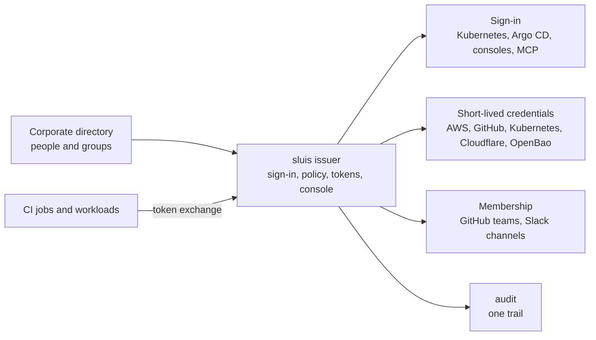

# sluis

sluis is an OpenID Connect issuer for workforce access. It signs people in against your corporate directory, turns groups into tokens under one reviewed policy file, and trades the proofs CI jobs and workloads already hold for short-lived credentials. One audit trail records every decision.

[](https://github.com/truvity/sluis/actions/workflows/ci.yaml)
[](https://github.com/truvity/sluis/releases)
[](LICENSE)

## What you get

| Capability | What it does | Read |
|---|---|---|
| One issuer, one policy | One `iss`, one policy file in git, one flat `groups` claim. `git log` is the history of access. | [why sluis exists](docs/concepts/sluis/why.md) |
| Sign-in through your directory | People sign in with Google Workspace and receive their groups. Passwords and MFA stay with the directory. | [Google Workspace](docs/guides/sluis/connect/google-workspace.md) |
| Token exchange (RFC 8693) | CI jobs, ServiceAccounts and AWS roles trade the proof they hold for short-lived AWS, GitHub, Kubernetes or Cloudflare credentials. No stored secret. | [verify and issue](docs/concepts/sluis/verify-and-issue.md) |
| Membership that follows groups | GitHub teams and Slack channels are reconciled from resolved groups. A failed probe or stale snapshot never removes anyone. | [directory model](docs/concepts/sluis/directory-model.md) |
| MCP authorization | A resource proxy puts a stock MCP server behind sluis. Clients identify themselves with Client ID Metadata Documents. | [MCP server](docs/guides/sluis/connect/mcp.md) |
| A strict client model | Public, confidential and exchange clients. PKCE is required for public clients, and per client with `pkce: required`. | [clients](docs/reference/sluis/policy-clients.md) |
| Recovery without the directory | A recovery account signs in with SRP-6a, so the password never crosses the wire. An operator can turn it off. | [recovery](docs/concepts/sluis/recovery.md) |
| A hardened web surface | HSTS, a content security policy, a sign-out that asks first and per-source throttling. Each refusal log names the path, client and user agent. | [safety](docs/concepts/sluis/safety.md) |
| An audit trail | Records written once, sealed, searchable and verifiable by an auditor. | [audit](docs/concepts/audit/README.md) |
| Provable backups | Age-encrypted backups. A restore checks a backup against the sealed audit trail. | [back up and restore](docs/guides/sluis/operate/back-up-on-layout-v5.md) |
| Verifiable releases | Keyless cosign signatures, provenance and SBOM attestations, signed checksums and `hack/release-verify.sh`. | [verify a release](docs/guides/sluis/operate/verify-a-release.md) |

## Where it runs



| Shape | What runs | Start at |
|---|---|---|
| AWS Lambda | One function per module ([ADR 0071](docs/decisions/0071-least-privilege-modules-one-credential-holder-per-function.md)): issuer, GitHub, Slack, Google, Cloudflare minter, backup and restore. DynamoDB, S3, SSM and KMS. Deployed with the Pulumi library. | [tutorial](docs/get-started/sluis/aws-lambda.md) |
| Kubernetes with AWS storage | The issuer as a pod from the Helm chart, state in DynamoDB and S3, signing in KMS. | [tutorial](docs/get-started/sluis/kubernetes-aws.md) |
| An existing Kubernetes installation | The earlier store on Kubernetes objects and Valkey. | [tutorial](docs/get-started/sluis/kubernetes-legacy-store.md) |

[Choose a deployment](docs/get-started/sluis/README.md) compares them.

## What it connects

| System | What sluis does | Guide |
|---|---|---|
| Google Workspace | reads people and groups | [Google Workspace](docs/guides/sluis/connect/google-workspace.md) |
| Kubernetes API server | sign-in, groups to RBAC roles | [Kubernetes cluster](docs/guides/sluis/connect/kubernetes-cluster.md) |
| Argo CD, Kargo | sign-in, groups to roles | [Argo CD](docs/guides/sluis/connect/argocd.md), [Kargo](docs/guides/sluis/connect/kargo.md) |
| Your consoles and applications | sign-in, groups claim | [Console app](docs/guides/sluis/connect/console-app.md) |
| MCP servers | authorization for resource servers and agents | [MCP server](docs/guides/sluis/connect/mcp.md), [resource proxy](docs/guides/sluis/connect/mcp-resource-proxy.md) |
| GitHub organisation | team membership, account linking, App tokens | [GitHub organisation](docs/guides/sluis/connect/github-organisation.md), [App tokens](docs/guides/sluis/connect/github-app-tokens.md) |
| Slack | channel membership | [Slack workspace](docs/guides/sluis/connect/slack-workspace.md) |
| GitHub Actions | short-lived credentials for CI jobs | [GitHub Actions](docs/guides/sluis/connect/github-actions.md) |
| AWS | role mapping, short-lived credentials | [AWS account](docs/guides/sluis/connect/aws-account.md), [AWS workloads](docs/guides/sluis/connect/aws-workloads.md) |
| Cloudflare | short-lived API tokens and R2 credentials | [Cloudflare tokens](docs/guides/sluis/cloudflare-tokens.md) |
| OpenBao | sign-in, short-lived SSH and database certificates | [OpenBao](docs/guides/sluis/connect/openbao.md) |

[Connect something](docs/guides/sluis/connect/README.md) lists every integration.

## Standards and conformance

<!-- standards-and-conformance: the table and the conformance results are added by the change that carries the conformance runs. -->

## Install and try

| Step | Where |
|---|---|
| Verify the release | [verify a release](docs/guides/sluis/operate/verify-a-release.md) |
| Install | [Lambda](docs/get-started/sluis/aws-lambda.md), [Helm](docs/guides/sluis/operate/install-with-helm.md) |
| Sign in and use it | [`sluisctl`](docs/reference/sluis/sluisctl.md) |

### Try it without a credential

Build the console and start the issuer on an in-memory directory.

```sh
devbox shell
just console
cat > /tmp/demo.yaml <<'YAML'
demo: true
store: memory
allowInsecure: true
issuerURL: http://localhost:8099
publicURL: http://localhost:8099/console
listen: {address: ":8099"}
probes: {address: ":7099"}
YAML
go run ./cmd/sluis issuer --config /tmp/demo.yaml
```

Open `http://localhost:8099/console/` and choose *Continue with the demonstration directory*.

## What is published

| Deliverable | Published at |
|---|---|
| sluis and audit images | `ghcr.io/truvity/sluis/*`, `ghcr.io/truvity/audit/*` |
| Helm charts `sluis`, `audit` | `oci://ghcr.io/truvity/charts/sluis`, `oci://ghcr.io/truvity/charts/audit` |
| `sluisctl`, `audit` CLI, Lambda zips | the [GitHub release](https://github.com/truvity/sluis/releases) |
| Go modules (root, `storage`, `audit`, Pulumi libraries) | `github.com/truvity/sluis[/<dir>]`, tagged with the release |
| `@truvity/sluis`, `@truvity/audit`, `@truvity/audit-react` | GitHub Packages |
| GitHub Action | `truvity/sluis@<commit>` |

[Artifacts](docs/reference/sluis/artifacts.md) lists every file and image.

## Documentation

| Topic | Where |
|---|---|
| The site | <https://truvity.github.io/sluis/> |
| Tutorials | [sluis](docs/get-started/sluis/README.md), [audit](docs/get-started/audit/README.md) |
| How it works | [concepts](docs/concepts/sluis/README.md), [architecture](docs/concepts/sluis/architecture.md), [decisions](docs/decisions/README.md) |
| Policy | [policy concepts](docs/concepts/sluis/policy.md), [policy reference](docs/reference/sluis/policy.md) |
| Operations | [day one](docs/guides/sluis/operate/day-one.md), [day two](docs/guides/sluis/operate/day-two.md) |
| Libraries | [Go and TypeScript SDKs](docs/sdk/README.md), [Pulumi library](docs/reference/sluis/pulumi-library.md) |
| Upgrades | the [CHANGELOG](CHANGELOG.md) links an upgrade page from each breaking entry |

## The rule that makes this repository public

Mechanism only: no account, hostname or secret path of an installation. [`hack/leak-canary.sh`](hack/leak-canary.sh) enforces it.

## Status

Used in production by its maintainers. audit may break in a minor, with a **Breaking:** entry. Report vulnerabilities as [SECURITY.md](SECURITY.md) says.

## Development

Run `devbox shell`, then `just check`. See [CONTRIBUTING](CONTRIBUTING.md), which also covers [releasing](CONTRIBUTING.md#releasing).

## Licence

MIT, see [LICENSE](LICENSE).
