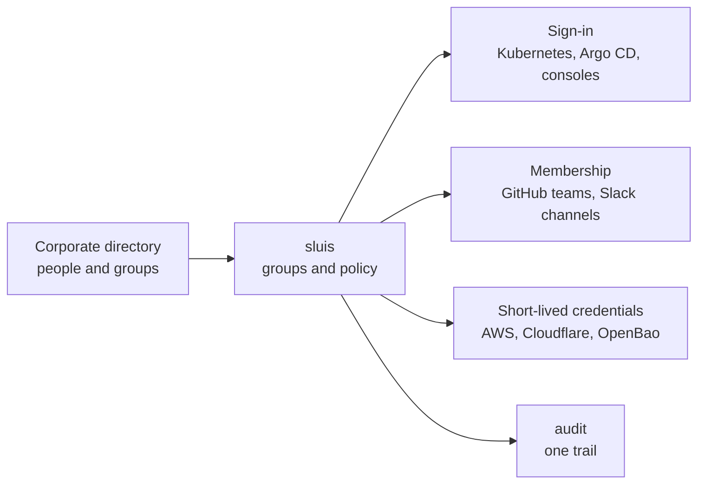

# sluis

sluis federates one identity source, your corporate directory, into every system you run. People, groups and short-lived credentials come from one reviewed policy file, and every decision lands in one tamper-evident audit trail. You change a person's group once, and each system follows.

[](https://github.com/truvity/sluis/actions/workflows/ci.yaml)
[](https://github.com/truvity/sluis/releases)
[](LICENSE)

| Deliverable | Published at |
|---|---|
| sluis and audit images | `ghcr.io/truvity/sluis/*`, `ghcr.io/truvity/audit/*` |
| Helm charts `sluis`, `audit` | `oci://ghcr.io/truvity/charts/sluis`, `oci://ghcr.io/truvity/charts/audit` |
| `sluisctl`, `audit` CLI, Lambda zips | the [GitHub release](https://github.com/truvity/sluis/releases) |
| Go modules (root, `storage`, `audit`, Pulumi libraries) | `github.com/truvity/sluis[/<dir>]`, tagged with the release |
| `@truvity/sluis`, `@truvity/audit`, `@truvity/audit-react` | GitHub Packages |
| GitHub Action | `truvity/sluis@<commit>` |

## What it federates



| System | What sluis does | How | Guide |
|---|---|---|---|
| Google Workspace | reads people and groups | directory reader | [Google Workspace](docs/guides/sluis/connect/google-workspace.md) |
| Kubernetes API server | sign-in, groups to RBAC roles | OIDC client | [Kubernetes cluster](docs/guides/sluis/connect/kubernetes-cluster.md) |
| Argo CD, Kargo | sign-in, groups to roles | OIDC client | [Argo CD](docs/guides/sluis/connect/argocd.md), [Kargo](docs/guides/sluis/connect/kargo.md) |
| Your consoles and applications | sign-in, groups claim | OIDC client | [Console app](docs/guides/sluis/connect/console-app.md) |
| GitHub organisation | team membership, account linking | reconciler | [GitHub organisation](docs/guides/sluis/connect/github-organisation.md), [account links](docs/guides/sluis/connect/github-account-links.md) |
| Slack | channel membership | reconciler | [Slack workspace](docs/guides/sluis/connect/slack-workspace.md) |
| GitHub Actions | short-lived credentials for CI jobs | token exchange | [GitHub Actions](docs/guides/sluis/connect/github-actions.md) |
| AWS | role mapping, short-lived credentials | token exchange | [AWS account](docs/guides/sluis/connect/aws-account.md) |
| Cloudflare | short-lived API tokens and R2 credentials | preset | [Cloudflare tokens](docs/guides/sluis/cloudflare-tokens.md) |
| OpenBao | sign-in, short-lived certificates | token exchange | [OpenBao](docs/guides/sluis/connect/openbao.md) |

[Connect something](docs/guides/sluis/connect/README.md) lists every integration. sluis runs on Kubernetes or AWS Lambda.

## The model

A policy file maps directory groups and machine identities to groups. sluis mints tokens and reconciles GitHub and Slack from it. See [concepts](docs/concepts/sluis/concepts.md).

## Install and a worked example

```sh
sluisctl render --installation installation.yaml --out rendered/
helm install sluis oci://ghcr.io/truvity/charts/sluis --version X.Y.Z --namespace sluis --create-namespace \
  --values values.yaml --set-file documents.service=rendered/sluis.yaml --set-file documents.policy=rendered/policy.yaml
```

### Try it without a credential

```sh
cat > /tmp/demo.yaml <<'YAML'
demo: true
store: memory
allowInsecure: true
issuerURL: http://localhost:8099
publicURL: http://localhost:8099/console
listen: {address: ":8099"}
probes: {address: ":7099"}
YAML
go run ./cmd/sluis serve --config /tmp/demo.yaml
```

Open `http://localhost:8099/console/` and choose *Continue with the demonstration directory*.

## Consumers

| Consumer | Uses |
|---|---|
| Estates | the Helm charts or the Pulumi libraries |
| Services | the Go module or `@truvity/sluis` |
| CI jobs | the GitHub Action and `sluisctl` |
| People | `sluisctl` |

## Neighbours

| Neighbour | Role |
|---|---|
| OpenBao | trusts sluis tokens and issues certificates; can be audit's key provider |
| Cloudflare | fronts the Lambda shape; can hold audit's archive on R2 |

## Documentation

| Topic | Where |
|---|---|
| The site | <https://truvity.github.io/sluis/> |
| Tutorials | [sluis](docs/get-started/sluis/README.md), [audit](docs/get-started/audit/README.md) |
| Every deliverable | [artifacts](docs/reference/sluis/artifacts.md) |
| Upgrades | the [CHANGELOG](CHANGELOG.md) links an upgrade page from each breaking entry |

## The rule that makes this repository public

Mechanism only: no account, hostname or secret path of an installation. [`hack/leak-canary.sh`](hack/leak-canary.sh) enforces it.

## Status

Used in production by its maintainers. audit may break in a minor, with a **Breaking:** entry. Report vulnerabilities as [SECURITY.md](SECURITY.md) says.

## Development

Run `devbox shell`, then `just check`. See [CONTRIBUTING](CONTRIBUTING.md).

## Releasing

By hand, as a pushed tag `vX.Y.Z`. See [CONTRIBUTING](CONTRIBUTING.md#releasing).

## Licence

MIT, see [LICENSE](LICENSE).
