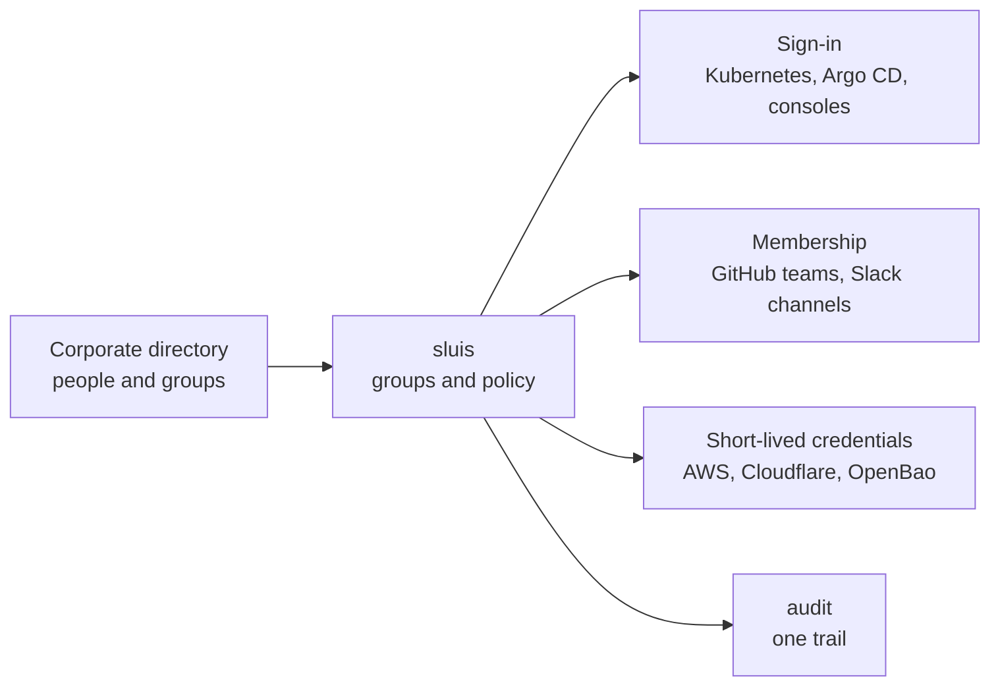

# sluis

sluis federates one identity source, your corporate directory, into every system you run. People, groups and short-lived credentials come from one reviewed policy file, and every decision lands in one tamper-evident audit trail. You change a person's group once, and every system follows.

[](https://github.com/truvity/sluis/actions/workflows/ci.yaml)
[](https://github.com/truvity/sluis/releases)
[](LICENSE)

| Deliverable | Published at |
|---|---|
| sluis and audit images | `ghcr.io/truvity/sluis/*`, `ghcr.io/truvity/audit/*` |
| Helm charts `sluis`, `audit` | `oci://ghcr.io/truvity/charts/sluis`, `oci://ghcr.io/truvity/charts/audit` |
| `sluisctl`, `audit` CLI, Lambda zips | the [GitHub release](https://github.com/truvity/sluis/releases) |
| Go modules (root, `storage`, `audit`, Pulumi libraries) | `github.com/truvity/sluis[/<dir>]`, tagged with the release |
| `@truvity/sluis`, `@truvity/audit`, `@truvity/audit-react` | GitHub Packages |
| GitHub Action | `truvity/sluis@<commit>` |

## What it federates



| System | What sluis does | How | Guide |
|---|---|---|---|
| Google Workspace | reads people and groups | directory reader | [Google Workspace](docs/guides/sluis/connect/google-workspace.md) |
| Kubernetes API server | sign-in, groups to RBAC roles | OIDC client | [Kubernetes cluster](docs/guides/sluis/connect/kubernetes-cluster.md) |
| Argo CD, Kargo | sign-in, groups to roles | OIDC client | [Argo CD](docs/guides/sluis/connect/argocd.md), [Kargo](docs/guides/sluis/connect/kargo.md) |
| Your consoles and applications | sign-in, groups claim | OIDC client | [Console app](docs/guides/sluis/connect/console-app.md) |
| GitHub organisation | team membership, account linking | reconciler | [GitHub organisation](docs/guides/sluis/connect/github-organisation.md), [account links](docs/guides/sluis/connect/github-account-links.md) |
| Slack | channel membership | reconciler | [Slack workspace](docs/guides/sluis/connect/slack-workspace.md) |
| GitHub Actions | short-lived credentials for CI jobs | token exchange | [GitHub Actions](docs/guides/sluis/connect/github-actions.md) |
| AWS | role mapping, short-lived credentials | token exchange | [AWS account](docs/guides/sluis/connect/aws-account.md) |
| Cloudflare | short-lived API tokens and R2 credentials | preset | [Cloudflare tokens](docs/guides/sluis/cloudflare-tokens.md) |
| OpenBao | sign-in, short-lived certificates | token exchange | [OpenBao](docs/guides/sluis/connect/openbao.md) |

[Connect something](docs/guides/sluis/connect/README.md) lists every integration.

## Who it is for

Platform teams running many systems from one directory.

## The model

A policy file maps directory groups to access everywhere. See [concepts](docs/concepts/sluis/concepts.md).

## Standards and conformance

| Status | Meaning, as of v1.77.1 |
|---|---|
| Full | Nothing missing that the standard requires or recommends |
| Almost full | The notes name the gap |
| Partial, chosen / Not served, chosen | A decision, see [what is not served](docs/concepts/sluis/not-served.md) |
| Partial / Not implemented | A gap |

| Standard | Status | Notes |
|---|---|---|
| OpenID Connect Core 1.0 | Almost full | Code flow, `public` subjects. `prompt=consent`, `login_hint`, `claims` and `acr_values` selection are ignored |
| OpenID Connect Discovery 1.0 | Full | Members the issuer does not serve are absent |
| OpenID Connect RP-Initiated Logout 1.0 | Full | `/end_session` asks first unless the `id_token_hint` names the signed-in person |
| OpenID Connect Back-Channel Logout 1.0 | Full | Opt-in per client. No delivery retry |
| OpenID Connect Front-Channel Logout, Session Management | Not served, chosen | No consumer asked |
| RFC 6749 OAuth 2.0 | Almost full | Code, refresh and token exchange. No implicit, password or client credentials grant |
| RFC 6750 Bearer tokens | Almost full | Header and form body only. No `insufficient_scope` |
| RFC 7636 PKCE | Almost full | S256 only. Required for public clients; `pkce: required` or `optional` per confidential client |
| RFC 7009 Revocation | Almost full | A client revokes only its own tokens. A JWT verified offline lives to `exp` |
| RFC 7662 Introspection | Not served, chosen | The tokens are JWTs. The route answers `404` |
| RFC 8414 Authorization server metadata | Full | Also at the path-inserted URL |
| RFC 8693 Token exchange | Partial, chosen | One audience, access token out. No `actor_token` or `act` |
| RFC 8707 Resource indicators | Almost full | One `resource`, matched in full |
| RFC 9068 JWT access tokens | Partial | Required claims present. The header `typ` is `JWT`, not `at+jwt` |
| RFC 9207 `iss` in the response | Full | On every redirect carrying `code` or `error` |
| RFC 9700 Security best current practice | Almost full | No sender-constrained tokens. A confidential client may omit PKCE |
| RFC 8252 Native apps | Full | A loopback redirect differs in the port only. A non-loopback `http` redirect is refused |
| RFC 7517, 7518 Key sets | Full | ES384 and RS256. No JWE |
| RFC 9728 Protected resource metadata | Partial, chosen | Served by the resource side, the `identity/resource` package and the resource proxy, not by the issuer |
| RFC 9101 JAR | Not implemented | `request` answers `request_not_supported` |
| RFC 9126 PAR, RFC 9449 DPoP, RFC 8705 mTLS | Not served, chosen | Surface without a consumer |
| RFC 7591 Dynamic registration | Not served, chosen | Client ID Metadata Documents replace it |
| RFC 8628 Device grant | Not served, chosen | Token exchange covers CI jobs and workloads |
| OAuth 2.1 draft | Almost full | As RFC 9700 |
| Client ID Metadata Documents (draft) | Almost full | Only `client_name` and `redirect_uris` are read. A document that declares a secret is refused |
| MCP authorization (2025-06-18, 2025-11-25) | Almost full | Metadata, `resource`, PKCE S256, `iss` and metadata documents. No dynamic registration or step-up |

### Conformance results

| Date | Version | Plan | Result | Run |
|---|---|---|---|---|
| 2026-09-12 | v1.0.0 | Config, Basic OP, RP-Initiated Logout, Back-Channel Logout | 0 failed | [findings](docs/concepts/sluis/conformance-findings.md) |
| TBD | v1.77.1 | Config OP | TBD | TBD |
| TBD | v1.77.1 | Basic OP | TBD | TBD |
| TBD | v1.77.1 | RP-Initiated Logout OP | TBD | TBD |
| TBD | v1.77.1 | Back-Channel Logout OP | TBD | TBD |

## Install and a worked example

```sh
sluisctl render --installation installation.yaml --out rendered/
helm install sluis oci://ghcr.io/truvity/charts/sluis --version X.Y.Z --namespace sluis --create-namespace \
  --values values.yaml --set-file documents.service=rendered/sluis.yaml --set-file documents.policy=rendered/policy.yaml
```

### Try it without a credential

```sh
cat > /tmp/demo.yaml <<'YAML'
demo: true
store: memory
allowInsecure: true
issuerURL: http://localhost:8099
publicURL: http://localhost:8099/console
listen: {address: ":8099"}
probes: {address: ":7099"}
YAML
go run ./cmd/sluis serve --config /tmp/demo.yaml
```

Open `http://localhost:8099/console/` and choose *Continue with the demonstration directory*.

## Consumers

| Consumer | Uses |
|---|---|
| Estates | the Helm charts or the Pulumi libraries |
| Services | the Go module or `@truvity/sluis` |
| CI jobs | the GitHub Action and `sluisctl` |
| People | `sluisctl` |

## Neighbours

| Neighbour | Role |
|---|---|
| OpenBao | trusts sluis tokens and issues certificates; can be audit's key provider |
| Cloudflare | fronts the Lambda shape; can hold audit's archive on R2 |

## Documentation

| Topic | Where |
|---|---|
| The site | <https://truvity.github.io/sluis/> |
| Tutorials | [sluis](docs/get-started/sluis/README.md), [audit](docs/get-started/audit/README.md) |
| Every deliverable | [artifacts](docs/reference/sluis/artifacts.md) |
| Where it runs | Kubernetes or AWS Lambda, see [Connect something](docs/guides/sluis/connect/README.md) |
| Conformance | [run conformance](docs/guides/sluis/run-conformance.md), [findings](docs/concepts/sluis/conformance-findings.md) |
| Protocol details | [endpoints](docs/reference/sluis/endpoints.md), [MCP clients](docs/guides/sluis/connect/mcp.md), [client policy](docs/reference/sluis/policy-clients.md#pkce) |
| Upgrades | the [CHANGELOG](CHANGELOG.md) links an upgrade page from each breaking entry |

## The rule that makes this repository public

Mechanism only: no account, hostname or secret path of an installation. [`hack/leak-canary.sh`](hack/leak-canary.sh) enforces it.

## Status

Used in production by its maintainers. audit may break in a minor, with a **Breaking:** entry. Report vulnerabilities as [SECURITY.md](SECURITY.md) says.

## Development

Run `devbox shell`, then `just check`. See [CONTRIBUTING](CONTRIBUTING.md).

## Releasing

By hand, as a pushed tag `vX.Y.Z`. See [CONTRIBUTING](CONTRIBUTING.md#releasing).

## Licence

MIT, see [LICENSE](LICENSE).
