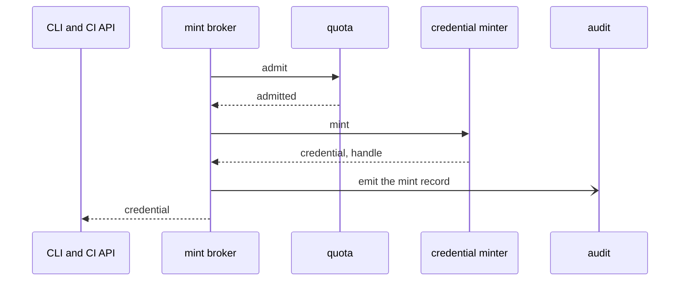
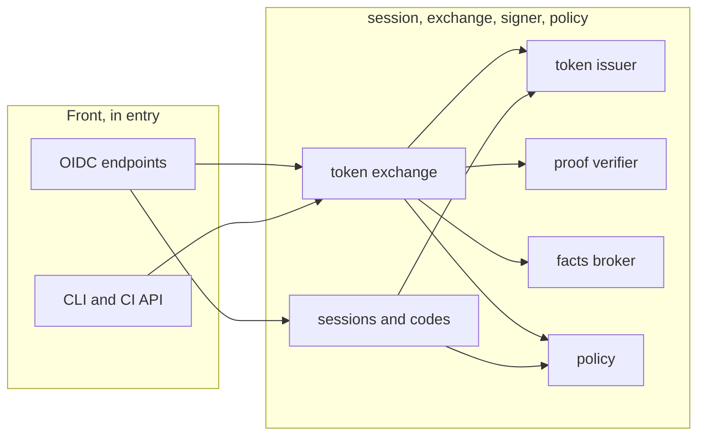
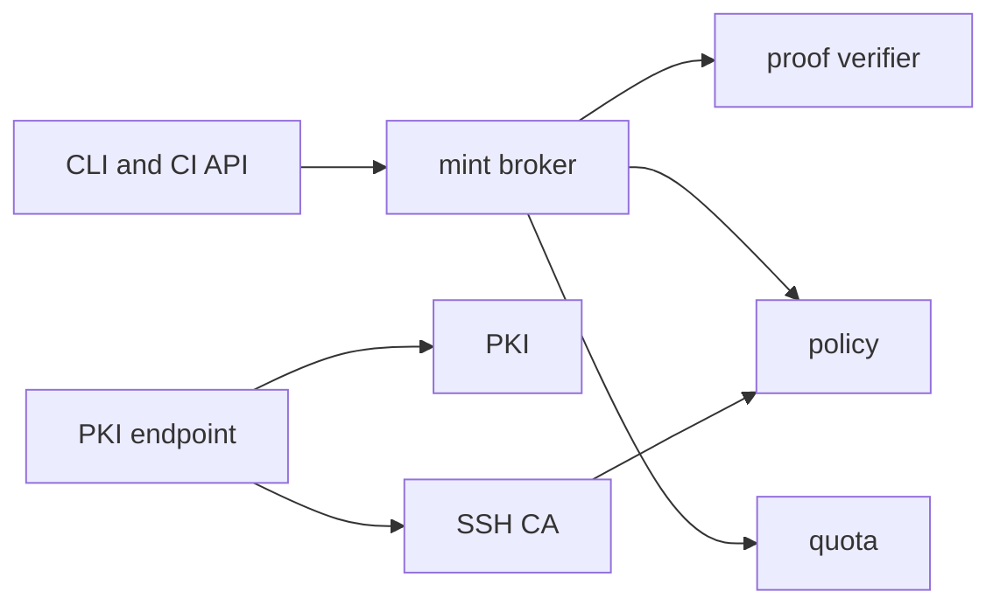
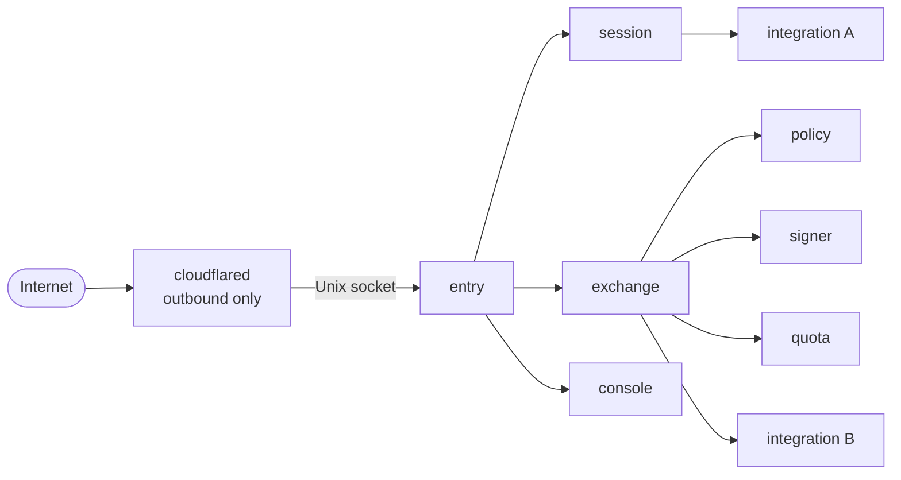
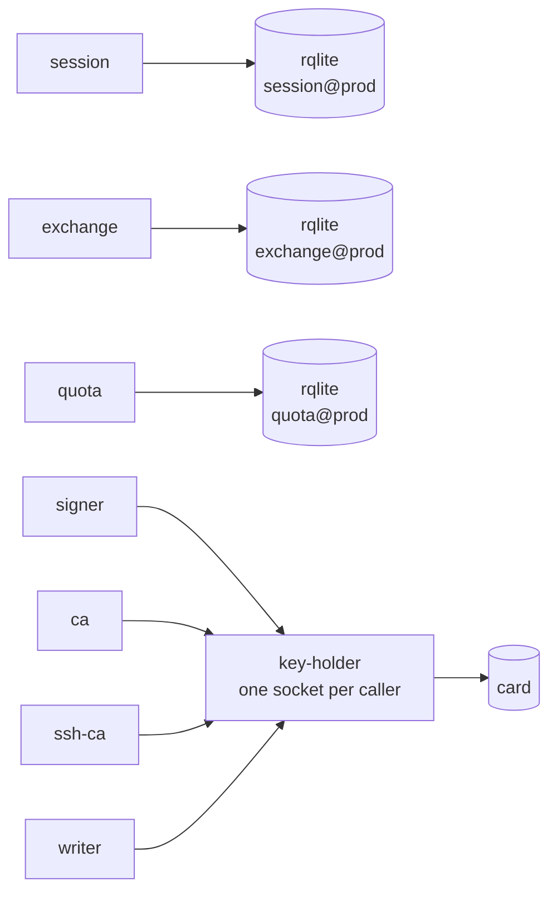
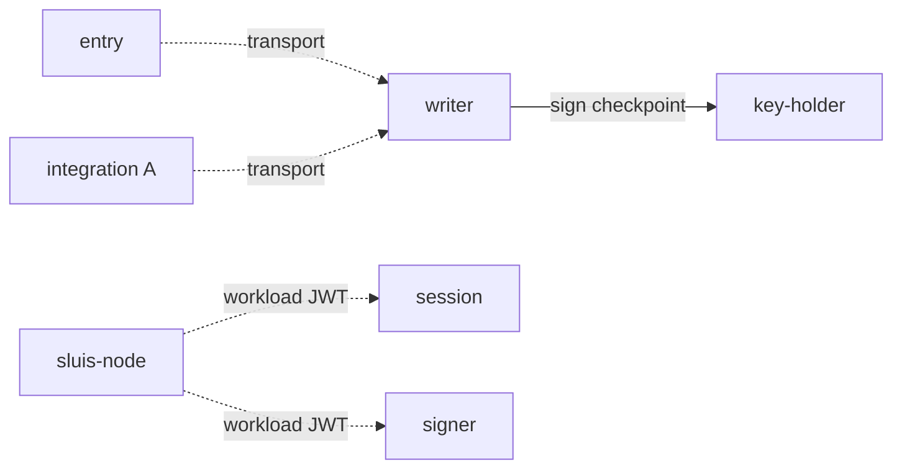

At the second zoom level the [black box](/architecture/context/) is split into **components**: each has one responsibility, a ConnectRPC contract and a short list of components it may call. At the third level the components are placed into **processes**, the [actors](/concepts/actors/), each with one credential set. This page lists what exists: which components and processes there are, what each holds and writes, what it calls, and who may call it. What an actor is, how instances are named, which ports each actor requires and how placement is derived are on [Actors](/concepts/actors/); the enforcement on each runtime is on [Deployment and listeners](/architecture/deployment/).

Every major component is a ConnectRPC contract, even when caller and callee share a process. In-process calls use an in-memory transport, so moving a component into its own process changes configuration, not code ([ADR 0002](/decisions/0002-the-design-model-actors-ports-drivers-and-contracts/#contracts)).

## Component groups

| Group | Components | Responsibility |
| ----- | ---------- | -------------- |
| **Front** | web surface, OIDC endpoints, CLI and CI API, webhook ingress, PKI endpoint, exports API, console HTTP | Parse the wire protocol, apply uniform hardening (headers, cookies, throttling, uniform refusals), and delegate every decision to an owner. A front component decides nothing |
| **Identity path** | authn, authorization flows, sessions, token exchange, mint broker, token issuer, client registry, key ring, proof verifier, facts broker, policy, tick scheduler, grants export, console | Own sessions, codes, refresh tokens and clients; verify proofs; turn facts into grants; ask for credentials to be minted |
| **Certificates and quota** | PKI and its issuance log, SSH CA, host enrolment, quota, backup, restore | Issue X.509 and SSH certificates, admit metered operations, and protect and recover the installation ([Backup](/concepts/backup/)) |
| **Audit** | audit writer, witness, audit indexer, audit query, static publisher | Take records from every other component, seal them in batches, have the batch heads signed through the keys port, and serve them back ([Audit](/concepts/audit/)) |
| **Integrations** | upstream, facts source, credential minter, provisioner, notifier; workload verifiers | Talk to one external system each. Return facts, or carry out effects core has authorized ([Integrations](/integrations/)) |
| **Ports and drivers** | keys, state, lease, blob, transport, index, cloud, witness, secrets, export | Libraries linked into the component that needs them, and the platform-started services behind them. Never a hop of their own |

The front runs in `entry`, which parses, validates against closed parameter lists and routes. `session` hosts authn, the authorization flows and sessions. `exchange` hosts token exchange, the mint broker, the proof verifiers, the client registry and host enrolment. `console` hosts the console, `signer` the key ring and the token issuer, `policy` the decision point, `ca` the PKI and its issuance log, and `ssh-ca` the SSH CA. The audit components split across `writer`, `witness`, `indexer` and `reader`; `quota` is its own actor; and each integration runs as its own process, one per vendor tenant and credential.

## Processes

Each process below is an actor instance, `<actor>@<boundary>` ([ADR 0003](/decisions/0003-core-actors-with-one-responsibility-each/#names)). The [actor registry](/reference/actors/) lists every actor in one table, with its language, placement, keys and card slots, governing records and issue label. "Holds" names the keys and credentials it can use; "writes" the record kinds it owns; "calls" and "called by" are edges of the call graph, which is default deny. Every process also puts audit records on the transport, because every success is audited; that edge is not repeated in the tables.

### Core actors

The core actors are fixed by [ADR 0003](/decisions/0003-core-actors-with-one-responsibility-each/#the-actors).

| Process | Holds | Writes | Calls | Called by |
| ------- | ----- | ------ | ----- | --------- |
| `entry` | **Nothing**: no key, no secret, no state, no outbound network | Nothing | `session`, `exchange`, `console`, `ssh-ca`; an integration only to route a push notification | The edge connector |
| `session` | The cookie-sealing key: a data key wrapped under the sealing key with `purpose=cookie` | Sessions, refresh tokens, the revocation list, authorization codes, consent, device authorization records, pending sign-in state, passkey records and the recovery switch | `signer`, `policy`, the `Upstream` integrations | `entry`; `console`, to check a session |
| `console` | No key; delegation checks only | Nothing of its own: each operator-set write goes to the actor that owns the kind | `session`, the owners of operator-set kinds (`exchange`, an integration), the audit `reader` | `entry` |
| `exchange` | Verifier drivers with public material only; use of the enrolment key, which stays in `key-holder` or KMS | Client secret versions and metadata, enrolments, enrolment-token hashes, the host registry, minted-credential records | `policy`, `quota`, `signer`, `ca`, the minters and notifiers; its workload verifiers in process | `entry`; `console`, for its operator-set kinds |
| `signer` | The token-signing key | The signing ring and its rotation schedule | Nothing but its keys driver | `session`, `exchange` |
| `policy` | Use of the sealing key, to seal grants only (`purpose=grant`) | Nothing: no state, no network, no secrets | Nothing but its keys driver | `session`, `exchange`, `ssh-ca`, the audit `reader` |
| `ca` | The X.509 intermediate | Issued-certificate records, the issuance log, CRL state | Nothing but its drivers | `exchange` |
| `ssh-ca` | The `ssh-user` and `ssh-host` CA keys | Issued SSH-certificate records, KRL state | `policy` | `entry` |

`signer` is not a pure signing oracle: it checks the issuer URL, the audience set, the lifetime and the algorithm. `policy` maps facts to grants with a declared Cedar policy ([ADR 0009](/decisions/0009-policy-is-cedar-in-a-rust-actor/)). A compromised `entry` reaches only the sockets it routes to, and each receiver checks the request again; a compromised `signer` can sign but parses no request; a compromised integration reaches its own provider account and its own state.

### Audit and quota actors

| Process | Holds | Writes | Calls | Called by |
| ------- | ----- | ------ | ----- | --------- |
| `writer` | The log-store credential, create-if-absent only. It never holds the log key: `key-holder` signs each checkpoint for it, or on AWS a key policy that names it | Batch objects, the `audit_batches` sequence, dedupe records, the last signed head; erasure and purge entries on request | `key-holder` or KMS, to sign checkpoints | Every process, through the transport |
| `witness` | Its own witness key | Its co-signatures, in the blob | Nothing; it reads new heads | Nobody; a `peer` witness takes other nodes' checkpoints over mutual TLS |
| `indexer` | Read on the log, write on the index | The search index and its cursor | Nothing; it follows the log by checkpoint | Nobody |
| `reader` | Read-only access to the index and the log | Nothing; every read is audited | `policy`, for the caller's grant | The audit front's `entry`; a console |
| `quota` | No key | Quota balances, reservations and request ids | Nothing but its state driver | `exchange` and other metered callers |

One writer per log and one log per node are on [Audit](/concepts/audit/#exactly-one-writer-per-log). Quota meters by default, enforces per policy rule, counts each call once by its request id, and is strict in 2.0; whether to relax enforcement is decided after the load test ([ADR 0017](/decisions/0017-audit-records-the-usage-stream-and-quota/#quota)).

### Platform processes

| Process | Holds | Enforces |
| ------- | ----- | -------- |
| `key-holder` | The node's card (or a software key in development), opened exclusively, and the PIN in locked memory | One Unix socket per caller, in a directory only that caller can open; a peer-uid check on each call; an access list of `(caller actor, key purpose, operation)` generated from the manifests; signing that parses each purpose's content. Callers never see a PIN or key material |
| `sluis-node` | The right to issue each local actor a short-lived workload JWT, and on a cloud VM the instance role | Identity per uid; it pulls and verifies signed configuration and binaries and starts units. Bare-metal only |
| `sluis-rqlite@<boundary>-<actor>` | One state cluster per (boundary, owning actor) | The owner's user may `execute`, declared readers' users may only `query` |

`key-holder` is the one mediating driver: the only backends that cannot tell their callers apart are a card with one PIN and a key file in development ([ADR 0004](/decisions/0004-drivers-listeners-and-boundary-enforcement/#key-holder-is-the-one-mediator)). It has no network, loads no plugins and runs one code path per operation, with fuzzed decoding, a rate limit and an audit record before each signature. Every other backend checks callers itself, so state has no mediator: there is no `state-owner`. A `per-actor` rqlite driver reaches its own cluster through a narrow network rule ([ADR 0011](/decisions/0011-state-is-one-port-with-compare-and-set/#how-a-per-actor-rqlite-driver-reaches-its-cluster)). The node agent is the node's trusted base, and everything on [Deployment and listeners](/architecture/deployment/) depends on it staying small.

### Integration actors

Each integration is its own process, `<vendor>[-<capability>]@<tenant>`, and holds one vendor tenant's credential: the GitHub App keys, a chat token, a minter credential, a directory service account. It is called only by the core actors the call graph names, keeps state and secrets only in its own namespace (`<integration>/<connection>/*`), and reaches only its provider's hosts, through the egress proxy. An integration with no standing work is not resident: a refresh or a reconcile tick runs from a timer and exits, and a request-driven one starts on its socket and exits when idle.

Workload verifiers are the exception: they are verifier drivers of `exchange`, with public material only, not processes of their own ([ADR 0007](/decisions/0007-workload-identity-and-host-enrolment/#proofs-and-the-exchange)).

## Integration contracts

All integrations share one base contract, `Integration` (describe itself, probe health, connect and disconnect, link a person's account, handle a webhook), and implement one or more of the contracts listed on [Integrations](/integrations/). Rules shared by the contracts:

- **Opaque references.** Core never parses an identifier an integration returns. Subjects and groups are `{namespace, id}` pairs; policy matches only on the namespace and on named attributes.
- **Attributes, not vendor structs.** Everything vendor-shaped travels as namespaced attributes (`github.repository`, `k8s.namespace`), declared with their types when the integration describes itself, so a policy file is validated at load without core knowing the vendor.
- **A closed error model.** `UNAVAILABLE`, `UPSTREAM_REJECTED`, `INVALID`, `NOT_FOUND`, `RATE_LIMITED`, `UNSUPPORTED`, `STALE`. No vendor error text crosses the boundary.
- **Freshness is part of every fact.** A fact carries `as_of`, `max_age` and whether it is authoritative. "I could not ask" is not "gone".
- **The same protobuf on every transport.** A Unix socket with peer credentials locally, a Lambda invoke on AWS, HTTPS with mutual TLS remotely.

Systems that sluis serves but never calls (databases, hosts, cert-manager, GitOps controllers, MCP, SSH certificate login) are **client profiles**, an OIDC client entry plus a resource profile, not integrations.

### Integrations return facts, or carry out authorized effects

A credential minter and a provisioner are effectors by nature, so two conditions keep them from deciding anything:

1. **Core decides, the integration executes.** A minter receives a **mint grant sealed by `policy` under the sealing key**, with `purpose=grant` in the encryption context and opened only by sluis itself: the decision, the policy digest and the hash of the scope. It refuses a scope the grant does not cover and cannot lengthen the lifetime. A provisioner pulls a desired state **addressed by its digest** from a read-only prefix that core writes; it never asks core a question.
2. **Business limits live in core.** Caller caps, mint rates and which group may hold which role are policy or quota, checked before the minter is called. An integration enforces only technical limits: the vendor's API rate and maximum lifetime.

The mint flow, in two steps. Step 1: the mint broker verifies the proof and asks policy.


The decision carries the scope bound, the lifetime cap and the sealed mint grant.

Step 2: the mint broker admits the operation and the minter mints.



Quota admits by operation id. The minter receives the kind, the scope, the lifetime, the operation id and the grant, and returns the credential, its expiry and a handle. The mint record never holds the secret.

## Ports

A port is the narrowest interface that every driver can honour and every user needs ([ADR 0002](/decisions/0002-the-design-model-actors-ports-drivers-and-contracts/#ports-and-drivers)). A port is a library linked into the component that uses it, and the driver behind it is a service the platform starts, reached over a Unix socket; nobody execs a driver. Every port is protected in three layers: the port library, the backend's own check of the caller, and physical separation ([ADR 0004](/decisions/0004-drivers-listeners-and-boundary-enforcement/#three-layers-per-port)). The drivers and what they require are on [Ports and drivers](/concepts/drivers/).

| Port | Operations | Notes |
| ---- | ---------- | ----- |
| **keys** | `sign`, `public-key`, `wrap`, `unwrap` | Callers name a key purpose, never an ARN or a slot. A key never leaves its store |
| **state** | `get`, `put` (create if absent), `cas`, atomic batches | Strong and local reads. The library scopes every call to `<boundary>/<kind>/…` from the actor's own identity and encrypts every value ([ADR 0011](/decisions/0011-state-is-one-port-with-compare-and-set/#every-value-is-encrypted)). Delete, listing by prefix and watch are tracked in [#1009](https://github.com/truvity/sluis/issues/1009); a conditional adjust only if the quota load test needs it ([ADR 0045](/decisions/0045-quota-consistency-and-failure-are-measured-per-state-driver-before-enforcement-is-switched-on/#the-load-test)) |
| **lease** | `acquire`, `renew` | Named leases with fencing tokens, on the state store, one per target ([ADR 0011](/decisions/0011-state-is-one-port-with-compare-and-set/#leases)) |
| **blob** | `put-once`, `get`, `list` | A lock mode (none, removable, compliance). Create-if-absent is what fences the audit writer, so a backend without it is not supported ([ADR 0016](/decisions/0016-the-audit-log/#the-write-once-fence)); Garage is backlog ([#982](https://github.com/truvity/sluis/issues/982)). One `s3-compatible` driver serves S3 and R2 |
| **transport** | `put`, `receive`, `ack`, or a stream | How a record gets from an emitter to the writer: direct, or a queue (spool, SQS, NATS JetStream) ([ADR 0015](/decisions/0015-audit-pieces-transport-search-and-front/#transport)) |
| **index** | `write`, `query` | The search index of the audit trail: `sqlite`, `rqlite` or `postgres` |
| **cloud** | credentials for a cloud role | Who called, as a normalized `{class, id}`, and cloud credentials: AWS STS, GCP, Azure, R2 temporary credentials |
| **witness** | `cosign` | The one port audit adds: `peer` or `external`, optional everywhere; `sluis config check` warns when there is none |
| **secrets** | `get`, `put` against a revision, `delete`, `list` | sluis's own secrets and its integrations', sealed in state. A listing returns names, never values ([#1014](https://github.com/truvity/sluis/issues/1014)) |
| **export** | `put`, `delete`, `status` | A small, typed set of documents that something outside sluis may read, age-encrypted to the consumer ([#1014](https://github.com/truvity/sluis/issues/1014)) |

### The keys port

The keys port binds a **key purpose** to a backend and refuses a backend too weak for it when the configuration loads; the code refuses a software key in production ([ADR 0012](/decisions/0012-cryptography-and-authority-keys/#floors-in-code)). Each environment boundary has its own keys, a purpose an installation does not enable has none, and on a card each purpose has the slot the [card slot map](/concepts/keys/#the-card-slot-map) gives it.

| Key purpose | Used by | On AWS KMS |
| ----------- | ------- | ---------- |
| `token-signing` | `signer` only. A key of its own, never the CA key, with a non-CA certificate for signing only that the node intermediate issues; each key-set entry carries an `x5c` chain | One `ECC_NIST_P384` key; tokens are signed directly |
| `ca` (X.509 intermediate) | `ca` only; one per boundary; only if the installation issues certificates | One `ECC_NIST_P384` key |
| issuance log | `ca` only, for the checkpoints of its issuance log | A key of its own |
| `ssh-user`, `ssh-host` | `ssh-ca` only; only if enabled | One `ECC_NIST_P384` key each |
| `log` | The audit `writer` only, through `key-holder` or a key policy; one key signs the audit log and the usage log | One `ECC_NIST_P384` key per log |
| `sealing` | Wraps and unwraps under an encryption context: the data key of each (boundary, record kind), the cookie-sealing key of `session`, and the mint grants of `policy` | One symmetric key per environment boundary, an encryption context per use enforced by key-policy conditions; multi-Region in production |
| `enrolment` | `exchange` only: opens HPKE-sealed enrolment requests. Hosts get its public key as a certificate that the boundary's intermediate issues, in the trust bundle | A key of its own |
| release signing | `signer` only, for the signing API: an OpenPGP subkey for detached signatures over releases | A key of its own |

There is no `grant` purpose: a grant is sealed, not signed ([ADR 0012](/decisions/0012-cryptography-and-authority-keys/#grants-are-sealed-not-signed)). Tenants have no keys of their own; their data keys are wrapped under the sealing key. The port signs bytes or digests; JWT shaping lives in the token issuer. ES384 (P-384) is the default, and the cloud-federation keys and the FAPI 2.0 algorithms are the named exceptions, each a key of its own ([ADR 0012](/decisions/0012-cryptography-and-authority-keys/#named-exceptions)).

Tokens are signed directly by the non-extractable token-signing key in every installation; there are no derived, burst or short-lived online keys. A YubiKey 5 Nano signs P-384 in about 147 ms, about 7 signatures a second per card and about 21 for three boards (measured 2026-10-31, firmware 5.8.0; [Board capacity](/runtimes/bare-metal/#board-capacity)).

## The call graph

The tables under [Processes](#processes) list the graph's edges; the views below draw them at component granularity. A solid arrow is a synchronous ConnectRPC call; a dashed arrow is asynchronous (the transport, a tick, or a read of a store). The graph is a reviewed file, enforced by one interceptor in every process, **default deny**: a call that is not an edge is refused. The [architecture explorer](/architecture/explorer/) draws it per installation.

### View 1: sign-in and exchange



### View 2: minting and certificates



### View 3: the integrations

`session` calls its upstreams; the mint broker in `exchange` calls the minters and notifiers; `console` and the tick scheduler drive the provisioners and facts sources; the webhook ingress routes a push to the integration that owns the object. Each integration then talks to its own external system and to nothing else.

### View 4: the audit

Every process emits to the `writer` on the transport. The writer asks `key-holder` to sign each checkpoint, the witness co-signs, the indexer follows the log by checkpoint, and the reader answers the console from the index. The [audit explorer](/architecture/audit-explorer/) draws it.

Rules the graph encodes:

- **Core calls integrations, never the reverse.** An integration's results travel through state, the audit transport, and the reply to its caller. A flow that looks circular, such as console to integration to provider to webhook to integration, is a flow over time with the pending state kept as a record.
- **Integrations never call each other.** No integration imports another.
- **Only the audit sink is called by everyone**, and asynchronously. The one synchronous audit call is the blocking sink used by maintenance, restore and migration.
- **The decision point has no outgoing edge.** `policy` reads a reviewed file and nothing else.

## One writer per record kind

Every record kind has exactly one component that writes it. Others read through the owner's contract, or read a prefix the owner publishes. The manifest generator refuses two actors that both write one kind, and the store enforces the same rule at run time with the owner's own credentials: the only rqlite user with `execute` on the owner's cluster, an IAM leading-key condition on DynamoDB ([ADR 0011](/decisions/0011-state-is-one-port-with-compare-and-set/#one-writer-per-kind)).

The writers of the core, audit and quota kinds are in the "writes" column under [Processes](#processes). The certificate kinds need one note: the issuance log of `ca` is a C2SP static-ct-api log of every certificate, witnessed like the audit log, and serials are random 128-bit values, so no serial ledger is kept ([ADR 0008](/decisions/0008-certificate-authorities-for-x509-ssh-and-databases/#issuance-log-and-revocation)). The other kinds:

| Record kind | Writer |
| ----------- | ------ |
| Last-known (held) fact sets per subject | facts broker |
| Directory snapshots and tenant records | the directory integration |
| Organization records, App catalogue, account links | the GitHub integration |
| Workspace records, pending shared channels | the chat integration |
| Leases per target; the desired-state projections per connection | tick scheduler; grants export |
| Per-target tick reports | the ticked integration |
| Operator-set records of a kind (console channels, runtime switches, console-connected tenants) | the one component that owns the kind, on a request routed by `console`. An integration that owns an operator-set kind is its only writer, and never writes learned and operator-set data of the same object |
| Backup archives and manifests | backup |

Two cases need a rule rather than a name. A GitHub App's catalogue record is written by two flows, so it is split into kinds by origin ([ADR 0010](/decisions/0010-configuration-and-data-pkl-schema-origins-and-sensitivities/#origins)): the ids and installation the vendor returned are issued records, written by the integration only; fields that carry authority are declared in configuration and written by no one at run time. And the held fact set is a copy with an expiry, not a source: the integration owns the snapshot, the facts broker owns the held record.

## The fusion rule

An installation may run several actors in one unit to fit a small machine, under the rule on [Actors](/concepts/actors/#the-fusion-rule): the unit's manifest is the union of its actors', and no unit holds a key next to an unauthenticated listener ([ADR 0003](/decisions/0003-core-actors-with-one-responsibility-each/#the-fusion-rule)). The unit is the credential scope of each runtime: a systemd unit on bare-metal, a function on serverless, a container on Kubernetes. A generated check runs for every installation and fails the build when a unit that can use a key also has a listener. So `signer` is never fused into `entry`, on serverless it stays a function of its own, and small key-less actors without a listener, such as `quota`, may share a unit on a 2 GB board.

## Packaging

Every component ships as its own executable, in one language ([Source layout](/architecture/source-layout/#languages)). On a host that uses packages, the executables live under `/usr/libexec/sluis/`, grouped by kind:

```text
/usr/libexec/sluis/
  actors/         entry  session  console  exchange  signer  policy  ca  ssh-ca  quota  writer  witness  indexer  reader
  drivers/        key-holder  <port drivers>
  integrations/   <one executable per integration>
  node/           sluis-node
  vendor/         third-party binaries that sluis starts, such as rqlite
```

The executable a unit starts is the only code in that process, so an actor cannot contain another actor's code. Packaging follows the runtime ([ADR 0019](/decisions/0019-release-train-packaging-and-distribution/#packaging-per-runtime)): on bare-metal, `.deb` and `.rpm` packages split by function that ship systemd template units and a generator which creates the instances from `/etc/sluis/install.yaml`; on serverless, one function per actor and one zip per executable; on Kubernetes, one OCI image per process with the packages' binaries byte for byte, and one Helm chart with presets. There is no development build: local is an installation, not a build. The artifacts are on [Packages](/distribution/packages/).

## The actor processes on each runtime

The same actors run on every runtime. What changes is who starts them, what they can rely on, and how they reach each other.

| | bare-metal, 1 node | bare-metal, N nodes | serverless | kubernetes |
| --- | --- | --- | --- | --- |
| **Unit of an actor** | A systemd unit and an OS user | The same, on every node | A Lambda function | A container |
| **Calls between actors** | Unix sockets | Unix sockets on the node; no actor is called from another node | Lambda invoke, authorized by a resource policy on an alias | Unix sockets within a pod, on socket volumes mounted into the permitted callers; HTTPS with mutual TLS to an integration's pod |
| **Node agent** | `sluis-node` | `sluis-node` on every node | None: the platform attests the function | None: a projected ServiceAccount token per container |
| **Mediating driver** | `key-holder`, for a card on the node | The same, on every node | None: KMS key policies | None: KMS key policies |
| **Actors with instances: exactly 1** | Run once | A lease on the state store | The writer: a reserved concurrency of 1, fenced by create-if-absent on the blob | A lease on the state store (DynamoDB) |
| **Tested installation** | local | boards | lambda | kubernetes |

### Bare-metal, one node

A bare-metal node (a single-board computer, a virtual machine, or a container on a workstation) runs every actor as its own user, in its own instance of a systemd template unit, `sluis-<actor>@<boundary>`. Every call is a Unix-socket call allowed by the call graph. The node is drawn in three steps.

#### Step 1: the request path



Only the edge connector reaches `entry`, on its Unix socket; `entry` has no network ([Listeners](/architecture/deployment/#listeners)).

#### Step 2: keys and state



The actors that use a key reach it only through `key-holder`, each through a socket of its own; `policy` uses the sealing key the same way and is left out of the picture. Every actor that keeps state has its own rqlite cluster, and a declared reader of another actor's records has a `query`-only user on it.

#### Step 3: audit emits and the node agent



Dashed lines to `writer` are asynchronous emits through the transport port. The node agent issues a workload JWT to each actor that needs one; `entry` needs none.

### Bare-metal, N nodes

On a three-node installation (boards is the tested one) every node runs this set, and each rqlite cluster talks to its peers on the other nodes over its own mutual-TLS port. Each node's `writer` drains its own spool and keeps its own log, and the other nodes are its peer witnesses ([Audit](/concepts/audit/#exactly-one-writer-per-log)), so no lease is needed to elect a writer between nodes. Readers merge the logs by recorded time. The audit pieces run on the same nodes and share driver instances ([ADR 0018](/decisions/0018-runtimes-installations-and-delivery-order/#installations)).

### Serverless

On serverless the same actors are separate Lambda functions with no `sluis-node` and no `key-holder`: the KMS key policy is the access list, and each function's execution role is its identity. The transport is an SQS queue. The audit writer runs with a reserved concurrency of 1 on a standard SQS queue; its correctness comes from the write-once fence on the bucket, not from the limit. The index is `postgres` in the `aurora` mode, which the indexer and the reader reach through RDS Proxy with IAM authentication ([ADR 0015](/decisions/0015-audit-pieces-transport-search-and-front/#provisioning-modes)). See [Serverless](/runtimes/serverless/).

### Kubernetes

Each actor and each driver is a container, and the container is the fusion unit. The node pod holds the core actors and `quota`, their drivers as native sidecars, and a key-less edge relay. Each integration runs in a pod of its own, and the audit side is a separate audit installation ([ADR 0018](/decisions/0018-runtimes-installations-and-delivery-order/#kubernetes), [Kubernetes](/runtimes/kubernetes/)).

## The audit installation

Audit is four pieces, the emitter library, the log, Search and Quota, joined by the transport port ([Audit](/concepts/audit/#the-four-pieces), [ADR 0015](/decisions/0015-audit-pieces-transport-search-and-front/#four-pieces)). Pieces are separate installations by default; pieces combined in one installation, even with sluis, share driver instances, and the defence-in-depth layers stay per actor.

| Part | Placement |
| ---- | --------- |
| Transport | Per installation: direct, or a queue. The default is a spool on bare-metal, SQS on serverless and NATS JetStream on Kubernetes; direct mode falls back to a local spool, so it needs a disk |
| Writer and blob | Exactly one writer per log, a cluster keeps one log per node. A production log needs a compliance lock, or a weaker mode plus a witness ([ADR 0016](/decisions/0016-the-audit-log/#lock-modes)) |
| Witness | Optional everywhere; `sluis config check` warns when there is none |
| Search and Quota | Derived from the port and driver rules ([ADR 0002](/decisions/0002-the-design-model-actors-ports-drivers-and-contracts/#placement-is-derived)): with a `sqlite` index on a cluster the reader runs on the indexer's node |

Every audit installation, also one combined with sluis, has a front of its own: a slim `entry` on its own host, the `reader` as its API, and its own `session` and `console`, the same executables as sluis's, with an audit console bundle of its own ([ADR 0015](/decisions/0015-audit-pieces-transport-search-and-front/#the-audit-front)). The [audit explorer](/architecture/audit-explorer/) draws these boxes for each tested installation.

## Integration invariants

The structure above is kept by tests that run in CI, cheap to write because the graph, the manifests and the import tree are data.

| Invariant | What fails |
| --------- | ---------- |
| Core packages import no vendor package | A core component that names GitHub, Slack or a cloud |
| No edge from an integration to an owner | An integration that calls back into core |
| No integration imports another integration | Two integrations sharing code by import |
| Policy matchers carry no vendor fields | A policy schema that knows a vendor. Matchers are `{type, namespace, attributes}` |
| Only the wiring package imports drivers | A component that links a driver directly instead of the port |
| An authority key has exactly one user actor | A key policy that names two actors |
| No unit holds a key beside an unauthenticated listener | A fusion that breaks [the fusion rule](#the-fusion-rule) |
| Each driver passes the port's conformance suite | A driver that diverges from the port contract |
| The deny matrix ([Deployment](/architecture/deployment/#the-deny-matrix)) | A generated policy that is too wide |
| Isolation per layer, with the other layers switched off | A layer that passes only because another layer caught the case |
| The drift test: generated scopes, access lists, policy documents, units, sockets and ServiceAccounts agree | A hand edit, or a generator change that missed one output |

Next: [Deployment and listeners](/architecture/deployment/) shows how each runtime enforces these boundaries.
