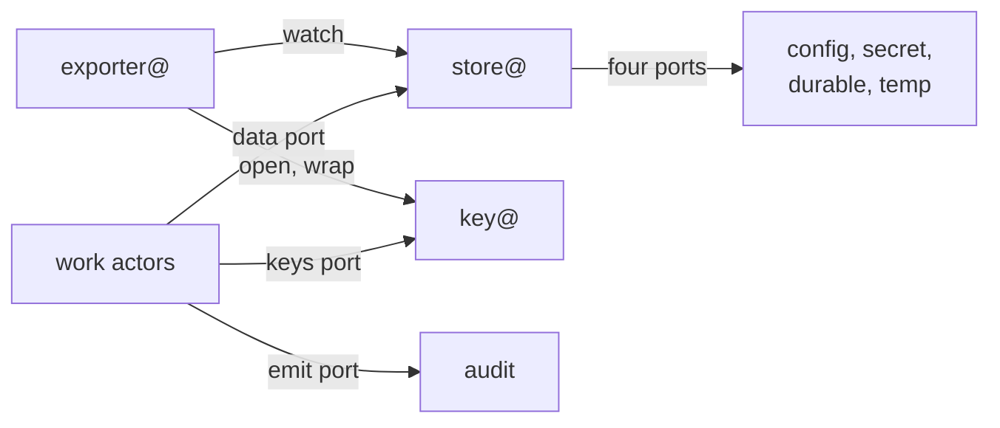
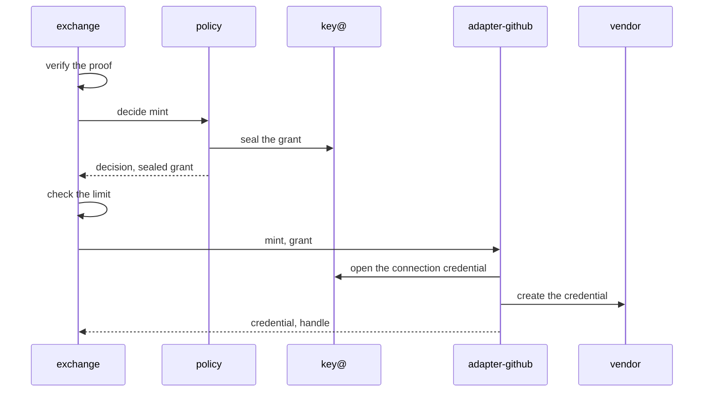
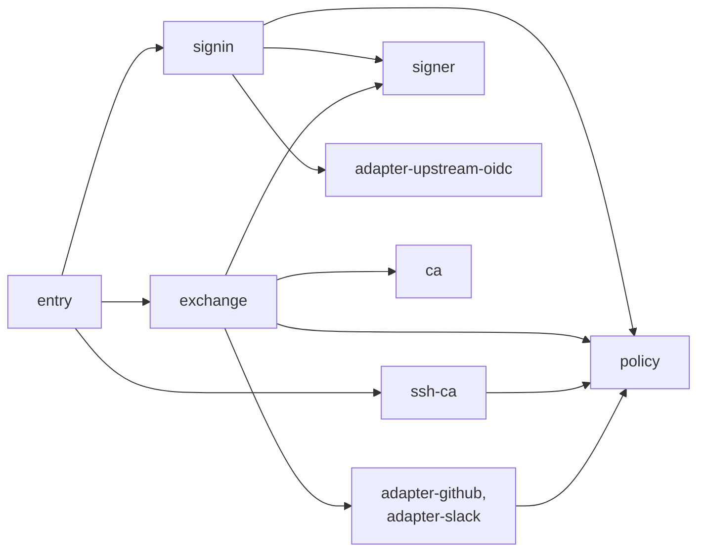
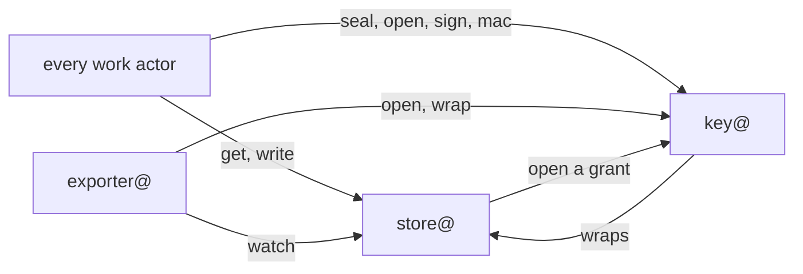

At the second zoom level the [black box](/architecture/#the-black-box) is split into **actors**: each has one responsibility, a ConnectRPC contract, a short list of actors it may call, and a family that says what it may hold. At the third level the actors become **units**, each with one identity. This page lists what exists. The decisions are [0002](/decisions/0002-families-of-actors/) (actors and families), [0003](/decisions/0003-units-transports-and-fusion/) (units, transports, fusion), [0011](/decisions/0011-runtimes-and-installations/) (installations) and [0044](/decisions/0044-sluis-is-a-core-and-add-ons/) (layers). The words are on [Families](/concepts/families/), and the enforcement on each installation is on [Deployment and listeners](/architecture/deployment/).

Every contract is Protobuf served over ConnectRPC, even when caller and callee share a unit. In-process calls use an in-memory transport, so moving an actor into its own unit changes configuration, not code ([0002](/decisions/0002-families-of-actors/#contracts)).

## The three families

Every actor belongs to one family, and a port is never shared between two families ([0002](/decisions/0002-families-of-actors/#the-families)).

| Family | Actors | Holds at rest | Its ports |
| ------ | ------ | ------------- | --------- |
| **Work** | `entry`, `signin`, `console`, `exchange`, `policy`, `signer`, `kv`, `ca`, `ssh-ca` and the adapters `adapter-<vendor>` | **Nothing**: no storage, key or export credential | A data port to store@, a keys port to key@, an emit port to audit, and the ports of its job: a listener (`entry` only), a provider API (adapters), outbound fetch |
| **Data** | `store@`, `exporter@` | The credentials of the storage ports, and of the export destinations | Four ports downward for store@, one per storage class; a destination port for exporter@ |
| **Keys** | `key@` | The card PIN, or the permission to use the cloud key service | A port to its card or key service |



The **credential holders** are exactly store@, exporter@ and key@ ([0002](/decisions/0002-families-of-actors/#credential-holders)). There is no audit family: audit is the product of [truvity/audit](https://github.com/truvity/audit), its pieces hold their own credentials, and sluis only emits to it ([Audit](/concepts/audit/)). Platform pieces belong to no family: the edge connector, the host's card service, the engine processes and the node agent `sluis-node`.

### The foundation and the layers

The data and keys families are the **foundation**: store@, exporter@ and key@ run in every installation, and their binaries do not change with what runs above them. They are thin hosts of blocks of [atoom](https://github.com/truvity/atoom): store@ hosts `state`, key@ hosts `seal` and exporter@ hosts `export` ([atoom 0008](https://github.com/truvity/atoom/blob/master/docs/decisions/0008-blocks.md)). The blocks hold the mechanics; sluis supplies the rules and the placement. Today the three are sluis's own code on atoom's ports, and the move onto the blocks is planned in atoom's [plan](https://github.com/truvity/atoom/blob/master/docs/plan.md).

Above the foundation sluis has two layers ([0044](/decisions/0044-sluis-is-a-core-and-add-ons/)). The **core** is what every installation runs: sign-in and tokens, the console, KV, the integrations, the limit check and the hardening. **Add-ons** (PKI with SSH and database access, Cloudflare, GitHub) bring their own actors, kinds and key purposes, and no core actor calls one. A layer is a grouping, not a fourth family: each actor stays in one family.

## Actors

Each actor runs as `<actor>@<boundary>` ([0002](/decisions/0002-families-of-actors/#names)). "Calls" are the edges beyond the three ports every actor has, and the call graph is default deny. The [actor registry](/reference/actors/) has the key purposes, placement and callers of each actor.

| Actor | Layer | Responsibility | Calls |
| ----- | ----- | -------------- | ----- |
| `entry` | core | Parses each request, validates it against closed parameter lists and routes it. Holds nothing and has no outbound network | `signin`, `exchange`, `console`, `ssh-ca`; an adapter only to route a push |
| `signin` | core | Sign-in, sign-in sessions, the session cookie and step-up | `policy`, `signer`, `exchange`, `adapter-upstream-oidc` |
| `console` | core | The operator API. Checks delegation and routes each write to the owner of the kind | `signin`, `exchange`, `policy`, the adapters |
| `exchange` | core | Token exchange, enrolment, the front of the signing API, the verifiers of proofs, and the owner of what a tenant has configured | `policy`, `signer`, `ca`, the adapters |
| `signer` | core | Signs tokens under a signing policy, and artifacts for a grant `policy` sealed | Nothing |
| `policy` | core | The decision point: a declared Cedar policy maps facts to grants, and key@ seals them. No outbound network | Nothing |
| `kv` | core | Versioned static secrets in stores that no tenant owns ([0047](/decisions/0047-kv-is-a-core-service-of-stores-that-no-tenant-owns/)) | `exchange`, `policy` |
| `ca` | add-on | The X.509 authority and its issuance log ([0023](/decisions/0023-certificate-authorities/)) | Nothing |
| `ssh-ca` | add-on | The SSH authority, for user and host certificates | `policy` |
| `adapter-<vendor>` | core; `adapter-github` is an add-on | The work actor of an integration. Serves one vendor and opens each tenant's connection credential at key@ for each call | `policy` |

Built today: `entry`, `signin`, `exchange`, `policy`, `signer` and `adapter-upstream-oidc`; `ca` is a v0 that is off in the core. Planned: `console`, `kv`, `ssh-ca`, `adapter-github` and `adapter-slack`. The limit check has no actor: it is part of the request path ([0046](/decisions/0046-limits-on-the-request-path-and-usage-in-audit/)). `kv` is not in the registry yet.

A compromised `entry` reaches only the sockets it routes to, and each receiver checks the request again. A compromised work actor holds no credential at rest: it yields what it is using at that moment and nothing it could replay later ([principle 16](/principles/#16-few-credential-holders)). key@ is the one holder of keys, serves each caller on a socket of its own and, on a board, has the card to itself ([0006](/decisions/0006-keys-and-sealing/#exclusive-card-access)). store@ never seals or opens a value, so a flaw in it yields ciphertext, hashes, plain values and the values of secret sources, but no plaintext of a sealed value ([0005](/decisions/0005-the-store/#secret-sources)).

## Integration contracts

All integrations share one base contract, `Integration` (describe itself, probe health), and implement one or more of the contracts on [Integrations](/integrations/): `Upstream`, `FactsSource`, `CredentialMinter`, `Provisioner` and `Notifier` ([0025](/decisions/0025-integrations/#the-contracts)). Rules shared by the contracts:

- **Opaque references and attributes, not vendor structs.** Core never parses an identifier an integration returns: subjects and groups are `{namespace, id}` pairs, and everything vendor-shaped travels as namespaced attributes (`github.repository`, `k8s.namespace`) declared when the adapter describes itself, so a policy file is validated at load without core knowing the vendor.
- **A closed error model.** `UNAVAILABLE`, `UPSTREAM_REJECTED`, `INVALID`, `NOT_FOUND`, `RATE_LIMITED`, `UNSUPPORTED`, `STALE`. No vendor error text crosses the boundary ([0025](/decisions/0025-integrations/#what-an-integration-may-return)).
- **Freshness is part of every fact.** A fact carries `as_of`, `max_age` and whether it is authoritative. "I could not ask" is not "gone".

Systems that sluis serves but never calls (databases, hosts, cert-manager, GitOps controllers, MCP, SSH certificate login) are **client profiles**, a client entry plus a resource profile, not integrations ([0021](/decisions/0021-clients/)).

### Integrations return facts, or carry out authorized effects

A credential minter and a provisioner are effectors by nature, so two conditions keep them from deciding anything:

1. **Core decides, the adapter executes.** An adapter receives a **grant** that `policy` decided and key@ sealed: the decision, the policy digest and the hash of the scope ([0007](/decisions/0007-policy-and-sealed-grants/#sealed-grants)). It refuses a scope the grant does not cover and cannot lengthen the lifetime. A provisioner reconciles to a desired state that a directory adapter wrote as data from `policy`'s answer ([0025](/decisions/0025-integrations/#how-core-authorises-an-effect)).
2. **Business limits live in core.** Caller caps, mint rates and which group may hold which role are policy or the limit check of [0046](/decisions/0046-limits-on-the-request-path-and-usage-in-audit/#limits-and-balances), checked before the adapter is called. An adapter enforces only technical limits: the vendor's API rate and maximum lifetime.

The mint flow. The limit check is planned; until it is built the step has no check.



The adapter receives the kind, the scope, the lifetime, the operation id and the grant, and returns the credential, its expiry and a handle. Every step is an audit fact, and the mint fact never holds the secret.

## Ports

A port is a contract of [atoom](https://github.com/truvity/atoom), and a driver implements it for one backend. A work actor sees three ports of the same shape on every installation: **data** (the one generic store service, through typed clients), **keys** (`Seal`, `Open`, `Sign`, `Mac` by key purpose) and **emit** (a record handed to audit's emitter; a usage record uses a blocking emit, a security record never blocks). Beyond them it has the ports of its job: the listener of `entry`, the provider API of an adapter, outbound fetch limited to the hosts of the actor's egress classes. Each holder has ports of its own downward: four for store@ (config source, secret source, durable, temp), one per destination for exporter@, and one key store for key@. Any actor's host may run a driver; the store and key rules decide who may call it ([0005](/decisions/0005-the-store/), [0006](/decisions/0006-keys-and-sealing/)).

The contracts are atoom's: the [store port](https://github.com/truvity/atoom/blob/master/store/docs/store-port.md) and the [source port](https://github.com/truvity/atoom/blob/master/source/docs/source-port.md) with the `state` block, the [key port](https://github.com/truvity/atoom/blob/master/key/docs/key-port.md) with the `seal` block, the [destination port](https://github.com/truvity/atoom/blob/master/destination/docs/destination-port.md) with the `export` block, and the emit port of [audit](https://github.com/truvity/audit/blob/master/docs/decisions/0002-pieces-and-holders.md). What sluis adds as the host is the kind registry's rules and a grant sealed for the tenant on every tenant-scoped write ([Store API](/reference/store-api/)), the key purposes of each actor ([Keys](/concepts/keys/)), the exportable kinds ([0009](/decisions/0009-export/)), and the action table and scope mapping of the emit port ([Audit](/concepts/audit/)).

Open: atoom has no page for the blocks yet; they are decided in [atoom 0008](https://github.com/truvity/atoom/blob/master/docs/decisions/0008-blocks.md) and ordered in its [plan](https://github.com/truvity/atoom/blob/master/docs/plan.md). The mechanics (items, the signed configuration document and its layers, wraps and rotation, the card driver, the packaging of drivers) are atoom's.

## The call graph

The Calls column lists the graph's edges; the views draw them. The graph is declared once in the actor registry and compiled into every binary, where one interceptor refuses a caller that is not listed (**default deny**). Each transport enforces it a second time: socket groups and sandboxes on boards, invoke resource policies on Lambda, NetworkPolicies on Kubernetes ([0003](/decisions/0003-units-transports-and-fusion/#the-call-graph)). The [identity explorer](/architecture/identity-explorer/) draws it per installation. Every actor also calls store@ and key@ through its ports and emits to audit; those edges are left out of View 1.

### View 1: sign-in, exchange and minting



`console` calls `signin`, `exchange` and `policy` for a person's grants and for the writes they own, and the adapters whose connect flows it starts. It writes only `Switch` and `LogLevelOverride` itself, and it embeds audit's page instead of calling an audit reader ([0027](/decisions/0027-the-console/#writes)).

### View 2: the holders



store@ asks key@ to open the grant on every tenant-scoped write, and key@ reads and writes its own `DataKeyWrap` items through store@ ([0005](/decisions/0005-the-store/#rules)).

Rules the graph encodes:

- **Core calls adapters, never the reverse.** A flow that looks circular, such as console to adapter to provider to webhook to adapter, is a flow over time with the pending state kept in a temp kind.
- **An adapter calls only `policy`,** and adapters never call each other ([0025](/decisions/0025-integrations/#the-rule)).
- **No core actor calls an add-on to do its own job** ([0044](/decisions/0044-sluis-is-a-core-and-add-ons/#the-layers)).
- **The decision point has no outgoing edge.** `policy` reads its effective policy set through the data port and nothing else.

## One writer per kind

Every kind has exactly one writer. Others read through the store, under the rules of the kind registry, which the store applies with the caller's identity from the transport ([0004](/decisions/0004-the-data-model/#one-writer-per-kind)). The generated [Rules](/reference/rules/) page lists every actor × kind × verb, and [Kinds](/reference/kinds/) lists every writer.

| Writer | Kinds it writes (examples) |
| ------ | -------------------------- |
| Infrastructure as code | Config and secret kinds of the installation: `Boundary`, `KeyPlan`, `Tunables`, `Upstream`, `BackupPlan`, `ExportDestination`, `BreakGlassPasskey`, and the secrets such as `UpstreamSecret` |
| The publishing pipeline | Reviewed, signed config: `Policy`, `RegulatedPartyPolicy`, `GrantVocabulary`, `ExchangeTrust`, `PkiProfile` |
| `signin` | Everything about people: `Person`, `UpstreamLink`, `StaffPasskey`; and the temp state of sign-in: `AuthCode`, `SessionChain`, `ClientDocument` |
| `exchange` | What a tenant has configured: `Tenant`, `TenantClient`, `ClientSecret`, `PolicyLink`; and enrolment: `EnrolmentToken`, `PendingEnrolment` |
| An adapter | What its flow makes: `GitHubApp` and `GitHubInstallation` (`adapter-github`), `SlackConnection` (`adapter-slack`), `EntraConnection` (`adapter-upstream-oidc`); the connections `DirectoryConnection`, `MinterConnection` and `MinterTarget`; and the directory facts |
| `key@` | `DataKeyWrap`, `KeyRevocation`, `KeyCertificate`, and on boards `PinReleaseRequest` and `PinRelease` |
| `ca`, `ssh-ca` | `IssuedCertificate`, `Revocation`, `Crl`, `TrustBundle`; `IssuedSshCertificate`, `SshRevocation`, `Krl` |
| `signer`, `entry`, `console` | `SigningRing`, `OpenPgpBinding`; `RateWindow`; exactly two for the console, `Switch` and `LogLevelOverride` |
| `store@`, `exporter@` | `MaintenanceMode`; `ExportCursor`, `ExportManifest`, `ExportReport` |

There are two exceptions. The restore command of store@ writes back the kinds it restores. And the **declared self-scoped kinds**, `Lease`, `ReplayGuard` and `SpentGrant`, have an id that starts with the writing actor's name, and the store lets each actor write only ids under its own name. Audit's own kinds belong to audit, which declares them through atoom's `state` registry ([audit 0015](https://github.com/truvity/audit/blob/master/docs/decisions/0015-configuration-kinds.md)); until that code moves, this registry still declares them.

## The fusion rule

An installation may run several work actors in one unit to fit a small machine. Fusion is an explicit installation choice, never the default ([0003](/decisions/0003-units-transports-and-fusion/#fusion)):

- **A holder is never fused with a work actor,** and key@ is never fused with `entry`.
- **The store applies the union of the members' rules to a fused unit.** Fusing never grants something no member was allowed, and the configuration check prints the union.
- **`entry` is never fused with an actor that signs:** `signer`, `ca` or `ssh-ca`. `ca` and `ssh-ca` stay separate units on every installation.
- **Small work actors that hold nothing and have no listener** may share a unit on a 2 GB board. So may `console` and `entry`, at the price of widening the one unit reachable from outside.

A generated check runs for every installation and fails the build for a unit that breaks the rule. On Lambda there is no in-process store: no function links store@ into a work actor, and the latency spike showed that none is needed.

## Packaging

Every actor ships as its own executable, and the packaging follows the runtime ([0013](/decisions/0013-release-train-packaging-and-distribution/#packaging-per-runtime)). The artifacts, the package split and the dependencies are on [Packages](/distribution/packages/). sluis ships no driver: a driver is an atoom package that the unit of its holder starts. There is no development build: local is an installation, not a build.

## Units on each installation

The same actors run on every installation. What changes is who starts them, what they can rely on, and how they reach each other ([0003](/decisions/0003-units-transports-and-fusion/#units)). The engine, the key store and the edge of each installation are in [0011](/decisions/0011-runtimes-and-installations/#installations) and on [Runtimes](/runtimes/).

| | boards and local | lambda | kubernetes |
| --- | --- | --- | --- |
| **Unit** | A systemd unit and a Unix user per actor; in local, a container with a pinned uid | A function per actor and per holder, each behind the Lambda Web Adapter | A pod per actor and per holder, each with a service account |
| **Calls between units** | Unix sockets; no actor is called from another node | Lambda invoke, authorised by a resource policy | In-cluster gRPC with a projected service-account token whose audience the callee checks, behind a NetworkPolicy |
| **A holder's drivers** | Separate systemd services whose socket only the owner opens | Linked in the function where the language matches, else extensions in one merged drivers layer | Native sidecar containers in the holder's pod |
| **Identity to the platform** | `sluis-node` issues a workload token per actor; only the holders' drivers use cloud credentials | The function's role; only the holders' roles reach storage, keys or destinations | A projected token, mounted only into the driver container |
| **State** | local built; boards: deploy and smoke test built | Planned | Planned |

**Boards.** A board runs every actor as its own user, in its own instance of a systemd template unit, `sluis-<actor>@<boundary>`. Every call is a Unix-socket call allowed by the call graph, and the only port a board opens to another board is rqlite's Raft port. Only the edge connector reaches `entry`, on its Unix socket ([Listeners](/architecture/deployment/#listeners)). Work actors reach store@ on one socket and key@ on a socket per caller; none holds an engine login or a PIN. `sluis-node` hands each actor a workload token and asks key@ to sign it. One rqlite cluster serves the installation, and any board serves any request because every board holds the data and the temp data is replicated too ([0005](/decisions/0005-the-store/#engines)). The local installation is the same layout on one node, as containers.

**Lambda.** The same actors are separate functions with no `sluis-node` and no host card service: the KMS key policy names key@'s role alone, and each function's role is its identity. Every function runs behind the vendored, pinned Lambda Web Adapter. A function is an app zip plus a config layer, and one merged drivers layer only where a driver's language differs from the function's ([0011](/decisions/0011-runtimes-and-installations/#the-lambda-shape)). A work function's role may only invoke other functions and hand records to audit's transport. Every store read and key open is an invoke, which the latency spike found fast enough ([0037](/decisions/0037-capacity-is-measured-before-it-is-promised/#measured-so-far)). See [Serverless](/runtimes/serverless/).

**Kubernetes.** Each actor and each holder runs in a pod of its own, with its drivers as native sidecars. A projected service-account token is mounted only into the driver container, and a work pod has no cloud identity. The edge is the cluster's own Cloudflare tunnel and gateway, routed to the key-less relay of `entry`; a `cloudflared` sidecar in `entry`'s pod is an option for a cluster without its own tunnel. Cells keep most calls on one node, and each adapter pod has its own egress policy to its vendor ([0011](/decisions/0011-runtimes-and-installations/#kubernetes), [Kubernetes](/runtimes/kubernetes/)).

**Audit.** Every installation provides audit's pieces next to sluis, with the transport, blob and index that suit the runtime. Their placement is in [audit's distribution record](https://github.com/truvity/audit/blob/master/docs/decisions/0016-distribution-and-the-lambda-shape.md), and what sluis emits is on [Audit](/concepts/audit/). The code of the writer, indexer and reader still sits in this repository until it moves to audit ([0012](/decisions/0012-the-language-follows-the-executable/#per-actor-table)).

## Source layout

One executable has one language. Go is the default; Rust is used at the unauthenticated edge, in the trusted base, in the holders and on the smallest boards. The rules and the language of every actor are in [0012](/decisions/0012-the-language-follows-the-executable/#per-actor-table). Tokens are standard JWS and JWT, so any language verifies them against the published key set.

```text
proto/          ConnectRPC contracts and the kind messages
kits/           libraries shared by two or more executables, and sluis's conformance vectors
actors/<actor>/
drivers/<owner>/<driver>/
cli/sluis/      the one sluis binary
deploy/         packages, Helm chart, Lambda archives, local and boards
tests/          integration tests on the tested installations
docs/  site/
```

`drivers/` holds today the thin hosts of atoom's driver libraries: the socket, the peer check and the command line around each. Running atoom's packaged driver binaries instead is planned. The ports, their kits and the driver libraries are [atoom's](https://github.com/truvity/atoom). The directories of planned parts (`node/` for `sluis-node`, `host/` for `sluis-host`, `console/`) appear when the part is built. The single-board images are built in a separate public repository ([#881](https://github.com/truvity/sluis/issues/881)).

## Integration invariants

The structure above is kept by tests that run in CI, cheap to write because the call graph, the registries and the import tree are data.

| Invariant | What fails |
| --------- | ---------- |
| Core packages import no vendor package | A core actor that names GitHub, Slack or a cloud |
| No edge from an adapter to a work actor other than `policy` | An adapter that calls back into core |
| No adapter imports another adapter | Two adapters sharing code by import |
| Policy matchers carry no vendor fields | A policy schema that knows a vendor. Matchers are `{type, namespace, attributes}` |
| Only the wiring package imports drivers | An actor that links a driver directly instead of using its port |
| An authority key has exactly one user actor | A key policy that names two actors |
| No work actor holds a credential at rest, and no unit holds a holder with a work actor | A fusion or a registry row that breaks [the fusion rule](#the-fusion-rule) |
| Each driver passes the port's conformance suite (atoom's kit, run in atoom's CI; sluis runs a smoke test of each host, `just atoom-smoke`) | A driver that diverges from the port contract |
| The deny matrix ([Deployment](/architecture/deployment/#the-deny-matrix)) | A generated policy that is too wide |
| Each of the two checks holds with the other switched off | A check that passes only because the other caught the case |
| The drift test: generated rules, grant checks, policy documents, units, sockets and service accounts agree with the registries | A hand edit, or a generator change that missed one output |

Next: [Deployment and listeners](/architecture/deployment/) shows how each installation enforces these boundaries.
