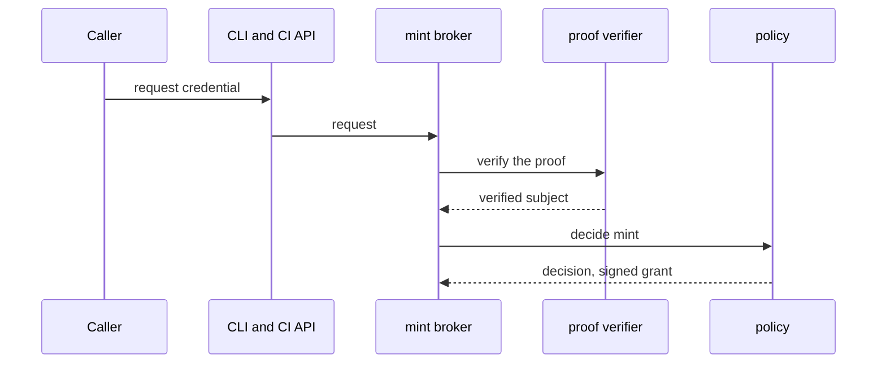
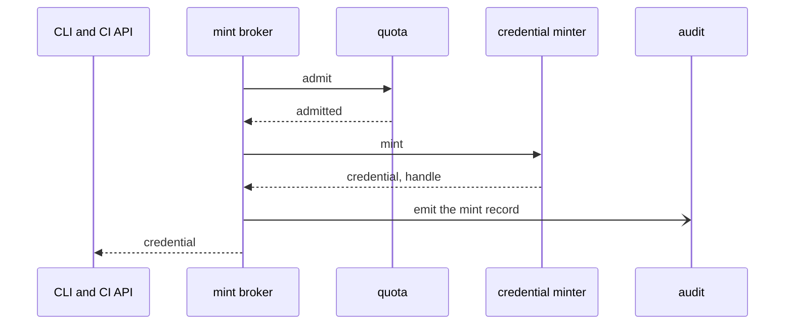
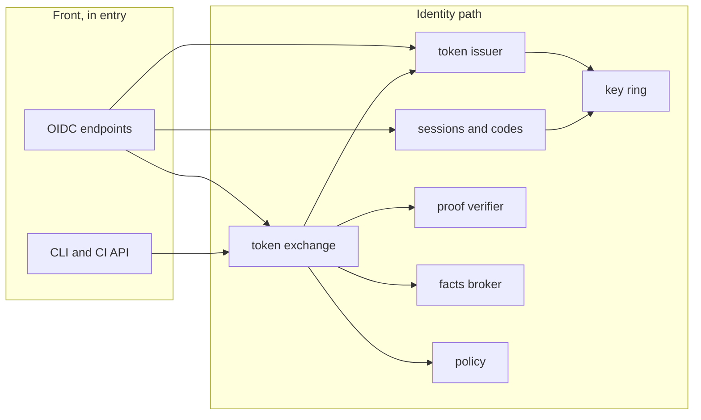
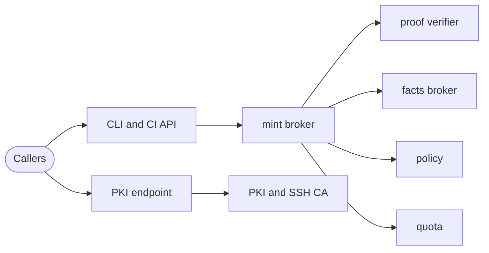
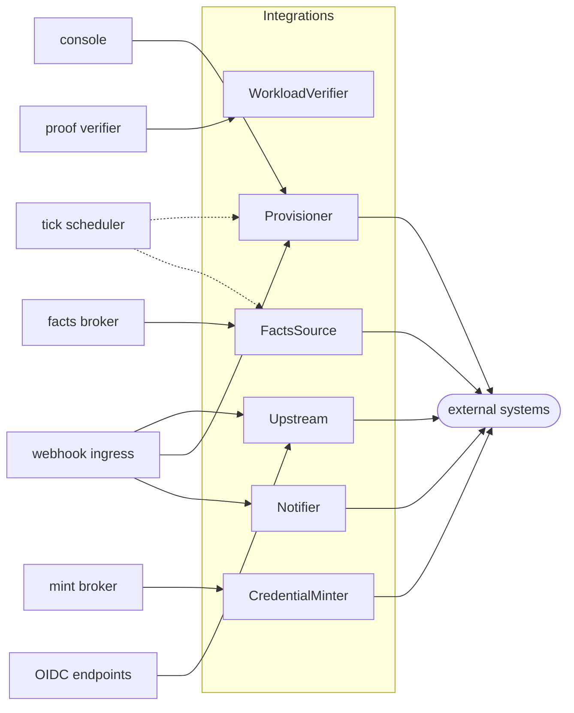
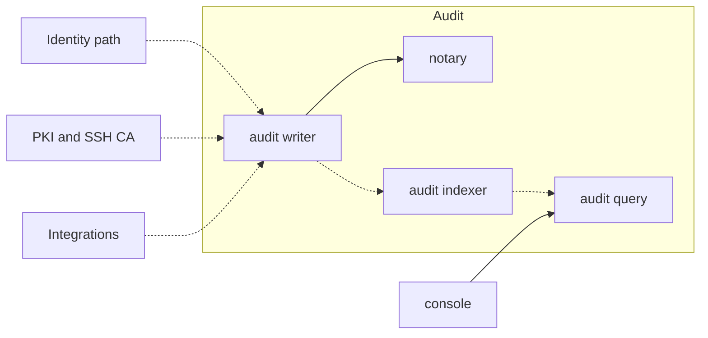
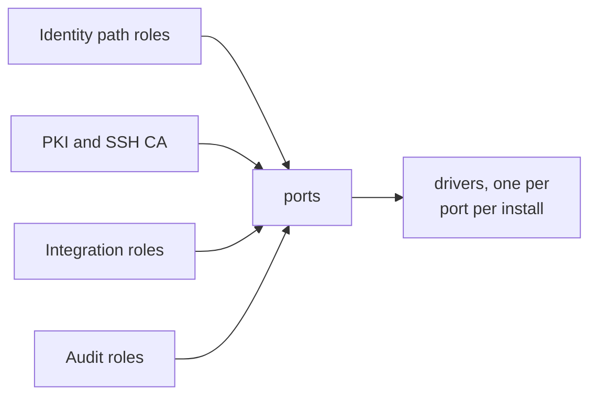

At the second zoom level the [black box](/architecture/context/) is split into components. Each component has one responsibility, a ConnectRPC contract, and a short list of other components it may call. A component is not a process: [L3](/architecture/processes/) decides which components run together.

Every major component is a ConnectRPC contract, even when caller and callee share a process. In-process calls use an in-memory transport, so moving a component into its own process changes configuration, not code.

## Component groups

| Group | Components | Responsibility |
| ----- | ---------- | -------------- |
| **Front** | web surface, OIDC endpoints, CLI and CI API, webhook ingress, PKI endpoint, exports API, console HTTP, audit query HTTP | Parse the wire protocol, apply uniform hardening (headers, cookies, throttling, uniform refusals), and delegate every decision to an owner. A front component decides nothing |
| **Identity path** | authn, authorization flows, sessions, token exchange, token issuer, client registry, key ring, proof verifier, facts broker, policy, mint broker, tick scheduler, grants export, console | Own sessions, codes, refresh tokens and clients; verify proofs; turn facts into grants; ask for credentials to be minted |
| **Certificates and quota** | PKI, SSH CA, quota, backup, restore | Issue X.509 and SSH certificates, admit metered operations, and protect and recover the install |
| **Audit and trust** | audit writer, notary, witness coordinator, audit indexer, audit query, trust log, static publisher | Take records from every other component, seal them in batches, sign the batch heads, and serve them back ([Audit](/concepts/audit/)) |
| **Integrations** | upstream, workload verifier, facts source, credential minter, provisioner, notifier | Talk to one external system each ([Integrations](/concepts/integrations/)). Return facts, or carry out effects core has authorized |
| **Ports** | state, index, keys, blob, queue, lease, cloud | Libraries linked into the component that needs them. Never a hop |
| **Drivers** | the technology behind one port | See [Drivers](/concepts/drivers/) and the table below |

The groups map onto [process roles](/architecture/processes/) (see also [Roles](/concepts/roles/)): `entry` hosts the front, authn, sessions, exchange, client registry and console; `signer` hosts the key ring; `policy` hosts the decision point; `ca` hosts PKI and SSH; the audit components split across `audit-writer`, `notary` and `audit-read`; `quota` is its own role; and each integration runs as its own process.

## Integration contracts

All integrations share one base contract, `Integration`, and implement one or more of six role contracts.

| Contract | What it does | Facts only? | Implementations |
| -------- | ------------ | ----------- | --------------- |
| `Integration` (base) | Describe itself, probe health, connect and disconnect, link a person's account, handle a webhook | n/a | Every integration |
| `Upstream` | Authenticate a person elsewhere: begin and complete a sign-in, verify an upstream access token | Yes | Workspace directory sign-in, generic OIDC, peer sluis |
| `WorkloadVerifier` | Verify a machine proof. Needs no secret | Yes | GitHub Actions, Kubernetes, AWS web identity, peer sluis |
| `FactsSource` | Answer what an external system knows about a subject or group, with freshness; refresh a snapshot | Yes | Workspace directory, GitHub teams, chat workspace users, generic OIDC claims |
| `CredentialMinter` | Produce a short-lived downstream credential for a scope core has authorized | Effector | Cloud API tokens, GitHub installation tokens, peer sluis |
| `Provisioner` | Make an external system equal to a desired state core supplies | Effector | GitHub team membership, chat channels, wiki users and groups, on-call rotations |
| `Notifier` | Deliver a message to a person or place; receive interactions through the webhook | Yes | Chat workspace, Telegram |

Rules shared by the contracts:

- **Opaque references.** Core never parses an identifier an integration returns. Subjects and groups are `{namespace, id}` pairs; policy can match only on the namespace and on named attributes.
- **Attributes, not vendor structs.** Everything vendor-shaped travels as namespaced attributes (`github.repository`, `k8s.namespace`). Each integration declares its attribute names and types when it describes itself, so a policy file is validated at load without core knowing the vendor.
- **A closed error model.** `UNAVAILABLE`, `UPSTREAM_REJECTED`, `INVALID`, `NOT_FOUND`, `RATE_LIMITED`, `UNSUPPORTED`, `STALE`. No vendor error text crosses the boundary.
- **Freshness is part of every fact.** A fact carries `as_of`, `max_age` and whether it is authoritative. "I could not ask" is not "gone".
- **The same protobuf on every transport.** A Unix socket with peer credentials locally, a Lambda invoke on AWS, HTTPS with mTLS remotely.

Six of the sixteen integrations that v1 lists call no external system: databases, hosts, cert-manager, the GitOps controllers, MCP, and SSH certificate login. They become **client profiles** (an OIDC client entry plus a resource profile), not integrations, which leaves eleven real ones.

### Integrations return facts, or carry out authorized effects

Four of the six contracts only return facts. A credential minter and a provisioner are effectors by nature, so two conditions keep them from deciding anything:

1. **Core decides, the integration executes.** A minter receives a **mint grant signed by the policy role's own key**: the decision, the policy digest and the hash of the scope. It refuses a scope the grant does not cover and cannot lengthen the lifetime. A provisioner pulls a desired state **addressed by its digest** from a read-only prefix that core writes. It never asks core a question.
2. **Business limits live in core.** Caller caps, mint rates and which group may hold which role are policy or quota, checked before the minter is called. An integration enforces only technical limits: the vendor's API rate and maximum lifetime.

The mint flow is drawn in two steps.

Step 1: the mint broker verifies the proof and asks policy.

The caller asks for a credential of a kind and a scope, with a proof. The mint broker asks policy to decide with the subject, the facts, the kind and the scope. The decision carries the scope bound, the ttl cap and the signed mint grant.

Step 2: the mint broker admits the operation and the minter mints.

Quota admits by operation id. The minter receives the kind, the scope, the ttl, the operation id and the mint grant, and returns the credential, its expiry and a handle. The emitted mint record never holds the secret. The CLI and CI API hands the credential to the caller.

## Ports

A port is the narrowest interface that every driver can honour and every user needs. Ports are libraries linked into the component that uses them; a port call is never a network hop. A driver is the technology behind a port (see [Concepts](/concepts/)).

| Port | Operations | Notes |
| ---- | ---------- | ----- |
| **state** | `Get`, `Create`, `CompareAndSwap`, `DeleteIf`, `List`, `WriteBatch`, `Adjust` | Two consistency levels, strong and local. An atomic write batch keeps the audit batch row, its dedupe record and the index cursor together; a conditional adjust makes quota one atomic update. A scope object `{owner, connection}` isolates callers; no one builds key strings |
| **index** | `Apply`, `Cursor`, `Query`, `Rebuild` | The audit index. Query syntax never leaks past the driver |
| **keys** | `Describe`, `Sign`, `Wrap`, `Unwrap`, `Derive`, `Agree`, `PublicKey` | See below. Callers name a key role, never an ARN or a slot |
| **blob** | `PutIfAbsent`, `Put`, `Get`, `List`, `Delete`, `Capabilities` | Immutability is the common case. `Capabilities` reports retention mode, versioning and maximum object size |
| **queue** | `Publish`, `Receive`, `Ack`, `Nack` | Carries a durability level on publish. Visibility timeouts and dead-letter queues stay in the driver |
| **lease** | `Acquire(name, ttl)`, `Renew`, `Release` | Named leases with fencing tokens, one per target, not "one leader" |
| **cloud** | `Invoke`, `InvokeAsync`, `CallerIdentity` | How a process calls another and learns who called it. `CallerIdentity` returns a normalized `{class, id}` whatever proves it: a peer credential, a platform token, a certificate |

Each driver is a service started by the platform that speaks ConnectRPC over a Unix socket; nobody execs a driver. A driver declares `instance: per-role | shared`. See [Processes](/architecture/processes/).

### The keys port

The keys port binds a **key role** to a backend and refuses a backend that is too weak for the role when the configuration loads. The code refuses a software key on a production shape; configuration picks among the modes the shape allows. The roles are the unit callers name: `token-signing`, `ca`, `notary`, `grant`, `sealing`, and one per cloud federation. Callers never see an ARN, a slot or a path.

| Key role | Requires | On AWS KMS | On a YubiKey (PIV) |
| -------- | -------- | ---------- | ------------------ |
| `token-signing` | Never exportable; used by the `signer` role only | One `ECC_NIST_P384` key; tokens are signed directly | Slot 9c; about 8 signatures per second |
| `ca` (X.509 and SSH) | Never exportable; used by the `ca` role only | One `ECC_NIST_P384` key | Slots 9c and 82 |
| `notary` | Never exportable; separate custody from the audit writer | One `ECC_NIST_P384` key; on T4 one per node | A node key; clusters co-sign 2 of 3 |
| `grant` | Never exportable; used by the `policy` role only | One `ECC_NIST_P384` key | A node key |
| `sealing` | Wraps and unwraps; takes an encryption context | One symmetric key with encryption contexts | ECDH plus HKDF (HPKE-style) with a P-384 key in slot 9d |

Each backend describes itself with traits: exportability, attestation, whether a human must touch it, latency class, throughput, and who enforces which caller may use it (platform IAM, a shared driver, or nothing). The port signs bytes or digests; JWT shaping (`exp`, `iat`, lifetime limits) lives in a `jose` library in the token issuer, not in the port. `Derive` (a keyed, deterministic function) and `Agree` (ECDH) are separate operations because a PIV token has no HMAC. EC P-384 is used everywhere; the cloud-federation keys are the exception, each in its own slot or key in the algorithm that cloud requires.

Tokens are signed directly with the non-extractable key on every shape; there are no derived signing keys. A P-384 signature on a YubiKey takes about 120 ms, which is about 8 tokens per second, far above the measured load.

## The call graph

The graph is at role granularity. A solid arrow is a synchronous ConnectRPC call; a dashed arrow is asynchronous (a queue, a tick, or a read of a store). The graph is a reviewed file, enforced by one interceptor in every process, **default deny**: a call that is not an edge is refused. It is drawn in five views: sign-in and exchange, minting and certificates, the integrations, the audit, and the ports.

The callers are browsers, CLI, CI jobs, workloads, cert-manager and auditors. Each reaches the front box that serves it: the OIDC endpoints, the CLI and CI API, the console, the webhook ingress or the PKI endpoint.

### View 1: sign-in and exchange

### View 2: minting and certificates

### View 3: the integrations

### View 4: the audit

The dashed arrows into the audit writer are emits. The writer hands the indexer the `audit_batches` records, and the indexer hands audit query the `index`. The console reads the audit through audit query.

### View 5: the ports

The ports are state, index, keys, blob, queue, lease and cloud. The identity path roles include the key ring, which reaches the ports through its drivers like every other role, and the `tick` scheduler, whose edges are in view 3.

Rules the graph encodes:

- **Core calls integrations, never the reverse.** An integration calls no core component over Connect. Its results travel through state, the audit queue, and the reply to its caller. A flow that looks circular, such as console to integration to provider to webhook to integration, is a flow over time with the pending state kept as a record.
- **Integrations never call each other.** No integration imports another.
- **Only the audit sink is called by everyone**, and asynchronously. The one synchronous audit call is the blocking sink used by maintenance, restore and migration.
- **The decision point has no outgoing edge.** The policy role maps facts to grants and signs a mint grant. It reads a reviewed file and nothing else.

## One writer per record kind

Every record kind has exactly one component that writes it. Others read through the owner's contract, or read a prefix the owner publishes. The manifest generator refuses two roles that both declare `writer: true` for one kind, and on self-hosted shapes the `state-owner` shared driver enforces the same rule at run time.

| Record kind | Writer |
| ----------- | ------ |
| Sessions (single sign-on, per client, agent class), refresh tokens, the revocation list | sessions |
| Authorization codes, consent, device authorization records | authorization flows |
| Pending sign-in state, the recovery verifier and switch (passkeys are a later roadmap feature) | authn |
| Client secret versions and the client metadata cache | client registry |
| The signing ring (published keys, key references) and its rotation schedule | key ring |
| Last-known (held) fact sets per subject | facts broker |
| Directory snapshots and tenant records | the directory integration |
| Organization records, App catalogue, account links, mint ring | the GitHub integration |
| Workspace records, Slack Connect pending shares | the chat integration |
| Minted-credential records (recent credentials, caller caps) | mint broker |
| Leases per target; the desired-state projections per connection | tick scheduler; grants export |
| Per-target tick reports | the ticked integration |
| Console-set configuration layer | console. Integrations return *learned* entries to the console, which writes them |
| Issued-certificate and SSH-certificate ledgers, CRL and KRL state | PKI; SSH CA |
| Trust log tiles | trust log, the only appender; ceremony tools submit through it |
| Audit batch objects, the `audit_batches` sequence, dedupe records | audit writer. Erasure and purge commands are appended by the writer on request, never by their requesters |
| The last countersigned head | notary |
| The audit index and its cursor | audit indexer |
| Quota balances and ledger rows | quota |
| Backup archives and manifests | backup |
| Throttle counters | web surface |

Two cases need a rule rather than a name. A GitHub App's catalogue record is written by two flows, so its fields are split by origin: learned fields (ids, installation) are written by the integration only; fields that carry authority are declared in configuration and written by no one at run time. And the held fact set is a copy with an expiry, not a source: the integration owns the snapshot, the facts broker owns the held record.

## Integration invariants

The shape above is kept by tests that run in CI. They are cheap to write because the graph, the manifests and the import tree are all data.

| Invariant | What fails |
| --------- | ---------- |
| Core packages import no vendor package | A core component that names GitHub, Slack or a cloud |
| No edge from an integration to an owner | An integration that calls back into core |
| No integration imports another integration | Two integrations sharing code by import |
| Policy matchers carry no vendor fields | A policy schema that knows a vendor. Matchers are `{type, namespace, attributes}` |
| Only the wiring package imports drivers | A component that links a driver directly instead of the port |
| Every record kind has exactly one writer across all manifests | Two roles that both write a kind |
| An authority key has exactly one user role | A key policy that names two roles |
| No unit holds a key beside an unauthenticated listener | A fusion that breaks [the fusion rule](/architecture/processes/#the-fusion-rule) |
| Each driver passes the port's conformance suite | A driver that diverges from the port contract |
| The deny matrix: for every pair of roles, X is denied Y's records, secrets, keys and sockets | A generated policy that is too wide |

:::note[Proposed]
Two further start-up checks are proposed but not yet agreed. First, every process that links the policy engine (entry, mint, PKI, exports, quota) reports its policy digest, and the install refuses to serve if they disagree for more than a few seconds. Second, the trust graph between installs, where one sluis trusts another as an upstream or a verifier, must be a directed acyclic graph, checked when the configuration loads.
:::

Next: [Processes](/architecture/processes/) says which of these components run together, and with which credentials.
