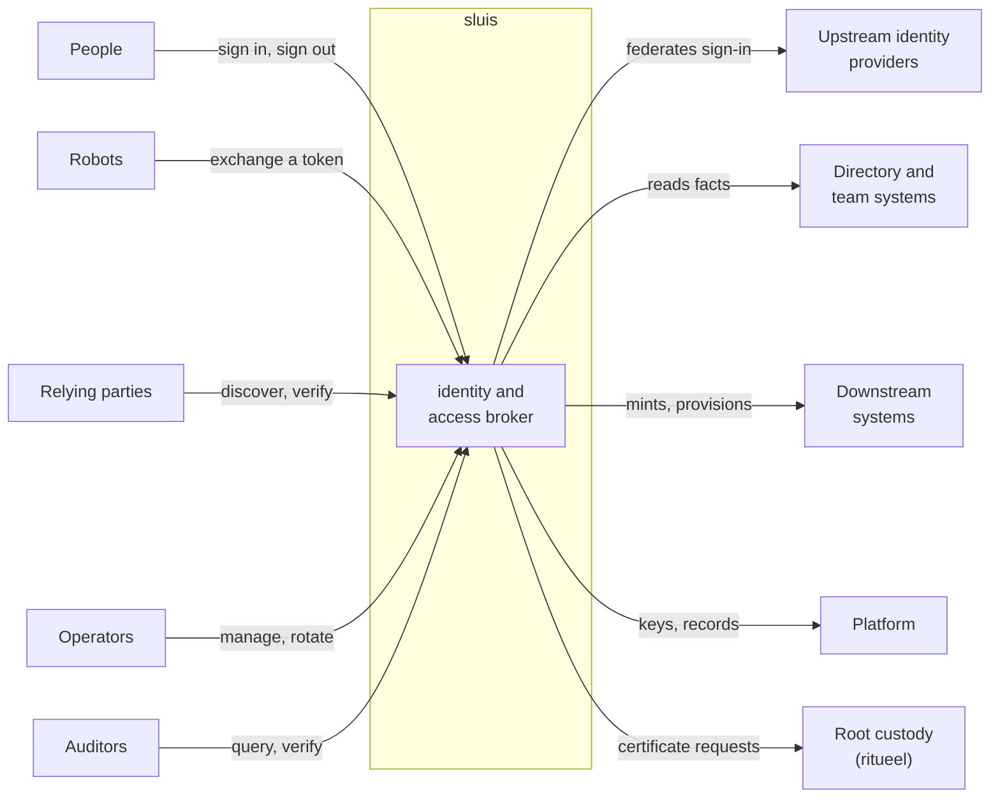
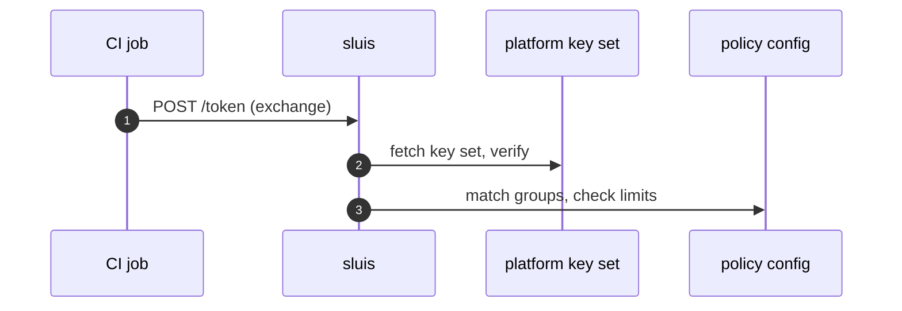
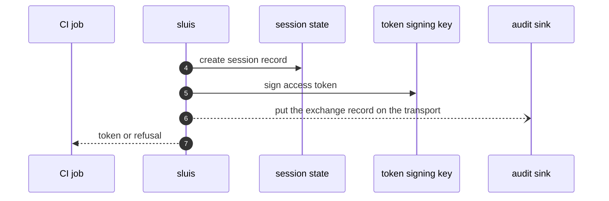

At the first zoom level sluis is one box. This page says who talks to it, what they can call, and which resources it touches to answer. How the box is split into components and processes is on [Components and processes](/architecture/components/).

## Who uses sluis

| Party | What they do with sluis |
| ----- | ----------------------- |
| **People** | From a browser or a CLI, sign in through an upstream identity provider, refresh, list and revoke their sessions, and sign out. Device login for headless machines is postponed ([#855](https://github.com/truvity/sluis/issues/855)) |
| **Robots** | CI jobs, workloads and services present a platform token (a GitHub Actions token, a Kubernetes ServiceAccount token, an AWS web-identity token) and exchange it for an access token, a downstream credential, or a certificate |
| **Relying parties** | Apps and cloud APIs read discovery and the key set, then verify tokens offline with any standard JOSE library. sluis needs no client library |
| **Operators** | Through the console and the CLI, connect integrations, manage clients and secrets, run backup, restore and migration, and request and install the certificates of the intermediates (`sluis key request`, `install`, `status`) |
| **Auditors** | Auditors and independent verifiers query the audit trail and verify it without trusting sluis's index or state |
| **Upstream identity providers** | Workspace directories and generic OIDC authenticate people. sluis federates sign-in and never stores a password for a person |
| **Directory and team systems** | The source of facts: who is in which group or team. sluis reads and reconciles them, and policy maps the facts to grants |
| **Downstream systems** | Cloud APIs, GitHub and chat workspaces receive the credentials sluis mints and the desired state it provisions |
| **Platform** | KMS or YubiKey, blob, transport and state hold keys, records, objects and messages |
| **Root custody** | [ritueel](https://ritueel.id) holds the roots offline, certifies sluis's intermediates and publishes the root list. sluis holds intermediates only and never generates a root ([ADR 0013](/decisions/0013-the-hand-off-to-root-custody-and-the-signing-api/#sluis-holds-no-root)) |

## The external API surface

Four kinds of caller identity reach the box, and these are all it has to verify: a person's session cookie, a person's bearer (the access token of a live sign-in), a workload's platform token, and a confidential client's secret. Only discovery and the key set are public.

### OIDC and OAuth endpoints

Served on the origin root of the public host, for example `https://sluis.example.com`.

| Endpoint | Method and path | Caller |
| -------- | --------------- | ------ |
| Discovery | `GET /.well-known/openid-configuration`, `GET /.well-known/oauth-authorization-server` | Anyone. Public, CORS-open, no credentials |
| Key set | `GET /keys` | Anyone. Public |
| Authorization | `GET /authorize` (PKCE `S256` only, `response_mode=query` or `form_post` ([ADR 0006](/decisions/0006-identity-issuers-audiences-and-sign-in/)), `resource`, `prompt`) | A browser |
| Sign-in | `GET /login`, `GET /login/<provider>/start`, `GET /authorize/callback` | A browser, bound to the request by a `__Host-` cookie |
| Token | `POST /token` with `authorization_code` or `refresh_token` | A client, public with PKCE or confidential with a secret. Refresh tokens are single use |
| UserInfo | `GET\|POST /userinfo` | A bearer of a live sign-in |
| Revocation | `POST /revoke` (RFC 7009) | The client the token was issued to |
| Sign-out | `GET\|POST /end_session`, `GET /signed-out`; back-channel logout to relying parties | A browser; the relying party |
| Recovery | `POST /login/recovery`, a passkey assertion | An operator, when no upstream can vouch: see [Break-glass recovery](/security/break-glass/) |
| Agent consent | `POST /login/agent-consent` | A signed-in person authorizing an agent-class session |

### Token exchange and mint

Both are `POST /token` with `grant_type=urn:ietf:params:oauth:grant-type:token-exchange` (RFC 8693). The `subject_token` is a GitHub Actions token, a Kubernetes ServiceAccount token from any known cluster, an AWS web-identity token, a token from a peer sluis, or the access token of a live sign-in presented by a client that is allowed to re-audience it. The `actor_token` is refused.

| Result | Selected by | Notes |
| ------ | ----------- | ----- |
| An access token for another audience | `audience` | Never an ID token. A refusal looks like an unknown audience; the reason is only in the audit record |
| A GitHub installation token | `requested_token_type=urn:sluis:params:oauth:token-type:github-installation-token`, `audience=github-app:<id>`, `repositories`, `scope` | The first grant that covers the whole request wins. Grants are never added together |
| A cloud API token or object-store credential | `requested_token_type=urn:sluis:params:oauth:token-type:cloudflare-token`, `audience=cloudflare:<preset>`, `lifetime` | Caps and rate limits are checked in core before the minter is asked |
| Cloud credentials for a person or robot | `audience` naming a cloud role | The cloud accepts a short-lived token that sluis signed, and returns its own credentials |

`GET /.access/grants` answers "what do I hold" for a bearer of a live sign-in; `Explain` answers "why".

### Console API

Connect services (JSON or protobuf over HTTP) under the console mount, package `sluis.console.v2alpha1` until v2.0.0 ([Contracts and errors](/reference/contracts/#packages-and-files)), served by the `console` actor through `entry`. Console calls use the same-origin HttpOnly session cookie, and the browser holds no token. A workload may call them with its own platform token; some services also accept a CLI bearer. Roles are viewer and operator, optionally scoped to one directory. An operator-set write is carried out by the actor that owns the record kind, which validates it, and it is audited under the signed-in person's name ([ADR 0003](/decisions/0003-core-actors-with-one-responsibility-each/#the-console)). The single-page application is a separate artifact on the same origin ([The console's static host](/architecture/deployment/#the-consoles-static-host)).

The services are `SessionService` (list and revoke sessions), `AccessService` (`WhoAmI`, `Explain`, the effective policy, recovery status, group search), `BackupService` (status, history, run a backup, preview a restore), and one service per integration (connect, reconnect, probe, refresh, disconnect; for Cloudflare, list, rotate and revoke minted presets).

Browser redirect routes under `/connect/<integration>/` complete the provider flows.

### Audit read

The audit trail is served by the audit installation's own front: its own `entry` on a sibling host (`sluis-audit.example.com`), the `reader` as its API, and its own `session` and `console`. A sluis console reaches it with an exchanged token of at most five minutes, bound to the console's certificate ([ADR 0015](/decisions/0015-audit-pieces-transport-search-and-front/#the-audit-front)). Independent verification does not call sluis: an auditor fetches the sealed batches, the log's public key and any witness co-signatures from the bucket, and checks the chain.

### Operator and automation

| Surface | Crosses the boundary as |
| ------- | ----------------------- |
| `sluis` CLI, login, token, exchange, credential helpers for kubeconfig and cloud SDKs | The endpoints above, with results cached under the user's config directory |
| `sluis config check`, `sluis config explain` | Offline by default, with no call to sluis. With `--live` they read the operator-set records through the console API, with an operator's credentials |
| `sluis backup`, `restore`, `migrate`, `doctor` | On the host, against state and secrets directly |
| Scheduled work (directory refresh, reconcile ticks, rotation, backup) | Events from a timer, a queue, or a platform scheduler, not user API |

### Second factor

sluis runs a **generic WebAuthn relying party**: a passkey is the fast sign-in path and counts as phishing-resistant multi-factor authentication. A full sign-in at the upstream provider, with its own multi-factor authentication, is still required at an interval that policy sets and for high-privilege grants, requested by RFC 9470 step-up ([Generic OIDC and peer sluis](/integrations/oidc-upstream/)). Until passkeys ship ([#885](https://github.com/truvity/sluis/issues/885)), sluis takes the upstream provider's multi-factor result as a fact.

### Added in v2

These operations are new in v2; their paths and RPC names are fixed when each is built:

- device login (RFC 8628), postponed ([#855](https://github.com/truvity/sluis/issues/855)): `POST /device_authorization`, `GET /device` and the `device_code` grant, with a verification page that needs a session with upstream MFA;
- certificates for workloads, people and hosts: a Connect call for cert-manager's external-issuer library, and `sluis pki` and `sluis ssh`;
- static publication: public `GET` of CA certificates, CRLs, trust bundles, SSH CA keys and the key revocation list;
- the audit receiver (`SinkService.Send`) and the witness protocol (a checkpoint out, a cosignature back);
- quota: admit, confirm, cancel and top-up calls for metered operations ([ADR 0017](/decisions/0017-audit-records-the-usage-stream-and-quota/#quota)).

## Resources each use case touches

A use case touches resources of eight classes: a **signing key**, **state** (records), a **blob**, a **transport**, the **audit sink**, **secrets**, **config** (declared configuration: policy and clients), and **external** systems. Operator-set configuration is stored through the state port, so it appears in the State column. `r` marks an operation on the request path (the caller waits); `b` marks one in the background.

The operations are `sign`, `verify` (public key only), `wrap`, `unwrap`, `read`, `list`, `create` (if absent), `cas` (compare and swap on a revision), `put`, `append`, `delete`, `receive`, `fetch` (external read) and `call` (external write).

| Use case | Key | State | Blob | Transport | Audit | Secret | Config | External |
| -------- | --- | ----- | ---- | ----- | ----- | ------ | ------ | -------- |
| Sign in through an upstream | sign r | cas, create, read r | | | put b | read r | read r | fetch r |
| Device login (postponed) | sign r | cas, create, read r and b | | | put b | | read r | call b, fetch r |
| Refresh, UserInfo, revoke, sign out, sessions | sign, verify r | cas, create, delete, list, read r | | | put b | | read r | call b |
| Agent sessions and resources | sign r | create r | | | put b | | read r | fetch r |
| Recovery sign-in | sign r | cas, create, read r | | | put r, spooled locally | read r | read r | call r |
| Token exchange from a platform token | sign, verify r | create, read r | | | put b | | read r | fetch r |
| Mint a GitHub installation token | sign r | append, read r | | | put b | | read r | call r |
| Mint a cloud API token on demand | | cas, read r | | | put b | read r | read r | call r, fetch r |
| Rotate stored credentials on a schedule | | cas, create, delete, read b | | receive b | put b | put, read b | read b | call b |
| Issue certificates | sign r | read r | put b | | put b | | read r | |
| Refresh directory facts, reconcile teams and channels | sign b | cas, create, list, read b | put b, read r | receive b | put b | read b | read b | call b, fetch b and r |
| Connect an integration | put r | cas, create r | | | put b | put r | | call r |
| Resolve grants, answer "what do I hold" | verify r | read r | | | put b | | read r | |
| Deliver policy and configuration | | | | | | | read b | |
| Rotate a client secret | verify r | | | receive b | put b | cas, create, read r | read r | |
| Emit, seal and witness audit batches | sign b | append, cas, read b | put b | put, receive b | call b | | | call b |
| Query and verify the audit trail | | read r | read r | | put b | | read r | |
| Console reads and actions | | cas, read r | read r | | put b | | read r | |
| Back up, restore, migrate | | cas, create, list, put b | list, put, read b | receive b | call, put b | cas, list, put, read b | | |
| Rotate signing keys, request intermediates | sign, wrap, unwrap b | create, list b | | | | | | |
| Discovery and offline verification | | list r | | | | | read r | |
| Install, bootstrap, health | | create, read b | | | call b | read b | read b | call b |
| Admit a metered operation | | cas r | | | put b | | | |

Three things follow from the matrix, and they shape L2 and L3:

- **Every sign-in-side use case is on the request path of state and of a signing key.** Nothing in that group touches a blob; the transport is used only to emit the audit record. The strongest consistency need is state: a single-use code, a refresh token and a revocation must each be linearizable.
- **Downstream minting puts one to three external round trips on the caller's request path.** The decision and the credential-holding call are different credential holders, so they are different actors.
- **Controllers, refreshes and backups are background only.** They hold the broadest credentials and never need a listener.

## Two sequences

sluis is a single participant in both flows. Resources are named by class.

### A CI job exchanges its token

Step 1: sluis verifies the job's token and checks the policy.

sluis fetches and caches the platform's key set, verifies the signature, the expiry and the audience, matches the owner, repository and ref to groups, and checks the exchange limits.

Step 2: sluis records the exchange, signs the token and answers.

The answer is an access token, or a refusal in fixed words plus a request id. No client secret is involved: the proof is the job's own token. A refused exchange answers like an unknown audience, so the caller learns nothing; the reason is only in the audit record, which covers success and refusal.

### A downstream credential is minted

The request is the same token exchange with a `requested_token_type`, an `audience` and a `scope`, and the proof is verified as above. sluis checks that a grant covers the group, audience and scope and that the caller's caps allow it; the read of the caller's live credentials fails closed, and a refusal is `access_denied` with an audit record. Within the grant, sluis reads the minter credential, creates a downstream credential narrowed to the grant, records its id with a compare-and-swap and answers with the credential and its expiry, shown once. The audit record never holds the value.

At L2 this one participant becomes several: the decision is made by the `policy` actor, and the call that holds the vendor credential is made by an integration that only carries out what core has authorized. The flow is drawn in two steps on [Components and processes](/architecture/components/#integrations-return-facts-or-carry-out-authorized-effects).

Next: [Components and processes](/architecture/components/) opens the box. [Runtimes](/runtimes/) shows the same box running on each runtime.
