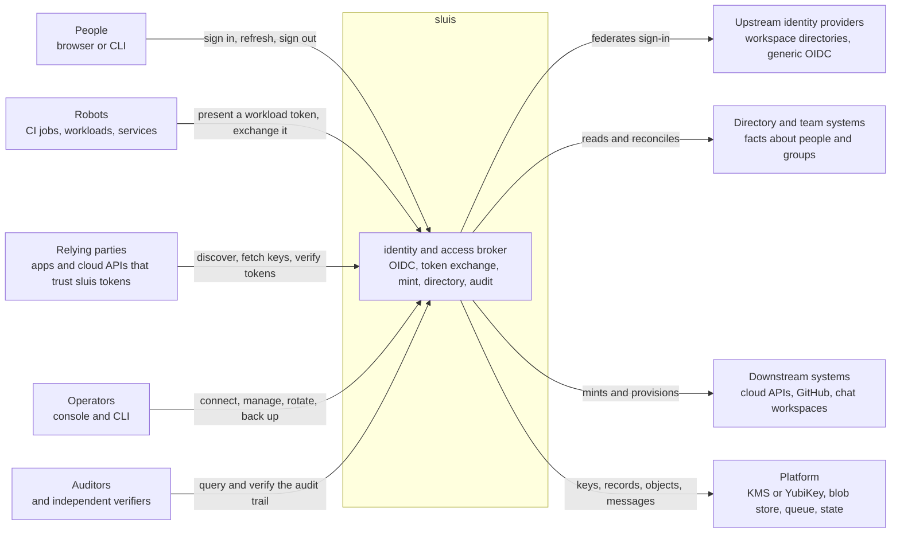
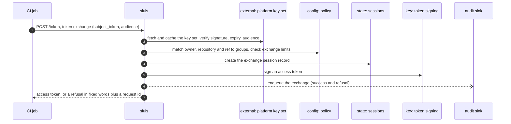
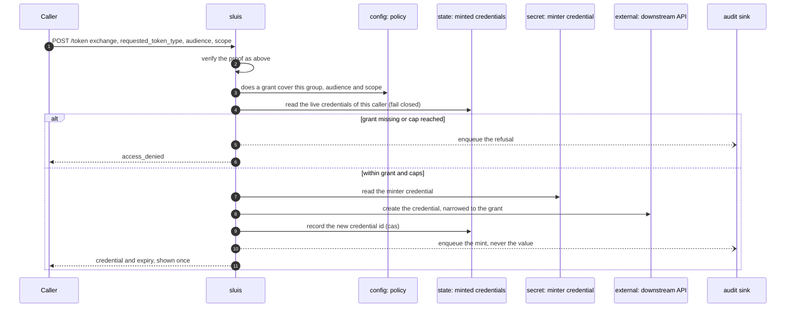

At the first zoom level sluis is one box. This page says who talks to it, what they can call, and which resources it touches to answer. How the box is split into components is [L2](/architecture/components/); how it is split into processes is [L3](/architecture/processes/).

## Actors

| Actor | What they do with sluis |
| ----- | ----------------------- |
| **Person** | Signs in through an upstream identity provider, from a browser or from a CLI on a machine with a browser; signs in on a headless machine with device login; refreshes, lists and revokes their sessions; signs out |
| **Robot** | A CI job or a workload presents a platform token (a GitHub Actions token, a Kubernetes ServiceAccount token, an AWS web-identity token) and exchanges it for an access token, a downstream credential, or a certificate |
| **Relying party** | Reads discovery and the key set, then verifies tokens offline with any standard JOSE library. sluis needs no client library |
| **Operator** | Connects and reconnects integrations, manages clients and secrets, reads the console, runs backup, restore and migration, and holds the key ceremonies |
| **Auditor** | Queries the audit trail and verifies it independently, without trusting sluis's index or state |
| **Upstream provider** | Authenticates people. sluis federates sign-in and never stores a password for a person |
| **Directory and team systems** | The source of facts: who is in which group or team. Policy maps those facts to grants |
| **Downstream system** | Receives credentials sluis mints and desired state sluis provisions |

## The external API surface

Four kinds of caller identity reach the box, and these are all it has to verify: a person's session cookie, a person's bearer (the access token of a live sign-in), a workload's platform token, and a confidential client's secret. Only discovery and the key set are public.

### OIDC and OAuth endpoints

Served on the origin root of the public host (for example `https://sluis.example.com`).

| Endpoint | Method and path | Caller |
| -------- | --------------- | ------ |
| Discovery | `GET /.well-known/openid-configuration`, `GET /.well-known/oauth-authorization-server` | Anyone. Public, CORS-open, no credentials |
| Key set | `GET /keys` | Anyone. Public |
| Authorization | `GET /authorize` (PKCE `S256` only, `response_mode=query`, `resource`, `prompt`) | A browser |
| Sign-in | `GET /login`, `GET /login/<provider>/start`, `GET /authorize/callback` | A browser, bound to the request by a `__Host-` cookie |
| Token | `POST /token` with `authorization_code` or `refresh_token` | A client, public with PKCE or confidential with a secret. Refresh tokens are single use |
| UserInfo | `GET\|POST /userinfo` | A bearer of a live sign-in |
| Revocation | `POST /revoke` (RFC 7009) | The client the token was issued to |
| Sign-out | `GET\|POST /end_session`, `GET /signed-out`; back-channel logout to relying parties | A browser; the relying party |
| Recovery | `POST /login/recovery`, and the SRP-6a password flow under `/login/srp/` | An operator, when no upstream can vouch. The proof needs no Kubernetes |
| Agent consent | `POST /login/agent-consent` | A signed-in person authorizing an agent-class session |

### Token exchange and mint

Both are `POST /token` with `grant_type=urn:ietf:params:oauth:grant-type:token-exchange` (RFC 8693). The `subject_token` is a GitHub Actions token, a Kubernetes ServiceAccount token from any known cluster, an AWS web-identity token, a token from a peer sluis, or the access token of a live sign-in presented by a client that is allowed to re-audience it. The `actor_token` is refused.

| Result | Selected by | Notes |
| ------ | ----------- | ----- |
| An access token for another audience | `audience` | Never an ID token. A refusal looks like an unknown audience; the reason is only in the audit record |
| A GitHub installation token | `requested_token_type=urn:sluis:params:oauth:token-type:github-installation-token`, `audience=github-app:<id>`, `repositories`, `scope` | The first grant that covers the whole request wins. Grants are never added together |
| A cloud API token or object-store credential | `requested_token_type=urn:sluis:params:oauth:token-type:cloudflare-token`, `audience=cloudflare:<preset>`, `lifetime` | Caps and rate limits are checked in core before the minter is asked |
| Cloud credentials for a person or robot | `audience` naming a cloud role | The cloud accepts a short-lived token that sluis signed, and returns its own credentials |

`GET /.access/grants` answers "what do I hold" for a bearer of a live sign-in; `Explain` answers "why".

### Console API

Connect services (JSON or protobuf over HTTP) under the console mount, package `sluis.v1`. Console calls use the same-origin session cookie; a workload may call them with its own platform token; some services also accept a CLI bearer. Roles are viewer and operator, optionally scoped to one directory.

| Service | What it manages |
| ------- | --------------- |
| `SessionService` | List and revoke sessions, own or anyone's |
| `AccessService` | `WhoAmI`, `Explain`, the effective policy, recovery status, group search |
| `WorkspaceService` and one service per integration | Connect, reconnect, probe, refresh and disconnect directories, GitHub organizations and Apps, chat workspaces |
| `CloudflareService` | List, rotate and revoke minted credential presets |
| `BackupService` | Backup status and history, run a backup, preview a restore |

Browser redirect routes under `/connect/<integration>/` complete the provider flows.

### Audit read

`audit.v1.QueryService` is reached only through the console, which forwards the call with a five-minute token minted for the signed-in person and addressed to the audit install. `401` means signed out, `403` means no grant, `502` means unreachable. Independent verification does not call sluis: an auditor fetches the sealed batches and the notary's public key and checks the chain.

### Operator and automation

| Surface | Crosses the boundary as |
| ------- | ----------------------- |
| `sluis` CLI, login, token, exchange, credential helpers for kubeconfig and cloud SDKs | The endpoints above, with results cached under the user's config directory |
| `sluis config check`, `sluis config explain` | Offline. No call to sluis |
| `sluis backup`, `restore`, `migrate`, `doctor` | On the host, against state and secrets directly |
| Scheduled work (directory refresh, reconcile ticks, rotation, backup) | Events from a timer, a queue, or a platform scheduler, not user API |

### Added in v2

:::note[Proposed]
The operations below are new in v2. Their paths and RPC names are proposed and may change before they are built.

| Operation | Shape |
| --------- | ----- |
| Device login (RFC 8628) | `POST /device_authorization`, `GET /device`, approve and deny calls, and `grant_type=urn:ietf:params:oauth:grant-type:device_code` on `/token`. The verification page requires a session with MFA and shows the client, host, IP address and location |
| Certificates for workloads, people and hosts | A Connect call for cert-manager's external-issuer library, and `sluis pki` and `sluis ssh` for people and robots |
| Static publication | `GET` of CA certificates, CRLs, bundles, SSH CA keys and the key revocation list, public |
| Audit receiver | `SinkService.Send` served by sluis, so other installs can send records |
| Quota | Admit, emit, cancel and top-up calls for metered operations |
| Audit witness protocol | A checkpoint goes out and a cosignature comes back |
:::

## Resources each use case touches

A use case touches resources of eight classes: a **signing key**, **state** (records), a **blob** store, a **queue**, the **audit sink**, **secrets**, **config** (policy and clients), and **external** systems. The matrix lists the operations. `r` marks an operation on the request path (the caller waits); `b` marks one in the background.

Operations: `sign` and `verify` (public key only), `wrap` and `unwrap`, `read`, `list`, `create` (if absent), `cas` (compare and swap on a revision), `put`, `append`, `delete`, `enqueue` and `dequeue`, `fetch` (external read), `call` (external write).

| Use case | Key | State | Blob | Queue | Audit | Secret | Config | External |
| -------- | --- | ----- | ---- | ----- | ----- | ------ | ------ | -------- |
| Sign in through an upstream | sign r | cas, create, read r | | | enqueue b | read r | read r | fetch r |
| Device login | sign r | cas, create, read r and b | | | enqueue b | | read r | call b, fetch r |
| Refresh, UserInfo, revoke, sign out, sessions | sign, verify r | cas, create, delete, list, read r | | | enqueue b | | read r | call b |
| Agent sessions and resources | sign r | create r | | | enqueue b | | read r | fetch r |
| Recovery sign-in | sign r | cas, create, read r | | | enqueue r, spooled locally | read r | read r | call r |
| Token exchange from a platform token | sign, verify r | create, read r | | | enqueue b | | read r | fetch r |
| Mint a GitHub installation token | sign r | append, read r | | | enqueue b | | read r | call r |
| Mint a cloud API token on demand | | cas, read r | | | enqueue b | read r | read r | call r, fetch r |
| Rotate stored credentials on a schedule | | cas, create, delete, read b | | dequeue b | enqueue b | put, read b | read b | call b |
| Issue certificates | sign r | read r | put b | | enqueue b | | read r | |
| Refresh directory facts, reconcile teams and channels | sign b | cas, create, list, read b | put b, read r | dequeue b | enqueue b | read b | read b | call b, fetch b and r |
| Connect an integration | put r | cas, create r | | | enqueue b | put r | | call r |
| Resolve grants, answer "what do I hold" | verify r | read r | | | enqueue b | | read r | |
| Deliver policy and configuration | | | | | | | read b | |
| Rotate a client secret | verify r | | | dequeue b | enqueue b | cas, create, read r | read r | |
| Emit, seal and witness audit batches | sign b | append, cas, read b | put b | enqueue, dequeue b | call b | | | call b |
| Query and verify the audit trail | | read r | read r | | enqueue b | | read r | |
| Console reads and actions | | cas, read r | read r | | enqueue b | | read r | |
| Back up, restore, migrate | | cas, create, list, put b | list, put, read b | dequeue b | call, enqueue b | cas, list, put, read b | | |
| Rotate signing keys, key ceremonies | sign, wrap, unwrap b | create, list b | | | | | | |
| Discovery and offline verification | | list r | | | | | read r | |
| Install, bootstrap, health | | create, read b | | | call b | read b | read b | call b |
| Admit a metered operation | | cas r | | | enqueue b | | | |

Four things follow from the matrix, and they shape L2 and L3:

- **Every sign-in-side use case is on the request path of state and of a signing key.** Nothing in that group touches a blob store or a queue. The strongest consistency need is state: a single-use code, a refresh token and a revocation must each be linearizable.
- **Downstream minting puts one to three external round trips on the caller's request path.** The decision and the credential-holding call are different credential holders, so they are different roles.
- **Controllers, refreshes and backups are background only.** They hold the broadest credentials and never need a listener.
- **Recovery is the one request-path use case that must not wait on audit.** It spools its audit record locally and delivers it later, so a down audit install does not shut the emergency door.

## Two sequences

sluis is a single participant in both diagrams. Resources are named by class.

### A CI job exchanges its token

No client secret is involved: the proof is the job's own token. A refused exchange answers like an unknown audience, so the caller learns nothing; the reason is only in the audit record.

### A downstream credential is minted

At L2 this one participant becomes several: the decision is made by the policy role, and the call that holds the vendor credential is made by an integration that only carries out what core has authorized. See [Components](/architecture/components/).

Next: [Components](/architecture/components/) opens the box. [Shapes](/shapes/) shows the same box installed in each environment.
