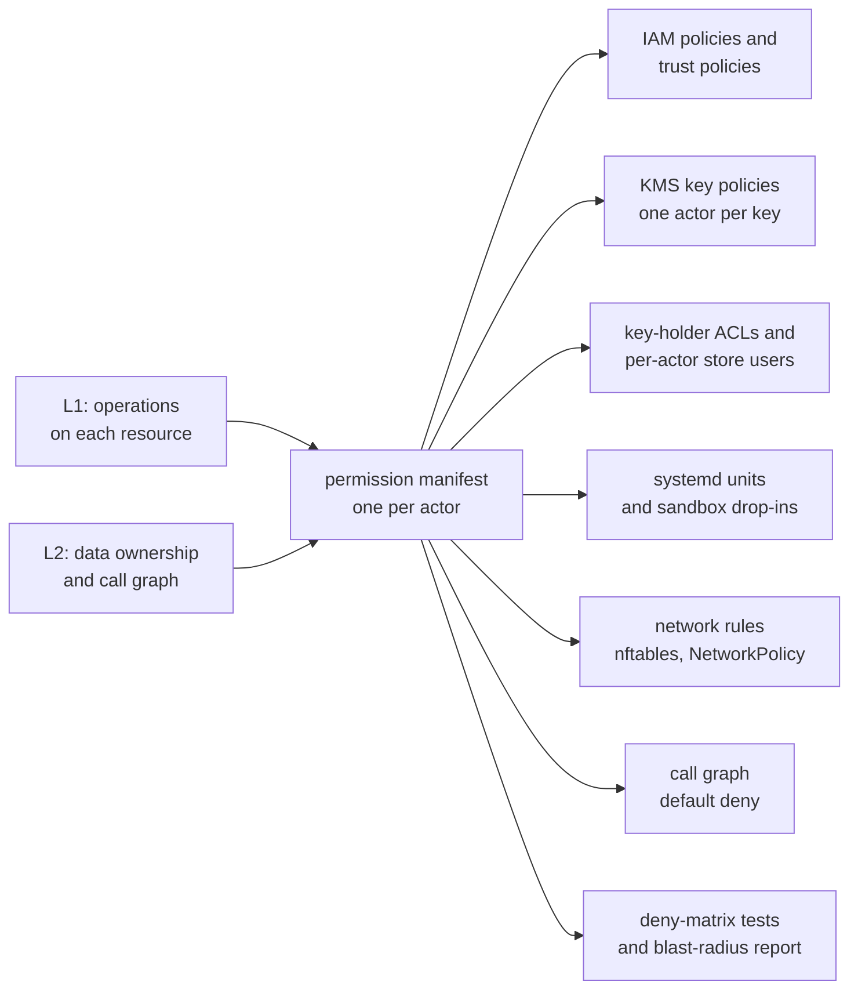

The architecture of sluis is described at three zoom levels ([ADR 0002](/decisions/0002-the-design-model-actors-ports-drivers-and-contracts/#three-zoom-levels)). Each level answers one question, and the output of one level is the input of the next.

| Level | Question | What it produces | Page |
| ----- | -------- | ---------------- | ---- |
| **L1, black box** | What does sluis do, for whom, and which resources does it touch to do it? | The use cases, the external API, and the resources each use case touches | [System context](/architecture/context/) |
| **L2, components** | Which component is responsible for each operation, and through which contract? | Components with one responsibility each, their contracts and ports, the call graph, and one writer per record kind | [Components and processes](/architecture/components/) |
| **L3, processes** | What runs where, with which credentials, and what enforces that in each runtime? | The processes, what each holds and calls, packaging, and the enforcement and listeners of each runtime | [Components and processes](/architecture/components/), [Deployment and listeners](/architecture/deployment/) |

## The permission manifest is the spine

Every [actor](/concepts/actors/) has one **permission manifest**. It states which record kinds the actor reads and writes, which of its kinds accept operator-set writes, which secrets and keys it may use, which hosts it may reach, which actors may call it, and which actors it calls. The manifest is derived from L1 (the operations on each resource) and L2 (data ownership and the call graph), and it lives in `manifest/` ([ADR 0002](/decisions/0002-the-design-model-actors-ports-drivers-and-contracts/#the-permission-manifest)).

Nothing that enforces least privilege is written by hand. The manifest generates it, for every runtime:

Three consequences follow:

- **A change in permissions is a change in one file.** A pull request that adds a use case says which component owns each step and which actor's manifest changes. The blast-radius report of every actor is checked in, so a reviewer sees what the change grants.
- **The same actor runs on every runtime.** An installation may fuse several actors into one unit, but only by taking the union of their manifests ([the fusion rule](/architecture/components/#the-fusion-rule)). Bare-metal, serverless and Kubernetes differ in the mechanism that enforces the manifest, not in the actors.
- **Enforcement is tested, not assumed.** The deny matrix is generated from the same data: for every pair of actors, actor X is denied actor Y's records, secrets, keys and sockets, and a test proves it.

Until the manifest exists, the diagrams on these pages are Mermaid, written next to the text and reviewed in a pull request; afterwards they are generated from the design model.

## Ground rules

- **Every major component is a ConnectRPC contract**, even when it runs in the same process as its caller. Contracts are Protobuf, in `proto/`.
- **Integrations return facts, or carry out effects that core has already authorized. They never decide.** A minter receives a mint grant that the `policy` actor sealed under the sealing key. Caps and rate limits live in core.
- **Core calls integrations, never the reverse.**
- **Plugins always run out of process.** There are no Go `.so` plugins and no WebAssembly ([ADR 0004](/decisions/0004-drivers-listeners-and-boundary-enforcement/#drivers-are-platform-started-services)).

## Pages

| Page | Level | What it covers |
| ---- | ----- | -------------- |
| [System context](/architecture/context/) | L1 | Who uses sluis, the external API surface, and the use case by resource matrix |
| [Components and processes](/architecture/components/) | L2, L3 | Components, integration contracts, ports, the call graph, one writer per record kind; the processes, what each holds and calls, packaging, and the processes on each runtime |
| [Deployment and listeners](/architecture/deployment/) | L3 | Enforcement per runtime, what accepts connections and where, and the residual risk |
| [Source layout](/architecture/source-layout/) | | Languages per component, shared kits, the repository tree |
| [Architecture explorer](/architecture/explorer/) | L1 to L3 | An interactive view of the components and their calls |
| [Audit explorer](/architecture/audit-explorer/) | L2 | An interactive view of the audit pipeline |

Related: [Concepts](/concepts/) explains the vocabulary ([actors](/concepts/actors/), [ports and drivers](/concepts/drivers/), [keys](/concepts/keys/)), [Integrations](/integrations/) the integration model, and [Runtimes](/runtimes/) where sluis runs and the [tested installations](/runtimes/installations/). To try sluis rather than read about it, follow the [single-node install](/tutorials/single-node-install/).
