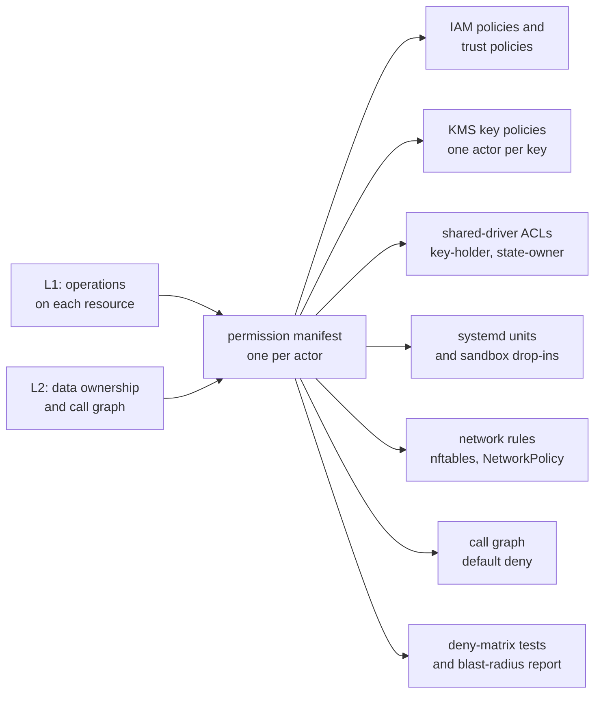

The architecture of sluis is described at three zoom levels. Each level answers one question, and the output of one level is the input of the next.

| Level | Question | What it produces | Page |
| ----- | -------- | ---------------- | ---- |
| **L1, black box** | What does sluis do, for whom, and which resources does it touch to do it? | The use cases, the external API, and the resources each use case touches | [System context](/architecture/context/) |
| **L2, components** | Which component is responsible for each operation, and through which contract? | Components with one responsibility each, their contracts and ports, the call graph, and one writer per record kind | [Components](/architecture/components/) |
| **L3, processes** | What runs where, with which credentials, and what enforces that in each environment? | Actors, one permission manifest per actor, packaging, and the enforcement for each environment, with the presets as examples | [Processes](/architecture/processes/), [Deployment](/architecture/deployment/) |

Three further pages cover the parts that cut across the levels: [Listeners](/architecture/listeners/) (what accepts connections, and where), [Source layout](/architecture/source-layout/) (languages, shared kits, and the repository tree), and the interactive explorers described below. To try sluis rather than read about it, follow the [single-node install](/tutorials/single-node-install/).

## The permission manifest is the spine

Every actor has one **permission manifest**. An actor is a process with one responsibility, and it declares the ports it requires. The manifest states, for that actor, which record kinds it reads and writes, which secrets and keys it may use, which hosts it may reach, which actors may call it, and which actors it calls. The manifest is derived from L1 (the operations on each resource) and L2 (data ownership and the call graph).

Nothing that enforces least privilege is written by hand. The manifest generates it, for every environment:

Three consequences follow from making the manifest the single source:

- **A change in permissions is a change in one file.** A pull request that adds a use case says which component owns each step and which actor's manifest changes. The blast-radius report for every actor is checked in, so a reviewer sees what the change grants.
- **The same actor runs in every environment.** An installation may fuse several actors into one unit, but only by taking the union of their manifests (see [the fusion rule](/architecture/processes/#the-fusion-rule)). Bare-metal, serverless and Kubernetes differ in the mechanism that enforces the manifest, not in the actors.
- **Enforcement is tested, not assumed.** The deny matrix is generated from the same data: for every pair of actors, actor X is denied actor Y's records, secrets, keys and sockets, and the test proves it.

## Ground rules

- **Every major component is a ConnectRPC contract**, even when it runs in the same process as its caller.
- **Integrations return facts, or carry out effects that core has already authorized. They never decide.** A minter receives a mint grant signed by the `policy` actor's own key. Caps and rate limits live in core.
- **Core calls integrations, never the reverse.**
- **Plugins always run out of process.** There are no Go `.so` plugins and no WebAssembly.

## Pages

| Page | Level | What it covers |
| ---- | ----- | -------------- |
| [System context](/architecture/context/) | L1 | Who uses sluis, the external API surface, and the use case by resource matrix |
| [Components](/architecture/components/) | L2 | Components, integration contracts, ports, the call graph, one writer per record kind |
| [Processes](/architecture/processes/) | L3 | Actors and what each holds, the fusion rule, packaging, the actor processes in each environment, and where the audit installation, Search and Quota run |
| [Deployment](/architecture/deployment/) | L3 | Enforcement per environment and mechanism, with the presets as examples, and the residual risk |
| [Listeners](/architecture/listeners/) | L3 | The `entry` loopback port, Unix sockets everywhere else, and the Raft port |
| [Source layout](/architecture/source-layout/) | | Languages per component, shared kits, the repository tree |
| [Architecture explorer](/architecture/explorer/) | L1 to L3 | An interactive view of the components and their calls |
| [Audit explorer](/architecture/audit-explorer/) | L2 | An interactive view of the audit pipeline |

Related sections: [Concepts](/concepts/) explains the vocabulary ([actors](/concepts/actors/), [ports and drivers](/concepts/drivers/), integrations, keys), [Environments](/environments/) describes where sluis runs (bare-metal, serverless, kubernetes) and the [presets](/environments/presets/) that name tested installations, and [Open decisions](/open-decisions/) lists what is not settled.

The diagrams on these pages are Mermaid, written next to the text and reviewed in a pull request ([OD-6](/open-decisions/#od-6)). Once the permission manifest exists, they are generated from the design model with LikeC4.
