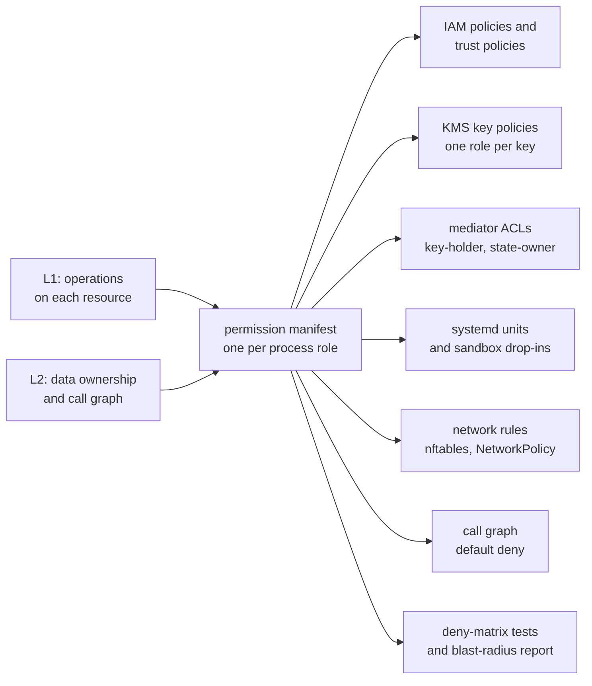

The architecture of sluis is described at three zoom levels. Each level answers one question, and the output of one level is the input of the next.

| Level | Question | What it produces | Page |
| ----- | -------- | ---------------- | ---- |
| **L1, black box** | What does sluis do, for whom, and which resources does it touch to do it? | The use cases, the external API, and the resources each use case touches | [System context](/architecture/context/) |
| **L2, components** | Which component is responsible for each operation, and through which contract? | Components with one responsibility each, their contracts and ports, the call graph, and one writer per record kind | [Components](/architecture/components/) |
| **L3, processes** | What runs where, with which credentials, and what enforces that on each shape? | Process roles, one permission manifest per role, packaging, and the enforcement for each shape | [Processes](/architecture/processes/), [Deployment](/architecture/deployment/) |

Three further pages cover the parts that cut across the levels: [Listeners](/architecture/listeners/) (what accepts connections, and where), [Source layout](/architecture/source-layout/) (languages, shared kits, and the repository tree), and the interactive explorers described below.

## The permission manifest is the spine

Every process role has one **permission manifest**. It states, for that role, which record kinds it reads and writes, which secrets and keys it may use, which hosts it may reach, which roles may call it, and which roles it calls. The manifest is derived from L1 (the operations on each resource) and L2 (data ownership and the call graph).

Nothing that enforces least privilege is written by hand. The manifest generates it, for every shape:

Three consequences follow from making the manifest the single source:

- **A change in permissions is a change in one file.** A pull request that adds a use case says which component owns each step and which role's manifest changes. The blast-radius report for every role is checked in, so a reviewer sees what the change grants.
- **The same role runs on every shape.** A shape may fuse several roles into one unit, but only by taking the union of their manifests (see [the fusion rule](/architecture/processes/#the-fusion-rule)). Lambda, Kubernetes and a single-board computer differ in the mechanism that enforces the manifest, not in the roles.
- **Enforcement is tested, not assumed.** The deny matrix is generated from the same data: for every pair of roles, role X is denied role Y's records, secrets, keys and sockets, and the test proves it.

## Ground rules

- **Every major component is a ConnectRPC contract**, even when it runs in the same process as its caller.
- **Integrations return facts, or carry out effects that core has already authorized. They never decide.** A minter receives a mint grant signed by the policy role's own key. Caps and rate limits live in core.
- **Core calls integrations, never the reverse.**
- **Plugins always run out of process.** There are no Go `.so` plugins and no WebAssembly.

## Pages

| Page | Level | What it covers |
| ---- | ----- | -------------- |
| [System context](/architecture/context/) | L1 | Actors, the external API surface, and the use case by resource matrix |
| [Components](/architecture/components/) | L2 | Components, integration contracts, ports, the call graph, one writer per record kind |
| [Processes](/architecture/processes/) | L3 | Process roles and what each holds, the fusion rule, packaging, one node drawn out |
| [Deployment](/architecture/deployment/) | L3 | Enforcement per shape and mechanism, and the residual risk |
| [Listeners](/architecture/listeners/) | L3 | Unix sockets, the edge connector, and the exceptions |
| [Source layout](/architecture/source-layout/) | | Languages per component, shared kits, the repository tree |
| [Architecture explorer](/architecture/) | L1 to L3 | An interactive view of the components and their calls (link follows when the explorer is published) |
| [Audit explorer](/architecture/) | L2 | An interactive view of the audit pipeline (link follows when the explorer is published) |

Related sections: [Concepts](/concepts/) explains the vocabulary (roles, drivers, integrations, keys), [Shapes](/shapes/) describes each way to install sluis, and [Open decisions](/open-decisions/) lists what is not settled.

:::caution[Open decision OD-6: Diagram tool]
The diagrams on these pages are Mermaid, written next to the text and reviewed in a pull request. Whether they are generated from the design model instead (LikeC4) is undecided.
:::
