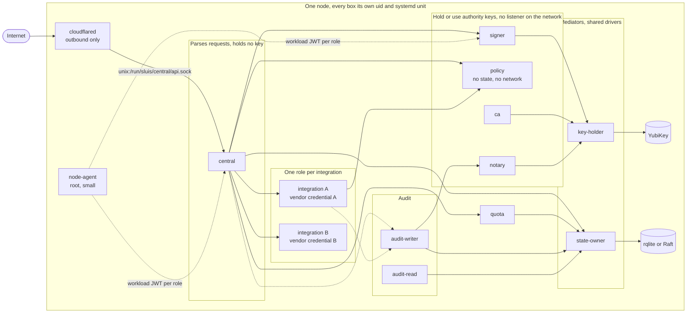

At the third zoom level the [components](/architecture/components/) are placed into **process roles**. A role is a unit with one credential set. Each role is its own OS user and systemd unit, its own Lambda function, or its own pod, so a compromise of one role gives the attacker that role's credentials and nothing else.

The rules the split follows:

| Rule | Reading |
| ---- | ------- |
| One credential holder per process | A process per owner, never a process per port |
| No key beside an unauthenticated listener | A role that can use an authority key does not parse unauthenticated internet input |
| The decision point has no network and no state | `policy` reads a reviewed file and returns grants |
| The audit writer can only append | Its credentials cannot overwrite or delete an archive object, and cannot sign a seal |
| Every integration is its own role | Started on demand where it has no standing work |

## Core roles

There are about eight core roles, plus integrations. `signer` and `policy` are split out from the first slice rather than later: splitting later is what v1 deferred and never did.

| Role | Responsibility | Holds | Cannot |
| ---- | -------------- | ----- | ------ |
| `central` | The OIDC protocol: sign-in, sessions, token exchange, the console API. Sits behind the edge connector | Sessions, refresh tokens, client secret verifiers. **No key** | Read the signing keys, or reach an integration's vendor credential |
| `signer` | Holds the signing ring and signs tokens under a signing policy; it is not a pure oracle. It checks the issuer URL, the audience set, the lifetime and the algorithm | The token-signing key use (KMS `Sign`, or the hardware key through `key-holder`) | Accept a request from anyone but `central`, or parse internet input |
| `policy` | The decision point. Reviewed, file-based policy maps facts to grants. Signs mint grants with its own key | The grant key. No state, no network, no secrets | Reach any resource: a bad process can decide wrongly, but exfiltrates nothing |
| `ca` | X.509 and the SSH CA | The CA keys | Sign anything outside its policy roles |
| `notary` | Signs audit batch heads | The notary key, in a separate custody domain from the writer | Write a record |
| `audit-writer` | Seals audit batches and writes them to the blob store | No signing key; it calls `notary` | Delete or overwrite an object, or forge a seal |
| `audit-read` | Serves audit queries from the index | Read access only. It audits every read | Write to the evidence |
| `quota` | Rate limits and caps, with conditional adjust | Its own balances and ledger | Touch identity records |

The blast radius of each is small by construction. A compromised `central` can ask `signer` for tokens while it runs (a signing oracle), but cannot read the key and cannot reach an integration. A compromised `signer` holds the ability to sign, not the ability to parse a request. A compromised integration reaches its own provider account and its own state.

:::caution[Open decision OD-1: Name of the central process]
`central` is a placeholder. The name is open: coordinator, central, hub, and others.
:::

## Integration roles

Each integration runs as its own process and holds its own vendor credential: the GitHub App keys, a chat token, the minter credential for a cloud API, a directory service account. Integrations that hold no external secret (a verifier of workload tokens, for example) are still separate roles, because they separate code and policy and are good candidates for fusion when memory is tight.

All integrations share one shape: ingress only from `central` and from the decision point by the call graph; state and secrets only in their own namespace (`<integration>/<connection>/*`); an audit emit; and egress to an allow-list of the provider's hosts, nothing else. They return facts or carry out authorized effects, and they call no other integration.

Integrations with no standing work are not resident. A directory refresh or a reconcile tick runs from a systemd timer and exits. A request-driven one starts on its socket and exits when idle.

## Mediators and the node agent

Two roles exist because some backends cannot tell their callers apart. Each is a **shared driver**: one process serves every role, authenticates the caller by peer credentials (`SO_PEERCRED`), checks an ACL generated from the manifests, performs the operation, and audits every use before acting.

| Role | Owns | Enforces |
| ---- | ---- | -------- |
| `key-holder` | The keys driver for an HSM, a YubiKey, or a software key | `(caller role, key purpose, operation)`. Callers never see a PIN, an authentication key or key material. The device node is mode 0600 for its uid only |
| `state-owner` | rqlite or the Raft store, as the state driver | `(caller role, record kind, operation)`, and **one writer role per record kind**. rqlite binds to loopback with one credential only it can read |

Neither has internet egress, loads plugins, or has reconcile logic. One code path per operation, fuzz-tested decoding. Their blast radius is the whole resource class, and that price is paid once, in a small audited process, rather than in every owner. With AWS KMS or DynamoDB the platform does this job (a key policy and a per-role identity; IAM leading-key conditions), so the mediator is not used there.

The **node agent** (self-hosted shapes) is the root-owned process that is the node's trusted base. It issues a short-lived workload JWT per role, brokers cloud credentials, pulls and verifies signed configuration and binaries, and starts units. Everything in [Deployment](/architecture/deployment/) depends on it staying small.

:::caution[Open decision OD-2: Name of the node agent]
`node-agent` is a placeholder name.
:::

## The fusion rule

Roles are not the same as units. A shape may run several roles in one unit, to fit a small machine, if both of these hold:

1. **The unit's manifest is the union of the manifests of the roles in it.** Fusing never grants something no member role was allowed.
2. **No unit holds a key next to an unauthenticated listener.**

Both are tested for every shape. For example, `signer` cannot be fused into `central`: the fusion would put the signing key beside the internet-facing listener. On Lambda the same reasoning keeps `signer` a separate function, because the key grant must stay out of the role of the function that faces the internet. Small, listener-free roles that hold no key (`quota` and an integration with no external secret, for instance) can share a unit on a 2 GB board.

## Packaging

:::note[Proposed]
Every component ships as its own binary. On a host that uses packages, the binaries live under `/usr/libexec/sluis/`, grouped by kind:

```text
/usr/libexec/sluis/
  roles/          central  signer  policy  ca  notary  audit-writer  audit-read  quota
  drivers/        state-owner  key-holder  <port drivers>
  integrations/   <one binary per integration>
  node/           node-agent
  vendor/         third-party binaries that sluis starts, such as rqlite
```

The directory names and the layout are agreed (PK-1); the binary names above are illustrative. Each role has one systemd unit, one uid, and one socket directory `/run/sluis/<role>/`. Roles are pinned by the unit: the binary a unit starts is the only code in that process, so a role cannot contain another role's code. Lambda ships one zip per role, and the Lambda Web Adapter is vendored into our own layer. Kubernetes runs one pod per role, from a multi-arch image, with the image pinned by digest.
:::

One version covers the whole repository. See [Distribution](/distribution/) for the artifacts, the apt and dnf repositories, and signing.

Why not Go plugins: a Go `.so` shares the host's address space and so has no isolation at all; it needs the same toolchain and dependency versions as the host, so it can never be released independently; and it cannot be unloaded. Why not WebAssembly: dropped. Plugins always run out of process: a Unix socket with peer credentials locally, a Lambda invoke on AWS, HTTPS with mTLS remotely.

## One node, drawn out

A self-hosted node (a single-board computer, or an EC2 instance) runs every role as its own user. Arrows are Unix-socket calls allowed by the call graph. The only thing that reaches `central` from outside is the edge connector, and it reaches a socket, not a port. See [Listeners](/architecture/listeners/).



The solid line from `gh` to `policy` is a decision request; the integration asks "may this caller have this", never the reverse. Dashed lines to `audit-writer` are asynchronous emits. The `node-agent` dashes stand for the workload JWT it issues to every role; the picture omits them for the other roles to stay readable.

On a three-node [cluster](/shapes/) every node runs this set, and the `state-owner` processes talk to each other over the Raft driver's mTLS port. Each node's `audit-writer` drains its own spool, and the notary co-signs batch heads 2 of 3 across nodes. On [Lambda](/shapes/) the same roles are separate functions with no node-agent; on Kubernetes they are separate pods.

:::caution[Open decision OD-5: Audit outbox port per shape]
Where an audit record waits before it is sealed differs by shape: a local spool on self-hosted and EC2 shapes, a queue on Lambda, and either a queue or blocking on Kubernetes. The lean is a spool for self-hosted shapes and a queue for Lambda.
:::

Next: [Deployment](/architecture/deployment/) shows how each shape enforces these boundaries.
