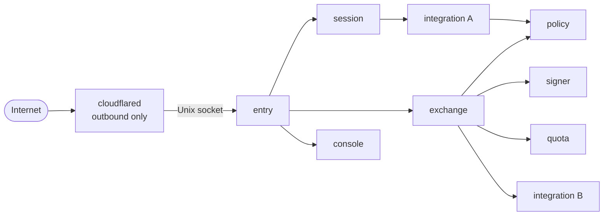
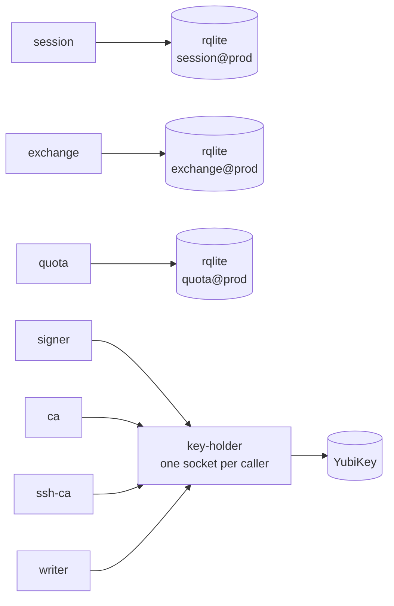
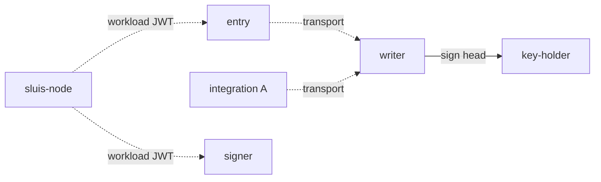

At the third zoom level the [components](/architecture/components/) are placed into **actors**. An actor is a process with one responsibility and one credential set; it declares the [ports](/concepts/drivers/) it requires. Each actor instance, named `<actor>@<boundary>` ([Naming](/concepts/actors/#naming)), is its own OS user and systemd template instance on bare-metal, its own Lambda function on serverless, or (on Kubernetes) its own container, so a compromise of one actor gives the attacker that actor's credentials and nothing else.

Where the actors run is described per [runtime](/runtimes/): the kind that decides how processes are started and what they can rely on. The number of nodes and the outside services an installation uses belong to the installation, not to the runtime. The four tested installations ([local, boards, lambda and kubernetes](/runtimes/installations/)) are used below as examples.

The rules the split follows:

| Rule | Reading |
| ---- | ------- |
| One credential holder per process | A process per owner, never a process per port |
| No key beside an unauthenticated listener | An actor that can use an authority key does not parse unauthenticated internet input |
| The decision point has no network and no state | `policy` reads a reviewed file and returns grants |
| The audit writer can only append | Its credentials cannot overwrite or delete a blob object, and it never holds the log key: `key-holder` signs for it |
| Every integration is its own actor | Started on demand where it has no standing work |

## Core actors

The concept is explained on [Actors](/concepts/actors/); the ports and the shared drivers on [Ports and drivers](/concepts/drivers/); the six integration actors on [Integrations](/concepts/integrations/); the key custody behind `signer` and `ca` on [Keys](/concepts/keys/); and the audit actors on [Audit](/concepts/audit/).

The core actors are `entry`, `session`, `console`, `exchange`, `signer`, `policy`, `ca` and `ssh-ca` ([ADR 0007](/decisions/0007-core-is-a-few-actors-with-one-responsibility-each/), rewritten on 2026-10-30). The `quota` actor sits beside them as the engine of the Quota piece, and there are four audit actors, plus integrations. `signer` and `policy` are split out from the first slice rather than later: splitting later is what v1 deferred and never did.

| Actor | Responsibility | Holds | Cannot |
| ----- | -------------- | ----- | ------ |
| `entry` | Parses each request, validates it against closed parameter lists generated from the contracts, and routes it. Sits behind the edge connector | **Nothing**: no key, no secret, no state, no outbound network | Reach anything but the sockets of the actors it routes to |
| `session` | Sessions, the session cookie, per-boundary freshness (step-up), the sign-in flows | Sessions and refresh tokens; the cookie-sealing key, behind the keys port | Sign a token, or reach an integration's vendor credential |
| `console` | The operator API, as the browser's backend. Routes each write to the actor that owns the record kind | Delegation checks. No key | Write a record kind it does not own |
| `exchange` | Token exchange (RFC 8693), enrolment and the proof verifiers | Client secret verifiers, enrolments, token hashes. Verifier drivers with public material only; the enrolment key stays in `key-holder` or KMS | Sign a token itself |
| `signer` | Holds the signing ring and signs tokens under a signing policy; it is not a pure oracle. It checks the issuer URL, the audience set, the lifetime and the algorithm | The token-signing key use (KMS `Sign`, or the hardware key through `key-holder`) | Accept a request from anyone but `entry`, or parse internet input |
| `policy` | The decision point. Declared Cedar policy, plus template-linked policies within a declared delegation policy, maps facts to grants. Signs mint grants with its own key | The grant key. No state, no network, no secrets | Reach any resource: a bad process can decide wrongly, but exfiltrates nothing |
| `ca` | The X.509 CA | The X.509 CA keys | Sign anything outside its policy |
| `ssh-ca` | The SSH CA, for user and host certificates | The `ssh-user` and `ssh-host` keys | Sign anything but an OpenSSH certificate within its policy |
| `quota` | Not a core actor: the engine of the Quota piece. Rate limits, caps and metering, with compare-and-set on the state port (a conditional adjust is proposed, ADR 0057) | Its own balances (issued) and meters (derived). No key | Touch identity records |
| `writer` | Receives audit records, seals them in batches and writes them to the blob, create-if-absent. Exactly one per log | The log-store credential. It asks `key-holder` (on AWS, KMS under a key policy that names it) to sign each batch head, and never holds the log key | Delete or overwrite an object, or use any key but the log key |
| `witness` | Co-signs the batch heads it has seen. Optional | Its own key | Write a batch object |
| `indexer` | Builds the search index from the blob. Exactly one | Read on the blob, write on the index | Write to the evidence |
| `reader` | Serves audit queries from the search index. It audits every read | Read access only | Write to the evidence |

The blast radius of each is small by construction. A compromised `entry` holds nothing and reaches only the sockets it routes to; it cannot read a key, a session or a secret, and every request it forwards is checked again by the actor that receives it. A compromised `signer` holds the ability to sign, not the ability to parse a request. A compromised integration reaches its own provider account and its own state.

The audit actors are the **writer**, the **witness**, the **indexer** and the **reader**. There is no notary actor (agreed, [OD-39](/open-decisions/#od-39)): the writer asks `key-holder` to sign, and `key-holder`'s access list lets only the writer use the log key.

`quota` is drawn as its own box. Quota is a separate piece of the audit design, combinable with sluis in one installation, where it shares sluis's driver instances ([OD-37](/open-decisions/#od-37) and [OD-38](/open-decisions/#od-38)). It meters by default and enforces per policy rule, which needs `state` with compare-and-set on the mint path ([OD-33](/open-decisions/#od-33)). Turning enforcement on in production still waits for the k6 load test.

## Integration actors

Each integration runs as its own process and holds its own vendor credential: the GitHub App keys, a chat token, the minter credential for a cloud API, a directory service account. Integrations that hold no external secret (a verifier of workload tokens, for example) are still separate actors, because they separate code and policy and are good candidates for fusion when memory is tight.

Each integration is one process per vendor tenant and credential, named `<vendor>[-<capability>]@<tenant>`, such as `google-signin@<company>` and `google-directory@<company>`. All integrations share one pattern: ingress only from the core actors by the call graph; state and secrets only in their own namespace (`<integration>/<connection>/*`); an audit emit; and egress through the proxy to an allow-list of the provider's hosts, nothing else. They return facts or carry out authorized effects, and they call no other integration.

Integrations with no standing work are not resident. A directory refresh or a reconcile tick runs from a systemd timer and exits. A request-driven one starts on its socket and exits when idle.

## The mediating driver and the node agent

A backend that can authorise each caller is used with **per-actor credentials and no mediator**: IAM and KMS key policies on AWS, an rqlite cluster per owning actor with an rqlite user per actor, a Postgres role per actor. One backend cannot: a card on a node, with one PIN. For it there is one **mediating driver**, `key-holder`.

| Process | Owns | Enforces |
| ------- | ---- | -------- |
| `key-holder` | The keys driver for a YubiKey, an HSM through PKCS#11, or a software key | One Unix socket per caller, in a directory only that caller can open; a peer-uid check on each call; an access list of `(caller actor, key purpose, operation)` generated from the manifests; and signing that understands each purpose's content. Callers never see a PIN, an authentication key or key material. The device node is mode 0600 for its uid only |

It has no internet egress, loads no plugins and has no reconcile logic: one code path per operation, fuzz-tested decoding, a rate limit and an audit record per signature. Its blast radius is every key on the card, and that price is paid once, in a small audited process. See [The mediating driver](/concepts/drivers/#the-mediating-driver).

There is **no `state-owner`**. State on a cluster of boards is **one rqlite cluster per (boundary, owning actor)**, `sluis-rqlite@<boundary>-<actor>`: the owner has the only user with `execute`, declared readers have `query`-only users, and each cluster has its own port, certificate and systemd sandbox.

The **node agent** (`sluis-node`, bare-metal only) is the root-owned process that is the node's trusted base. It issues a short-lived workload JWT per uid, brokers cloud credentials, pulls and verifies signed configuration and binaries, and starts units. Everything in [Deployment](/architecture/deployment/) depends on it staying small. It does not run on serverless or on Kubernetes.

## The fusion rule

Actors are not the same as units. An installation may run several actors in one unit, to fit a small machine, if both of these hold:

1. **The unit's manifest is the union of the manifests of the actors in it.** Fusing never grants something no member actor was allowed.
2. **No unit holds a key next to an unauthenticated listener.**

Both are tested for every installation. For example, `signer` cannot be fused into `entry`: the fusion would put the signing key beside the internet-facing listener. On serverless the same reasoning keeps `signer` a separate function, because the key grant must stay out of the role of the function that faces the internet. Small, listener-free actors that hold no key (`quota` and an integration with no external secret, for instance) can share a unit on a 2 GB board.

On Kubernetes a pod holds several actors, so the word "unit" in rule 2 needs a definition. The unit is the **credential scope** (decided, [OD-18](/open-decisions/#od-18)): the systemd unit on a node, the function on serverless, and the container on Kubernetes, where each container has its own token audience. A generated check then fails the build if any container that can use a key also has a listener. A pod that holds `entry` and `signer` as two containers passes in substance, because `entry`'s container cannot reach the credentials of `signer`'s.

## Packaging

Every component ships as its own executable, in one language ([Source layout](/architecture/source-layout/#languages)). On a host that uses packages, the executables live under `/usr/libexec/sluis/`, grouped by kind:

```text
/usr/libexec/sluis/
  actors/         entry  session  console  exchange  signer  policy  ca  ssh-ca  quota  writer  witness  indexer  reader
  drivers/        key-holder  <port drivers>
  integrations/   <one executable per integration>
  node/           sluis-node
  vendor/         third-party binaries that sluis starts, such as rqlite
```

The directory names and the layout are agreed (PK-1), and the directory is called `actors/` (agreed; it amends the layout, which first called it `roles/`). The executable names above are illustrative. Actors are pinned by the unit: the executable a unit starts is the only code in that process, so an actor cannot contain another actor's code. Packaging follows the runtime, and is agreed ([ADR 0029](/decisions/0029-one-repository-one-version-one-release-train-and-packaging-follows-the-runtime/), [ADR 0038](/decisions/0038-the-local-installation-is-docker-compose-with-one-container-per-actor/)):

- **Bare-metal** ships `.deb` and `.rpm` packages **split by function** (`sluis`, `sluis-node`, `sluis-server`, `sluis-drivers`, `sluis-driver-yubikey`, `sluis-audit-writer`, `sluis-audit-search`, `sluis-quota`, `sluis-host`, `sluis-console`), and a tarball. The packages ship **systemd template units** only, `sluis-<actor>@.service` and `.socket`; a **systemd generator** in the package reads `/etc/sluis/install.yaml` and creates the instances and their `sysusers.d` entries.
- **Serverless** ships **one function per actor and one zip per executable**; drivers reach a function as one Rust `aws` extension, and sluis uses at most three layers of its own.
- **Kubernetes** runs **one OCI image per process**, carrying the packages' binaries byte for byte, pinned by digest, and installed with **one Helm chart with presets**.

There is no separate development build: local is an installation, not a build. The artifacts and their names are on [Packages](/distribution/packages/).

Why not Go plugins: a Go `.so` shares the host's address space and so has no isolation at all; it needs the same toolchain and dependency versions as the host, so it can never be released independently; and it cannot be unloaded. Why not WebAssembly: dropped. Plugins always run out of process: a Unix socket with peer credentials locally, a Lambda invoke on AWS, HTTPS with mTLS remotely.

## The actor processes on each runtime

The same actors run on every runtime. What changes is who starts them, what they can rely on, and how they reach each other.

| | bare-metal, 1 node | bare-metal, N nodes | serverless | kubernetes (proposed) |
| --- | --- | --- | --- | --- |
| **Unit of an actor** | A systemd unit and an OS user | The same, on every node | A Lambda function | A container |
| **Calls between actors** | Unix sockets | Unix sockets on the node; the Raft ports of the rqlite clusters are the only TCP ports between nodes | Lambda invoke, authorized by a resource policy on an alias | Unix sockets within a pod, on a socket volume mounted into the permitted callers. No call crosses a pod boundary; the audit transport is the only link between pods |
| **Node agent** | `sluis-node` | `sluis-node` on every node | None: the platform attests the function | None: the platform's token is used |
| **Mediating driver** | `key-holder`, for a card on the node | The same, on every node | None: KMS key policies do the job | None: KMS key policies do the job |
| **Actors that declare instances: exactly 1** | Run once | Need the lease port, on the state store | A lease on DynamoDB, or a FIFO queue with one message group (to verify) | Need the lease port, on the state store (DynamoDB) |
| **Tested installation** | local | boards | lambda | kubernetes |

### Bare-metal, one node

A bare-metal node (a single-board computer, a virtual machine such as EC2, or a container on a workstation) runs every actor as its own user, in its own instance of a systemd template unit, `sluis-<actor>@<boundary>`. The node is drawn in three steps: the request path, the keys and the state, and the audit emits. Arrows are Unix-socket calls allowed by the call graph. The only thing that reaches `entry` from outside is the edge connector, and it forwards to `entry`'s Unix socket; `entry` runs with no network at all. Every call is a Unix-socket call. See [Listeners](/architecture/listeners/).

| Group | Actors | What the group is |
| ----- | ------ | ----------------- |
| Front | `entry` | Parses and routes requests, and holds nothing |
| Protocol | `session`, `exchange`, `console` | Sessions, token exchange and enrolment, and the operator API |
| Authority | `signer`, `policy`, `ca`, `ssh-ca` | Use authority keys, with no listener on the network. `policy` holds no state and has no network |
| Integrations | one actor per integration | Each holds its own vendor credential (credential A, credential B) |
| Audit | `writer`, `witness`, `indexer`, `reader` | Write, witness, index and read the audit chain. The writer signs only through `key-holder` |
| Mediating driver | `key-holder` | The one keys driver for the node's card |
| State | one rqlite cluster per owning actor | Each actor's own store, with an rqlite user per actor |
| Node agent | `sluis-node` | Runs as root and is small |

#### Step 1: the request path



The solid line from integration A to `policy` is a decision request; the integration asks "may this caller have this", never the reverse.

#### Step 2: keys and state



The actors that use a key (`signer`, `ca`, `ssh-ca`, and the audit `writer` for its log key) reach it only through `key-holder`, each through a socket of its own. Every actor that keeps state has its own rqlite cluster, and a declared reader of another actor's records has a `query`-only user on that cluster. `policy` also uses its grant key; it is left out of the picture.

#### Step 3: audit emits and the node agent



Dashed lines to `writer` are asynchronous emits through the transport port. The node agent dashes stand for the workload JWT it issues to every actor; the picture omits them for the other actors to stay readable.

### Bare-metal, N nodes

On a three-node installation (the boards installation is the tested one) every node runs this set, and each rqlite cluster talks to its peers on the other nodes over its own mTLS port. The audit actors are the exception worth reading carefully. A cluster keeps **one log per node**: each node's `writer` drains its own spool and signs with its own log key, and the other two nodes are its peer witnesses, which is the 2-of-3 co-signing. The rule is **exactly one writer per log**, not one per installation, so no lease is needed to elect a writer between nodes. Readers merge the logs by time. See [the audit installation](#the-audit-installation).

### Serverless

On serverless the same actors are separate Lambda functions with no `sluis-node` and no `key-holder`: the KMS key policy is the access list. The platform gives each function an execution role, which is its identity. The audit writer is fenced by create-if-absent on the blob; whether a reserved concurrency of 1 can stand in for its lease with an SQS trigger is to be verified, and the safe forms are a FIFO queue with one message group or a lease on DynamoDB. The transport is an SQS queue. Search may run inside the functions with a `postgres` index, through RDS Proxy (proposed) ([OD-12](/open-decisions/#od-12), revised). The default index of the lambda installation is none (proposed), and then Search is a separate installation that reads the same blob, or a small installation uses the scan from the CLI. See [Serverless](/runtimes/serverless/).

### Kubernetes

:::note[Proposed]
On Kubernetes the actors are containers of a node pod and of an audit pod, cut at the audit transport ([OD-17](/open-decisions/#od-17)). The audit side is being redesigned as a separate audit installation ([OD-31](/open-decisions/#od-31)). The first release targets Amazon EKS with AWS KMS ([OD-20](/open-decisions/#od-20)), and SQS is the transport for now ([OD-22](/open-decisions/#od-22)). See [Kubernetes](/runtimes/kubernetes/).
:::

## The audit installation

Audit is built from the same ports as the rest of sluis and adds one port, the witness. Audit is made of four separate pieces ([OD-37](/open-decisions/#od-37), decided): the **emitter** (a library inside each end application, not a process), the **log** (the writer, a blob with a lock mode, and the witness), **Search** and **Quota**. The **transport** (direct, or a queue) is a port, not a piece. Each piece can be its own installation, and pieces combined in one installation, even with sluis, share driver instances. A writer on the same node as sluis is one installation's choice. A separate audit installation connected over the network is another, and is the direction of [OD-31](/open-decisions/#od-31).

| Part | Placement | Where it is decided |
| ---- | --------- | ------------------- |
| Transport | Per installation: direct (`direct-unix` on the same host, `direct-mtls` between hosts) or a queue (spool, SQS, NATS JetStream). The defaults are a spool on bare-metal and SQS on serverless and Kubernetes; direct mode falls back to a local spool when the writer is down, so it needs a disk | [OD-34](/open-decisions/#od-34), [OD-35](/open-decisions/#od-35) |
| Writer | Per installation. Exactly one writer per log; a cluster keeps one log per node | [OD-31](/open-decisions/#od-31) |
| Blob | Per installation, with a lock mode of none, removable or compliance | |
| Witness | Per installation, and optional everywhere; `sluis config check` warns when there is none | [OD-36](/open-decisions/#od-36) |

Two further pieces are separate from the log:

| Piece | What it is | Where it runs |
| --- | ---------- | ------------- |
| **Search** | The indexer, the search index and the reader | Derived from the port and driver rules, not decided per installation: for example, with a `sqlite` index on a cluster the reader runs on the indexer's node. See [Ports and drivers](/concepts/drivers/#where-an-actor-runs-is-derived) and [OD-32](/open-decisions/#od-32) |
| **Quota** | The quota engine and its quota state (the state port with compare-and-set) | Derived in the same way. A separate piece, combinable with sluis, sharing its driver instances. It meters by default and enforces per policy rule. [OD-38](/open-decisions/#od-38), [OD-33](/open-decisions/#od-33) |

The [audit explorer](/architecture/audit-explorer/) draws these boxes for each tested installation, and the [architecture explorer](/architecture/explorer/) draws the actor processes.

Next: [Deployment](/architecture/deployment/) shows how each runtime enforces these boundaries.
