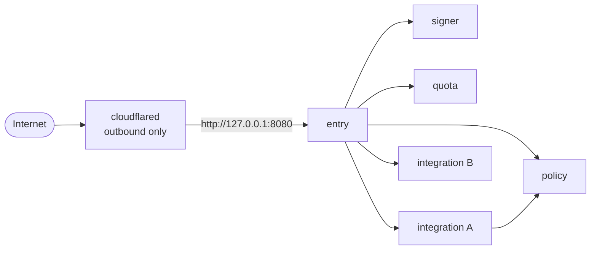
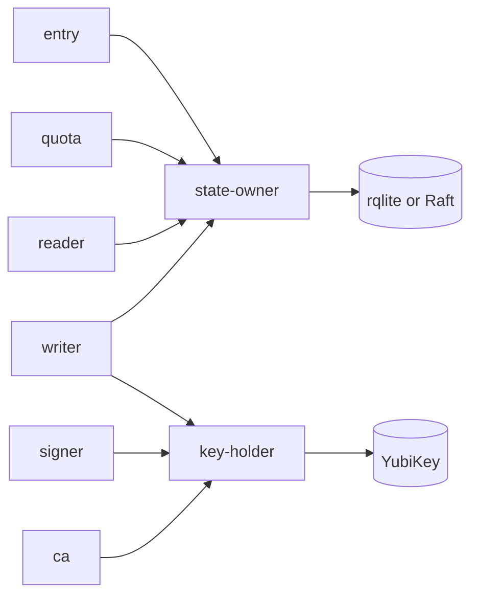
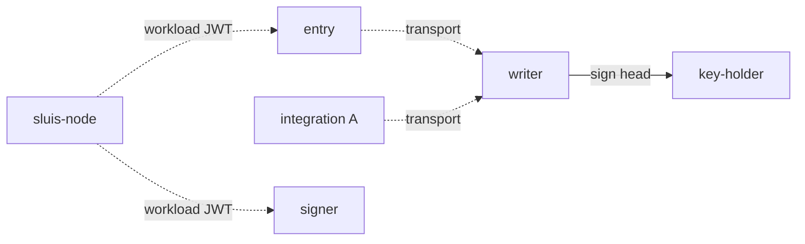

At the third zoom level the [components](/architecture/components/) are placed into **actors**. An actor is a process with one responsibility and one credential set; it declares the [ports](/concepts/drivers/) it requires. Each actor is its own OS user and systemd unit on bare-metal, its own Lambda function on serverless, or (on Kubernetes, as proposed) its own container, so a compromise of one actor gives the attacker that actor's credentials and nothing else.

Where the actors run is described per [runtime](/runtimes/): the kind that decides how processes are started and what they can rely on. The number of nodes and the outside services an installation uses belong to the installation, not to the runtime. The four tested installations ([local, boards, lambda and kubernetes](/runtimes/installations/)) are used below as examples.

The rules the split follows:

| Rule | Reading |
| ---- | ------- |
| One credential holder per process | A process per owner, never a process per port |
| No key beside an unauthenticated listener | An actor that can use an authority key does not parse unauthenticated internet input |
| The decision point has no network and no state | `policy` reads a reviewed file and returns grants |
| The audit writer can only append | Its credentials cannot overwrite or delete a blob object, and it never holds the log key: `key-holder` signs for it |
| Every integration is its own actor | Started on demand where it has no standing work |

## Core actors

The concept is explained on [Actors](/concepts/actors/); the ports and the shared drivers on [Ports and drivers](/concepts/drivers/); the six integration actors on [Integrations](/concepts/integrations/); the key custody behind `signer` and `ca` on [Keys](/concepts/keys/); and the audit actors on [Audit](/concepts/audit/).

There are about nine core and audit actors, plus integrations. `signer` and `policy` are split out from the first slice rather than later: splitting later is what v1 deferred and never did.

| Actor | Responsibility | Holds | Cannot |
| ----- | -------------- | ----- | ------ |
| `entry` | The OIDC protocol: sign-in, sessions, token exchange, the console API. Sits behind the edge connector | Sessions, refresh tokens, client secret verifiers. **No key** | Read the signing keys, or reach an integration's vendor credential |
| `signer` | Holds the signing ring and signs tokens under a signing policy; it is not a pure oracle. It checks the issuer URL, the audience set, the lifetime and the algorithm | The token-signing key use (KMS `Sign`, or the hardware key through `key-holder`) | Accept a request from anyone but `entry`, or parse internet input |
| `policy` | The decision point. Reviewed, file-based policy maps facts to grants. Signs mint grants with its own key | The grant key. No state, no network, no secrets | Reach any resource: a bad process can decide wrongly, but exfiltrates nothing |
| `ca` | X.509 and the SSH CA | The CA keys | Sign anything outside its policy |
| `quota` | Rate limits and caps, with conditional adjust | Its own balances and ledger | Touch identity records |
| `writer` | Receives audit records, seals them in batches and writes them to the blob. Exactly one per log | The log-store credential. It asks `key-holder` to sign each batch head, and never holds the log key | Delete or overwrite an object, or use any key but the log key |
| `witness` | Co-signs the batch heads it has seen. Optional | Its own key | Write a batch object |
| `indexer` | Builds the search index from the blob. Exactly one | Read on the blob, write on the index | Write to the evidence |
| `reader` | Serves audit queries from the search index. It audits every read | Read access only | Write to the evidence |

The blast radius of each is small by construction. A compromised `entry` can ask `signer` for tokens while it runs (a signing oracle), but cannot read the key and cannot reach an integration. A compromised `signer` holds the ability to sign, not the ability to parse a request. A compromised integration reaches its own provider account and its own state.

The audit actors are the **writer**, the **witness**, the **indexer** and the **reader**. There is no notary actor (agreed, [OD-39](/open-decisions/#od-39)): the writer asks `key-holder` to sign, and `key-holder`'s access list lets only the writer use the log key.

`quota` is drawn as its own box. Quota is a separate piece of the audit design, combinable with sluis in one installation, where it shares sluis's driver instances ([OD-37](/open-decisions/#od-37) and [OD-38](/open-decisions/#od-38)). It meters by default and enforces per policy rule, which needs `state` with compare-and-set on the mint path ([OD-33](/open-decisions/#od-33)). Turning enforcement on in production still waits for the k6 load test.

## Integration actors

Each integration runs as its own process and holds its own vendor credential: the GitHub App keys, a chat token, the minter credential for a cloud API, a directory service account. Integrations that hold no external secret (a verifier of workload tokens, for example) are still separate actors, because they separate code and policy and are good candidates for fusion when memory is tight.

All integrations share one pattern: ingress only from `entry` and from the decision point by the call graph; state and secrets only in their own namespace (`<integration>/<connection>/*`); an audit emit; and egress to an allow-list of the provider's hosts, nothing else. They return facts or carry out authorized effects, and they call no other integration.

Integrations with no standing work are not resident. A directory refresh or a reconcile tick runs from a systemd timer and exits. A request-driven one starts on its socket and exits when idle.

## Shared drivers and the node agent

Two platform processes exist because some backends cannot tell their callers apart. Each is a **shared driver**: one process serves every actor, authenticates the caller by peer credentials (`SO_PEERCRED`), checks an ACL generated from the manifests, performs the operation, and audits every use before acting.

| Process | Owns | Enforces |
| ------- | ---- | -------- |
| `key-holder` | The keys driver for an HSM, a YubiKey, or a software key | `(caller actor, key purpose, operation)`. Callers never see a PIN, an authentication key or key material. The device node is mode 0600 for its uid only |
| `state-owner` | rqlite or the Raft store, as the state driver | `(caller actor, record kind, operation)`, and **one writer actor per record kind**. rqlite binds to loopback with one credential only it can read |

Neither has internet egress, loads plugins, or has reconcile logic. One code path per operation, fuzz-tested decoding. Their blast radius is the whole resource class, and that price is paid once, in a small audited process, rather than in every owner. With AWS KMS or DynamoDB the platform does this job (a key policy and a per-actor identity; IAM leading-key conditions), so the shared driver is not used there.

The **node agent** (`sluis-node`, bare-metal only) is the root-owned process that is the node's trusted base. It issues a short-lived workload JWT per actor, brokers cloud credentials, pulls and verifies signed configuration and binaries, and starts units. Everything in [Deployment](/architecture/deployment/) depends on it staying small. It does not run on serverless or on Kubernetes.

## The fusion rule

Actors are not the same as units. An installation may run several actors in one unit, to fit a small machine, if both of these hold:

1. **The unit's manifest is the union of the manifests of the actors in it.** Fusing never grants something no member actor was allowed.
2. **No unit holds a key next to an unauthenticated listener.**

Both are tested for every installation. For example, `signer` cannot be fused into `entry`: the fusion would put the signing key beside the internet-facing listener. On serverless the same reasoning keeps `signer` a separate function, because the key grant must stay out of the role of the function that faces the internet. Small, listener-free actors that hold no key (`quota` and an integration with no external secret, for instance) can share a unit on a 2 GB board.

:::note[Proposed]
On Kubernetes a pod holds several actors, so the word "unit" in rule 2 needs a definition. The proposal is that the unit is the **credential scope**: the systemd unit on a node, the function on serverless, and the container on Kubernetes, where each container has its own token audience. A generated check then fails the build if any container that can use a key also has a listener. A pod that holds `entry` and `signer` as two containers passes in substance, because `entry`'s container cannot reach the credentials of `signer`'s. This is [OD-18](/open-decisions/#od-18).
:::

## Packaging

:::note[Proposed]
Every component ships as its own binary. On a host that uses packages, the binaries live under `/usr/libexec/sluis/`, grouped by kind:

```text
/usr/libexec/sluis/
  actors/         entry  signer  policy  ca  quota  writer  witness  indexer  reader
  drivers/        state-owner  key-holder  <port drivers>
  integrations/   <one binary per integration>
  node/           sluis-node
  vendor/         third-party binaries that sluis starts, such as rqlite
```

The directory names and the layout are agreed (PK-1), and the directory is called `actors/` (agreed; it amends the layout, which first called it `roles/`). The binary names above are illustrative. Each actor has one systemd unit, one uid, and one socket directory `/run/sluis/<actor>/`. Actors are pinned by the unit: the binary a unit starts is the only code in that process, so an actor cannot contain another actor's code. Packaging follows the runtime. Bare-metal ships a deb, an rpm and a tarball. Serverless ships one zip per actor, and the Lambda Web Adapter is vendored into our own layer. Kubernetes runs one container per actor, from a multi-arch OCI image pinned by digest, installed with a Helm chart. There is no separate development build: local is an installation, not a build.
:::

One version covers the whole repository. See [Packages](/distribution/packages/) for the artifacts, the apt and dnf repositories, and signing.

Why not Go plugins: a Go `.so` shares the host's address space and so has no isolation at all; it needs the same toolchain and dependency versions as the host, so it can never be released independently; and it cannot be unloaded. Why not WebAssembly: dropped. Plugins always run out of process: a Unix socket with peer credentials locally, a Lambda invoke on AWS, HTTPS with mTLS remotely.

## The actor processes on each runtime

The same actors run on every runtime. What changes is who starts them, what they can rely on, and how they reach each other.

| | bare-metal, 1 node | bare-metal, N nodes | serverless | kubernetes (proposed) |
| --- | --- | --- | --- | --- |
| **Unit of an actor** | A systemd unit and an OS user | The same, on every node | A Lambda function | A container |
| **Calls between actors** | Unix sockets | Unix sockets on the node; the Raft port is the only TCP port between nodes | Lambda invoke, authorized by a resource policy on an alias | Unix sockets within a pod, on a socket volume mounted into the permitted callers; a Service between pods |
| **Node agent** | `sluis-node` | `sluis-node` on every node | None: the platform attests the function | None: the platform's token is used |
| **Shared drivers** | `key-holder`, `state-owner` where the backend cannot tell callers apart | The same, with `state-owner` talking Raft to its peers | None: IAM does the job | None where the cloud does it |
| **Actors that declare instances: exactly 1** | Run once | Need the lease port | Reserved concurrency of 1 may stand in for the lease | Need the lease port (the Kubernetes Lease driver) |
| **Tested installation** | local | boards | lambda | kubernetes |

### Bare-metal, one node

A bare-metal node (a single-board computer, a virtual machine such as EC2, or a container on a workstation) runs every actor as its own user, in its own systemd unit. The node is drawn in three steps: the request path, the keys and the state, and the audit emits. Arrows are Unix-socket calls allowed by the call graph. The only thing that reaches `entry` from outside is the edge connector, and it connects to `entry`'s loopback TCP port; every other call is a Unix-socket call. See [Listeners](/architecture/listeners/).

| Group | Actors | What the group is |
| ----- | ------ | ----------------- |
| Front | `entry` | Parses requests and holds no key |
| Authority | `signer`, `policy`, `ca` | Use authority keys, with no listener on the network. `policy` holds no state and has no network |
| Integrations | one actor per integration | Each holds its own vendor credential (credential A, credential B) |
| Audit | `writer`, `witness`, `indexer`, `reader` | Write, witness, index and read the audit chain. The writer signs only through `key-holder` |
| Shared drivers | `key-holder`, `state-owner` | One key driver and one state driver for the node |
| Node agent | `sluis-node` | Runs as root and is small |

#### Step 1: the request path



The solid line from integration A to `policy` is a decision request; the integration asks "may this caller have this", never the reverse.

#### Step 2: keys and state



The actors that use a key (`signer`, `ca`, and the audit `writer` for its log key) reach it only through `key-holder`, and every actor that reads or writes state goes through `state-owner`. `policy` also uses its grant key; it is left out of the picture.

#### Step 3: audit emits and the node agent



Dashed lines to `writer` are asynchronous emits through the transport port. The node agent dashes stand for the workload JWT it issues to every actor; the picture omits them for the other actors to stay readable.

### Bare-metal, N nodes

On a three-node installation (the boards installation is the tested one) every node runs this set, and the `state-owner` processes talk to each other over the Raft driver's mTLS port. The audit actors are the exception worth reading carefully. A cluster keeps **one log per node**: each node's `writer` drains its own spool and signs with its own log key, and the other two nodes are its peer witnesses, which is the 2-of-3 co-signing. The rule is **exactly one writer per log**, not one per installation, so no lease is needed to elect a writer between nodes. Readers merge the logs by time. See [the audit installation](#the-audit-installation).

### Serverless

On serverless the same actors are separate Lambda functions with no `sluis-node`. The platform gives each function an execution role, which is its identity. The audit writer has a reserved concurrency of 1, which stands in for the lease. The transport is an SQS queue. Search may run inside the functions with a `postgres` index, through RDS Proxy (proposed) ([OD-12](/open-decisions/#od-12), revised). The default index of the lambda installation is none (proposed), and then Search is a separate installation that reads the same blob, or a small installation uses the scan from the CLI. See [Serverless](/runtimes/serverless/).

### Kubernetes

:::note[Proposed]
On Kubernetes the actors are containers of a node pod and of an audit pod, cut at the audit transport ([OD-17](/open-decisions/#od-17)). The audit side is being redesigned as a separate audit installation ([OD-31](/open-decisions/#od-31)). The first release targets Amazon EKS with AWS KMS ([OD-20](/open-decisions/#od-20)), and SQS is the transport for now ([OD-22](/open-decisions/#od-22)). See [Kubernetes](/runtimes/kubernetes/).
:::

## The audit installation

Audit is built from the same ports as the rest of sluis and adds one port, the witness. Audit is made of four separate pieces ([OD-37](/open-decisions/#od-37), decided): the **emitter** (a library inside each end application, not a process), the **log** (the writer, a blob with a lock mode, and the witness), **Search** and **Quota**. The **transport** (direct, or a queue) is a port, not a piece. Each piece can be its own installation, and pieces combined in one installation, even with sluis, share driver instances. A writer on the same node as sluis is one installation's choice. A separate audit installation connected over the network is another, and is the direction of [OD-31](/open-decisions/#od-31).

| Part | Placement | Where it is decided |
| ---- | --------- | ------------------- |
| Transport | Per installation: direct (`direct-unix` on the same host, `direct-mtls` between hosts) or a queue (spool, SQS, NATS JetStream). The defaults are a spool on bare-metal and SQS on serverless and Kubernetes; direct mode falls back to a local spool when the writer is down, so it needs a disk | [OD-34](/open-decisions/#od-34), [OD-35](/open-decisions/#od-35) |
| Writer | Per installation. Exactly one writer per log; a cluster keeps one log per node | [OD-31](/open-decisions/#od-31) |
| Blob | Per installation, with a lock mode of none, removable or compliance | |
| Witness | Per installation, and optional everywhere; `sluis config check` warns when there is none | [OD-36](/open-decisions/#od-36) |

Two further pieces are separate from the log:

| Piece | What it is | Where it runs |
| --- | ---------- | ------------- |
| **Search** | The indexer, the search index and the reader | Derived from the port and driver rules, not decided per installation: for example, with a `sqlite` index on a cluster the reader runs on the indexer's node. See [Ports and drivers](/concepts/drivers/#where-an-actor-runs-is-derived) and [OD-32](/open-decisions/#od-32) |
| **Quota** | The quota engine and its quota state (the state port with compare-and-set) | Derived in the same way. A separate piece, combinable with sluis, sharing its driver instances. It meters by default and enforces per policy rule. [OD-38](/open-decisions/#od-38), [OD-33](/open-decisions/#od-33) |

The [audit explorer](/architecture/audit-explorer/) draws these boxes for each tested installation, and the [architecture explorer](/architecture/explorer/) draws the actor processes.

Next: [Deployment](/architecture/deployment/) shows how each runtime enforces these boundaries.
