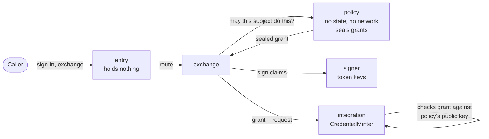

sluis is not one program. It is a handful of **core actors**, each with one job, plus the **integration actors** that talk to vendors and a few platform services. An **actor** is a process with one responsibility, and it declares the [ports](/concepts/drivers/) it requires. An actor is the unit of least privilege: it is its own OS user and systemd unit on a bare-metal node, its own Lambda function on serverless, and a container on Kubernetes (proposed, see below). What the platform lets an actor touch is written once, in that actor's [permission manifest](/architecture/), and generated into IAM policies, key policies, driver access lists, systemd units and network rules.

## The kinds of actor

| Kind | Actors | Notes |
|---|---|---|
| **Core actors** | `entry`, `session`, `console`, `exchange`, `signer`, `policy`, `ca`, `ssh-ca` | Actors with one responsibility each ([ADR 0007](/decisions/0007-core-is-a-few-actors-with-one-responsibility-each/), rewritten on 2026-10-30). `entry` is slim: it parses, validates and routes, and holds nothing. |
| **Quota** | `quota` | Not a core actor: `quota` is the engine of the Quota piece, which is a separate piece that can be combined with sluis in one installation and then shares its driver instances ([OD-37](/open-decisions/#od-37) and [OD-38](/open-decisions/#od-38), decided). See [Audit](/concepts/audit/#the-four-pieces). |
| **Integration actors** | `Upstream`, `WorkloadVerifier`, `FactsSource`, `CredentialMinter`, `Provisioner`, `Notifier` | One process per vendor tenant and credential, such as `google-signin@<company>` and `google-directory@<company>`. See [Integrations](/concepts/integrations/) and [Naming](#naming). |
| **Platform** | `sluis-node`, `key-holder` | `sluis-node` is the node agent; it does not run on serverless or on Kubernetes. `key-holder` is the one mediating driver, for the keys on a node's card: see [Ports and drivers](/concepts/drivers/#the-mediating-driver). |
| **Audit actors** | `writer`, `witness`, `indexer`, `reader` | There is no notary actor (agreed, [OD-39](/open-decisions/#od-39)). See [Audit](/concepts/audit/). |

## The core and audit actors

| Actor | Responsibility | Holds |
|---|---|---|
| `entry` | Parses each request, validates it against closed parameter lists generated from the contracts, and routes it to `session`, `exchange` or `console`. It sits behind the edge connector | **Nothing**: no key, no secret, no state and no outbound network. It reaches only the sockets of the actors it routes to (on serverless, it invokes them) |
| `session` | Session records, the session cookie, and freshness per boundary (step-up) | The cookie-sealing key, behind the keys port |
| `console` | The operator API, as the browser's backend. It routes each write to the actor that owns the record kind | Delegation checks; no key |
| `exchange` | Token exchange ([RFC 8693](https://datatracker.ietf.org/doc/html/rfc8693)), enrolment and the proof verifiers ([Machine identity](/concepts/machine-identity/)) | Verifier drivers, which hold public material only. The enrolment (HPKE) key stays in `key-holder` or KMS |
| `signer` | Holds the signing ring and signs tokens under a signing policy. It is not a pure signing oracle. | The token-signing keys |
| `policy` | The decision point. A declared Cedar policy, plus template-linked policies within a declared delegation policy, maps facts to grants. It has no state and no network. It seals mint grants under the sealing key, with `purpose=grant` in the encryption context. | Use of the sealing key for grants only |
| `ca` | The X.509 certificate authority | The X.509 CA keys |
| `ssh-ca` | The SSH certificate authority, an actor of its own because it is a different authority ([SSH](/integrations/ssh/)) | The `ssh-user` and `ssh-host` CA keys |
| `quota` | Rate limits, caps and metering, on the state port with compare-and-set. The engine of the Quota piece, not a core actor. | No key. It writes quota balances (issued records) and meters (derived) |
| `writer` | Receives audit records from the transport, seals them in batches and writes them to the blob store. It asks `key-holder` to sign each batch head (on AWS, the KMS key policy names it). Exactly one per log. | The log-store credential. It never holds the log key |
| `witness` | Co-signs the batch heads it has seen. Optional. | Its own key |
| `indexer` | Builds the search index from the log store. Exactly one. | Read on the log store, write on the index |
| `reader` | Serves audit queries from the index and audits every read. | Read-only access |
| Integration actors | One process per vendor tenant and credential, in six kinds: see [Integrations](/concepts/integrations/). | The vendor credential of that integration only |

Three actors use an authority key, each a different one: `signer`, `ca` and `ssh-ca`. `policy` holds no signing key: it seals its grants under the sealing key. The audit `writer` uses the log key too, but only by asking `key-holder` to sign, and `key-holder`'s access list lets nobody but the writer use that key; on AWS a key policy does the same. `entry`, which faces the internet through the edge connector, holds nothing. Its public API is the only listener that faces the edge, and every other actor listens on Unix sockets only (see [Listeners](/architecture/listeners/)). `entry` was formerly called central.

**Copied tokens are useless.** Tokens are sender-constrained (DPoP or mutual TLS) and authorization codes are bound by PKCE, so a token or a code read off the wire cannot be used by anyone else.

**Hardening of `entry`.** `entry` is written in a memory-safe language (see [Source layout](/architecture/source-layout/#languages)), parses only closed parameter lists and is fuzzed, loads no plugin and runs on a read-only file system. On bare-metal it also runs under seccomp and Landlock with `PrivateNetwork=yes` and Unix sockets only: `cloudflared` forwards to a Unix-socket origin.

**The console.** The browser reaches the console API through `entry`, which routes it to the `console` actor; the session is an HttpOnly cookie that `session` checks, and the browser holds no token. An operator-set write is routed by `console` to the actor that owns the record kind, which validates it; the manifest says which kinds accept operator-set writes, and the owner's own state credentials refuse any other writer ([ADR 0007](/decisions/0007-core-is-a-few-actors-with-one-responsibility-each/), [ADR 0016](/decisions/0016-data-has-an-origin-and-a-sensitivity/)). The console's single-page application is a separate artifact, served on the same origin by each runtime's static host.

## Naming

Every actor instance is named **`<actor>@<boundary>`**, and the name is generated from the manifest. The [boundary](/runtimes/boundaries/) is an environment such as `prod`, a company or a product. The same name appears in every layer:

| Layer | Example for `ca@prod` |
|---|---|
| systemd unit | `sluis-ca@prod.service` |
| Unix user | `sluis-ca-prod` |
| Socket | `/run/sluis/ca/prod.sock` |
| Lambda function and IAM role | `sluis-ca-prod` |
| Kubernetes container and ServiceAccount | `ca-prod` |
| KMS alias | `alias/sluis/prod/ca/<purpose>` |
| State prefix | `prod/ca/…` |
| Lease name, audit field | `actor=ca@prod` |
| SPIFFE ID | `spiffe://prod.<td>/sluis/ca` |

**Integrations are named `<vendor>[-<capability>]@<tenant>`, one per credential.** A vendor whose sign-in and directory use different credentials is two integrations: `google-signin@<company>` and `google-directory@<company>`. Others are `github@<org>`, `slack@<workspace>`, `cloudflare@<company>` and `aws-minter@<org>`, and `oidc@<name>` is the generic OIDC upstream.

## Actors and ports

Every actor declares which ports it requires. R means required, O optional, and a dash means the actor does not use the port. The ports are described on [Ports and drivers](/concepts/drivers/).

| Actor | keys | state | lease | blob | transport | index | witness | cloud |
|---|---|---|---|---|---|---|---|---|
| `entry` | – | – | – | – | R | – | – | – |
| `session` | R | R | – | – | R | – | – | – |
| `console` | – | – | – | – | R | – | – | – |
| `exchange` | R | R | – | – | R | – | – | – |
| `signer` | R | R | O | O | R | – | – | – |
| `policy` | R | – | – | – | R | – | – | – |
| `ca` | R | R | – | O | R | – | – | – |
| `ssh-ca` | R | R | – | O | R | – | – | – |
| `quota` | – | R | – | – | R | – | – | – |
| `Upstream` | O | O | – | – | R | – | – | – |
| `WorkloadVerifier` | – | O | – | – | R | – | – | – |
| `FactsSource` | – | R | O | – | R | – | – | O |
| `CredentialMinter` | O | O | – | – | R | – | – | O |
| `Provisioner` | – | O | O | R | R | – | – | O |
| `Notifier` | – | O | – | – | R | – | – | – |
| `sluis-node` | R | – | – | R | R | – | – | – |
| `key-holder` | – | – | – | – | R | – | – | – |
| third-party app | O | – | – | – | R | – | – | – |

The audit actors, with the same legend (the cell marked * is the one place an actor receives from the transport instead of putting into it):

| Actor | keys | state | lease | blob | transport | index | witness | cloud |
|---|---|---|---|---|---|---|---|---|
| `writer` | R | – | O | R | R* | – | O | O |
| `witness` | R | R | – | R | – | – | – | – |
| `indexer` | – | – | O | R | – | R | – | – |
| `reader` | – | – | – | R | – | R | – | – |

Every actor is a producer on the **transport** port, because every success is audited. The writer is the one consumer. Why the table looks this way is in [Audit](/concepts/audit/). `entry` keeps no state: sessions belong to `session`, and enrolments and exchanges to `exchange`. `exchange` uses the keys port only to open enrolment requests sealed to the enrolment key.

## Where an actor runs is derived

There is no per-installation table that says where each actor runs. Where an actor runs is **derived from the port and driver rules** ([OD-32](/open-decisions/#od-32), decided). This holds for every actor: the core actors, the integration actors, the platform services and the Search actors. `sluis config check` enforces the rules, and each [tested installation](/runtimes/installations/) only names its default drivers.

The rules, applied to an actor:

1. **An actor runs wherever all its required ports are reachable.** Its drivers are started by the platform next to it (a systemd service, a Lambda extension, a native sidecar) and spoken to over a Unix socket, so the actor and the driver instances of its ports share a node, a function or a pod.
2. **The driver's requirements move the actor.** A driver that needs a long-running process or a persistent disk puts its actor where one exists. A `yubikey-piv` keys driver puts `signer`, `policy`, `ca` and `ssh-ca` on a node that has the YubiKey. The same driver is refused on serverless.
3. **Instances: exactly 1 pins the actor to one holder.** The indexer, the audit writer of each log and the `FactsSource` reconciler run once, and with more than one node or elastic nodes they need the lease port.
4. **A single-writer driver puts its readers beside its writer.** With a `sqlite` index on a cluster there is one writer, so the reader runs on the indexer's node. With a `postgres` index the reader can run on any node that reaches the database.
5. **Actors may share a unit under the fusion rule.** Combined pieces of an installation share driver instances, even with sluis.

| Actor | What decides where it runs |
|---|---|
| `entry` | Needs the edge connector and the sockets of the actors it routes to. It is the one actor that faces the edge, and it holds nothing |
| `session`, `console`, `exchange` | Their state and keys ports. They have no listener toward the edge |
| `signer`, `policy`, `ca`, `ssh-ca` | The keys port: a node with the key hardware for `yubikey-piv`, anywhere for `aws-kms` |
| `quota` | The state port with compare-and-set. It can run beside sluis or as a piece of its own |
| Integration actors | Their state and cloud ports; one process each, started on demand where they have no standing work |
| `sluis-node`, `key-holder` | Per node, beside the hardware they front. They are not used on serverless or Kubernetes, where the platform provides the identity and the keys |
| Writer | The blob, keys and transport ports; exactly 1 per log. On a cluster of boards each node runs its own writer for its own log |
| Witness | The witness port; on a cluster, the other nodes witness a node's log |
| Indexer, reader | The index and blob ports; the indexer is exactly 1, and a single-writer index puts the reader beside it |

See [Ports and drivers](/concepts/drivers/#where-an-actor-runs-is-derived) for the rules as they apply to drivers.

## Instances: exactly 1

Some actors declare **instances: exactly 1**. At any moment there must be one and only one of them:

- the audit writer, because its batch sequence must have no gaps or forks. The rule is **exactly one writer per log**, not one per installation: a cluster keeps one log per node, each with its own writer;
- the `FactsSource` reconciler, because two reconcilers would fight over the same external state;
- the indexer, because the search index has one writer.

When an installation has more than one node, or its nodes are elastic, such an actor needs the **lease** port, so that exactly one holder runs at a time and a stale holder is refused by its fencing token (see [Data](/concepts/data/#leases-and-fencing-tokens)). On a single node a local lock is enough. On serverless the audit writer runs with a reserved concurrency of 1 on a standard SQS queue, and its single-writer guarantee comes from the blob fence (every batch created only if absent), not from the concurrency limit (decided 2026-10-30).

## Why the signer and the policy are separate

In v1 the issuer is one function that serves sign-in, machine token exchange and downstream minting, and it touches 25 resources. Least privilege cannot be expressed for something that broad. v2 splits it before writing it:

- `entry` parses and routes and holds nothing, so a bug in request parsing reaches no key, no secret and no record.
- `exchange` and `session` own the protocol state, and ask `policy` before anything is issued.
- `signer` holds the token-signing keys and signs only what its signing policy allows. It is not a pure oracle, so a compromised `entry` or `exchange` cannot ask it for an arbitrary token.
- `policy` decides. It has no state and no network, so it cannot be made to read or exfiltrate anything. Its output is a **grant** sealed under the sealing key of its environment, and a minter will only act on a grant that it can open under the context `purpose=grant`.

Splitting the decision from the signature gives two independent checks. To obtain a credential, an attacker needs a grant that `policy` signed **and** a minter that accepts it; to forge a token, they need `signer` to agree **and** the signing policy to allow it. v1 left the split for later and never made it. v2 makes it from the first slice.

The `policy` actor is written in Rust with the `cedar-policy` crate, and Cedar is the policy language. The actor, its isolation and its signed output do not depend on the language. Each executable has one language, chosen by rules in [ADR 0060](/decisions/0060-the-language-follows-the-executable/); see [Source layout](/architecture/source-layout/#languages).

## The fusion rule

On a small node memory is tight, and the node also runs the state store, so two actors may be **fused** into one unit when the rule allows it. On a 2 GB board, spike S5 measured on 2026-10-31 about 10 MiB of private memory per Go actor stand-in under load and about 1 MiB per Rust one, and a tier-0 board with 30 actors, each in its own process, stayed under its memory ceiling in either language ([ADR 0060](/decisions/0060-the-language-follows-the-executable/)). The rule:

> Two actors may share a unit only if the unit's manifest is the union of theirs, and no unit holds a key next to an unauthenticated listener.

Both halves are checked. The first means fusion never grants an actor something it did not already have in its own unit, it only puts the two together. The second keeps the line that matters most: a process that is reachable without authentication, such as `entry` behind the edge connector, never also holds a key. `entry` is never fused with anything that holds a key, a secret or state, because it holds none of them by design. The rule is tested: a configuration that fuses actors in a way that breaks it fails the build.

On Kubernetes the "unit" of this rule is the **credential scope**, which is the container, because one pod holds several actors, each with its own token audience ([OD-18](/open-decisions/#od-18), decided). With the container as the unit, the build checks that no container that can use a key also has a listener.

## Actors on every runtime

The set of actors is the same on every [runtime](/runtimes/). What changes is how each one is run and what is behind its ports.

| Runtime | An actor is |
|---|---|
| Bare-metal (a single board, a cluster of boards, a virtual machine, local Docker) | An instance of a systemd template unit, `sluis-<actor>@<boundary>`, with its own OS user (a container under local Docker); a few actors may be fused under the rule above |
| Serverless | One function per actor |
| Kubernetes (proposed) | A container per actor, in a node pod or an audit pod |

:::note[Proposed]
On Kubernetes an actor is a container with its own user id and its own token audience, and a pod holds several actors. This replaces one pod, with one ServiceAccount, per actor. The layout is a node pod plus a separate audit side ([OD-17](/open-decisions/#od-17)); audit is a separate audit installation ([OD-31](/open-decisions/#od-31), decided), and each integration runs in a pod of its own ([OD-29](/open-decisions/#od-29)). See [Kubernetes](/runtimes/kubernetes/).
:::

See [Runtimes](/runtimes/) for each runtime and the tested installations, and [Processes](/architecture/processes/) for what runs where.
