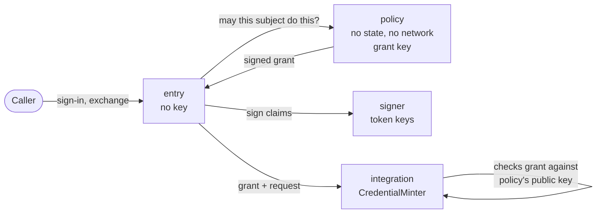

sluis is not one program. It is a handful of **core actors**, each with one job, plus the **integration actors** that talk to vendors and a few platform services. An **actor** is a process with one responsibility, and it declares the [ports](/concepts/drivers/) it requires. An actor is the unit of least privilege: it is its own OS user and systemd unit on a bare-metal node, its own Lambda function on serverless, and a container on Kubernetes (proposed, see below). What the platform lets an actor touch is written once, in that actor's [permission manifest](/architecture/), and generated into IAM policies, key policies, driver access lists, systemd units and network rules.

## The kinds of actor

| Kind | Actors | Notes |
|---|---|---|
| **Core actors** | `entry`, `signer`, `policy`, `ca`, `quota` | Whether `quota` is a core actor or a separate product is open: [OD-38](/open-decisions/#od-38). |
| **Integration actors** | `Upstream`, `WorkloadVerifier`, `FactsSource`, `CredentialMinter`, `Provisioner`, `Notifier` | One process per integration. See [Integrations](/concepts/integrations/). |
| **Platform** | `sluis-node`, `key-holder`, `state-owner` | `sluis-node` is the node agent; it does not run on serverless or on Kubernetes. `key-holder` (keys) and `state-owner` (state) are the two mediating drivers: see [Ports and drivers](/concepts/drivers/#the-two-mediating-drivers). |
| **Audit actors** | `notary`, `audit-writer`, `audit-read` today; `writer`, `witness`, `indexer`, `reader` proposed | See [Audit](/concepts/audit/) and [OD-39](/open-decisions/#od-39). |

## The core and audit actors

| Actor | Responsibility | Holds |
|---|---|---|
| `entry` | The OIDC protocol: sign-in, sessions, token exchange and the console API. It sits behind the edge connector. | No key |
| `signer` | Holds the signing ring and signs tokens under a signing policy. It is not a pure signing oracle. | The token-signing keys |
| `policy` | The decision point. A reviewed, file-based policy maps facts to grants. It has no state and no network. It signs mint grants with its own key. | The grant key |
| `ca` | X.509 and the SSH certificate authority. | The CA keys |
| `quota` | Rate limits and caps, using conditional adjust on the state port. | Nothing but its own counters |
| `notary` | Signs the heads of audit batches. | The notary key |
| `audit-writer` | Seals audit batches and writes them to the blob store. | No signing key; it calls the notary |
| `audit-read` | Serves audit queries from the index. | Read-only access |
| Integration actors | One process per integration, in six kinds: see [Integrations](/concepts/integrations/). | The vendor credential of that integration only |

Four actors hold an authority key: `signer`, `policy`, `ca` and `notary`. Each holds a different one. `entry`, which faces the internet through the edge connector, holds none. `entry` is the one actor with a TCP listener: its public API is bound to `127.0.0.1`, and every other actor listens on Unix sockets only (see [Listeners](/architecture/listeners/)). `entry` was formerly called central.

:::note[Proposed]
The three audit actors above are proposed to be replaced by four: a **writer** that receives records and seals batches, a **witness** that co-signs batch heads, an **indexer** that builds the search index, and a **reader** that serves queries. The notary is then folded into the `key-holder` access list, or kept as a thin checker. Whether to make this change is [OD-39](/open-decisions/#od-39). The audit actors are described on [Audit](/concepts/audit/).
:::

## Actors and ports

Every actor declares which ports it requires. R means required, O optional, and a dash means the actor does not use the port. The ports are described on [Ports and drivers](/concepts/drivers/).

| Actor | keys | state | lease | blob | transport | index | witness | cloud |
|---|---|---|---|---|---|---|---|---|
| `entry` | – | R | – | – | R | – | – | – |
| `signer` | R | R | O | O | R | – | – | – |
| `policy` | R | – | – | – | R | – | – | – |
| `ca` | R | R | – | O | R | – | – | – |
| `quota` | – | R | – | – | R | – | – | – |
| `Upstream` | O | O | – | – | R | – | – | – |
| `WorkloadVerifier` | – | O | – | – | R | – | – | – |
| `FactsSource` | – | R | O | – | R | – | – | O |
| `CredentialMinter` | O | O | – | – | R | – | – | O |
| `Provisioner` | – | O | O | R | R | – | – | O |
| `Notifier` | – | O | – | – | R | – | – | – |
| `sluis-node` | R | – | – | R | R | – | – | – |
| `key-holder`, `state-owner` | – | – | – | – | R | – | – | O |
| third-party app | O | – | – | – | R | – | – | – |

:::note[Proposed]
The audit actors, with the same legend (the cell marked * is the one place an actor receives from the transport instead of putting into it):

| Actor | keys | state | lease | blob | transport | index | witness | cloud |
|---|---|---|---|---|---|---|---|---|
| audit writer | R | – | O | R | R* | – | O | O |
| audit witness | R | R | – | R | – | – | – | – |
| audit indexer | – | – | O | R | – | R | – | – |
| audit reader | – | – | – | R | – | R | – | – |

This is part of [OD-39](/open-decisions/#od-39).
:::

Every actor is a producer on the **transport** port, because every success is audited. The writer is the one consumer. Why the table looks this way is in [Audit](/concepts/audit/).

## Instances: exactly 1

Some actors declare **instances: exactly 1**. At any moment there must be one and only one of them:

- the audit writer, because its batch sequence must have no gaps or forks;
- the `FactsSource` reconciler, because two reconcilers would fight over the same external state;
- the indexer, because the search index has one writer.

When an installation has more than one node, or its nodes are elastic, such an actor needs the **lease** port, so that exactly one holder runs at a time and a stale holder is refused by its fencing token (see [Data](/concepts/data/#leases-and-fencing-tokens)). On a single node a local lock is enough. On serverless, the platform's concurrency limit of 1 (reserved concurrency) may stand in for the lease.

## Why the signer and the policy are separate

In v1 the issuer is one function that serves sign-in, machine token exchange and downstream minting, and it touches 25 resources. Least privilege cannot be expressed for something that broad. v2 splits it before writing it:

- `entry` speaks the protocol and holds no key, so a bug in request parsing reaches no key.
- `signer` holds the token-signing keys and signs only what its signing policy allows. It is not a pure oracle, so a compromised `entry` cannot ask it for an arbitrary token.
- `policy` decides. It has no state and no network, so it cannot be made to read or exfiltrate anything. Its output is a **grant** signed by its own key, and a minter will only act on a grant signed by that key.

Splitting the decision from the signature gives two independent checks. To obtain a credential, an attacker needs a grant that `policy` signed **and** a minter that accepts it; to forge a token, they need `signer` to agree **and** the signing policy to allow it. v1 left the split for later and never made it. v2 makes it from the first slice.

The `policy` actor is written in Rust with the `cedar-policy` crate, and Cedar is the policy language. The actor, its isolation and its signed output do not depend on the language.

## The fusion rule

On a small node there is not enough memory for every actor to be its own process (an estimate is 15 to 30 MB resident per Go process, and a small node also runs the state store). So two actors may be **fused** into one unit when the rule allows it:

> Two actors may share a unit only if the unit's manifest is the union of theirs, and no unit holds a key next to an unauthenticated listener.

Both halves are checked. The first means fusion never grants an actor something it did not already have in its own unit, it only puts the two together. The second keeps the line that matters most: a process that is reachable without authentication, such as `entry` behind the edge connector, never also holds a key. The rule is tested: a configuration that fuses actors in a way that breaks it fails the build.

:::note[Proposed]
On Kubernetes the "unit" of this rule is proposed to be the **credential scope**, which is the container, because one pod holds several actors, each with its own token audience. Read literally, a pod that holds `entry` and `signer` would break the second half. With the container as the unit, the build checks that no container that can use a key also has a listener. Which meaning of "unit" applies is [OD-18](/open-decisions/#od-18).
:::

## Actors in every environment

The set of actors is the same in every [environment](/environments/). What changes is how each one is run and what is behind its ports.

| Environment | An actor is |
|---|---|
| Bare-metal (a single board, a cluster of boards, a virtual machine, local Docker) | An OS user and a systemd unit (a container under local Docker); a few actors may be fused under the rule above |
| Serverless | One function per actor |
| Kubernetes (proposed) | A container per actor, in a node pod or an audit pod |

:::note[Proposed]
On Kubernetes an actor is a container with its own user id and its own token audience, and a pod holds several actors. This replaces one pod, with one ServiceAccount, per actor. The layout is a node pod plus a separate audit side ([OD-17](/open-decisions/#od-17)); the audit side is being redesigned as a separate audit installation ([OD-31](/open-decisions/#od-31)). See [Kubernetes](/environments/kubernetes/).
:::

See [Environments](/environments/) for each environment and its presets, and [Processes](/architecture/processes/) for what runs where.
