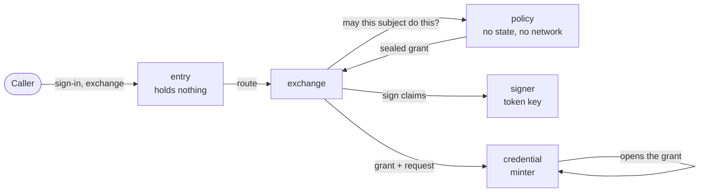

sluis is not one program. An **actor** is a process with one responsibility, and it declares the [ports](/concepts/drivers/) it requires. The actor is the unit of least privilege: its own OS user and systemd unit on bare metal, its own function on serverless, its own container on Kubernetes. What it may touch is written once, in its [permission manifest](/architecture/), and generated into IAM policies, key policies, driver access lists, systemd units and network rules. A compromise of one actor gives the attacker that actor's credentials and nothing else. The record is [ADR 0003](/decisions/0003-core-actors-with-one-responsibility-each/).

The set of actors is the same on every runtime. What runs where, what each actor holds and what it calls is tabled in [Components](/architecture/components/).

## The core actors

| Actor | Responsibility | Holds |
|---|---|---|
| `entry` | Parses each request, validates it against closed parameter lists generated from the contracts, and routes it to the actor that owns the step. It sits behind the edge connector | **Nothing**: no key, no secret, no state, no outbound network |
| `session` | Sign-in, session records, the session cookie and freshness per boundary (step-up) | The cookie-sealing key, behind the keys port |
| `console` | The operator API, as the browser's backend. It checks the operator's delegation and routes each write to the actor that owns the record kind | No key |
| `exchange` | Token exchange ([RFC 8693](https://datatracker.ietf.org/doc/html/rfc8693)), enrolment and the verifiers of proofs ([Identity](/concepts/identity/)) | Verifier drivers, which hold public material only |
| `signer` | Signs tokens under a signing policy. It is not a pure signing oracle | The token-signing key |
| `policy` | The decision point: a declared Cedar policy maps facts to grants. No state and no network | Use of the sealing key, to seal grants only |
| `ca` | The X.509 certificate authority | The X.509 CA intermediate |
| `ssh-ca` | The SSH certificate authority, separate from `ca` because it is a different authority | The `ssh-user` and `ssh-host` CA keys |

`signer`, `policy`, `ca` and `ssh-ca` run per [boundary](/concepts/boundaries/), and each boundary installation runs its own slim `entry`.

## The other actors

| Actor | Responsibility |
|---|---|
| `key-holder` | The one mediating driver: it fronts a node's card, gives each caller its own socket and has the card to itself ([Ports and drivers](/concepts/drivers/)) |
| `sluis-node` | The node agent on a self-hosted node: it issues each actor its workload token ([Identity](/concepts/identity/#how-an-actor-reaches-a-cloud)) |
| `writer` | Seals audit records into batches and writes them to the log store; it asks `key-holder` to sign checkpoints |
| `witness` | Co-signs the checkpoints it has seen; optional |
| `indexer` | Builds the search index from the log store |
| `reader` | Serves audit queries from the index, and audits every read |
| `quota` | The engine of the Quota piece: rate limits, caps and metering, beside sluis or on its own ([ADR 0017](/decisions/0017-audit-records-the-usage-stream-and-quota/#quota)) |
| Integration actors | Upstream, facts source, credential minter, provisioner and notifier: one process per vendor tenant and credential ([Integrations](/integrations/)) |

The audit actors and their pieces are explained on [Audit](/concepts/audit/). The verifiers of proofs are not actors: they are verifier drivers of `exchange`.

## Naming

Every actor instance is named **`<actor>@<boundary>`**, and the name is generated from the manifest. The [boundary](/concepts/boundaries/) is an environment such as `prod`, a company or a product. The same name appears in every layer, so a unit, a role, a key alias and an audit record match without a lookup table:

| Layer | Example for `ca@prod` |
|---|---|
| systemd unit | `sluis-ca@prod.service` |
| Unix user | `sluis-ca-prod` |
| Socket | `/run/sluis/ca/prod.sock` |
| Lambda function and IAM role | `sluis-ca-prod` |
| Kubernetes container and ServiceAccount | `ca-prod` |
| KMS alias | `alias/sluis/prod/ca/<purpose>` |
| State prefix | `prod/ca/…` |
| Lease name, audit field | `actor=ca@prod` |
| SPIFFE ID | `spiffe://prod.<td>/sluis/ca` |

**Integrations are named `<vendor>[-<capability>]@<tenant>`, one per credential.** A vendor whose sign-in and directory use different credentials is two integrations, `google-signin@<company>` and `google-directory@<company>`. Others are `github@<org>`, `slack@<workspace>`, `cloudflare@<company>` and `aws-minter@<org>`; `oidc@<name>` is the generic OIDC upstream.

## Who holds which key

Three actors use an authority key, each a different one: `signer`, `ca` and `ssh-ca`. `policy` holds no signing key. The audit `writer` never holds the log key: `key-holder`'s access list, or on AWS the key policy, lets only the writer use it.

`entry`, which faces the internet, holds nothing. It is the only actor with a listener toward the edge; every other actor listens on Unix sockets only ([ADR 0004](/decisions/0004-drivers-listeners-and-boundary-enforcement/#listeners)). It is written in a memory-safe language, parses only closed parameter lists, is fuzzed, loads no plugin and runs on a read-only file system.

**A copied token is useless.** Tokens are sender-constrained (DPoP or mutual TLS) and authorization codes are bound by PKCE, so a token or a code read off the wire cannot be used by anyone else.

**The console.** The browser holds no token: its session is an HttpOnly cookie that `session` seals. `console` routes each operator-set write to the actor that owns the record kind, and the owner's state credentials refuse any other writer ([Data and secrets](/concepts/data/)).

## Why the signer and the policy are separate

In v1 the issuer is one function that serves sign-in, token exchange and minting, and touches 25 resources: too broad for least privilege. v2 splits it:

- `entry` parses and routes and holds nothing, so a bug in request parsing reaches no key, no secret and no record.
- `exchange` and `session` own the protocol state, and ask `policy` before anything is issued.
- `signer` signs only what its signing policy allows, so a compromised `entry` or `exchange` cannot ask it for an arbitrary token.
- `policy` decides. It has no state and no network, so it cannot be made to read or send anything. Its output is a **grant** sealed under the sealing key of its environment, and a minter acts only on a grant it can open under the context `purpose=grant`.

To obtain a credential, an attacker needs a grant that `policy` sealed **and** a minter that accepts it; to forge a token, `signer` **and** its signing policy must agree.

`policy` is written in Rust with the `cedar-policy` crate; each executable's language follows the rules of [ADR 0014](/decisions/0014-the-language-follows-the-executable/).

## The fusion rule

On a small node memory is tight, so two actors may be **fused** into one unit when the rule allows it ([Board capacity](/runtimes/bare-metal/#board-capacity) has the measurements):

> Two actors may share a unit only if the unit's manifest is the union of theirs, and no unit holds a key next to an unauthenticated listener.

Fusion never grants an actor something it did not already have, and keeps every key holder away from `entry`. Small actors that hold no key and have no listener, such as `quota`, can share a unit on a board. The rule is tested: a configuration that breaks it fails the build. On Kubernetes the unit is the container, and a generated check fails the build when a container that holds a key credential exposes a listener ([ADR 0018](/decisions/0018-runtimes-installations-and-delivery-order/#kubernetes)).

## Where an actor runs is derived

No table says where each actor runs. Placement follows from the ports an actor requires and the drivers behind them, and `sluis config check` enforces it ([ADR 0002](/decisions/0002-the-design-model-actors-ports-drivers-and-contracts/#placement-is-derived)):

- An actor runs where all its required ports are reachable; its drivers run beside it and are spoken to over a Unix socket.
- A driver's requirements move the actor: a `yubikey-piv` keys driver puts `signer`, `policy`, `ca` and `ssh-ca` on a node with a card, and is refused on serverless.
- Some actors declare **instances: exactly 1**: the audit writer of each log, the facts-source reconciler and the indexer. With more than one node, or elastic nodes, such an actor needs the lease port, so a stale holder is refused by its fencing token.

## Actors on every runtime

| Runtime | An actor is |
|---|---|
| Bare-metal (a board, a cluster of boards, a virtual machine, local Docker) | An instance of the systemd template unit `sluis-<actor>@<boundary>` with its own OS user, or a container under local Docker Compose |
| Serverless | One function per actor |
| Kubernetes | A container with its own user id and token audience; a pod holds several actors, each integration has a pod of its own, and audit is a separate audit installation ([ADR 0018](/decisions/0018-runtimes-installations-and-delivery-order/#kubernetes)) |

See [Runtimes](/runtimes/) for each runtime and the tested installations.
