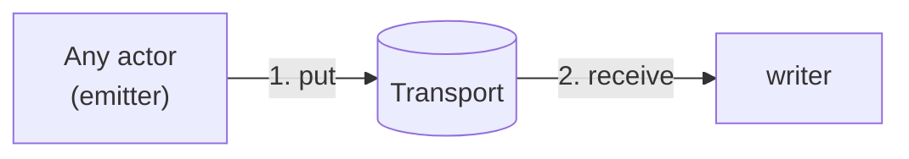
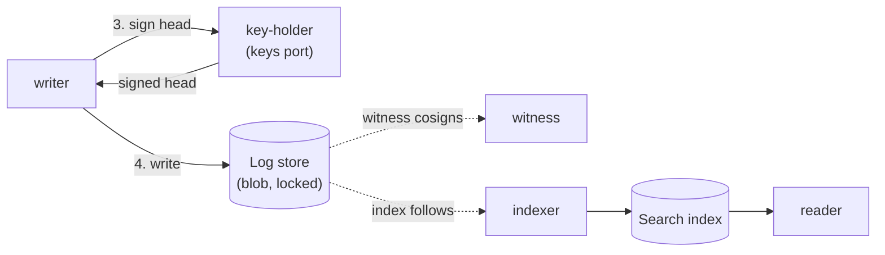

sluis writes a tamper-evident audit trail. This page explains the ideas. The actors, sockets and failure cases, installation by installation, are in the [audit explorer](/architecture/audit-explorer/).

## What is audited

**Every success is audited.** When an actor does something for a caller, such as issuing a token, minting a credential or changing a record, it appends an audit record. Every actor is therefore a producer.

**What was used goes to a usage log beside it.** An action that uses something, such as a metered call or a quota top-up, sends one message with an audit part and a usage part, and the writer puts each part into its own log. See [Records](#records-ocsf-events-with-a-sluis-extension-and-a-usage-stream).

## The four pieces

Audit is built from the same [ports and drivers](/concepts/drivers/) as the rest of sluis. It defines only one port of its own, the witness. It is made of **four separate pieces**. This is agreed ([OD-37](/open-decisions/#od-37) and [OD-38](/open-decisions/#od-38)).

| Piece | What it is | Ports it uses |
|---|---|---|
| **Emitter** | A library inside each end application, configured by that application. It is not a process. It appends the record | **transport**, as a producer |
| **Log** | The **writer**, the **blob** and the **witness**. The writer receives records, validates and de-duplicates them, groups them into sealed batches and writes them to the log store, as two log kinds: the audit log and the usage log. The log store is a blob with a lock mode. The witness co-signs batch heads, so that a single party cannot rewrite history | transport (as the receiver), blob, keys, witness, optionally lease |
| **Search** | The **indexer**, the **index** and the **reader**. The indexer builds the search index from the log store, and the reader serves queries | **index**, **blob** |
| **Quota** | The **quota engine** and its **state**. Quota state is `state` with compare-and-set | **state** (with compare-and-set) |

The audit actors are the **writer**, the **witness**, the **indexer** and the **reader**. There is no notary actor (agreed, [OD-39](/open-decisions/#od-39)): the writer asks `key-holder` to sign each batch head, and `key-holder`'s access list lets only the writer use the log key.

The **transport** is a port, not a piece. It is how a record gets from the emitter to the writer: direct, or through a queue. It replaces the older queue port and "outbox". A writer that runs on the same node as sluis is one installation's placement, not part of the model.

**Each piece can be its own installation.** When pieces are combined in one installation, even with sluis, they **share driver instances**. Quota is therefore a separate piece that can be combined with sluis. A combined installation does not run a second copy of a driver for each piece. Where each piece's actors run is derived from the port and driver rules, see [Where an actor runs is derived](/concepts/drivers/#where-an-actor-runs-is-derived).

## From record to trail

A record goes through four steps, and each step is done by a different actor.

The first two steps get the record to the writer.

The last two steps sign the batch head and archive the batch. The witness and the search index follow the chain.

1. **Transport.** An actor hands the record to the **transport** and carries on. In **queue** mode it returns to its caller once the record is durable in the queue, and never waits for the writer, the log store or the index. If the writer is down for an hour, requests still succeed and records queue. In **direct** mode the emitter streams the record to the writer; when the writer is down, the emitter falls back to a local spool (see [The transport](#the-transport)).
2. **Sealed batches.** The writer takes records from the transport, validates and de-duplicates them, and groups them into an ordered **batch**. A batch is sealed at **256 records or 5 seconds** after its first record, whichever comes first, and an empty batch is never sealed. Each batch ends with a **seal entry** that records its count, the writer instance and the observed clock offset, inside the tree, so the witnesses cosign it ([ADR 0021](/decisions/0021-the-audit-log-is-sealed-batches-in-a-blob-with-a-lock-mode/)).
3. **The signed head and the hash chain.** The writer asks `key-holder` to sign the batch head with the log key. It never holds the key itself, and `key-holder`'s access list lets only the writer use the log key. The signature on a head that includes the previous signed head forms a **hash chain**: removing, reordering or altering a batch breaks every head after it. On AWS the same job is done by the key policy: it names the writer's role and no other.
4. **Log store.** The batch is written to the blob store, with the lock mode that its blob driver gives. The log store is a `blob` whose lock mode matters: the `s3-compatible` driver locks in compliance mode on AWS S3 and in a mode that an account administrator can remove on Cloudflare R2, which is also the boards' blob store; Garage (a later backend) and `fs` have no lock at all, so tamper evidence there depends on witnesses. Every batch object is created with `If-None-Match: *`, so an object that exists is never written again. See [capability flags](/concepts/drivers/#capability-flags).

The **witness** co-signs batch heads it has seen, so that the writer alone cannot choose which history an auditor sees. It is optional (see [The witness is optional](#the-witness-is-optional)).

**Duplicates and blocking emits.** Delivery is at least once. Each record carries a UUIDv7 id (RFC 9562) set by the emitter, and the writer remembers ids for 14 days, the longest retention of a supported queue; a record older than that is quarantined and reported, not written, until an operator releases it. Credential and administrative changes use a **blocking emit**, which returns once the record is durable in the transport: accepted by the queue, acknowledged by the writer, or fsync'd to the spool. If that fails, the change fails ([ADR 0021](/decisions/0021-the-audit-log-is-sealed-batches-in-a-blob-with-a-lock-mode/)).

## Exactly one writer per log

The rule is **exactly one writer per log**, not one per installation. A log is the ordered sequence of batches with one log key. The writer declares **instances: exactly 1**, so when an installation has more than one node, or elastic nodes, it needs the lease port.

**The writer is fenced by the blob store itself.** A batch object is created only if it does not exist yet (`If-None-Match: *`), so a second writer that believes it holds the log cannot overwrite a batch or fork the log: its create fails. The lease, where one is needed, lives on the state store with a fencing token ([Data](/concepts/data/#leases-and-fencing-tokens)).

**On serverless the writer runs with a reserved concurrency of 1 on a standard SQS queue** (decided 2026-10-30). An event source mapping starts at a concurrency of 2, so the limit throttles it, and throttled messages return to the queue. Correctness comes from the create-if-absent fence, not from the limit. The cost of the throttling is measured at the Lambda step ([ADR 0029](/decisions/0029-one-repository-one-version-one-release-train-and-packaging-follows-the-runtime/)).

**A cluster keeps one log per node.** Each node has its own writer, its own spool and its own log key. The other nodes are that log's **peer witnesses**, which is the 2-of-3 co-signing on a three-node cluster. Readers merge the logs by the time each record was recorded, keeping each log's own order, and claim no order across logs closer than the clock offsets the seals record. No writer reads another node's spool, so there is nothing to elect and **no writer lease is needed**, and when one node is down the other nodes keep writing their own logs.

| Installation | Log key | Witness |
|---|---|---|
| [local](/runtimes/installations/#local) | A software key, or the host's YubiKey through `key-holder` | None |
| [boards](/runtimes/installations/#boards) | Each node's own YubiKey signs for that node's log, through the shared `key-holder` | The other two nodes, as `peer` witnesses |
| [lambda](/runtimes/installations/#lambda) | One KMS `ECC_NIST_P384` key whose key policy names the writer function's role only | None by default; `external` is possible |
| [kubernetes](/runtimes/installations/#kubernetes) | A KMS key per log, named in the writer's ServiceAccount role | None by default; a `peer` witness is not independent within one cluster |

A key per log is a consequence of the rule. KMS `Sign` takes no encryption context, and IAM cannot restrict which message gets signed, so "only the writer may sign this log" can only be expressed as a key policy on a key that exists for that one log.

## The transport

The transport has two modes and several drivers:

| Mode | Drivers | How the record travels |
|---|---|---|
| **direct** | `direct-unix` (the writer on the same host), `direct-mtls` | The emitter streams the record to the writer. |
| **queue** | `spool` (a local fsync'd spool), `sqs`, `nats-jetstream` | The emitter puts the record into a queue; the writer receives it and acknowledges it. The record is durable in the queue. |

The installation defaults stay as they are ([OD-34](/open-decisions/#od-34)): the spool on bare-metal installations such as boards, and SQS on serverless and on Kubernetes ([OD-22](/open-decisions/#od-22)). `direct` and `nats-jetstream` are supported drivers with no installation default; where NATS JetStream fits is a choice of the installation. Cloudflare Queues was considered and is not a transport driver.

**The emitter is authenticated by the transport's own layer.** Each transport driver checks the producer with the platform's means, which is the second layer of [defence in depth](/concepts/drivers/#defence-in-depth):

| Driver | How the producer is authenticated |
|---|---|
| `direct-unix` | The peer uid, read by the writer |
| `direct-mtls` | The SPIFFE ID in the client certificate |
| `spool` | A spool directory per producer uid |
| `sqs` | A queue policy per sender role, and a queue per boundary |
| `nats-jetstream` | NATS accounts and permission templates: an operator per environment, an account per tenant namespace, the company as an account tag, the user `<actor>@<boundary>`, and the subjects `sluis.audit.{{tag(boundary)}}.{{tag(actor)}}.>` |

**sluis's own audit does not go through NATS by default.** NATS JetStream is a supported transport, and sluis can issue the NATS credentials that put it to use (as the NATS auth callout, or as user JWTs issued through `sluis agent`, both later and on Kubernetes), but the default transports stay the spool and SQS.

**Direct mode falls back to a local spool when the writer is down** ([OD-35](/open-decisions/#od-35)). The emitter keeps the record on its own disk and replays it when the writer returns. The consequence is that direct mode needs a disk, so it is not available on serverless, which fits the [compatibility table](/concepts/drivers/#which-drivers-fit-which-runtime). An in-memory buffer is not offered, because it would lose records.

## Audit is its own installation

**Audit is its own installation**, connected to sluis over the network, and sluis emits over a direct stream or a queue through the transport port ([OD-31](/open-decisions/#od-31), decided 2026-10-30). The actors are decided (no notary), and an emitter is authenticated by the transport driver's own layer (above). The points that refine it are decided too: [OD-32](/open-decisions/#od-32) (placement is derived), [OD-33](/open-decisions/#od-33) (quota metering and enforcement), [OD-34](/open-decisions/#od-34) to [OD-36](/open-decisions/#od-36) (the transport defaults, direct mode, and the optional witness), [OD-37](/open-decisions/#od-37) and [OD-38](/open-decisions/#od-38) (the four pieces) and [OD-39](/open-decisions/#od-39) (the audit actors).

- **The co-located profile** for a small install shares the installation's driver instances, as combined pieces do ([OD-37](/open-decisions/#od-37)). The defence-in-depth layers stay per actor, unchanged: each audit actor still has its own scope, its own backend identity and, at L3 and above, its own store ([Defence in depth](/concepts/drivers/#defence-in-depth)).
- **Every audit installation has its own front** ([OD-26](/open-decisions/#od-26), [ADR 0062](/decisions/0062-audit-front-is-a-slim-entry-the-reader-as-its-api-and-a-console-of-its-own/)): a slim router `entry`, the API, which is the `reader`, and a console of its own. See [The audit front](#the-audit-front).
- **On the boards the log lives on R2 in the first release.** R2's lock can be removed by an account administrator (lock mode `removable`), so the peer witnesses carry the log's tamper evidence. Garage, a blob store on the boards themselves, is a later backend, blocked upstream on conditional writes and prefix-scoped keys ([issue #982](https://github.com/truvity/sluis/issues/982), [Ports and drivers](/concepts/drivers/#garage)). With Garage comes an **hourly job** of the audit installation, a timer and not the writer, that copies new log objects to R2, create-if-absent, so that the writer never touches R2 and an R2 outage delays the copy, never the log ([ADR 0021](/decisions/0021-the-audit-log-is-sealed-batches-in-a-blob-with-a-lock-mode/), [issue #984](https://github.com/truvity/sluis/issues/984)).

## The formats are the C2SP ones

sluis follows published specifications and invents no format for the log (agreed).

- **Checkpoints** are C2SP `signed-note` documents in the `tlog-checkpoint` shape, signed with the P-384 log key (signature type `0x02`). A checkpoint names the size of the log and its root hash.
- **The log** is laid out as `tlog-tiles`: static objects in the blob store that anyone can read without a server.
- **A witness** signs with the `tlog-cosignature` format, using an Ed25519 or ML-DSA-44 key, and is asked to do so with the `tlog-witness` protocol. This is what the `peer` and `external` witness drivers speak.
- **The `ca` actor** logs every X.509 certificate it issues in a C2SP `static-ct-api` log, which is witnessed in the same way.
- **`mtc-tlog`** is adopted later, when Merkle Tree Certificates arrive, with the post-quantum track (parked).

The rows are in the [standards register](/standards/#transparency-and-audit). A record's hash is computed over its canonical JSON form (RFC 8785).

**The layout.** Each log has one prefix, `<kind>/<boundary>/<log>/` with `<kind>` either `audit` or `usage`, and the `tlog-tiles` paths below it; the usage log may also have a bucket of its own. Every checkpoint is also written once to `checkpoints/<size>`, create-if-absent, so the full checkpoint history survives on a store with no versioning; the `checkpoint` object that the format rewrites is a convenience pointer. Catalogues and schemas are written once below `<kind>/<boundary>/catalogue/`, and a schema entry in the log names the ones in force, so witnesses cosign them. A checkpoint's origin line is `<installation host>/<kind>/<boundary>/<log>` ([ADR 0021](/decisions/0021-the-audit-log-is-sealed-batches-in-a-blob-with-a-lock-mode/)).

## Records: OCSF events with a sluis extension, and a usage stream

The record formats follow published standards too ([ADR 0064](/decisions/0064-audit-records-are-ocsf-events-with-a-sluis-extension-and-usage-is-a-separate-stream/), decided 2026-11-01; the log itself is [ADR 0021](/decisions/0021-the-audit-log-is-sealed-batches-in-a-blob-with-a-lock-mode/)).

**An audit record is an OCSF event of a pinned version, with a sluis extension.** It uses OCSF's core classes, such as Authentication for a sign-in, a token grant or an issued certificate, Authorize Session for a grant of scopes, User Management for an issued credential, Entity Management for a console write or a key's life, and API Activity for a quota call, a key use or an audit search or export. The first release pins OCSF 1.9.0. Where OCSF has no activity for an action, the record uses activity 99 (`Other`), and `metadata.event_code` names the action. The sluis action is `metadata.event_code`, the company `metadata.tenant_uid`, the record id `metadata.uid`, and the actor `actor.user.uid = <actor>@<boundary>`.

**The extension is named `sluis` and is a profile, `sluis/audit`,** that adds one attribute, `sluis`, to the classes the catalogue uses. Every record declares the profile in `metadata.profiles` and the extension in `metadata.extensions`. It holds only what OCSF lacks:

| What | Where |
|---|---|
| The boundary and the catalogue version | `sluis.boundary` and `sluis.catalogue` |
| The sender binding of a token (DPoP or mTLS) | `sluis.sender_binding` |
| The kind and algorithm of a key | `sluis.key` (the key's id is a core resource or entity) |
| A configuration digest and revision | `sluis.config` |
| The proof given at enrolment | `sluis.enrolment` |
| The grant and the scopes | OCSF's `policy` and `authorizations` objects, with the grant id; the grant record's `privileges[]` |
| Certificate details | OCSF's `certificate` object, on Authentication |
| The trace id | `metadata.correlation_uid` |
| Data origin and sensitivity | The catalogue entry that `metadata.event_code` names |

- **The same bytes end to end.** The emitter writes the record as RFC 8785 canonical JSON; the transport carries those bytes, the writer checks they are canonical and stores them unchanged, and the reader returns them as they are. Nothing re-encodes a record. Numbers are integers within ±(2^53−1), and a larger identifier is a string.
- **The OCSF version is pinned per release** and named in every record (`metadata.version`); its compiled schema, with the extension, is stored in the log. An upgrade moves one OCSF minor release at a time, as a checked pull request, and old records are never rewritten.
- **The stored form is lean,** ids only. An export adds the enum captions, the `observables` and an integrity attestation that points back to the log entry, and is written as NDJSON.
- **Validation in three places.** The writer enforces the catalogue's JSON Schema, generated from the compiled OCSF schema, and stays authoritative. Go and Rust emitters validate their own entries before they emit. The OCSF toolkit, still pre-1.0, runs in CI only, with the validators of all three languages on the same test vectors.
- **sluis generates its own types** for Go, Rust and TypeScript from the compiled OCSF schema, for the classes the catalogue uses.

**The usage stream holds what was used,** as CloudEvents 1.0 events in structured JSON, canonical by RFC 8785, shaped like OpenMeter's usage events: the `type` selects a meter, the `subject` is the account, and `data` holds the unit, an integer amount with its sign, the request id and the subject's pseudonym. Its `id` is the audit record's id with the position of the event in the message.

- **One call, one message, two logs.** The emitter builds the audit record and the usage events from one call, and sends one message. The writer splits it, and registers both logs' sealed batches in one atomic state batch with the duplicate ids, so the two logs never disagree. There is no dual write, no second writer, and no way to emit a usage event without its audit record.
- **Each kind is a log of its own:** its own prefix or bucket, log key, checkpoints, retention, lock mode, readers and off-site copy. Every rule on this page holds for each kind. Witnesses cosign both, and usage entries are encrypted per company like audit entries.
- **Quota and finance read it,** and only quota writes balance effects into it. The usage log has no search index. The finance export is a table derived from it, in the style of FinOps FOCUS.

The standards are on the [register](/standards/#transparency-and-audit). The class of each action is listed in [ADR 0064](/decisions/0064-audit-records-are-ocsf-events-with-a-sluis-extension-and-usage-is-a-separate-stream/#the-class-mapping).

## The witness is optional

The witness port is where an independent party co-signs a head. `peer` lets the nodes of a cluster witness one another; `external` lets a party outside the installation do it; `none` is a single signer.

A witness is **optional everywhere** ([OD-36](/open-decisions/#od-36)). `sluis config check` warns when an installation has none. In production, a log without a compliance lock needs one (see [Lock modes, retention and legal holds](#lock-modes-retention-and-legal-holds)).

**The cadence.** The writer asks every witness to cosign each new checkpoint, at most once per witness every 5 seconds. When the log is idle, it asks again for the latest checkpoint every 5 minutes, so a reader can tell a quiet log from a writer that stopped publishing ([ADR 0021](/decisions/0021-the-audit-log-is-sealed-batches-in-a-blob-with-a-lock-mode/)).

:::caution[The risk of no witness]
With no witness and no notary, a compromised writer can get a rewritten checkpoint signed: it asks `key-holder` for a signature over a history it changed, and nobody else has seen the old one. A compliance lock on `s3` still prevents overwriting objects that were already written, but it does not prevent a **split view**, in which the writer shows one history to one reader and another history to the next. Only a witness that has co-signed the original head can expose a split view. On R2 the lock can be removed by an account administrator, and on `fs` there is no lock, so there the witness is the only protection. An installation that runs without a witness accepts this risk.
:::

There is no separate notary to take this role (agreed, [OD-39](/open-decisions/#od-39)). The notary was a second actor that signed what the writer wrote. It is replaced by the access list of `key-holder` (or by the key policy on AWS), which lets only the writer use the log key, and by the witness for what the writer alone cannot prove.

## Lock modes, retention and legal holds

The lock mode comes from the blob backend: `compliance` on AWS S3, `removable` on Cloudflare R2, `none` on Garage (later) and on `fs` ([capability flags](/concepts/drivers/#capability-flags)). `sluis config check` reports it, and applies one rule ([ADR 0021](/decisions/0021-the-audit-log-is-sealed-batches-in-a-blob-with-a-lock-mode/)):

- **A production log needs a `compliance` lock, or a weaker lock mode plus a witness** (`peer` or `external`). The check refuses anything else in a production boundary, and warns in development and staging. The boards pass with their peer witnesses; a single-node production installation on `fs` needs an `external` witness.
- **Each log declares its retention, and a production log must.** There is no built-in default. A compliance store applies it as per-object retention, which can only be extended; R2 applies it as the bucket lock rule; Garage and `fs` use a lifecycle rule or an expiry sweeper, whose credential may delete expired objects only and is the one delete right on the log. A trial in governance mode before compliance is recommended, not enforced.
- **Legal holds stay outside sluis.** A hold is placed and lifted with the store's own means, under cloud IAM or a break-glass role, and recorded as an audit record under the name of the person who did it. sluis neither sets nor checks holds, so **nothing in sluis stops a company-key shred during a hold**: the shred procedure must check for a standing hold first, and on a store without a hold flag expiry has to be suspended for the held range by hand.

## Companies, encryption and erasure

There is one audit log per environment boundary, and each company is a reader tenant of it with its **own audit tenant key** ([ADR 0009](/decisions/0009-one-installation-per-boundary/)).

- **Each entry is an envelope in clear plus the record, encrypted with HPKE to the company's key.** The envelope holds the record id, its times, the company, the action class, the outcome and the actor kind, with OCSF field names, and the boundary is the log's; the record itself is encrypted with a data key per (company, batch), sealed to the company's public key, so the writer cannot read back what it wrote. A machine-plane record is encrypted to the boundary's own audit key. A usage entry has the same form and the same company key.
- **The tree hashes the whole entry, ciphertext included.** A company that leaves has its slice exported and its key crypto-shredded; its records stay in the log, still verifiable, and nobody can read them again.
- **The operator's own view of a company's records is the envelope:** the class, the outcome and rotating pseudonyms.
- **The erasure of one person is met by the pseudonym.** Records carry no names or e-mail addresses, and an external actor is a keyed pseudonym; the mapping from a pseudonym to the person lives outside the log, and erasure deletes it. There are no per-subject keys in 2.0.

## Search and Quota are separate pieces

Two of the four pieces sit next to the log, use the same ports, and are drawn as boxes of their own.

**Search** is the **indexer** (which builds the search index from the log store), the **search index** and the **reader** (which serves queries). It uses the `index` port and reads the log store as a blob. The indexer is an actor with **instances: exactly 1**, so on more than one node it needs the lease port. Where Search runs is not a decision of its own: it is derived from the port and driver rules ([OD-32](/open-decisions/#od-32), decided). With a `sqlite` index on a cluster, for example, the reader runs on the indexer's node. See [Where an actor runs is derived](/concepts/drivers/#where-an-actor-runs-is-derived).

**Quota** is the **quota engine** and **quota state**. Quota state is `state` with compare-and-set, shared with the rest of sluis. Quota **meters by default and enforces per policy rule**, for chosen subjects or audiences ([OD-33](/open-decisions/#od-33), decided). Metering counts use. Enforcement refuses an operation over a cap, and it needs `state` with compare-and-set on the mint path. The earlier decision that strict quota comes only after the k6 load test still applies to turning enforcement on in production.

Quota's API is decided in [ADR 0023](/decisions/0023-quotas-api-is-idempotent-and-its-data-follows-the-origin-model/):

- **Every call that changes something is idempotent** by a canonical `request_id` field, which `entry` also fills from an `Idempotency-Key` header. An id is scoped to the calling client and the method and remembered for 24 hours, and rebuilt from the log after a restore.
- **`Admit` reserves an amount with a time to live** (declared per rule, 5 minutes by default), `Confirm` settles the actual amount, `Cancel` releases it, and an expired reservation is released and counted as expired.
- **`TopUp` takes positive amounts only,** from declared clients; corrections and refunds are an `Adjust` call with a reason, and a refund names the event it refunds and cannot exceed it.
- **Amounts are signed 64-bit integers** in a declared unit. A balance belongs to a declared **account** in a boundary and company. Balance effects live in the usage log, and only quota writes them; an application's usage events carry meters only. Quota rolls its balances forward from the usage log, and derives its meters and the FOCUS-style finance export from it.
- **A limit is a rate** (a token bucket per second or minute) **or a cap per calendar day or month in UTC.** Enforcement is strict only in 2.0, and an enforcing rule must declare what happens when its balance runs out and when quota is unreachable: there is no default.

## The search index lags the chain

The `reader` serves queries from a **search index**, which is a search view of the batches. The index is a convenience. It follows the signed checkpoints of each log and lags them by a few seconds, and it can always be rebuilt from the log ([ADR 0022](/decisions/0022-search-is-an-index-fed-from-the-log-and-the-index-is-one-driver-with-provisioning-modes/)). The default index of each tested installation is `sqlite` on local, `rqlite` on the boards (so that the reader can run on any node; the board spike confirms it, with `sqlite` as the fallback), `postgres` on Aurora on lambda, and `postgres` in the `cnpg` mode on Kubernetes. `postgres` also takes any connection string (`external`), and with `none (scan)` there is no index and queries scan the log store. Serverless functions reach Postgres through RDS Proxy with IAM authentication, one database role per actor kind. See [The postgres index driver](/concepts/drivers/#the-postgres-index-driver).

**What the index holds.** Fixed columns for the core fields (time, log, boundary, company, action, outcome, actor, subject pseudonym, target, request id, trace id), mapped from OCSF paths such as `metadata.event_code`, `status_id` and `actor.user.uid`; a typed attribute table for what the catalogue marks filterable or facetable; the record once; and one full-text table over what the catalogue marks searchable. Full text is word search without stemming, the same on every driver. There is one index per boundary with a company column: the indexer is a declared reader of each company's key, the reader filters every query by the caller's grant, and a shred purges that company's rows. A rebuild builds a new generation beside the serving one and switches to it atomically.

**What the reader offers.** Search with a closed filter grammar and free text, facets, a get that returns a record with its inclusion proof against a cosigned checkpoint, exports as NDJSON of enriched OCSF events behind a short-lived signed URL, and a tail as a repeated search; all unary Connect calls. Every call is authorised by a grant from `policy`, which becomes a mandatory filter of the query, and every read is itself audited. A small install can run `sluis audit search` from the CLI, which builds a local `sqlite` index from the chain. The index is a rebuildable cache; the chain in the bucket is the record.

**Verification never trusts the index, or the state store.** To check the trail, a verifier reads the batches from the log store, the signed heads and any witness co-signatures, and recomputes the chain itself. If the index or the state store has been tampered with, verification still passes or fails by what the log store and the signatures say. The state store may sit on the write path, because the transport and a reconciler that compares the log store's listing with the batch sequence recover from its loss, and because verification does not depend on it.

## The audit front

Every audit installation has a front of its own, also when the audit pieces are combined with sluis ([ADR 0062](/decisions/0062-audit-front-is-a-slim-entry-the-reader-as-its-api-and-a-console-of-its-own/), [issue #985](https://github.com/truvity/sluis/issues/985)):

- **A slim `entry` of its own, on its own host.** It is the same executable as sluis's, with the routes of the audit contracts, and it holds nothing. The host is a sibling of the boundary's host, `sluis-audit.<env>.example.com` beside `sluis.<env>.example.com`, so it inherits no cookie scope, and every passkey verifier's allow-list names it. A combined installation therefore has two fronts and two hosts.
- **The `reader` is the API.**
- **Its own `session` and `console` actors,** the same executables as sluis's. `session` is an OpenID Connect client of the environment's issuer and holds the browser session as an HttpOnly cookie; `console` routes the few writes, such as a rebuild of the index, to the actor that owns them. The front accepts only the issuer of the environment whose log it holds.
- **A console bundle of its own,** built on the same release train as the sluis console. It shows search, records with their proofs, exports, and the log's health: checkpoint age, witness cosignatures, index lag and the lag of the off-site copy. A company sees its own records, an operator the envelope, a reviewer what a grant names.
- **Another installation's console calls the audit front** with an exchanged token (RFC 8693) whose `aud` is the audit client id, valid for at most 5 minutes and bound to the console's X.509-SVID by mutual TLS.
- **Without the front,** `sluis audit verify` and `sluis audit read` work from the bucket alone with read-only cloud credentials; a payload decrypts only for a caller who may unwrap the company's key.

## Recovery does not block on audit

Recovery is the emergency way back in when normal sign-in cannot work. Its proof needs no Kubernetes: a hardware-token challenge or SRP.

Recovery also leaves an audit record, but it **spools that record locally and delivers it later instead of blocking** on the audit path. A down audit install cannot shut the emergency door. The record still exists and is delivered when the audit path is back.

The log itself is not part of the ordinary backup: see [Backup](/concepts/backup/#the-audit-log-is-handled-separately).

For the sockets, the failure table and the flow of a record in each installation, open the [audit explorer](/architecture/audit-explorer/).
