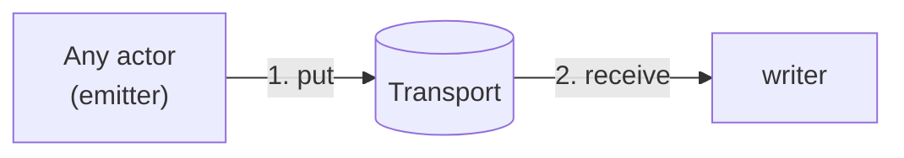
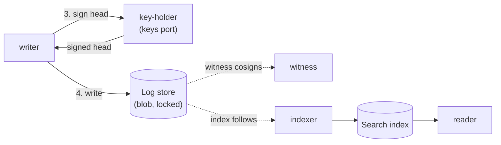

sluis writes a tamper-evident audit trail. This page explains the ideas. The actors, sockets and failure cases, installation by installation, are in the [audit explorer](/architecture/audit-explorer/).

## What is audited

**Every success is audited.** When an actor does something for a caller, such as issuing a token, minting a credential or changing a record, it appends an audit record. Every actor is therefore a producer.

## The four pieces

Audit is built from the same [ports and drivers](/concepts/drivers/) as the rest of sluis. It defines only one port of its own, the witness. It is made of **four separate pieces**. This is agreed ([OD-37](/open-decisions/#od-37) and [OD-38](/open-decisions/#od-38)).

| Piece | What it is | Ports it uses |
|---|---|---|
| **Emitter** | A library inside each end application, configured by that application. It is not a process. It appends the record | **transport**, as a producer |
| **Log** | The **writer**, the **blob** and the **witness**. The writer receives records, validates and de-duplicates them, groups them into sealed batches and writes them to the log store. The log store is a blob with a lock mode. The witness co-signs batch heads, so that a single party cannot rewrite history | transport (as the receiver), blob, keys, witness, optionally lease |
| **Search** | The **indexer**, the **index** and the **reader**. The indexer builds the search index from the log store, and the reader serves queries | **index**, **blob** |
| **Quota** | The **quota engine** and its **state**. Quota state is `state` with compare-and-set | **state** (with compare-and-set) |

The audit actors are the **writer**, the **witness**, the **indexer** and the **reader**. There is no notary actor (agreed, [OD-39](/open-decisions/#od-39)): the writer asks `key-holder` to sign each batch head, and `key-holder`'s access list lets only the writer use the log key.

The **transport** is a port, not a piece. It is how a record gets from the emitter to the writer: direct, or through a queue. It replaces the older queue port and "outbox". A writer that runs on the same node as sluis is one installation's placement, not part of the model.

**Each piece can be its own installation.** When pieces are combined in one installation, even with sluis, they **share driver instances**. Quota is therefore a separate piece that can be combined with sluis. A combined installation does not run a second copy of a driver for each piece. Where each piece's actors run is derived from the port and driver rules, see [Where an actor runs is derived](/concepts/drivers/#where-an-actor-runs-is-derived).

## From record to trail

A record goes through four steps, and each step is done by a different actor.

The first two steps get the record to the writer.

The last two steps sign the batch head and archive the batch. The witness and the search index follow the chain.

1. **Transport.** An actor hands the record to the **transport** and carries on. In **queue** mode it returns to its caller once the record is durable in the queue, and never waits for the writer, the log store or the index. If the writer is down for an hour, requests still succeed and records queue. In **direct** mode the emitter streams the record to the writer; when the writer is down, the emitter falls back to a local spool (see [The transport](#the-transport)).
2. **Sealed batches.** The writer takes records from the transport, validates and de-duplicates them, and groups them into an ordered **batch**. It closes the batch with a seal over its contents and the head of the previous batch.
3. **The signed head and the hash chain.** The writer asks `key-holder` to sign the batch head with the log key. It never holds the key itself, and `key-holder`'s access list lets only the writer use the log key. The signature on a head that includes the previous signed head forms a **hash chain**: removing, reordering or altering a batch breaks every head after it. On AWS the same job is done by the key policy: it names the writer's role and no other.
4. **Log store.** The batch is written to the blob store, with the lock mode that its blob driver gives. The log store is a `blob` whose lock mode matters: `s3` locks in compliance mode, `r2` locks in a mode that an account administrator can remove, and `fs` has no lock at all, so tamper evidence there depends on witnesses. See [capability flags](/concepts/drivers/#capability-flags).

The **witness** co-signs batch heads it has seen, so that the writer alone cannot choose which history an auditor sees. It is optional (see [The witness is optional](#the-witness-is-optional)).

## Exactly one writer per log

The rule is **exactly one writer per log**, not one per installation. A log is the ordered sequence of batches with one log key. The writer declares **instances: exactly 1**, so when an installation has more than one node, or elastic nodes, it needs the lease port (on serverless the platform's concurrency limit of 1 may stand in for it).

**A cluster keeps one log per node.** Each node has its own writer, its own spool and its own log key. The other nodes are that log's **peer witnesses**, which is the 2-of-3 co-signing on a three-node cluster. Readers merge the logs by time. No writer reads another node's spool, so there is nothing to elect, and when one node is down the other nodes keep writing their own logs.

| Installation | Log key | Witness |
|---|---|---|
| [local](/runtimes/installations/#local) | A software key, or the host's YubiKey through `key-holder` | None |
| [boards](/runtimes/installations/#boards) | Each node's own YubiKey signs for that node's log, through the shared `key-holder` | The other two nodes, as `peer` witnesses |
| [lambda](/runtimes/installations/#lambda) | One KMS `ECC_NIST_P384` key whose key policy names the writer function's role only | None by default; `external` is possible |
| [kubernetes](/runtimes/installations/#kubernetes) | A KMS key per log, named in the writer's ServiceAccount role | None by default; a `peer` witness is not independent within one cluster |

A key per log is a consequence of the rule. KMS `Sign` takes no encryption context, and IAM cannot restrict which message gets signed, so "only the writer may sign this log" can only be expressed as a key policy on a key that exists for that one log.

## The transport

The transport has two modes and several drivers:

| Mode | Drivers | How the record travels |
|---|---|---|
| **direct** | `direct-unix` (the writer on the same host), `direct-mtls` | The emitter streams the record to the writer. |
| **queue** | `spool` (a local fsync'd spool), `sqs`, `nats-jetstream` | The emitter puts the record into a queue; the writer receives it and acknowledges it. The record is durable in the queue. |

The installation defaults stay as they are ([OD-34](/open-decisions/#od-34)): the spool on bare-metal installations such as boards, and SQS on serverless and on Kubernetes ([OD-22](/open-decisions/#od-22)). `direct` and `nats-jetstream` are supported drivers with no installation default; where NATS JetStream fits is a choice of the installation. Cloudflare Queues was considered and is not a transport driver.

**Direct mode falls back to a local spool when the writer is down** ([OD-35](/open-decisions/#od-35)). The emitter keeps the record on its own disk and replays it when the writer returns. The consequence is that direct mode needs a disk, so it is not available on serverless, which fits the [compatibility table](/concepts/drivers/#which-drivers-fit-which-runtime). An in-memory buffer is not offered, because it would lose records.

:::caution[Open decision OD-31: Audit as a separate installation]
The audit side is being redesigned as its own installation, connected to sluis over the network. Open: the actors of the audit installation, how an emitter authenticates, and a co-located placement for a small install. The design is not settled. The lean is that audit is its own installation, and sluis emits over a direct stream or a queue through the transport port.

OD-31 is the existing audit split. The points that refine it are decided: [OD-32](/open-decisions/#od-32) (placement is derived), [OD-33](/open-decisions/#od-33) (quota metering and enforcement), [OD-34](/open-decisions/#od-34) to [OD-36](/open-decisions/#od-36) (the transport defaults, direct mode, and the optional witness), [OD-37](/open-decisions/#od-37) and [OD-38](/open-decisions/#od-38) (the four pieces) and [OD-39](/open-decisions/#od-39) (the audit actors).
:::

## The witness is optional

The witness port is where an independent party co-signs a head. `peer` lets the nodes of a cluster witness one another; `external` lets a party outside the installation do it; `none` is a single signer.

A witness is **optional everywhere** ([OD-36](/open-decisions/#od-36)). `sluis config check` warns when an installation has none.

:::caution[The risk of no witness]
With no witness and no notary, a compromised writer can get a rewritten checkpoint signed: it asks `key-holder` for a signature over a history it changed, and nobody else has seen the old one. A compliance lock on `s3` still prevents overwriting objects that were already written, but it does not prevent a **split view**, in which the writer shows one history to one reader and another history to the next. Only a witness that has co-signed the original head can expose a split view. On `r2` the lock can be removed by an account administrator, and on `fs` there is no lock, so there the witness is the only protection. An installation that runs without a witness accepts this risk.
:::

There is no separate notary to take this role (agreed, [OD-39](/open-decisions/#od-39)). The notary was a second actor that signed what the writer wrote. It is replaced by the access list of `key-holder` (or by the key policy on AWS), which lets only the writer use the log key, and by the witness for what the writer alone cannot prove.

## Search and Quota are separate pieces

Two of the four pieces sit next to the log, use the same ports, and are drawn as boxes of their own.

**Search** is the **indexer** (which builds the search index from the log store), the **search index** and the **reader** (which serves queries). It uses the `index` port and reads the log store as a blob. The indexer is an actor with **instances: exactly 1**, so on more than one node it needs the lease port. Where Search runs is not a decision of its own: it is derived from the port and driver rules ([OD-32](/open-decisions/#od-32), decided). With a `sqlite` index on a cluster, for example, the reader runs on the indexer's node. See [Where an actor runs is derived](/concepts/drivers/#where-an-actor-runs-is-derived).

**Quota** is the **quota engine** and **quota state**. Quota state is `state` with compare-and-set, shared with the rest of sluis. Quota **meters by default and enforces per policy rule**, for chosen subjects or audiences ([OD-33](/open-decisions/#od-33), decided). Metering counts use. Enforcement refuses an operation over a cap, and it needs `state` with compare-and-set on the mint path. The earlier decision that strict quota comes only after the k6 load test still applies to turning enforcement on in production.

## The search index lags the chain

The `reader` serves queries from a **search index**, which is a search view of the batches. The index is a convenience. It follows the chain and lags it, and it can always be rebuilt from the batches. On servers the `index` driver is `sqlite`; on a cluster of boards a replicated index on `rqlite` is proposed, so that the reader can run on any node (the full-text support has to be verified first); on Kubernetes it is `postgres` in the `cnpg` mode (proposed), or `postgres` with any connection string (`external`); with `none (scan)` there is no index and queries scan the log store. Serverless may run the indexer and the reader with a `postgres` index, through RDS Proxy (proposed) ([OD-12](/open-decisions/#od-12), revised). The default index of the lambda installation stays `none` (proposed), and a separate Search installation that reads the same bucket is another choice. See [The postgres index driver](/concepts/drivers/#the-postgres-index-driver). A small install can run `sluis audit search` from the CLI, which builds a local `sqlite` index from the chain. The index is a rebuildable cache; the chain in the bucket is the record.

**Verification never trusts the index, or the state store.** To check the trail, a verifier reads the batches from the log store, the signed heads and any witness co-signatures, and recomputes the chain itself. If the index or the state store has been tampered with, verification still passes or fails by what the log store and the signatures say. The state store may sit on the write path, because the transport and a reconciler that compares the log store's listing with the batch sequence recover from its loss, and because verification does not depend on it.

## Recovery does not block on audit

Recovery is the emergency way back in when normal sign-in cannot work. Its proof needs no Kubernetes: a hardware-token challenge or SRP.

Recovery also leaves an audit record, but it **spools that record locally and delivers it later instead of blocking** on the audit path. A down audit install cannot shut the emergency door. The record still exists and is delivered when the audit path is back.

The log itself is not part of the ordinary backup: see [Backup](/concepts/backup/#the-audit-log-is-handled-separately).

For the sockets, the failure table and the flow of a record in each installation, open the [audit explorer](/architecture/audit-explorer/).
