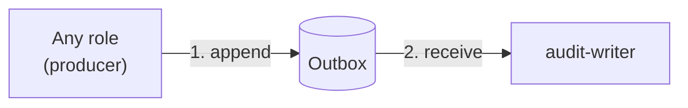
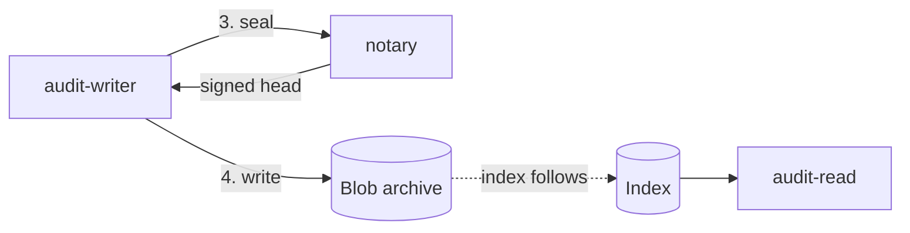

sluis writes a tamper-evident audit trail. This page explains the ideas. The roles, sockets and failure cases, shape by shape, are in the [audit explorer](/architecture/audit-explorer/).

## What is audited

**Every success is audited.** When a role does something for a caller, such as issuing a token, minting a credential or changing a record, it appends an audit record.

## From record to trail

A record goes through four steps, and each step is done by a different role.

The first two steps get the record to the writer.

The last two steps seal the batch and archive it. The index follows the chain.

Step 3 seals the batch and asks the notary for a signature on its head.

1. **Outbox.** A role appends the record to an **outbox** and carries on. It returns to its caller once the record is durable in the outbox, and never waits for the writer, the archive or the index. If the writer is down for an hour, requests still succeed and records queue.
2. **Sealed batches.** The `audit-writer` takes records from the outbox, validates and de-duplicates them, and groups them into an ordered **batch**. It closes the batch with a seal over its contents and the head of the previous batch. It holds no signing key.
3. **The notary and the hash chain.** The `audit-writer` asks the `notary` to sign the batch head. The notary's signature on a head that includes the previous signed head forms a **hash chain**: removing, reordering or altering a batch breaks every head after it. The notary holds a key that the writer does not, and the writer holds an archive credential that the notary does not, so a compromised writer cannot vouch for what it wrote and a compromised notary cannot write a record.
4. **Archive.** The batch is written to the blob store. Each shape stores it where its blob driver says.

The outbox is the port a role appends to; the driver behind it decides what "durable" means: a local fsync'd spool on servers, a queue on Lambda.

The audit outbox is a local spool on self-hosted shapes, co-signed in cluster mode, and an SQS queue on Lambda. On Kubernetes it is an SQS queue for now ([OD-22](/open-decisions/#od-22)).

:::caution[Open decision OD-31: Audit as a separate installation]
The audit side is being redesigned as its own installation, connected to sluis over the network. Open: the roles of the audit installation, the transport from emitters, how an emitter authenticates, and a co-located profile for a small install. The design is not settled. The lean is that audit is its own installation, and sluis emits over TCP or a queue through an outbox.
:::

On a cluster, each node's writer drains its own spool, and the notary co-signs batch heads 2 of 3 across the nodes. How the notary signs depends on the shape:

| Shape | Notary signing |
|---|---|
| T2 cluster of boards | Each node signs with its own YubiKey key, 2 of 3, with no separate notary YubiKey |
| T4 EC2 cluster | Each node has its own KMS `ECC_NIST_P384` signing key, co-signed 2 of 3. The node's key also signs that node's workload JWTs. A shared key cannot support co-signing, because KMS `Sign` takes no encryption context and IAM cannot restrict which message gets signed |
| T5 Lambda | A single notary key, used only by the notary function's role. There is no co-signing; the function role is the isolation |
| T1 single board and T3 EC2 single | One key. The residual risk, that root on the node can sign, is documented |
| T6 Kubernetes (proposed) | A dedicated notary with its own key, in the audit pod, with its own ServiceAccount and key policy. There is no co-signing across replicas. This is [OD-23](/open-decisions/#od-23) |

## The index lags the chain

The `audit-read` role serves queries from an **index**, which is a search view of the batches. The index is a convenience. It follows the chain and lags it, and it can always be rebuilt from the batches. On servers the index is `sqlite`; on Kubernetes it is `postgres`, with any connection string (for example CNPG). Lambda ships no index: `audit-read` and its index run in a separate audit install, on Kubernetes with Postgres or on a server with `sqlite`, that reads the same bucket. A small install can run `sluis audit search` from the CLI, which builds a local `sqlite` index from the chain. The index is a rebuildable cache; the chain in the bucket is the record.

**Verification never trusts the index, or the state store.** To check the trail, a verifier reads the batches from the archive and the notary's signatures, and recomputes the chain itself. If the index or the state store has been tampered with, verification still passes or fails by what the archive and the notary say. The state store may sit on the write path, because the outbox and a reconciler that compares the archive's listing with the batch sequence recover from its loss, and because verification does not depend on it.

## Recovery does not block on audit

Recovery is the emergency way back in when normal sign-in cannot work. Its proof needs no Kubernetes: a hardware-token challenge or SRP.

Recovery also leaves an audit record, but it **spools that record locally and delivers it later instead of blocking** on the audit path. A down audit install cannot shut the emergency door. The record still exists and is delivered when the audit path is back.

For the sockets, the failure table and the flow of a record on each shape, open the [audit explorer](/architecture/audit-explorer/).
