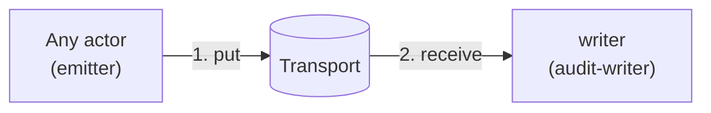
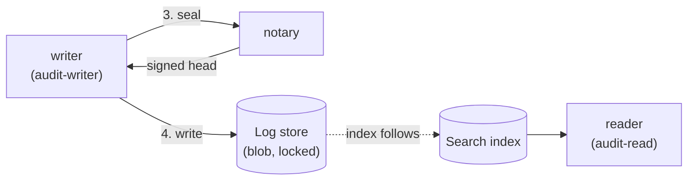

sluis writes a tamper-evident audit trail. This page explains the ideas. The actors, sockets and failure cases, preset by preset, are in the [audit explorer](/architecture/audit-explorer/).

## What is audited

**Every success is audited.** When an actor does something for a caller, such as issuing a token, minting a credential or changing a record, it appends an audit record. Every actor is therefore a producer.

## The parts

Audit is built from the same [ports and drivers](/concepts/drivers/) as the rest of sluis. It defines only one port of its own, the witness.

| Part | What it is | Port it uses |
|---|---|---|
| **Emitter** | A library inside every actor that appends the record | **transport**, as a producer |
| **Transport** | How a record gets from the emitter to the writer: direct, or through a queue | **transport** |
| **Writer** | Receives records, validates and de-duplicates them, groups them into sealed batches and writes them to the log store | transport (as the receiver), blob, keys, optionally lease and witness |
| **Log store** | Where sealed batches are kept. It is a **blob** with a lock mode | **blob** |
| **Witness** | Co-signs batch heads, so that a single party cannot rewrite history | **witness** |
| **Search** | The indexer, the search index and the reader. A separate box, see below | **index**, **blob** |
| **Quota** | The quota engine and its state. A separate box, see below | **state** (with compare-and-set) |

The emitter (a library) and the writer are decoupled by the **transport** port. This replaces the older queue port and "outbox". A writer that runs on the same node as sluis is one installation's placement, not part of the model.

:::note[Proposed]
Audit runs its own instances of the shared drivers, under its own identities, so that a compromised sluis actor cannot reach the log store, the witness or the search index through a driver of its own. Whether to separate the instances this way is [OD-37](/open-decisions/#od-37).
:::

## From record to trail

A record goes through four steps, and each step is done by a different actor.

The first two steps get the record to the writer.

The last two steps seal the batch and archive it. The search index follows the chain.

1. **Transport.** An actor hands the record to the **transport** and carries on. In **queue** mode it returns to its caller once the record is durable in the queue, and never waits for the writer, the log store or the index. If the writer is down for an hour, requests still succeed and records queue. In **direct** mode the emitter streams the record to the writer, and what happens when the writer is down is open: [OD-35](/open-decisions/#od-35).
2. **Sealed batches.** The writer takes records from the transport, validates and de-duplicates them, and groups them into an ordered **batch**. It closes the batch with a seal over its contents and the head of the previous batch. It holds no signing key.
3. **The notary and the hash chain.** The writer asks the `notary` to sign the batch head. The notary's signature on a head that includes the previous signed head forms a **hash chain**: removing, reordering or altering a batch breaks every head after it. The notary holds a key that the writer does not, and the writer holds a log-store credential that the notary does not, so a compromised writer cannot vouch for what it wrote and a compromised notary cannot write a record.
4. **Log store.** The batch is written to the blob store, with the lock mode that its blob driver gives. The log store is a `blob` whose lock mode matters: `s3` locks in compliance mode, `r2` locks in a mode that an account administrator can remove, and `fs` has no lock at all, so tamper evidence there depends on witnesses. See [capability flags](/concepts/drivers/#capability-flags).

:::note[Proposed]
The `notary`, `audit-writer` and `audit-read` actors are proposed to be replaced by a **writer**, an **indexer**, a **reader** and a **witness**, with the notary folded into the key-holder's access list or kept as a thin checker. The steps above do not change. See [Actors](/concepts/actors/) and [OD-39](/open-decisions/#od-39).
:::

### The transport

The transport has two modes and several drivers:

| Mode | Drivers | How the record travels |
|---|---|---|
| **direct** | `direct-unix` (the writer on the same host), `direct-mtls` | The emitter streams the record to the writer. The writer must be up. |
| **queue** | `spool` (a local fsync'd spool), `sqs`, `nats-jetstream` | The emitter puts the record into a queue; the writer receives it and acknowledges it. The record is durable in the queue. |

The default today is the spool on bare-metal presets, co-signed in cluster mode, and an SQS queue on serverless. On Kubernetes it is an SQS queue for now ([OD-22](/open-decisions/#od-22)). Which mode each preset uses, and where NATS JetStream fits (on clusters, or on Kubernetes instead of SQS), is [OD-34](/open-decisions/#od-34).

:::caution[Open decision OD-31: Audit as a separate installation]
The audit side is being redesigned as its own installation, connected to sluis over the network. Open: the actors of the audit installation, the transport from emitters, how an emitter authenticates, and a co-located placement for a small install. The design is not settled. The lean is that audit is its own installation, and sluis emits over a direct stream or a queue through the transport port.

OD-31 is the existing audit split. [OD-32](/open-decisions/#od-32) (where Search runs), [OD-33](/open-decisions/#od-33) (quota enforcement or metering), [OD-34](/open-decisions/#od-34) (transport per preset), [OD-35](/open-decisions/#od-35) (direct mode when the writer is down), [OD-36](/open-decisions/#od-36) (witness optional or required), [OD-37](/open-decisions/#od-37) (audit's driver instances), [OD-38](/open-decisions/#od-38) (quota as a product or an actor) and [OD-39](/open-decisions/#od-39) (the audit actors) refine it.
:::

On a cluster, each node's writer drains its own spool, and the notary co-signs batch heads 2 of 3 across the nodes. How the notary signs depends on the preset:

| Preset | Notary signing |
|---|---|
| T2 Board cluster | Each node signs with its own YubiKey key, 2 of 3, with no separate notary YubiKey |
| T4 EC2 cluster | Each node has its own KMS `ECC_NIST_P384` signing key, co-signed 2 of 3. The node's key also signs that node's workload JWTs. A shared key cannot support co-signing, because KMS `Sign` takes no encryption context and IAM cannot restrict which message gets signed |
| T5 AWS Lambda | A single notary key, used only by the notary function's role. There is no co-signing; the function role is the isolation |
| T1 Single board and T3 EC2 single | One key. The residual risk, that root on the node can sign, is documented |
| T6 Kubernetes (proposed) | A dedicated notary with its own key, in the audit pod, with its own ServiceAccount and key policy. There is no co-signing across replicas. This is [OD-23](/open-decisions/#od-23) |

:::note[Proposed]
The witness port is where an independent party co-signs a head. On a board cluster the `peer` witness would let the nodes witness one another; `external` would let a party outside the installation do it; `none` is a single signer. Whether a witness is optional or required is [OD-36](/open-decisions/#od-36).
:::

## Search and Quota are separate boxes

Two things sit next to audit, use the same ports, and are drawn as boxes of their own. Where each runs is open.

**Search** is the **indexer** (which builds the search index from the log store), the **search index** and the **reader** (which serves queries). It uses the `index` port and reads the log store as a blob. The indexer is an actor with **instances: exactly 1**, so on more than one node it needs the lease port. It is decided that Search does not run inside serverless. Where it runs otherwise (on the log host; on a separate host or Deployment; or nowhere, with the scan used instead) is [OD-32](/open-decisions/#od-32).

**Quota** is the **quota engine** and **quota state**. Quota state is `state` with compare-and-set, shared with the rest of sluis. Whether quota enforces a cap (which needs live state) or only meters (which can be a view derived from the log) is [OD-33](/open-decisions/#od-33). Whether quota is a separate product or an actor is [OD-38](/open-decisions/#od-38).

## The search index lags the chain

The `audit-read` actor serves queries from a **search index**, which is a search view of the batches. The index is a convenience. It follows the chain and lags it, and it can always be rebuilt from the batches. On servers the `index` driver is `sqlite`; on Kubernetes it is `postgres`, with any connection string (for example CNPG); with `none (scan)` there is no index and queries scan the log store. Serverless ships no index: `audit-read` and its index run in a separate audit install, on Kubernetes with Postgres or on a server with `sqlite`, that reads the same bucket. A small install can run `sluis audit search` from the CLI, which builds a local `sqlite` index from the chain. The index is a rebuildable cache; the chain in the bucket is the record.

**Verification never trusts the index, or the state store.** To check the trail, a verifier reads the batches from the log store and the notary's signatures, and recomputes the chain itself. If the index or the state store has been tampered with, verification still passes or fails by what the log store and the notary say. The state store may sit on the write path, because the transport and a reconciler that compares the log store's listing with the batch sequence recover from its loss, and because verification does not depend on it.

## Recovery does not block on audit

Recovery is the emergency way back in when normal sign-in cannot work. Its proof needs no Kubernetes: a hardware-token challenge or SRP.

Recovery also leaves an audit record, but it **spools that record locally and delivers it later instead of blocking** on the audit path. A down audit install cannot shut the emergency door. The record still exists and is delivered when the audit path is back.

For the sockets, the failure table and the flow of a record in each preset, open the [audit explorer](/architecture/audit-explorer/).
