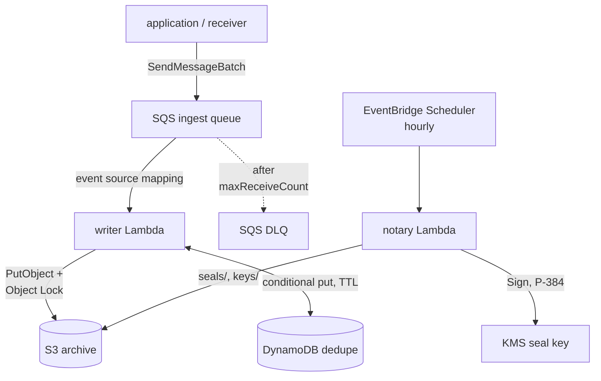

# How do the writer and notary run on AWS Lambda?

Audit runs on AWS without Kubernetes as two Lambda functions, an SQS queue before the writer, an S3 bucket and alarms. The Pulumi Go library `github.com/truvity/sluis/audit/deploy/pulumi` builds all of it. The estate makes the KMS keys, and the library looks them up by alias.

Tests use Pulumi mocks and LocalStack. No run in an account has happened, so [capabilities](../../reference/audit/capabilities.md) marks every AWS row 🧪.

## The shape

The writer cannot sign. The notary cannot write a record. Observe is the third [part](../../decisions/0058-three-parts-installed-independently.md); the library only creates its read role. Both functions send OTLP under their role.

Each function is a zip on `provided.al2023`, `arm64`, with `bootstrap` at its root, named `audit-{writer,notary}-lambda_<version>_linux_arm64.zip`. Set `Writer.Package` and `Writer.PackageSHA256` from the release `checksums.txt`. The library refuses any other file. When it resolves digests itself, it verifies `checksums.txt` against its Sigstore bundle. `CodeSigningConfigArn` puts both functions under a code signing configuration.

The functions run outside a VPC and reach S3, DynamoDB, SQS, KMS and STS over regional public endpoints.

## The writer

`cmd/audit-writer-lambda` wraps the `audit-writer` package with the `require: archived` guard.

An SQS event source mapping with `ReportBatchItemFailures` feeds the handler, which writes each batch in one call and returns the messages not archived.

| outcome | result |
|---|---|
| write succeeds | the platform deletes the batch |
| write fails | every decoded message returns, and deduplication absorbs any that landed |
| the sink refuses a record | that message returns |
| the message is not a record | it returns at once and reaches the DLQ after `MaxReceiveCount` deliveries |

Deduplication uses `dedupe/dynamodbdedupe`: one item per record id, `pk = DEDUPE#<id>`, with the TTL attribute `expires_at` in epoch seconds.

`Seen` is a consistent `BatchGetItem` and marks nothing. An expired item counts as absent. Marking is a conditional put, made once the copies are durable.

The window is the widest any framework profile asks for, unless you set `dedupe.dynamodb.window`. Set it to at least the queue retention, 14 days at most.

The handler re-reads legal holds at the start of each invocation.

Telemetry is flushed at the end of each invocation. The histogram `audit.queue.message.age` reports message age from `SentTimestamp`. CloudWatch owns the queue [alarms](../../reference/audit/aws-pulumi-library.md#alarms).

## The notary

`cmd/audit-notary-lambda` runs `internal/cli.Notary` per invocation. EventBridge Scheduler runs it hourly at `cron(15 * * * ? *)` UTC, without retry. The scheduler role's trust names the account and the default schedule group. A run is idempotent, so the next run seals what is missing. The Errors alarm covers failures.

Its file follows `schemas/config/audit-notary.schema.json`. A run that cannot seal a tenant fails the invocation.

Outside a VPC the notary cannot reach an in-cluster writer, so it records `audit.seal.written` only when `sink` names one it can reach. `audit.seal.age` over OTLP reports lag.

## Configuration as a layer

The rendered `audit.yaml`, the profile document and the catalogues ship as a layer version `<name>-writer-config`. The notary's layer, `<name>-notary-config`, holds `audit.yaml` alone. Lambda extracts the zip's `audit/` to `/opt/audit/`.

The environment is `AUDIT_CONFIG=/opt/audit/audit.yaml`, `AUDIT_CONFIG_LAYER=<layer version ARN>` and the telemetry `OTEL_*`.

A layer version is immutable and the library keeps old versions, so a rollback finds its configuration. The library refuses a `Writer.Keys` secret, because a layer is never destroyed.

`audit.writer.started` records the digests and the layer ARN ([configuration](../../reference/audit/configuration.md#evidence-the-writers-start-up-record)).

## Why no secret is in the environment

The binary refuses `secrets.source: env` on Lambda. A secret reaches the function through SSM Parameter Store, read at cold start with the function's role: [store the writer's secrets in SSM](../../guides/audit/operate/aws-store-secrets-in-ssm.md).

## The lock modes

Each install preset has its own bucket, prefix, region, optional endpoint and key alias. Only the attested preset's S3 bucket takes Object Lock. A store at an endpoint such as R2 has none.

`Archive.ObjectLockMode` sets the lock of the attested bucket the library creates. It defaults to COMPLIANCE, takes `Archive.DefaultRetentionDays` as the floor, and is refused where the library creates no such bucket.

| mode | effect |
|---|---|
| GOVERNANCE | Adds the configuration. A principal with `s3:BypassGovernanceRetention` can shorten a retention. Only `Archive.BreakglassRoleArns` may hold it. Use it to rehearse retention values, key layout and lifecycle. |
| COMPLIANCE | Nobody can shorten or remove a retention, including the account root. Needs `AcknowledgeCompliance: true`, or the library refuses to build. |
| NONE | Refused for the attested bucket. Every other preset's bucket is written without a lock, and the roles lack `PutObjectRetention` and `PutObjectLegalHold`. |

A bucket the library creates or adopts denies the bypass of the lock, its configuration and the deletion of versions to every principal but `Archive.BreakglassRoleArns`, which is required. The writer's put into `records/` is allowed only with `s3:if-none-match: *`.

The writer refuses to start when a store is weaker than a profile demands. Pulumi `protect` covers the bucket. To change the mode, see [turn the Object Lock on](../../guides/audit/operate/aws-turn-on-object-lock.md).

## Decided in

- [0056 Lock modes and store tiers](../../decisions/0056-lock-modes-and-store-tiers.md).
- [0058 Three parts installed independently](../../decisions/0058-three-parts-installed-independently.md).
- [0059 Sink durability and transports](../../decisions/0059-sink-durability-and-transports.md).
- [0063 One validated configuration file](../../decisions/0063-one-validated-configuration-file.md).
- [0065 Archive retention and lifecycle](../../decisions/0065-archive-retention-and-lifecycle.md).
- [0067 Configuration is immutable per instance](../../decisions/0067-configuration-is-immutable-per-instance.md).
- [0068 Storage is configured per preset](../../decisions/0068-storage-is-configured-per-preset.md).
