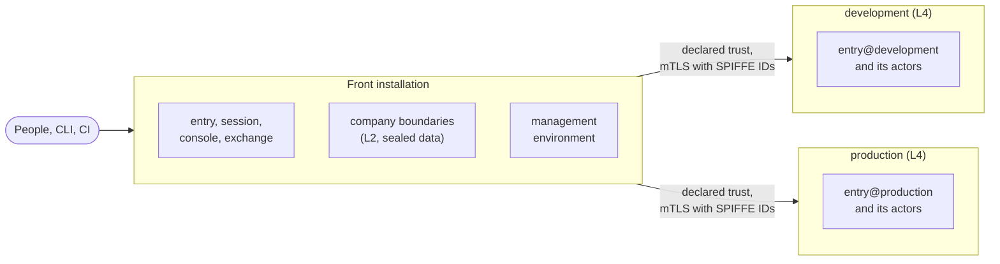

A **boundary** is the unit of isolation in sluis: what one compromised or misconfigured part cannot cross. The record is [ADR 0005](/decisions/0005-boundaries-and-the-isolation-ladder/); the issuers and tokens are [ADR 0006](/decisions/0006-identity-issuers-audiences-and-sign-in/).

## Kinds of boundary

| Kind | Owns | Holds an authority key |
|---|---|---|
| **Environment** | The machine plane of management, development, staging or production: its keys and intermediates, CA, issuer, sealing key, audit log, trust domain and state | Yes |
| **Company** | The identity plane: the directory, the upstream, the integrations, people's records, operator delegation and the audit tenant's data key | No |
| **Product** | A company and an environment together, with its own keys and issuer, for a company whose customers sign in through sluis | Yes, its own |

Production never shares a key or a state store with development. Product boundaries come with the CIAM upstream milestone ([#1023](https://github.com/truvity/sluis/issues/1023)); none exists before then.

## The isolation ladder

Each boundary declares a level. Each level adds to the one before it.

| Level | Adds |
|---|---|
| **L0 tenant** | Separation by sluis's code only |
| **L1 keys** | Its own sealing key (which also seals grants), CA and signing key |
| **L2 process** | Its own actor instances, uid or role, and state prefix |
| **L3 store** | Its own state store (an rqlite cluster, a DynamoDB table), bucket and queue |
| **L4 runtime** | Its own Kubernetes cluster, cloud account or hosts, and a separate install file joined by declared trust |

A **tenant**, such as an audit or directory tenant, is L0: kept apart by code only, and never a substitute for a boundary. Every environment on a cloud runtime runs at least at L2; companies run at **L2 plus sealed data**, in the front installation. A driver whose backend cannot check its callers is allowed at L3 and above only ([ADR 0004](/decisions/0004-drivers-listeners-and-boundary-enforcement/#three-layers-per-port)). An actor instance carries its boundary in its name, `<actor>@<boundary>` ([Naming](/concepts/actors/#naming)).

## A federation of installations

One sluis, as people see it, is a **federation**: one **front installation** and one **boundary installation for each L4 boundary**, under one operator and joined by declared trust. People get one sign-in address, one console and one identity plane. Boundaries below L4 live in the front installation and are declared in its install file.

For example, the front and the management environment share one cloud account, and development, staging and production each run at L4, with their own account or cluster, state and keys.

- **What is shared:** the front, the console, the roots (held by [ritueel](https://ritueel.id)) and the operator.
- **Accepted risks:** a compromise of the roots; the operator who deploys and cluster administrators; a compromise of an environment's `ca`, which reaches every company's workloads in that environment; a bug in a shared policy definition; data held outside sluis. See the [threat model](/security/threat-model/#accepted-risks).
- **A test installation is separate.** It serves no real user, trusts nothing of the federation, and lives outside the sluis host names.

### Across boundaries

A call from one boundary to another is **mutual TLS with SPIFFE IDs** ([Identity](/concepts/identity/#trust-domains)). The target decides again with its own policy; it never takes the caller's decision as its own. A sensitive boundary verifies the **person's passkey assertion itself**, against its own challenge, so a compromised front cannot act there on a person's behalf.

### Promotion: a company leaves

A company leaves, or moves to an installation of its own, by a runbook that exists from the first day:

1. disconnect the company's boundary: its upstream, directory, integrations and minters are its own processes and records;
2. export its slice of the audit trail, then crypto-shred it by deleting its audit tenant's data key ([ADR 0016](/decisions/0016-the-audit-log/)); legal holds are kept outside sluis, so check them first;
3. re-issue its workloads under the new installation's CA;
4. remove the person links of its subjects.

## Issuers and tokens

Each environment has its own issuer, and so does a product boundary. Companies have none: the company is the claim `org` and a policy scope.

| Issuer | Address |
|---|---|
| The group issuer, at the front | `https://sluis.example.com` |
| An environment's issuer | `https://sluis.<env>.example.com`, one origin per host, no path |

- **Discovery and keys are static** documents in a bucket of the boundary, so verification survives a compute outage. The key set lists every active token key with its `x5c` chain.
- **A boundary has no sign-in of its own.** Its slim `entry@<boundary>` takes the group issuer as its upstream; a passkey tap is asked for only where that boundary's policy wants fresh multi-factor authentication.
- **The CLI signs in once.** `sluis login` signs in at the front, and the CLI then exchanges tokens silently at each boundary's own token endpoint. The front never sees a boundary's tokens.
- **One passkey for every issuer.** The boundary hosts are siblings of the group host, so the passkey's relying-party id is the registrable parent (`example.com`), and every verifier checks a strict allow-list of origins: the sluis hosts only.
- **The audit front has a host of its own**, `sluis-audit.<env>.example.com` ([ADR 0015](/decisions/0015-audit-pieces-transport-search-and-front/#the-audit-front)).
- **Step-up is per client and per environment**, in `policy@<boundary>`: a request that needs more answers `insufficient_user_authentication` with `acr_values` ([RFC 9470](https://datatracker.ietf.org/doc/html/rfc9470)).

### Token claims

| Claim | Rule |
|---|---|
| `iss` | The issuer URL |
| `aud` | **Exactly one registered `client_id`**, never a URL. An RFC 8707 `resource=` selects a registered client and is never copied into `aud`. Between actors of two boundaries, `aud` is the target's SPIFFE ID |
| `sub` | An opaque random id, the same at every issuer, never an e-mail address ([Identity](/concepts/identity/#a-persons-subject)); for a JWT-SVID, the SPIFFE ID |
| `acr`, `amr`, `auth_time`, `cnf.jkt` | How and when the person signed in, and the key the token is bound to |
| grants | Only that boundary's grants |
| `org` | The person's company |

Client ids are unique per issuer, readable, and the same in every environment (`kubernetes`, `argocd`, `aws-<account-alias>`); each AWS account's OIDC provider uses its own, not `sts.amazonaws.com`. Every relying party pins `iss` and `aud`.

## The reference federation

The reference choices for a federation of several companies and environments, beyond those above. The management environment hosts the group-level applications.

| Topic | Choice |
|---|---|
| Subjects | A subject per directory account, plus a declared link between the subjects of one person. Grants are not inherited across the link. An SSH certificate carries the person key |
| Keys | Keys and intermediates per environment, certified through the hand-off to ritueel ([ADR 0013](/decisions/0013-the-hand-off-to-root-custody-and-the-signing-api/#the-hand-off)) |
| State | One engine with a prefix per boundary, replaced by a store of its own at L3 and above |
| Policy | One source, compiled per environment; the environment's sealing key seals its grants. **Company ceilings** are Cedar `forbid` guards: no grant on another company's scope unless declared cross-company |
| Audit | A log per environment, with its own front. Each company reads it as a tenant with its own data key |
| Trust bundles | One per environment, with no signing key of its own ([Identity](/concepts/identity/#the-trust-bundle)). `ca` issues only names and SPIFFE IDs that the requester's proven identity owns |
| SSH | An SSH CA per environment, with per-company principals in its principals bundle ([SSH](/integrations/ssh/)) |
