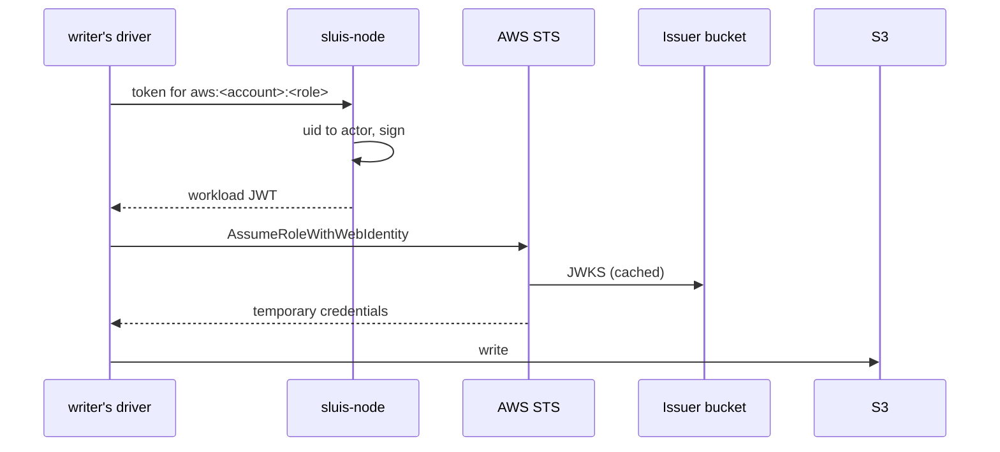
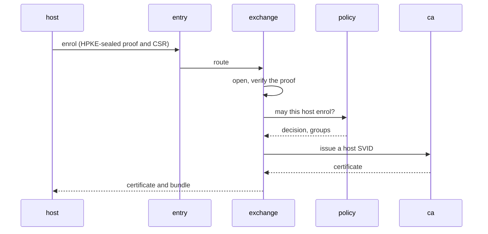

sluis gives credentials to people and to machines. A person comes from an upstream directory and gets an opaque subject. A machine, whether a host, a pod, a CI job or one of sluis's own actors, presents a proof and gets a short-lived credential under a SPIFFE ID. The records are [ADR 0006](/decisions/0006-identity-issuers-audiences-and-sign-in/) for issuers and subjects and [ADR 0007](/decisions/0007-workload-identity-and-host-enrolment/) for workload identity and enrolment. The threats they answer are on the [threat model](/security/threat-model/#machine-identity-enrolment-and-trust).

## A person's subject

- **`sub` is an opaque random id, the same at every issuer.** sluis assigns it when it first sees a person from a directory, so it is known before the first sign-in. It is never an e-mail address or a directory account name, so it survives a rename and keeps personal data out of log lines.
- **The directory account and `email` are claims of their own**, beside `acr`, `amr`, `auth_time` and, for a DPoP-bound token, `cnf.jkt`.
- **A person disabled in the directory is refused at once**, whatever the cached state.
- What happens to a subject over its life, and pairwise subjects per sector for customers, are for the subject-lifecycle decision record (planned, [#1024](https://github.com/truvity/sluis/issues/1024)).

Each environment has its own issuer, and tokens carry exactly one audience; see [Boundaries](/concepts/boundaries/#issuers-and-tokens).

## Machine identity: one mechanism

Every machine credential is obtained the same way:

1. The machine presents a **proof** from something sluis already trusts: a cloud's instance document, a Kubernetes token, a CI token, a hardware attestation, an enrolment token or a person's approval.
2. `exchange@<boundary>` verifies the proof in a **token exchange** ([RFC 8693](https://datatracker.ietf.org/doc/html/rfc8693)), and `policy` decides what the machine may become.
3. sluis returns a short-lived **credential**: an X.509-SVID from `ca`, a JWT-SVID from the boundary's issuer, an SSH certificate from `ssh-ca`, a database client certificate, or cloud credentials through a cloud driver.

Machines hold no OAuth client secret. **Renewal is by possession**: a machine renews over mutual TLS with the credential it holds, and proves its original kind of proof again from time to time.

## SPIFFE, as far as sluis implements it

sluis follows [SPIFFE](https://spiffe.io/) now for the SPIFFE ID, the trust domain and its bundle, the X.509-SVID (issued by `ca`) and the JWT-SVID (issued by the boundary's issuer). Federation, the Workload Endpoint and the Workload API come later. sluis does not deploy SPIRE: proving what a machine is, deciding what it may be called, and the CA are its own.

In SPIRE's terms, node attestors are sluis's verifier drivers, registration entries are declared rules plus Cedar policy, and the server CA is `ca`.

### SPIFFE IDs

| Subject | SPIFFE ID |
|---|---|
| A host | `spiffe://<td>/host/<name>` |
| A Kubernetes workload | `spiffe://<td>/k8s/<cluster>/ns/<ns>/sa/<sa>` |
| A sluis actor | `spiffe://<td>/sluis/<actor>`, for example `spiffe://prod.example.com/sluis/ca` |
| A CI job | `spiffe://<td>/ci/github/<org>/<repo>` |

**An actor has one ID**, whichever node or unit runs it. The instance is a separate attribute: a DNS name among the subject alternative names of an X.509-SVID, and a claim in a JWT-SVID. A JWT-SVID carries the boundary's issuer URL as `iss` and the SPIFFE ID as `sub`.

### Trust domains

**The trust domain is the [boundary](/concepts/boundaries/)**, such as `prod.example.com`. Each environment has its own trust domain, bundle and CA intermediate, because the boundary owns the keys. A host of one environment does not trust another environment's SVIDs unless a connection between the boundaries is declared. Between actors of two boundaries the call is mutual TLS with SPIFFE IDs, a token's audience is the target's SPIFFE ID, and the target decides again with its own policy.

## Proof kinds are verifier drivers

Each kind of proof is a **verifier driver** in `exchange`. A verifier holds public material only: roots, key sets, the registry of known cards. A new kind of proof is a new driver with its own conformance tests, not a new flow.

| Verifier driver | What it proves | Milestone |
|---|---|---|
| `github-oidc` | A GitHub Actions OIDC token, as used by the signing API's callers | First working version |
| `aws-iid` | The EC2 instance identity document, accepted **once per instance** | Parity |
| `k8s-sa-token` | A projected ServiceAccount token from a cluster sluis trusts | Parity |
| `yubikey-attestation` | A PIV attestation, chained through Yubico's published intermediates to **Yubico Attestation Root 1**, which sluis ships, and checked against the registry of known cards | Parity |
| `enrol-token` | A single-use or reusable enrolment token (below) | Parity |
| Manual approval | A person approved the request in the console | Parity |
| `tailscale-whois`, TPM | The Tailscale node behind the connection; a TPM quote | Later |

## How an actor reaches a cloud

An actor that talks to a cloud, such as the audit `writer` writing to a bucket, needs that cloud's credentials. Every actor uses its own; sluis brokers credentials and does not proxy data.

**Where the platform gives an identity, sluis uses it.** On serverless it is the function's role. On Kubernetes it is a projected ServiceAccount token per container, with one audience per role; EKS Pod Identity serves pods that hold a single actor, and `sluis-node` is only a fallback ([ADR 0018](/decisions/0018-runtimes-installations-and-delivery-order/#kubernetes)).

**On a self-hosted node, the node agent fills the gap.** `sluis-node` reads the caller's uid from the peer credentials of its Unix socket, maps it to an actor, and issues that actor a short-lived **workload JWT** signed with the node's token-signing key. The caller cannot name another actor. The token's `sub` is the actor instance, `<actor>@<boundary>` ([Naming](/concepts/actors/#naming)), and lasts about an hour.

**One workload issuer per boundary.** The boundary's issuer is the issuer of these tokens. Its key set holds one token key per node, three on the boards, and is published as static documents in a bucket. Per-node issuers, at `https://<issuer>/nodes/<node>/`, are an option for a fleet whose nodes run different sets of actors, so that a cloud role trusts only the nodes that run its actor. The cost of one issuer is that a compromised node can sign a token for any actor of its boundary until its key leaves the key set. AWS bounds the design: at most 100 keys in a key set and 100 OIDC providers per account, an `https` issuer URL with no port or query, and `iat` in every token.

**A cloud driver exchanges the token.**

| Cloud | Exchange | Token algorithm |
|---|---|---|
| AWS | `AssumeRoleWithWebIdentity` against an IAM OIDC provider | ES384 |
| GCP | Workload Identity Federation | ES256 |
| Azure | A federated credential on an Entra application | RS256 |

GCP and Azure need an algorithm other than P-384; the key that signs workload tokens for that cloud is a key of its own, a named exception of [ADR 0012](/decisions/0012-cryptography-and-authority-keys/#named-exceptions). Cloudflare has no federation for R2: its cloud driver holds a parent token of the boundary, stored sealed, and mints R2 temporary credentials scoped to a bucket and a prefix.

### An actor getting AWS credentials



The driver, under the actor's own uid, asks for a token whose audience is the role's registered client id (`aws:<account>:<role>`, with the account's declared name, never `sts.amazonaws.com`). `sluis-node` signs it with ES384: `iss=https://sluis.prod.example.com`, `sub=writer@prod`, `iat`, `exp`. STS checks the signature, `iss`, `aud` and `sub` against the role's trust policy and returns temporary credentials. The driver never holds a key, and the trust policy names this actor's `sub`, so the token is refused for every other actor. The signing cost per actor per hour is small next to a card's signing rate ([Board capacity](/runtimes/bare-metal/#board-capacity)).

**No local credential helper.** The AWS signing helper (`aws_signing_helper serve`) exposes credentials on a local port that every process on the node can read, so sluis does not use it. IAM Roles Anywhere is AWS-only; the design above serves all three clouds.

## Joining a host

A host enrols with the same mechanism and receives a host X.509-SVID from `ca`. A replacement sluis node enrols the same way, which is how a new state-cluster member gets its identity; its intermediate is certified separately, through the hand-off to ritueel ([ADR 0013](/decisions/0013-the-hand-off-to-root-custody-and-the-signing-api/#the-hand-off)).

| Case | How the host proves itself | Notes |
|---|---|---|
| **A. Manual approval** | A short code is shown on the host and in the console, and a person checks that they match | Groups are assigned at approval |
| **B. Automation through user data** | On EC2, the instance identity document, with no secret. Elsewhere, a single-use token in the user data | `sluis host user-data --group <g>` prints a cloud-init snippet |
| **C. Network** | Tailscale WhoIs (Later) | A plain IP address only for a low-privilege identity, or with approval |
| **D. Reusable token** | A token with a number of uses, an expiry, bound groups, a name pattern and a pre-approved flag | Shown once |
| **E. Hardware attestation** | A YubiKey now, a TPM later | |

**Attributes keep their provenance.** What the verifier read from the proof is `attested`, what reviewed configuration says is `declared`, and what an operator set in the console, audited, is `assigned`; these may grant. What the host says about itself, and plain cloud tags, is `reported` and grants nothing.



The enrolment API has start, poll, renew over mutual TLS, leave, and bundle; `entry` routes it and `exchange` carries it out. Policy has four actions: `host.enrol`, `host.renew`, `enrol-token.create` and `enrolment.approve`. Every step is audited, and a pending request notifies the people who may approve it. The client is `sluis-host enroll`, which keeps the host key in a card, then a TPM, then a file. ACME for host TLS certificates comes after the first release ([#978](https://github.com/truvity/sluis/issues/978)); until then a host sends a CSR to `ca` ([ADR 0008](/decisions/0008-certificate-authorities-for-x509-ssh-and-databases/)).

### The enrolment token never travels

A host that enrols with a token sends the **token's id** and an **HMAC over its certificate signing request and a server nonce**, keyed with the token's secret. The secret never crosses the network, so a recorded request cannot be replayed and a log line cannot leak it. **The server keeps the HKDF-derived HMAC key, not the secret**, for single-use and reusable tokens alike, and like every state value it is encrypted under the sealing key's data keys ([Data and secrets](/concepts/data/)). A copy of the store alone cannot enrol a host.

### Enrolment is encrypted end to end

The host encrypts its proof and its certificate signing request with **HPKE** ([RFC 9180](https://datatracker.ietf.org/doc/html/rfc9180)) to the boundary's **enrolment public key**, which reaches it as a certificate in the trust bundle, issued by the boundary's intermediate. The private key is a key of its own in `key-holder` or KMS, and `exchange` opens the request through the keys port. The edge in front of `entry` (`cloudflared`, an API gateway) sees only ciphertext.

### The roots' public keys are pinned

A joining host is given the **SPKI hashes of the roots' public keys** and refuses a bundle that does not chain to them. A key pin survives a root certificate re-issued over the same key. Web PKI is kept so that the host can reach sluis, and as an extra layer; it is not the reason to trust it. The one exception is manual approval, where the person compares the pin the host shows.

## The trust bundle

A boundary's **trust bundle** is a static document in SPIFFE format: the certificates a host of that boundary trusts, including the enrolment certificate. It is not signed by an online key. Each certificate in it verifies itself by chaining through the boundary's intermediate to a root in the **root list**, and the root list is signed by a root at ritueel and carries a version that only increases ([ADR 0013](/decisions/0013-the-hand-off-to-root-custody-and-the-signing-api/#root-pins-and-the-root-list)). There is one bundle per environment.

### Trust sync

The bundle reaches a host through the generic `sluis` package, not through a package generated for each installation.

- The package ships `sluis trust sync`, with a `sluis-trust-sync.timer` and a oneshot service. They do nothing until this command configures them, with `--root-pin` given once per root:

  ```sh
  sluis trust enroll --url <url> --root-pin <spki-hash> --root-pin <spki-hash>
  ```

- Each run fetches the root list and the bundle, checks the root list's signature against the pinned roots and each certificate's chain against the list, and refuses a root list with a lower version or a bundle with a lower `spiffe_sequence` than the last one. A host keeps its last good bundle when sluis is down.
- It writes the trust anchors and runs `update-ca-trust` or `update-ca-certificates`. The unit is hardened: it may write only the anchor directory and the extracted store.
- On Kubernetes the same bundle feeds trust-manager as a source. sluis writes no Kubernetes object.
