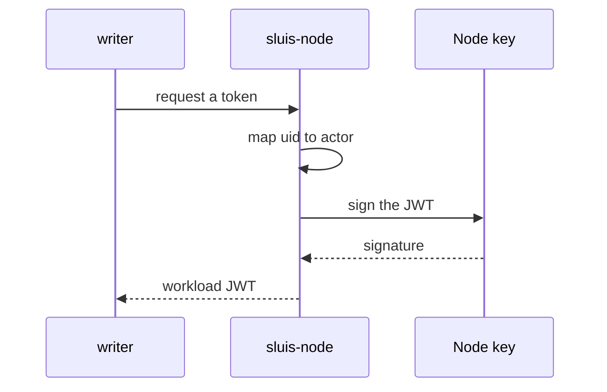
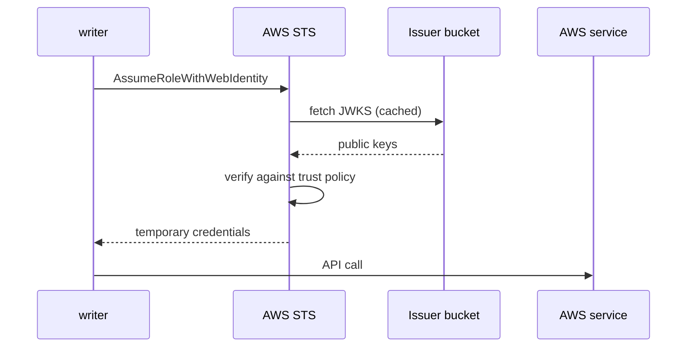

A sluis actor that talks to a cloud, for example to write an audit archive to a bucket, needs that cloud's credentials. On a cloud-native platform the platform hands the actor its identity: the Lambda function's role. On Kubernetes the identity comes from a projected ServiceAccount token (see below). On a node that the platform does not manage, nothing does. sluis fills that gap with workload identity.

This page is about how an actor of sluis reaches a cloud. How a host, a pod or a CI job gets a machine identity from sluis (SPIFFE IDs, SVIDs, enrolment and trust bundles) is on [Machine identity](/concepts/machine-identity/).

## Workload identity

The **node agent** (`sluis-node`) runs on each self-hosted node. It issues a short-lived **workload JWT** per actor. It knows which actor is asking without trusting what the caller says: the actor's identity comes from its **uid**, read from the connection's peer credentials on its Unix socket.

The node agent signs each token with the **node's non-extractable key**, so a token cannot be made without the node. Tokens are valid for an hour and refreshed hourly per actor. At about 120 ms per signature on a YubiKey, the cost is negligible.

The token's `sub` is the actor instance's name, **`<actor>@<boundary>`** ([Actors](/concepts/actors/#naming)), and the cloud role's trust policy pins it. This is credential brokering, not mediation: the node agent hands each actor a token of its own, and the cloud enforces what that token may do ([Ports and drivers](/concepts/drivers/#per-actor-and-shared-instances)).

## One issuer per boundary

The boundary's issuer is the issuer of these tokens, by default (decided 2026-10-30, [ADR 0012](/decisions/0012-machine-identity-follows-spiffe-proofs-are-exchanged-for-short-lived-credentials/)).

- Its **JWKS** holds public keys only: **one key per node card**, three on the boards, plus the next keys while a key rotates. Each node signs with its own card's key, under the one issuer.
- The issuer publishes a **static discovery document** and the JWKS. Nothing runs to serve them.
- **Per-node issuers are optional**, at `https://<issuer>/nodes/<node>/`, for a fleet whose nodes run different sets of actors. There the cloud role of an actor **trusts only the issuers of the nodes that run that actor**, so a compromised node can mint credentials only for the actors it was allowed to run.
- Where every node runs the same actors, as on the boards, per-node issuers would protect nothing more. The cost of one issuer is that a compromised node can mint a token for any actor of its boundary until its key leaves the key set.

AWS bounds this design: a JWKS holds at most 100 EC keys, an account has at most 100 OIDC providers, the issuer URL must be `https` with no port and no query, and the token must carry `iat`.

## Per-cloud exchange

Each cloud driver (`aws`, `gcp`, `azure`) exchanges the workload JWT for that cloud's credentials:

| Cloud | Exchange | Token algorithm |
|---|---|---|
| AWS | `AssumeRoleWithWebIdentity` against an IAM OIDC provider | ES384 (P-384) |
| GCP | Workload Identity Federation | ES256 |
| Azure | A federated credential on an Entra application | RS256 |

Cloudflare has no federation for R2. Its cloud driver, `cloud-cloudflare@<boundary>`, holds a parent token of the boundary, stored sealed, and mints R2 temporary credentials scoped to a bucket and a prefix ([Ports and drivers](/concepts/drivers/#one-s3-compatible-blob-driver)).

GCP and Azure each need an algorithm other than P-384. The exception is made for the key that signs workload tokens for that cloud, in its own slot or key, and is described in [Keys](/concepts/keys/), together with the per-audience RS256 exception for verifiers that cannot take EC.

## Platform-native identity

Where the platform supplies an identity, sluis uses it and does not add a layer: the function's role on serverless (AWS Lambda). The node agent exists for the nodes where none does.

**Kubernetes.** The identity of an actor is a projected ServiceAccount token, with one audience per sluis actor, mounted only into that actor's container and its driver. The actor's cloud driver exchanges the token with the cloud in the same way as in step 2 below (`AssumeRoleWithWebIdentity` on AWS, Workload Identity Federation on Google Cloud, a federated credential on Azure). Only the source of the token differs: the kubelet and the API server issue it, and the node agent `sluis-node` is not used on Kubernetes. The cloud role of each sluis actor trusts the cluster's issuer, that actor's audience, and the namespace and ServiceAccount of the install. The workload tokens are the cluster's, not sluis keys; see [Keys](/concepts/keys/).

EKS Pod Identity is used only for a pod that holds a single actor, because its credentials belong to the pod and not to a container ([OD-19](/open-decisions/#od-19), decided). Options and limits are on [Kubernetes](/runtimes/kubernetes/#identity).

## An actor getting AWS credentials

This is how an actor on an EC2 node, such as the audit `writer`, obtains AWS credentials to write to its bucket. The actor's AWS driver runs under the actor's own uid. The issuer URL and node name are examples. The flow has two steps.

### Step 1: the node agent issues a workload token

The driver asks for a workload token for the audience of the target account, its registered client ID such as `aws-<account-alias>` and not the shared `sts.amazonaws.com` ([ADR 0059](/decisions/0059-each-boundary-has-its-own-issuer-and-tokens-carry-one-audience/)), over the node agent's Unix socket. The node agent reads the caller's uid from the peer credentials and maps the uid to an actor. It signs a JWT with ES384 using the node key, which is non-extractable, with the claims `iss=https://sluis.prod.example.com` (the boundary's issuer; a fleet with per-node issuers uses the node's issuer URL instead), `sub=writer@prod` (the actor instance), `iat` and `exp`. The JWT is valid for about 1 hour.

### Step 2: the cloud exchanges the token for credentials

The driver calls `AssumeRoleWithWebIdentity` with the role ARN and the workload JWT. STS fetches the discovery document and the JWKS from the issuer, and caches them. It verifies the signature, `iss`, `aud` and `sub` against the role's trust policy, then returns temporary AWS credentials. The driver calls the AWS service with them.

The driver never holds a key. A token for an actor other than the caller cannot be requested, because the node agent decides the actor from the uid and not from the request. And the IAM role's trust policy names the boundary's issuer (or, with per-node issuers, this node's) and this actor's `sub`, so the same token is refused for every other actor.

## IAM Roles Anywhere

IAM Roles Anywhere is an AWS-only alternative. It accepts RSA, EC and ML-DSA certificates; the documentation does not say that P-384 is accepted. It stays an alternative for AWS only. The design above uses one mechanism for all three clouds.

## Why not the signing helper

The AWS signing helper (`aws_signing_helper serve`) exposes the credentials on port 9911 on the node, and **every local process can read them**. That removes the per-actor separation this page exists to create, so sluis does not use it. The node agent's socket checks the caller's uid on each request.
