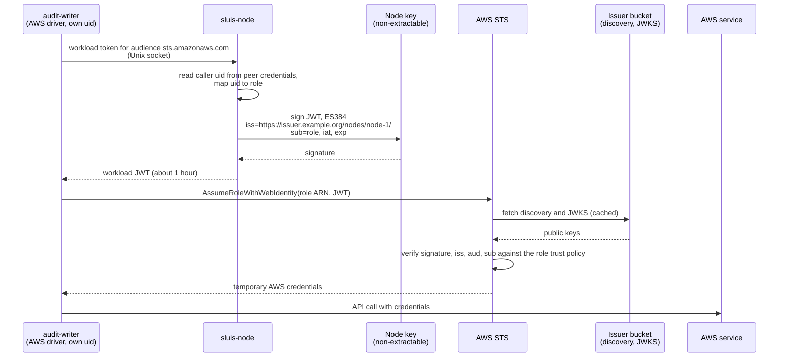

A sluis role that talks to a cloud, for example to write an audit archive to a bucket, needs that cloud's credentials. On a cloud-native platform the platform hands the role its identity: the Lambda function's role. On Kubernetes the identity is proposed to come from a projected ServiceAccount token (see below). On a node that the platform does not manage, nothing does. sluis fills that gap with workload identity.

## Workload identity

The **node agent** (`sluis-node`) runs on each self-hosted node. It issues a short-lived **workload JWT** per role. It knows which role is asking without trusting what the caller says: the role's identity comes from its **uid**, read from the connection's peer credentials on its Unix socket.

The node agent signs each token with the **node's non-extractable key**, so a token cannot be made without the node. Tokens are valid for an hour and refreshed hourly per role. At about 120 ms per signature on a YubiKey, the cost is negligible.

## Per-node OIDC issuers

Each node is its own OIDC issuer.

- The issuer publishes a **static discovery document** and a **JWKS** containing public keys only, at an HTTPS URL served from the distribution bucket. Nothing runs to serve them.
- The issuer URL is `https://<issuer>/nodes/<node>/`, one per node.
- A cloud role **trusts only the issuers of the nodes that run that role**. A compromised node can therefore mint credentials only for the roles it was allowed to run, never for another node's.

AWS bounds this design: a JWKS holds at most 100 EC keys, an account has at most 100 OIDC providers, the issuer URL must be `https` with no port and no query, and the token must carry `iat`.

## Per-cloud exchange

Each cloud driver (`aws`, `gcp`, `azure`) exchanges the workload JWT for that cloud's credentials:

| Cloud | Exchange | Token algorithm |
|---|---|---|
| AWS | `AssumeRoleWithWebIdentity` against an IAM OIDC provider | ES384 (P-384) |
| GCP | Workload Identity Federation | ES256 |
| Azure | A federated credential on an Entra application | RS256 |

GCP and Azure each need an algorithm other than P-384. The exception is made for the key that signs workload tokens for that cloud, in its own slot or key, and is described in [Keys](/concepts/keys/), together with the per-audience RS256 exception for verifiers that cannot take EC.

## Platform-native identity

Where the platform supplies an identity, sluis uses it and does not add a layer: the Lambda function role on Lambda. The node agent exists for the nodes where none does.

:::note[Proposed]
**Kubernetes (T6).** The identity of a role is a projected ServiceAccount token, with one audience per sluis role, mounted only into that role's container and its driver. The role's cloud driver exchanges the token with the cloud in the same way as in the sequence below (`AssumeRoleWithWebIdentity` on AWS, Workload Identity Federation on Google Cloud, a federated credential on Azure). Only the source of the token differs: the kubelet and the API server issue it, and the node agent `sluis-node` is not used on Kubernetes. The cloud role of each sluis role trusts the cluster's issuer, that role's audience, and the namespace and ServiceAccount of the install. The workload tokens are the cluster's, not sluis keys; see [Keys](/concepts/keys/).

EKS Pod Identity is used only for a pod that holds a single role, because its credentials belong to the pod and not to a container. This is [OD-19](/open-decisions/#od-19); options and limits are on [Kubernetes](/shapes/kubernetes/#identity).
:::

## A role getting AWS credentials

This is how a role on an EC2 node, such as `audit-writer`, obtains AWS credentials to write to its bucket. The issuer URL and node name are examples.

The driver never holds a key. A token for a role other than the caller's cannot be requested, because the node agent decides the role from the uid and not from the request. And the IAM role's trust policy names this node's issuer and this role's `sub`, so the same token is refused for every other role.

## IAM Roles Anywhere

IAM Roles Anywhere is an AWS-only alternative. It accepts RSA, EC and ML-DSA certificates; the documentation does not say that P-384 is accepted. It stays an alternative for AWS only. The design above uses one mechanism for all three clouds.

## Why not the signing helper

The AWS signing helper (`aws_signing_helper serve`) exposes the credentials on port 9911 on the node, and **every local process can read them**. That removes the per-role separation this page exists to create, so sluis does not use it. The node agent's socket checks the caller's uid on each request.
