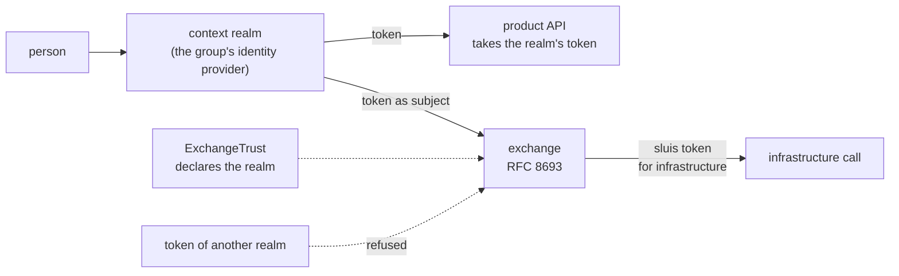
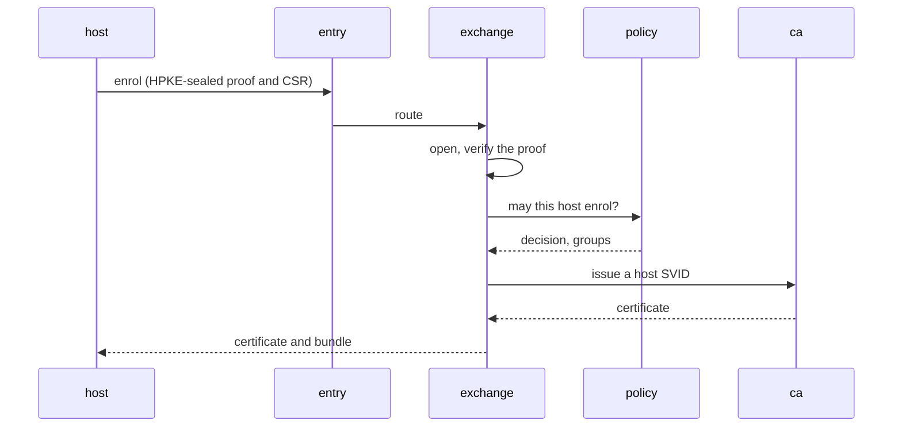

sluis gives credentials to people and to machines. A person comes from an upstream directory and gets an opaque subject. A machine, whether a host, a pod, a CI job or one of sluis's own actors, presents a proof and gets a short-lived credential under a SPIFFE ID. The records are [ADR 0017](/decisions/0017-identity-and-sign-in/) and [ADR 0019](/decisions/0019-person-and-upstream-link/) for issuers, sign-in and subjects, [ADR 0020](/decisions/0020-grant-vocabulary-and-token-claims/) for claims, and [ADR 0022](/decisions/0022-workload-identity-and-host-enrolment/) for workload identity and enrolment. The threats they answer are on the [threat model](/security/threat-model/#machine-identity-enrolment-and-trust).

## A person's subject

- **A person has an opaque random id, and it is the `sub` of every token the person gets** at that tenant, for every client. v2 issues no pairwise `sub` ([ADR 0020](/decisions/0020-grant-vocabulary-and-token-claims/#the-sub-of-a-token)). A relying party that needs a readable name reads the `email` claim of the ID token. `signin` assigns the id when it first sees a person: at the first sign-in today, and at a directory read, once directory sync is built ([ADR 0019](/decisions/0019-person-and-upstream-link/#assigning-a-subject)).
- **An upstream account is tied to the person by the issuer and a configured subject claim** (`sub`, or `oid` for Microsoft Entra), never by e-mail ([ADR 0019](/decisions/0019-person-and-upstream-link/#linking-an-upstream-account)). The subject is never an e-mail address or a directory account name, so it survives a rename and keeps personal data out of log lines.
- **A person has four states** (live, held, suspended and left), computed from the kinds and never stored. A person who is not live is refused at sign-in, refresh, exchange and step-up ([ADR 0019](/decisions/0019-person-and-upstream-link/#states)). A person disabled in the directory, or held by an operator, is refused at once, whatever the cached state.
- **The claims of a token are a fixed set** with one audience: `acr`, `amr` and `auth_time` as the upstream sent them, `groups` narrowed to the audience, and `cnf.jkt` when the audience declares DPoP binding (planned). The set is in [ADR 0020](/decisions/0020-grant-vocabulary-and-token-claims/#the-claims-of-a-token).

Each environment has its own issuer, and a token has exactly one audience; see [Boundaries](/concepts/boundaries/#issuers-and-tokens).

## How a person signs in

People come from an upstream directory, so sluis stores no passwords. A person signs in at the upstream, and the `signin` actor assigns the subject and keeps a **session chain**, a temp kind whose limits depend on the class of the sign-in session ([ADR 0018](/decisions/0018-sign-in-sessions/#session-chains)).

- **Passkeys are the fast path** and count as phishing-resistant multi-factor authentication. sluis stores only their public keys, sealed in the person's tenant. A full upstream sign-in is still required every N days and for high-privilege grant names ([ADR 0017](/decisions/0017-identity-and-sign-in/#passkeys)).
- **Two tiers.** Everyone signs in at the ordinary tier, where a synced passkey is enough. A person who administers identity, keys, organisation settings or releases signs in at the privileged tier, with a device-bound, attested security key ([ADR 0017](/decisions/0017-identity-and-sign-in/#two-tiers-of-staff-sign-in)). Enforcement is a policy commit. The attestation verifier is planned.
- **Step-up** asks for a fresh factor when a request needs more than the session holds ([ADR 0017](/decisions/0017-identity-and-sign-in/#step-up)).
- **Break-glass recovery** works when the directory or the store is damaged. Its credentials are passkeys held in config: two attested hardware keys and one pinned synced passkey ([Break-glass recovery](/security/break-glass/)).

## Machine identity: one mechanism

Every machine credential is obtained the same way:

1. The machine presents a **proof** from something sluis already trusts: a cloud's instance document, a Kubernetes token, a CI token, a hardware attestation, an enrolment token or a person's approval.
2. `exchange@<boundary>` verifies the proof in a **token exchange** ([RFC 8693](https://datatracker.ietf.org/doc/html/rfc8693)), and `policy` decides what the machine may become.
3. sluis returns a short-lived **credential**: a JWT-SVID from the boundary's issuer, an X.509-SVID from `ca`, an SSH certificate from `ssh-ca`, a database client certificate, or cloud credentials through the adapter of that cloud.

Machines hold no OAuth client secret. **Renewal is by possession**: a machine renews over mutual TLS with the credential it holds, and proves its original kind of proof again from time to time (planned).

## SPIFFE, as far as sluis implements it

sluis follows [SPIFFE](https://spiffe.io/) now for the SPIFFE ID, the trust domain and its bundle, the X.509-SVID (issued by `ca`) and the JWT-SVID (issued by the boundary's issuer). Federation, the Workload Endpoint and the Workload API come later. sluis does not deploy SPIRE and plays its parts: node attestors are the verifiers inside `exchange`, registration entries are reviewed config plus Cedar policy, and the server CA is `ca`.

### SPIFFE IDs

| Subject | SPIFFE ID |
|---|---|
| A host | `spiffe://<td>/host/<name>` |
| A Kubernetes workload | `spiffe://<td>/k8s/<cluster>/ns/<ns>/sa/<sa>` |
| A sluis actor | `spiffe://<td>/sluis/<actor>`, for example `spiffe://prod.example.com/sluis/ca` |
| A CI job | `spiffe://<td>/ci/github/<org>/<repo>` |
| An AWS role | `spiffe://<td>/aws/<account>/role/<path>/<name>` |

**An actor has one ID**, whichever node or unit runs it. The instance is a separate attribute: a DNS name among the subject alternative names of an X.509-SVID, and a claim in a JWT-SVID. A JWT-SVID carries the boundary's issuer URL as `iss` and the SPIFFE ID as `sub`.

### Trust domains

**The trust domain is the [boundary](/concepts/boundaries/)**, such as `prod.example.com`. Each environment has its own trust domain and CA intermediate, because the boundary owns the keys ([ADR 0022](/decisions/0022-workload-identity-and-host-enrolment/#trust-domains)). A host of one environment does not trust another environment's SVIDs unless a connection between the boundaries is declared. A host belongs to a boundary and to no tenant. Between actors of two boundaries the call is mutual TLS with SPIFFE IDs, a token's audience is the target's SPIFFE ID, and the target decides again with its own policy.

## Proof kinds are verifiers

Each kind of proof is a **verifier** inside `exchange`. A verifier holds public material only: roots, key sets, the registry of known cards. The config kind `ExchangeTrust` names the issuers, audiences and proof kinds an installation accepts, and the tenant of a workload. A new kind of proof is a new verifier with its own conformance tests, not a new flow ([ADR 0022](/decisions/0022-workload-identity-and-host-enrolment/#proofs-and-the-exchange)).

| Verifier | What it proves | State |
|---|---|---|
| Own tokens | A token of the boundary's own issuer | Built |
| `github-oidc` | A GitHub Actions OIDC token, as used by the callers of the signing API. Part of the GitHub add-on | Built in part |
| `k8s-sa-token` | A projected ServiceAccount token from a cluster sluis trusts. KV reads with it | Planned |
| `aws-iid` | The EC2 instance identity document, accepted **once per instance** | Planned |
| `yubikey-attestation` | A PIV attestation, chained through Yubico's published intermediates to **Yubico Attestation Root 1**, which sluis ships, and checked against the registry of known cards | Planned |
| `enrol-token` | A single-use or reusable enrolment token (below) | Planned |
| Manual approval | A person approved the request in the console | Planned |
| `tailscale-whois`, TPM | The Tailscale node behind the connection; a TPM quote | Later |

## Customers sign in at the group's identity provider

sluis signs in its staff and operators itself. A customer signs in at the group's identity provider, a Keycloak installation with a realm per context, and the products use its tokens: a product API never accepts a sluis token, and the identifier of a person is pairwise per boundary. sluis hosts no customer account, page or registration ([ADR 0048](/decisions/0048-product-apis-take-the-identity-providers-tokens/)).

A token of the group's identity provider enters sluis in one way only. `exchange` takes it as the subject token (RFC 8693) and issues a sluis token for a call down to infrastructure, such as KV or a minted credential. One installation trusts one context realm, which the `ExchangeTrust` config kind declares, and never the central realm above the context realms, so a token of another realm is refused. The token that comes out carries no `customer`, `org` or `product`.

`exchange` verifies a token of a trusted issuer today and then refuses it as a subject token. Accepting it for an infrastructure audience is planned ([ADR 0048](/decisions/0048-product-apis-take-the-identity-providers-tokens/)). A person who works for several vendors keeps one identity per tenant and holds several sessions in parallel on the client, not one subject shared across tenants ([#1894](https://github.com/truvity/sluis/issues/1894)).

## How an actor reaches a cloud

A unit that talks to a cloud, such as the exporter writing to a bucket, needs that cloud's credentials. Every unit uses its own; sluis brokers credentials and does not proxy data ([ADR 0022](/decisions/0022-workload-identity-and-host-enrolment/#spiffe-identities)).

- **Where the platform gives an identity, sluis uses it.** On serverless it is the function's role. On Kubernetes it is a projected service-account token that the holder exchanges for a cloud role ([ADR 0011](/decisions/0011-runtimes-and-installations/)).
- **On a self-hosted node, the node agent fills the gap (planned).** `sluis-node` is a platform piece, not an actor. It reads the caller's uid from the peer credentials of its Unix socket, maps it to an actor, and issues that actor a short-lived **workload JWT** with `sub` `<actor>@<boundary>` ([Naming](/concepts/families/#naming)). It holds no key credential: it asks key@ to sign with the **workload-issuer** key purpose, a key of its own in a slot of its own, never shared with `signer`'s token-signing key ([the card slot map](/concepts/keys/#the-card-slot-map)). The caller cannot name another actor.
- **One workload issuer per boundary.** Its key set holds one workload-issuer key per node, beside the token-signing keys, and is published as static documents in a bucket. A compromised node can sign a token for any actor of its boundary until its key leaves the key set; per-node issuers are the option for a fleet whose nodes run different sets of actors.
- **An adapter exchanges the token for the cloud's credentials,** and the role's trust policy pins `sub` to the actor and its boundary:

| Cloud | Exchange | Token algorithm |
|---|---|---|
| AWS | `AssumeRoleWithWebIdentity` against an IAM OIDC provider | ES384 |
| GCP | Workload Identity Federation | ES256 |
| Azure | A federated credential on an Entra application | RS256 |

GCP and Azure need an algorithm other than P-384; the key that signs workload tokens for that cloud is a key of its own, a named exception of [ADR 0006](/decisions/0006-keys-and-sealing/#named-exceptions). Cloudflare has no federation for R2: its adapter, part of the Cloudflare add-on, mints R2 temporary credentials from the account's sealed connection credential ([ADR 0025](/decisions/0025-integrations/#credential-minters)). The core holds no Cloudflare credential. The AWS side, the role names and the trust policy are on [AWS](/integrations/aws/).

**No local credential helper.** The AWS signing helper (`aws_signing_helper serve`) exposes credentials on a local port that every process on the node can read, so sluis does not use it. IAM Roles Anywhere is AWS-only; this design serves all three clouds.

## Joining a host

A host enrols with the same mechanism and receives a host X.509-SVID from `ca`. A replacement sluis node enrols the same way, which is how a new member of the engine cluster gets its identity; its intermediate is certified separately, through the hand-off to ritueel ([ADR 0024](/decisions/0024-root-custody-and-the-signing-api/#the-hand-off)). Host enrolment is planned, with the certificate authorities.

| Case | How the host proves itself | Notes |
|---|---|---|
| **A. Manual approval** | A short code is shown on the host and in the console, and a person checks that they match | Groups are assigned at approval |
| **B. Automation through user data** | On EC2, the instance identity document, with no secret. Elsewhere, a single-use token in the user data | The token is made with `enrol-token.create` |
| **C. Network** | Tailscale WhoIs (later) | A plain IP address only for a low-privilege identity, or with approval |
| **D. Reusable token** | A token with a number of uses, an expiry, bound groups, a name pattern and a pre-approved flag | Shown once |
| **E. Hardware attestation** | A YubiKey now, a TPM later | |

**Attributes keep their provenance.** What the verifier read from the proof is `attested`, what reviewed configuration says is `declared`, and what an operator set in the console, audited, is `assigned`; these may grant. What the host says about itself, and plain cloud tags, is `reported` and grants nothing.

- **The enrolment API** has start, poll, renew over mutual TLS, leave, and bundle; `entry` routes it and `exchange` carries it out. Policy has four actions: `host.enrol`, `host.renew`, `enrol-token.create` and `enrolment.approve`. A request waiting for approval is the temp kind `PendingEnrolment`, kept 7 days by default and 30 at most. ACME for host TLS certificates comes after the first release ([#978](https://github.com/truvity/sluis/issues/978)).
- **The enrolment token never travels.** The host sends the token's id and an HMAC over its certificate signing request and a server nonce. The server keeps the HKDF-derived HMAC key, not the secret, as the durable kind `EnrolmentToken`, sealed at key@, so a copy of the store alone cannot enrol a host.
- **Enrolment is encrypted end to end.** The host encrypts its proof and request with HPKE ([RFC 9180](https://datatracker.ietf.org/doc/html/rfc9180)) to the boundary's enrolment public key, which reaches it in the trust bundle. The edge in front of `entry` sees only ciphertext.
- **The host pins the roots' public keys** (SPKI hashes) and refuses a bundle that does not chain to them. Web PKI is kept so that the host can reach sluis; it is not the reason to trust it. The one exception is manual approval, where the person compares the pin the host shows.

## The trust bundle

A boundary's **trust bundle** is a static document in SPIFFE format: the certificates a host of that boundary trusts, including the enrolment certificate. It has no signature of its own. Each certificate in it verifies itself by chaining through the boundary's intermediate to a root key in the **root list**, which ritueel signs and which carries a trust sequence that only increases ([ADR 0024](/decisions/0024-root-custody-and-the-signing-api/#root-pins-and-the-root-list)). `ca` renders it as the exportable kind `TrustBundle`, and the exporter publishes it to a bucket as public material, so enrolment and renewal do not depend on the issuer's compute ([ADR 0022](/decisions/0022-workload-identity-and-host-enrolment/#the-trust-bundle)). It is planned, with the certificate authorities.

:::note[Proposed]
How many roots, root lists and trust bundles a boundary has, and so how the roots are laid out for the environments of one installation, is being decided with ritueel's layout of its directories ([#1066](https://github.com/truvity/sluis/issues/1066)). Until it is decided this page claims no count.
:::

### Trust sync

The bundle reaches a host through the generic `sluis` package, not through a package generated for each installation. `sluis trust sync` runs from a timer and does nothing until `sluis trust enroll --url <url> --root-pin <spki-hash>` configures it, with `--root-pin` given once per root. Each run checks the root list's signature against the pinned roots and each certificate's chain against the list, refuses a lower trust sequence or `spiffe_sequence` than the last one, keeps the last good bundle when sluis is down, and writes the trust anchors with `update-ca-trust` or `update-ca-certificates`. On Kubernetes the same bundle feeds trust-manager as a source from the bucket; sluis writes no Kubernetes object for it.
