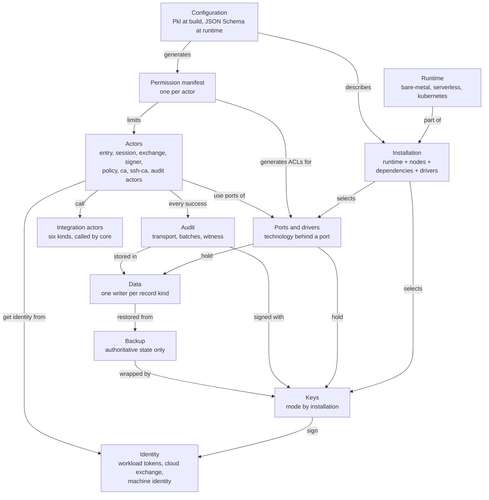

The concepts explain the model that the rest of the documentation relies on. Read them in order, or jump to the one you need from the map.

## The vocabulary

| Term | Meaning | Example |
|---|---|---|
| **Actor** | A process with one responsibility. It declares the ports it requires. | `signer` requires keys, state, transport |
| **Port** | An abstract interface, with capability flags | `blob` (lock mode: none, removable, compliance), `state` (cas) |
| **Driver** | An implementation of a port. It declares its requirements. | `s3-compatible`, `rqlite`, `sqs` |
| **Runtime** | Only the runtime kind: how processes are started and what they can rely on | bare-metal, serverless, kubernetes |
| **Nodes** | How many nodes an installation has: 1, N, or elastic (serverless) | |
| **Dependency** | Something outside sluis that a driver needs | an AWS account, a Cloudflare account, a YubiKey, a NATS service |
| **Installation** | One concrete deployment: runtime + nodes + available dependencies + one driver per port | "bare-metal, 3 nodes, AWS account" |
| **Tested installation** | One of four installations that the docs, the tutorials and the test matrix use: local, boards, lambda and kubernetes. Any other combination the rules allow is possible but untested. | [boards](/runtimes/installations/#boards) |
| **Environment** | Development, staging or production (and the management environment). An environment is one kind of boundary. | production |
| **Boundary** | The unit of isolation: an environment, a company or a product, placed on an isolation ladder from L0 (tenant) to L4 (its own runtime). | [prod](/runtimes/boundaries/) |
| **Actor instance** | An actor in one boundary, named `<actor>@<boundary>` in every layer | `ca@prod` |

## The pages

| Page | The question it answers |
|---|---|
| [Actors](/concepts/actors/) | Which processes make up sluis, what does each hold and need, and why are the signer and the policy separate? |
| [Ports and drivers](/concepts/drivers/) | How does an actor reach keys, state and storage without knowing the technology, which driver fits which runtime, and who may use which driver? |
| [Integrations](/concepts/integrations/) | How do vendors plug in, and why can they never decide? |
| [Keys](/concepts/keys/) | Which key backs which purpose in each installation, which algorithms are supported, and how is an intermediate certified? |
| [Identity](/concepts/identity/) | How does a process on a node prove who it is to a cloud? |
| [Machine identity](/concepts/machine-identity/) | How do hosts, pods and CI jobs get a SPIFFE identity from sluis, and how does a host join? |
| [Configuration](/concepts/configuration/) | How is an installation configured, validated and explained? |
| [Data](/concepts/data/) | Who may write which record, and how are writes made safe? |
| [Secrets](/concepts/secrets/) | Which secrets does sluis keep, which does it publish, and which does it refuse to keep? |
| [Backup](/concepts/backup/) | What is backed up, what is not, and how is sluis restored? |
| [Audit](/concepts/audit/) | What is recorded, and why can the trail be trusted? |

For the same system drawn as boxes and sockets, see [Architecture](/architecture/), or open the [architecture explorer](/architecture/explorer/).
