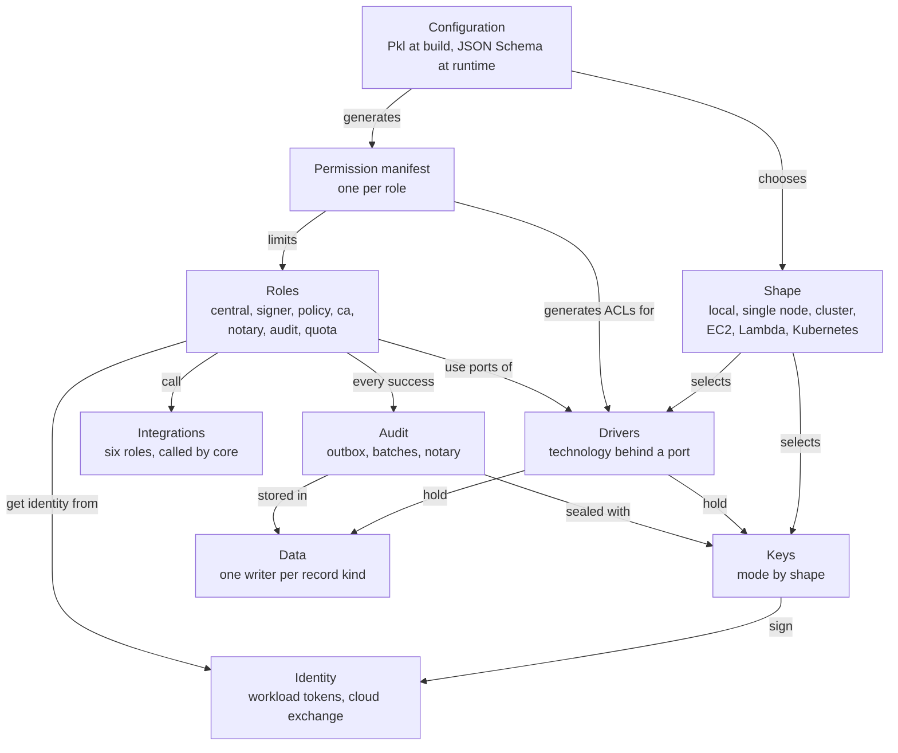

The concepts explain the model that the rest of the documentation relies on. Read them in order, or jump to the one you need from the map.

## The pages

| Page | The question it answers |
|---|---|
| [Roles](/concepts/roles/) | Which processes make up sluis, what does each hold, and why are the signer and the policy separate? |
| [Drivers](/concepts/drivers/) | How does a role reach keys, state and storage without knowing the technology, and who may use which driver? |
| [Integrations](/concepts/integrations/) | How do vendors plug in, and why can they never decide? |
| [Keys](/concepts/keys/) | Which key backs which purpose on each shape, and what algorithm? |
| [Identity](/concepts/identity/) | How does a process on a node prove who it is to a cloud? |
| [Configuration](/concepts/configuration/) | How is sluis configured, validated and explained? |
| [Data](/concepts/data/) | Who may write which record, and how are writes made safe? |
| [Audit](/concepts/audit/) | What is recorded, and why can the trail be trusted? |

For the same system drawn as boxes and sockets, see [Architecture](/architecture/).
