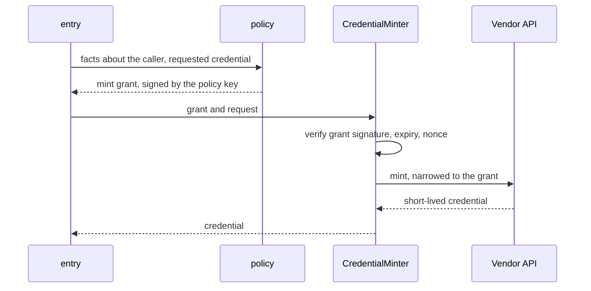

An **integration** connects sluis to something outside it: a sign-in provider, a directory, a cloud, a chat workspace. Each integration is its own process and holds only its own vendor credential. It is an **integration actor** of one of six kinds, each a ConnectRPC contract over one shared base contract. The [actors](/concepts/actors/) page lists the ports each kind needs.

This page is the model. For what each integration is *for*, what sluis asks its vendor for and how to connect it, see [Integrations](/integrations/) and the [setup patterns](/integrations/connecting/). For the standards the integrations and the protocol follow, see the [standards register](/standards/).

## The six integration actors

| Integration actor | It answers or does | Examples of what it connects |
|---|---|---|
| `Upstream` | Sign-in with an upstream identity provider | A workspace identity provider, a generic OIDC provider |
| `WorkloadVerifier` | Verifies a token presented by a workload and returns what it proves | CI systems, Kubernetes service accounts, cloud identities |
| `FactsSource` | Supplies directory facts: users, groups, teams | A workspace directory, GitHub teams, a chat workspace |
| `CredentialMinter` | Mints a downstream credential for a grant that core signed | Cloud API tokens, GitHub installation tokens, AWS credentials |
| `Provisioner` | Reconciles an external system to a desired state that core publishes | An external system that must follow sluis's grants |
| `Notifier` | Sends a message | A chat workspace |

Every vendor-shaped value travels as an opaque reference or a namespaced attribute (for example a subject in namespace `github` with an id that only the integration understands). Core never parses what an integration returns. Each integration declares its attribute names and types so that a policy file can be validated at load time without core knowing the vendor.

## Facts or core-authorized effects, never decisions

The rule is stated in one sentence:

> Integrations return facts, or carry out effects that core has already authorized. They never decide.

The older wording, "plugins return facts only", was not true of minters and provisioners, which are effectors by nature. The rule says what they may do instead:

- A **FactsSource** or **WorkloadVerifier** returns facts. Whether a fact entitles anyone to anything is `policy`'s question.
- A **CredentialMinter** carries out an effect. It receives a **mint grant signed by the `policy` actor's own key**, checks the signature, and mints exactly what the grant says, narrowed to the grant's limits. It decides nothing about whether to mint.
- A **Provisioner** pulls a desired state **addressed by its digest** and reconciles to it. It does not choose what the state should be.

Caps and rate limits are not integration business either. They live in core, in `policy` and `quota`, so a minter never contains a rule about how much is too much.

## Core calls integrations, never the reverse

Calls go one way. `entry`, `policy` and the other core actors call integrations; an integration never calls a core actor. Where an integration needs something from core, such as the desired state for a provisioner, core publishes it as data in a read-only prefix and the integration reads it.

Three invariants are checked by tests, so the rule survives changes:

- Core packages never import vendor packages.
- There is no edge from an integration to a core component.
- Policy matchers have no vendor-specific fields.

## Client profiles

Six of v1's 16 "integrations" never call an external system. They are clients of sluis, such as database access, host access, cert-manager, a GitOps controller, an MCP client or SSH sign-in, and sluis calls nothing outside for them. In v2 these are **client profiles**: configuration for how that client signs in and what it may ask for, not processes. That leaves the real integrations: the ones that hold a vendor credential and make outbound calls.

A client profile has no process, no credential and no manifest of its own. It is checked by [`sluis config check`](/concepts/configuration/) like the rest of the configuration.

## Isolation and permissions

An integration declares its configuration block and the permissions it needs in a descriptor. The installer never grants more than the descriptor asks and never accepts a descriptor above the install's admission policy, for example no authority keys for a third-party plugin, and outbound access only to the hosts it declares.

Because each integration is a separate process with a different user and a different credential, a compromised connector to one vendor does not reach another vendor's token. How the process is isolated in each environment is on [Environments](/environments/).
