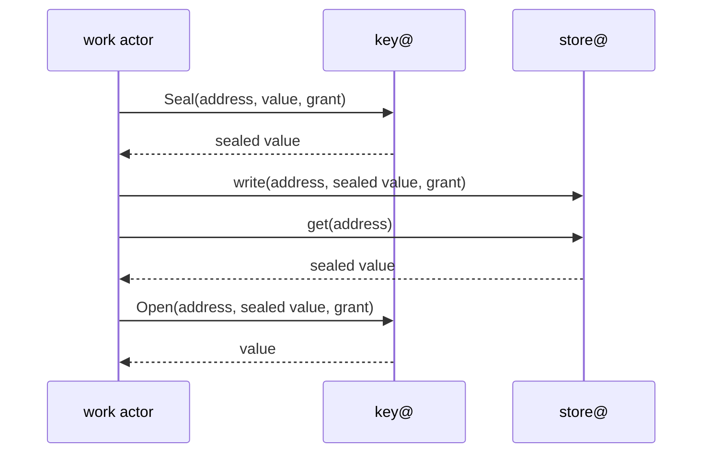

**key@** is the one holder of a boundary's keys. It holds the card PIN on a board or the KMS permission on AWS, and offers four operations: **Seal**, **Open**, **Sign** and **Mac** (a keyed hash). Every other actor asks it; none holds a key. Each [environment boundary](/concepts/boundaries/) has its own key@ and its own keys, so no key is shared between development, staging and production.

The mechanics are atoom's. Sealing, opening, wrapping, the data-key cache, the envelope and rotation by generation are its `seal` block, built on its [key port](https://github.com/truvity/atoom/blob/master/key/docs/key-port.md) and store port; the block declares the purposes it holds keys for, and the host supplies the rules ([atoom 0008](https://github.com/truvity/atoom/blob/master/docs/decisions/0008-blocks.md)). The block is planned (step B4 of atoom's [plan](https://github.com/truvity/atoom/blob/master/docs/plan.md)); the code that becomes it runs in key@ today, and atoom has no page for it yet. This page says what sluis decides: which keys a boundary and a tenant get, which purposes it declares, who may use which, and what happens on erasure and compromise. The rules and the roads not taken are [ADR 0006](/decisions/0006-keys-and-sealing/). The generated [Keys](/reference/keys/) page lists every purpose with its algorithm, its AWS key type, its card slot and the actor that asks for it. The threats are on the [threat model](/security/threat-model/).

## Key stores

The key store is the choice of key@'s driver. The three drivers are atoom's, and any actor's host may run one; which one an installation uses is a decision of the installation.

| Mode | atoom driver | Where it is used |
|---|---|---|
| **AWS KMS** | `key/awskms` | [lambda](/runtimes/#lambda), [kubernetes](/runtimes/#kubernetes) and other AWS installations |
| **YubiKey PIV** | `key/yubikeypiv` | [boards](/runtimes/#boards): one card per board |
| **Software** | `key/software` | [local](/runtimes/#local), CI, and development |

sluis consumes atoom's drivers and builds none: key@ runs the software and card drivers behind its own socket and peer check, and links the KMS driver in process (a Go library). What a card does, its PIN and touch policy and the measurements behind them are documented next to the driver ([`key/yubikeypiv/docs`](https://github.com/truvity/atoom/tree/master/key/yubikeypiv/docs)).

The local installation uses software keys and needs no hardware. The floor is in code: the software driver refuses to start when the environment is `production`, and configuration chooses only among the modes the floor allows ([ADR 0006](/decisions/0006-keys-and-sealing/#floors-in-code)). On Kubernetes the keys are AWS KMS keys; the workload tokens a pod presents are the cluster's projected service-account tokens, which the cluster signs and sluis neither holds nor signs. PKCS#11 drivers and post-quantum keys come later ([#1029](https://github.com/truvity/sluis/issues/1029)).

## Seal and open

**The store never seals or opens.** It keeps a sealed value as ciphertext and a compare-only value as a hash. To write, the actor asks key@ for `Seal(address, value, grant)` and writes the result; to read, it asks for `Open(address, sealed, grant)`. The plaintext exists only in the actor, for that call.

- **The value is sealed under the data key of its address's boundary, tenant and purpose,** with the full address as authenticated data. A value copied to another row, kind, tenant or boundary does not open.
- **key@ checks three things on every Seal and Open:** the caller's identity, by the transport; the caller's rule for the purpose and operation, generated from the actor registry; and, for a tenant's `data` and `evidence` keys, the grant, which must be sealed for the address's tenant, name the operation and not be expired. The tenant's `pseudonym`, `chain` and `credential` keys are checked by rule alone, because `policy` needs the facts they seal in order to decide.
- **Opens are batched,** so a request that needs a session cookie and a person's records pays one hop ([0037](/decisions/0037-capacity-is-measured-before-it-is-promised/#the-warm-sign-in-on-lambda)).
- **Sign-in session cookies are sealed and opened at key@ on every request,** under the boundary's `cookie` key, which `signin` never holds.
- **Mac** makes a keyed hash with HMAC-SHA384 over a data key: link ids and the hashed index entries of sealed kinds under the boundary's `mac` key, and audit pseudonyms under a tenant's `pseudonym` key. The caller names a label for each use, and a label whose output is a credential (the tag of a refresh token) is reserved to `signin`.

## Data keys

A data key is a software AES-256 key. key@ makes it, keeps it only wrapped, and opens it only in its own memory. It is never a KMS key, so a new tenant costs no KMS key and no key policy.

| Purpose | Scope | Protects |
|---|---|---|
| `data` | One per tenant | Personal and operational data of the tenant |
| `pseudonym` | One per tenant, rolled by epoch | Keyed hashes of the tenant: audit pseudonyms |
| `evidence` | One per tenant | Audit and usage evidence of the tenant |
| `chain` | One per tenant | Facts of a sign-in session chain that `signin` seals and opens and `exchange` opens |
| `credential` | One per tenant | The `StaffPasskey` kind, for `signin` alone |
| `grant` | One per boundary | Sealed grants |
| `cookie` | One per boundary | Sign-in session cookies and the sign-in cookie |
| `mac` | One per boundary | Keyed hashes of link ids, upstream sessions and the hashed index entries of sealed kinds |
| `data` | One per boundary, tenant `-` | The sealed kinds that have no tenant in their address |
| `secret` | One per KV store | The values and metadata of one KV store ([ADR 0047](/decisions/0047-kv-is-a-core-service-of-stores-that-no-tenant-owns/)) |

- **Each tenant has five data keys, one per purpose, and each boundary has four.** The purposes never share a key, so a tenant's exit can delete its personal data and keep its evidence. A tenant that exists in several boundaries has separate data keys in each. A tenant has no authority key and no wrapping key: a party that needs one is a boundary ([ADR 0006](/decisions/0006-keys-and-sealing/#data-keys)).
- **There is one key per purpose and per algorithm.** An asymmetric key never serves two purposes, and a key that issues certificates never signs tokens. Several audiences of one purpose share its key ([ADR 0006](/decisions/0006-keys-and-sealing/#key-purposes)).
- **Which actor may use which purpose is a rule of key@,** generated from the actor registry. The audit pieces use `pseudonym` and `evidence` through the same rules.
- **`chain` and `credential` are a tenant's keys, checked by rule with no grant,** once their key exists. A grant is a decision of `policy`, and `policy` needs these facts to decide, so a grant for every use would be circular. The first key of a tenant is made only under a grant that names the tenant.
- **The purposes are declared to `seal` by sluis** (O9: the key port takes any purpose its host declares). The key port takes the purposes its host declares since atoom 0.3.0 (step B13 of atoom's plan), and key@'s driver hosts declare sluis's purposes to it today; `seal` itself is planned (step B4).

### DataKeyWrap

Each wrapped copy of a data key is an ordinary durable kind, **`DataKeyWrap`**, with key@ as its one writer and the only actor that opens a wrap. Its id is `<purpose>/<generation>/<recipient>`.

- **On AWS there are two wraps:** the ciphertext that `GenerateDataKey` returns under the boundary's symmetric KMS key, with the encryption context {boundary, tenant, purpose}, and one for the backup recovery key, so that a compromised KMS key can be disabled without losing the old archives (the second wrap is planned).
- **On boards there is one wrap per recipient:** each board's card (its key-agreement key) and the backup recovery key. Making a wrap needs only the recipient's public key; opening one needs the card.
- **A new card or board is a rewrap:** an existing key@ opens each data key, wraps it for the new public key and writes the new item. The data is not touched. The recipients are a signed list in the `KeyPlan`, which key@ verifies itself ([ADR 0006](/decisions/0006-keys-and-sealing/#who-may-receive-a-wrap)).
- **The backup recovery key** is sluis's own key, a P-384 cloud KMS key in the boundary's anchor account, one for each environment, so that losing every card does not lose the data. It is not a ritueel object. No actor, not even key@, can open a wrap made for it; using it is a recovery step of the operator in that account.
- **The wrapping scheme, the key cache and the usage limits are the `seal` block's.** What sluis decides is the cache's time to live, set in the key plan under a built-in maximum: it is also the **erasure delay**. On boards and on Kubernetes key@ watches `DataKeyWrap` and drops an entry when its wrap is deleted; on Lambda nothing is pushed, so a warm function keeps its entries until they expire.

### Erasing a tenant

A tenant's exit deletes its `data`, `pseudonym`, `chain` and `credential` wraps at once, every generation and every recipient. Every value sealed for the tenant stops opening: this is the **crypto-shred**. Its `evidence` wrap is deleted when the evidence retention ends, because evidence outlives personal data ([ADR 0006](/decisions/0006-keys-and-sealing/#erasing-a-tenant), [Audit](/concepts/audit/#tenants-encryption-and-erasure)).

### A compromised key

A key declared compromised is revoked, then replaced: it leaves at once, its replacement signs at once, and only a person declares ([ADR 0041](/decisions/0041-a-compromised-key-is-revoked-then-replaced/)). For a data key, key@ makes a new generation and refuses every seal under the old one. The integrity keys (`grant`, `cookie`, `chain`) also stop opening it at once; the confidentiality keys keep opening it until a re-seal job has rewritten every value, or for the retention of the evidence. The declaration is a signed document ([Declarations](/reference/signed-config/#declarations)).

## Sealed grants

Only `policy` may ask key@ to seal a **grant**, the decision that a request is allowed. The store, `ca`, `signer`, key@ and the minters open it. A grant names the tenant and what it allows, is reusable for about 60 seconds, and is never stored; a one-shot irreversible action leaves a hashed `SpentGrant` marker. Grants are sealed under the boundary's `grant` data key, not a card key, so a grant costs a memory operation and not an ECDH. A grant sealed in one boundary opens in no other ([ADR 0007](/decisions/0007-policy-and-sealed-grants/#sealed-grants)).

This is one of **two independent checks**: the store's rule with a grant sealed for the tenant, and key@'s grant check on a tenant's `data` and `evidence` keys ([ADR 0007](/decisions/0007-policy-and-sealed-grants/#two-independent-checks)). The word *grant name* means something else: an entry of the grant vocabulary ([ADR 0020](/decisions/0020-grant-vocabulary-and-token-claims/#grant-names-and-the-vocabulary)).

## Algorithms

ES384 (ECDSA on P-384) is the default for everything sluis signs, the checkpoints of the issuance log included. sluis supports the FAPI 2.0 set, ES256, PS256 and EdDSA, as the algorithms of that profile ([ADR 0038](/decisions/0038-fapi-2-profile/)). It has a short list of named exceptions, each with a key of its own that serves nothing else: cloud federation, a per-audience RS256 key, NATS Ed25519 keys, the witness keys of the audit log and the audit checkpoint key, a P-256 key so that a generic witness verifies it ([ADR 0006](/decisions/0006-keys-and-sealing/#named-exceptions)). Everything else stays within the FIPS-approved set, with no FIPS mode or certified build in 2.0 ([ADR 0006](/decisions/0006-keys-and-sealing/#algorithms)). Which algorithm each store supports, and at what speed, is on atoom's [algorithms page](https://github.com/truvity/atoom/blob/master/key/docs/algorithms.md).

In Go, JOSE is `go-jose/v4` behind sluis's own `jose` package; Rust and TypeScript only verify ([Approved libraries](/reference/approved-libraries/#jose)). Tokens are standard JWS and JWT that any language verifies against the published key set.

## Key purposes

Two uses share a key only when their audience, lifetime, revocation coupling and callers are equal and the key store itself separates them. Purposes outside the baseline are **enabled on use**, each a dedicated key, and a purpose an installation does not enable has no key and no slot:

- the issuance-log key of `ca`;
- the release-signing key, in the release boundary only;
- the enrolment key of `exchange`, which hosts encrypt to (P-384 ECDH);
- the witness key, one per format;
- the backup archive key;
- the workload-issuer key of `sluis-node`, on boards only;
- each named exception.

Authority keys are born in their key store, sign in place and cannot be exported ([principle 1](/principles/#1-a-key-is-born-in-its-store-and-never-leaves-it)). There is no software signing for an authority key, and signing is content-aware: key@ signs a certificate only within its constraints, an SSH certificate body, a JWS signing input or an OpenPGP signature input, so a parser mistake refuses a signature.

## AWS KMS layout

A boundary on AWS needs **1 symmetric key and 5 asymmetric keys** in KMS (4 P-384 keys and the audit log's P-256 key), with one trust domain and one audit writer instance. Each further trust domain adds one P-384 key and each further audit writer instance one P-256 key.

| Key | Spec | Purpose |
|---|---|---|
| Symmetric | `ENCRYPT_DECRYPT`, AES-256 | Wraps every data key of the boundary, each under its own encryption context |
| Token signing | `ECC_NIST_P384`, `SIGN_VERIFY` | Tokens and the key set, used by `signer` through key@ |
| X.509 intermediate | `ECC_NIST_P384`, `SIGN_VERIFY` | The CA key of each trust domain, for `ca` (only when the PKI add-on is on) |
| SSH user CA, SSH host CA | `ECC_NIST_P384`, `SIGN_VERIFY` | One key each, for `ssh-ca` |
| Audit log | `ECC_NIST_P256`, `SIGN_VERIFY` | One per audit writer instance, for its audit and usage logs |
| Per tenant | None | A tenant's data keys are wrapped under the symmetric key |

The symmetric key's policy names key@'s role alone, and every signing key's policy names key@ only, because `kms:Sign` takes no encryption context. Every other actor reaches a key through key@, whose rules say who may ask for which purpose. KMS rotates the symmetric key automatically. In production it is a multi-Region key plus a replica, because losing it loses every sealed value; signing keys are single-Region ([ADR 0010](/decisions/0010-backup-and-recovery/#residency)).

## Keys per board

Each board has a card of its own, a YubiKey in PIV mode, and every key of the board is born on its card. A card belongs to one boundary, and a second card per board serves a further L1 boundary on the same engine. Data keys are not on the card: key@ wraps them for each card's key-agreement key. A lost board is replaced, not restored: a new key on a new card, a new certificate, and ritueel revokes the old one; the other boards rewrap every data key for the new card ([ADR 0041](/decisions/0041-a-compromised-key-is-revoked-then-replaced/)). The root cards are ritueel's and never sit in a board.

### The card slot map

The map that says which card slot serves which purpose is atoom's: the reference slot map and its check are on atoom's [slot plan](https://github.com/truvity/atoom/blob/master/key/slotplan/docs/slot-plan.md) page. The purposes in it are sluis's, and sluis decides how the map is used ([ADR 0006](/decisions/0006-keys-and-sealing/#the-slot-plan)):

- **One slot per purpose and per algorithm, and the map is pinned** (version 2). Every board of a version has the same layout, so enabling a purpose later never renumbers the keys of a live card. A slot is generated only when its purpose is enabled.
- **Six slots are rotation spares,** and a purpose that the map does not hold is named in the `KeyPlan` with one of them.
- **The `KeyPlan` holds each node's slot map,** signed by the publisher and so reviewed like any config. `sluis config check`, `sluis key request` and board initialisation refuse a collision and an enabled purpose with no slot.
- **Built and planned.** The card driver serves the slots of the first ten rows of the map; the rest are planned with the boards work on the [roadmap](/roadmap/), and key@ refuses a `KeyPlan` that enables one of them on a card.

## The token-signing key

Tokens are signed directly by the key store: KMS or the card signs each token itself, and there is no derived, burst or short-lived online key. The token-signing key is a key of its own, not the intermediate, so a key that signs tokens can never issue a certificate. Signing, the key set and the rotation of token keys are atoom's `token` block in time (planned, step B8).

**The token certificate is a switch.** When the installation turns it on (`token_certificate` in its `Boundary`; it is off in the core, and then no entry carries an `x5c` and no intermediate is needed), the board's intermediate certifies the token-signing key with a **non-CA certificate that allows digital signatures only**, under the token-signing profile of [ADR 0023](/decisions/0023-certificate-authorities/#leaf-profiles). Each ES384 entry of the published key set then carries an `x5c` chain; the RSA key of an audience that needs RS256 carries none. A standard verifier ignores it and fetches the key over TLS; a verifier that wants to can check custody down to a root it trusts. The signed set must list an ES384 `x509-intermediate` and an ES384 `token-signing` key, which `sluis config check` holds it to ([ADR 0006](/decisions/0006-keys-and-sealing/#the-token-certificate)).

## Exclusive card access, touch and PIN

key@ has the card to itself: its card driver runs as a dedicated user, and no other software that talks to cards runs on the board ([ADR 0006](/decisions/0006-keys-and-sealing/#exclusive-card-access)). The behaviour of the card is atoom's [card documentation](https://github.com/truvity/atoom/tree/master/key/yubikeypiv/docs). Board cards are touch never and PIN once, so a board signs unattended. A board starts locked, and key@ never stores the PIN in plaintext on disk: `sluis node unlock <node>` delivers it over an authenticated channel, or an unlocked peer releases it through the store ([the PIN release](https://github.com/truvity/atoom/blob/master/key/docs/key-port.md#the-pin-release)). After a full power loss one manual unlock is needed, and the first board then unlocks the others. A wrong PIN is never retried, because the card blocks after three attempts.

## Roots and certification

sluis holds **no root**. The roots, their ceremonies and every transition between root stores belong to [ritueel](https://ritueel.id); sluis holds intermediates and signs with them every day. The two exchange standard formats, fixed by ritueel's [hand-off contract, version 1](https://ritueel.id/reference/hand-off-contract/) and not repeated here ([ADR 0024](/decisions/0024-root-custody-and-the-signing-api/#the-hand-off)):

1. **Request.** `sluis key request` creates the key if it does not exist, on the board's card or in KMS, and writes a PKCS#10 request with a proof of where the key lives: the card's attestation chain, or the KMS key's full ARN.
2. **Certify.** In a ceremony at ritueel, ritueel checks the proof and a root key signs. The root is not in the answer.
3. **Install.** `sluis key install` checks the certificate against the CA bundle, the key and its request, and key@ writes the chain as `KeyCertificate`. Any CA that signs a PKCS#10 request in the profile can certify sluis ([ADR 0024](/decisions/0024-root-custody-and-the-signing-api/#the-floor)).
4. **Watch.** `sluis key status` shows each key, its store and its expiry. An intermediate certificate or an OpenPGP subkey lasts about 13 months and is re-signed over the same key in month 12; sluis warns 60, 30 and 14 days before the end.

Key material is replaced by the rule of [principle 3](/principles/#3-keys-are-shared-rotated-and-given-to-tenants-by-rule): on an event and, for a software key, no later than three years after it was made. The log keys change only on compromise ([ADR 0006](/decisions/0006-keys-and-sealing/#rotation)). Hosts pin the public keys of the root keys and refuse a root list with a lower trust sequence than the one they hold (`sluis trust sync`, [Identity](/concepts/identity/#trust-sync)).
