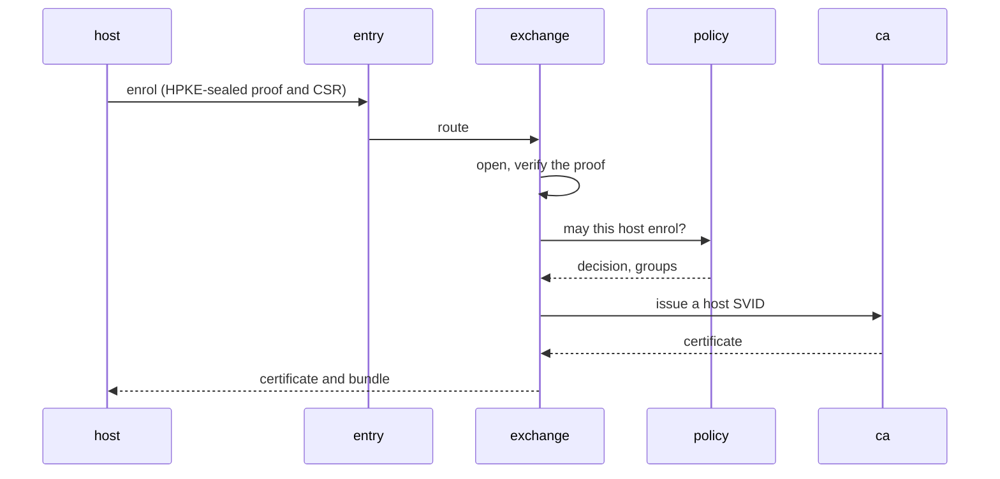

A **machine identity** is the name a host, a pod, a CI job or a sluis actor carries when it talks to something else, together with the credential that proves it. sluis issues machine identities with **one mechanism**:

1. The machine presents a **proof** from something sluis already trusts: a cloud's instance document, a Kubernetes token, a CI token, a hardware attestation, an enrolment token or a person's approval.
2. The `exchange` actor verifies the proof and performs a **token exchange** ([RFC 8693](https://datatracker.ietf.org/doc/html/rfc8693)). `policy` decides what the machine may become.
3. sluis returns a **credential**: an X.509-SVID from `ca`, a JWT-SVID from the boundary's issuer, or an SSH host certificate from `ssh-ca`.

This is agreed (2026-10-30). The record is [ADR 0012](/decisions/0012-machine-identity-follows-spiffe-proofs-are-exchanged-for-short-lived-credentials/). How an actor on a node reaches a cloud with its identity is on [Identity](/concepts/identity/); this page is about the identity itself. The threats it answers are T-20 to T-24 on the [threat model](/security/threat-model/#machine-identity-enrolment-and-trust): a credential for another identity, a caller from another boundary, a stolen or replayed enrolment, wrong roots, and a neighbour using an actor's identity.

## SPIFFE, as far as sluis implements it

sluis follows [SPIFFE](https://spiffe.io/) for the names, the trust domains, the bundles and the credential formats. It does not deploy SPIRE: the parts SPIFFE leaves to an implementation (proving what a machine is, deciding what it may be called, and the CA) are sluis's own.

| SPIFFE part | Status in sluis |
|---|---|
| SPIFFE ID | Implemented now |
| Trust domain and trust bundle | Implemented now. **The trust domain is the [boundary](/runtimes/boundaries/)** |
| X.509-SVID | Implemented now, issued by `ca` |
| JWT-SVID | Implemented now, issued by the boundary's issuer |
| Federation | Later |
| Workload Endpoint | Later |
| Workload API | Later |

The [standards register](/standards/) carries the same split.

### SPIFFE IDs

A trust domain is one boundary, such as `prod.example.com`. The ID paths are fixed:

| Subject | SPIFFE ID |
|---|---|
| A host | `spiffe://<td>/host/<name>` |
| A Kubernetes workload | `spiffe://<td>/k8s/<cluster>/ns/<ns>/sa/<sa>` |
| A sluis actor | `spiffe://<td>/sluis/<actor>`, for example `spiffe://prod.example.com/sluis/ca` |
| A CI job | `spiffe://<td>/ci/github/<org>/<repo>` |

**An actor has one ID**, whichever node or unit runs it. The instance is a separate attribute: a DNS name among the subject alternative names of an X.509-SVID, and a claim in a JWT-SVID. A rule that cares about the node reads the attribute (decided 2026-10-30).

A JWT-SVID carries `iss` = the boundary's issuer URL (`https://sluis.<env>.example.com`) and `sub` = the SPIFFE ID.

**Workload tokens on a node come from the boundary's issuer too** (decided 2026-10-30). `sluis-node` signs each actor's token with its own card's key, and the boundary's key set holds one key per node card, three on the boards, plus the next keys during a rotation. Per-node issuers are optional, only for a fleet whose nodes run different sets of actors, so that a cloud role can trust only the nodes that run its actor. Where every node runs the same actors, one issuer loses nothing and needs one OIDC provider instead of one per node. Between actors of two boundaries, the audience is the target's SPIFFE ID, over mutual TLS. See [Issuers and tokens](/runtimes/boundaries/#issuers-and-tokens).

### SPIRE as prior art

SPIRE solves the same problem, and sluis maps onto it. The table is for readers who know SPIRE.

| SPIRE | sluis |
|---|---|
| Node attestors | **Verifier drivers**, one per proof kind, in `exchange` |
| Workload attestors | The caller's uid on a node (peer credentials on a Unix socket), the projected ServiceAccount token on Kubernetes |
| Registration entries | Declared rules plus Cedar policy |
| The SPIRE server's CA | `ca`, with an intermediate that a root held by ritueel certifies ([Keys](/concepts/keys/#roots-and-certification)) |
| The trust bundle | A signed SPIFFE-format bundle, delivered by `sluis trust sync` (below) |

## Proof kinds are verifier drivers

Each kind of proof is a **verifier driver** in `exchange`. A verifier holds public material only: root certificates, key sets, the registry of known cards.

| Proof kind | What it proves | When |
|---|---|---|
| `aws-iid` | The EC2 instance identity document. Accepted **once per instance**. It is the primary path on EC2 | First release |
| `k8s-sa-token` | A projected ServiceAccount token from a cluster sluis trusts | First release |
| `github-oidc` | A GitHub Actions OIDC token | First release |
| `yubikey-attestation` | A PIV attestation, chained through Yubico's published intermediates to Yubico's PIV attestation root, **Yubico Attestation Root 1**, which sluis ships as the trust anchor, and checked against the registry | First release |
| `enrol-token` | An enrolment token, single-use or reusable (see below) | First release |
| Manual approval | A person approved the request | First release |
| `tailscale-whois` | The Tailscale node behind the connection | Next |
| TPM | A TPM quote | Later |

**Renewal is by possession**: a machine renews with the credential it already holds, over mutual TLS, and is asked to attest again at a fixed interval. The same flow enrols a **replacement sluis node**. The node's intermediate is certified through the hand-off to ritueel, as a separate step ([Keys](/concepts/keys/#roots-and-certification)).

## Joining a host

Five cases cover how a host joins. Each ends in the same exchange.

| Case | How the host proves itself | Notes |
|---|---|---|
| **A. Manual approval** | A short code is shown on the host and on the console, and a person checks that they match | Groups are assigned at approval. The person also compares the root fingerprint |
| **B. Automation through user data** | On EC2, the instance identity document, with no secret. Elsewhere, a single-use token put into the user data | `sluis host user-data --group <g>` prints a cloud-init snippet: text, not an artifact |
| **C. Network** | Tailscale WhoIs | A plain IP address is accepted only for low-privilege identities, or with approval |
| **D. Reusable token** | A token with a number of uses, an expiry, bound groups, a name pattern and a pre-approved flag, as Tailscale auth keys have | Shown once. The server keeps a key derived from the secret, sealed at rest (below) |
| **E. Hardware attestation** | A YubiKey attestation (later a TPM) | |

Groups come from declared rules over the host's attributes. An attribute records where it came from: **attested**, **declared** and **assigned** (on the console, audited) attributes may grant; **reported** attributes and plain cloud tags may not.

### The enrolment token never travels

A host that enrols with a token sends the **token's id** and an **HMAC over its certificate signing request and a server nonce**, keyed with the token's secret. The secret itself never crosses the network, so a recorded request cannot be replayed and a log line cannot leak it.

**The server keeps a key derived from the secret, not the secret.** It stores the HMAC key that HKDF derives from the token's secret. Like every state value, the record is encrypted in the port library, under a data key that the boundary's key-encryption key wraps, in KMS or on the node cards ([Data](/concepts/data/#every-value-is-encrypted)). A copy of the store alone does not let anyone enrol a host.

### Enrolment is encrypted end to end

The signed trust bundle carries an **enrolment public key**. The host encrypts its proof and its certificate signing request to that key with **HPKE** ([RFC 9180](https://datatracker.ietf.org/doc/html/rfc9180)). The private key is held by `key-holder` or KMS. The edge in front of `entry` (`cloudflared`, an API gateway) sees only ciphertext.

### The root fingerprint is pinned

A host that joins must be given the **pin of the roots**, the hashes of their public keys, and it refuses a bundle that does not chain to them. The pin updates itself through the signed root list, which only grows in version. Web PKI is kept so that the host can reach sluis, not as the reason to trust it. The one exception is manual approval, where the person compares the fingerprint shown on both sides.

## Trust sync

The trust bundle reaches a host through a **generic package**, not through a package that sluis generates for each estate.

- The `sluis` package ships `sluis trust sync`, with a `sluis-trust-sync.timer` and a oneshot service. They stay off until `sluis trust enroll --url <bundle-url> --fingerprint <root-fingerprint>` configures them.
- Each run fetches the SPIFFE-format bundle, checks the bundle and the root list against the pinned roots (the signature must be by a root in the list the host holds), refuses a bundle whose `spiffe_sequence` or a root list whose version is lower than the one it has, writes the trust anchors and runs `update-ca-trust` or `update-ca-certificates`.
- The unit is hardened: it may write only the anchor directory and the extracted store.
- On Kubernetes the same bundle feeds a trust-manager `Bundle` source or a `ClusterTrustBundle`.

## The work, by place

| Place | What it does |
|---|---|
| Server | The enrolment API (start, poll, renew over mutual TLS, leave, bundle), routed by `entry` to `exchange`; the verifier drivers; state for enrolments, the derived token keys and the host registry with attribute provenance; the Cedar actions `host.enrol`, `host.renew`, `enrol-token.create` and `enrolment.approve`; the host-SVID profile in `ca`; audit and notifications |
| Client | `sluis-host enroll` detects the platform, keeps the key in a card, then a TPM, then a file, shows the matching code, and handles status, renew, leave and re-enrol |
| Console | A hosts list, a queue of pending requests, enrolment tokens (shown once), an "Add host" page, and the rules, read-only |

**ACME comes after the first release** (decided 2026-10-30, [#978](https://github.com/truvity/sluis/issues/978)). `ca` will then serve ACME (RFC 8555), and `sluis-host` is only the SSH host service ([SSH](/integrations/ssh/)). Until then a host gets TLS certificates by sending a CSR to `ca`, through the enrolment API or the certificate module of `sluis-host` ([ADR 0013](/decisions/0013-ca-and-ssh-ca-are-the-certificate-authorities-and-ssh-uses-only-sluis-own-ca/)).
