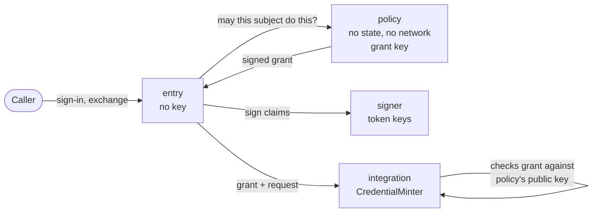

sluis is not one program. It is about eight **core roles**, each with one job, plus the **integrations** that talk to vendors. A role is the unit of least privilege: it is its own OS user and systemd unit on a self-hosted node, its own Lambda function on Lambda, and a container on Kubernetes (proposed, see below). What the platform lets a role touch is written once, in that role's [permission manifest](/architecture/), and generated into IAM policies, key policies, driver access lists, systemd units and network rules.

## The roles

| Role | Responsibility | Holds |
|---|---|---|
| `entry` | The OIDC protocol: sign-in, sessions, token exchange and the console API. It sits behind the edge connector. | No key |
| `signer` | Holds the signing ring and signs tokens under a signing policy. It is not a pure signing oracle. | The token-signing keys |
| `policy` | The decision point. A reviewed, file-based policy maps facts to grants. It has no state and no network. It signs mint grants with its own key. | The grant key |
| `ca` | X.509 and the SSH certificate authority. | The CA keys |
| `notary` | Signs the heads of audit batches. | The notary key |
| `audit-writer` | Seals audit batches and writes them to the blob store. | No signing key; it calls the notary |
| `audit-read` | Serves audit queries from the index. | Read-only access |
| `quota` | Rate limits and caps, using conditional adjust on the state port. | Nothing but its own counters |
| Integrations | One process per integration, in six kinds: see [Integrations](/concepts/integrations/). | The vendor credential of that integration only |

Four roles hold an authority key: `signer`, `policy`, `ca` and `notary`. Each holds a different one. `entry`, which faces the internet through the edge connector, holds none. `entry` is the one role with a TCP listener: its public API is bound to `127.0.0.1`, and every other role listens on Unix sockets only (see [Listeners](/architecture/listeners/)). The role was formerly called central.

## Why the signer and the policy are separate

In v1 the issuer is one function that serves sign-in, machine token exchange and downstream minting, and it touches 25 resources. Least privilege cannot be expressed for something that broad. v2 splits it before writing it:

- `entry` speaks the protocol and holds no key, so a bug in request parsing reaches no key.
- `signer` holds the token-signing keys and signs only what its signing policy allows. It is not a pure oracle, so a compromised `entry` cannot ask it for an arbitrary token.
- `policy` decides. It has no state and no network, so it cannot be made to read or exfiltrate anything. Its output is a **grant** signed by its own key, and a minter will only act on a grant signed by that key.

Splitting the decision from the signature gives two independent checks. To obtain a credential, an attacker needs a grant that `policy` signed **and** a minter that accepts it; to forge a token, they need `signer` to agree **and** the signing policy to allow it. v1 left the split for later and never made it. v2 makes it from the first slice.

The `policy` role is written in Rust with the `cedar-policy` crate, and Cedar is the policy language. The role, its isolation and its signed output do not depend on the language.

## The fusion rule

On a small node there is not enough memory for every role to be its own process (an estimate is 15 to 30 MB resident per Go process, and a small node also runs the state store). So two roles may be **fused** into one unit when the rule allows it:

> Two roles may share a unit only if the unit's manifest is the union of theirs, and no unit holds a key next to an unauthenticated listener.

Both halves are checked. The first means fusion never grants a role something it did not already have in its own unit, it only puts the two together. The second keeps the line that matters most: a process that is reachable without authentication, such as `entry` behind the edge connector, never also holds a key. The rule is tested: a profile that fuses roles in a way that breaks it fails the build.

:::note[Proposed]
On Kubernetes the "unit" of this rule is proposed to be the **credential scope**, which is the container, because one pod holds several roles, each with its own token audience. Read literally, a pod that holds `entry` and `signer` would break the second half. With the container as the unit, the build checks that no container that can use a key also has a listener. Which meaning of "unit" applies is [OD-18](/open-decisions/#od-18).
:::

## Roles on every shape

The set of roles is the same on every shape. What changes is how each one is run and what is behind its ports.

| Shape | A role is |
|---|---|
| Single node, cluster, EC2 | An OS user and a systemd unit; a few roles may be fused under the rule above |
| Lambda | One function per role |
| Kubernetes (proposed) | A container per role, in a node pod or an audit pod |

:::note[Proposed]
On Kubernetes a role is a container with its own user id and its own token audience, and a pod holds several roles. This replaces one pod, with one ServiceAccount, per role. The layout is [OD-17](/open-decisions/#od-17); see [Kubernetes](/shapes/kubernetes/).
:::

See [Shapes](/shapes/) for each shape and [Processes](/architecture/processes/) for what runs where.
