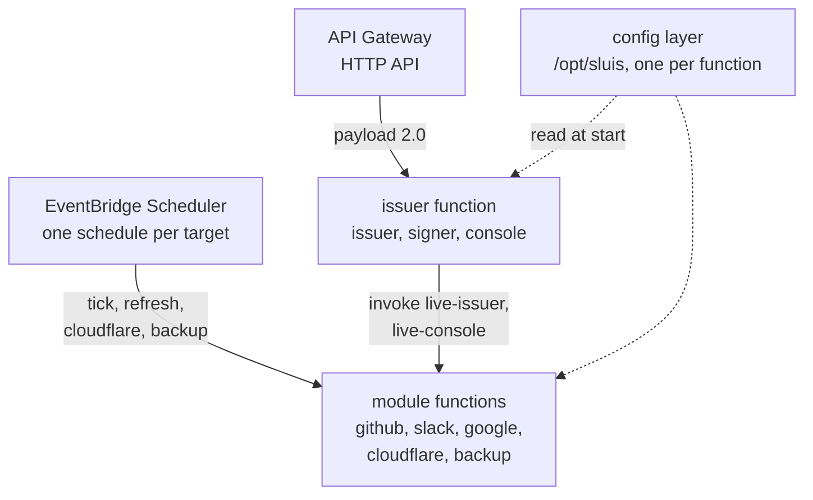
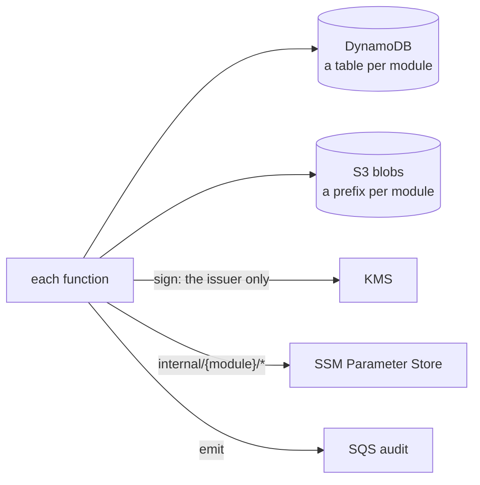

# How does sluis run on AWS Lambda?

sluis runs on Lambda as one function per module, each from its own release zip: the issuer, and `github`, `slack`,
`google`, `cloudflare`, `backup` and `restore`. Nothing is in a VPC. Every dependency is an AWS API a function reaches
over its own role. The only inbound path is an API Gateway HTTP API, in front of the issuer. The events, the
environment, the roles and the version rules are in the [reference](../../reference/sluis/lambda.md).

The inbound paths are the HTTP API and EventBridge Scheduler, one schedule per target. The issuer calls a module's
function; a module answers only the caller class its alias names.

## What does each function run?

A module function runs its own passes and answers the issuer's and the console's calls.

| Function | Runs |
|---|---|
| issuer | the issuer, the signer and the console |
| github, slack | the controllers' passes and the console's provider pages; GitHub mints installation tokens |
| google | the sign-in identity, the directory refresh and the Workspace pages |
| cloudflare | the token and R2 mint on its rotation tick |
| backup, restore | the daily archive; a restore for an administrator or the break-glass role |

Controllers do not loop on Lambda. Each pass is assembled for its invocation and runs once under the target's lease;
the platform freezes the process between invocations.

A schedule per target replaces the loop. The console's "run now" is an asynchronous invoke of the module's own function.

A module whose `remote` is unset in the issuer's document runs inside the issuer instead ([layouts](../../reference/sluis/pulumi-library.md#layouts)).
On layout v5 each module has its own function, role, table, parameter namespace and blob prefix.

## Who may call whom?

Every function has the alias `live`, which its schedules invoke, and one `live-<class>` alias per caller class:
`live-issuer`, `live-console`, `live-admin`, `live-breakglass`. The callee learns the caller's class from the alias it
was invoked through, never from the payload. A method lists the classes it answers; every other class gets
`not authorised`.

The restore function has `live-admin` and `live-breakglass` only, and its resource policy names the roles of each
class. A compromised issuer can call a module's methods and cannot read its credentials. The GitHub App keys, the
Slack tokens and the Google keys are in that module's namespace alone.

## What is deployed?

The Pulumi library deploys the zips it was given after checking each SHA-256 (`PackageSHA256`, from the release's
checksums). A zip is the release byte for byte, and its module is pinned at build. What makes a function an
installation's is a configuration layer.

Each function's documents live in one immutable Lambda layer, mounted last. Configuration changes by publishing a new
layer version and updating the function. Each change publishes a function version, and every caller invokes an alias,
which moves to it at once; there is no canary. The previous version stays, so a rollback points the alias back.

A layer outlives the deploy that made it and the function can read its own. The documents therefore name secrets and
hold none: secrets are SSM parameters read by name.

## What lives where at runtime?

The configuration is the layer's, read once. A secret is read from SSM when first used and cached for a minute. State,
sessions, leases and the targets' reports are in DynamoDB and S3, so no invocation depends on another's memory.

The directory snapshot refreshes on read when it is stale, and on a schedule. A refresh a request started finishes before
the response returns to the platform. A service is assembled once per execution environment. A controller is assembled
per invocation, as `sluis tick` does.

The backup function writes one age-encrypted `tar.gz` a day, readable without sluis
([backup](../../reference/sluis/backup.md)).

The binaries are built without the Kubernetes and Valkey clients, which keeps cold start short
([how it is held](../../reference/sluis/lambda.md)).

## What do you check before deploying?

`PackageSHA256` is a pin. Take it from a reviewed value in the stack's source, never from a digest fetched next to the zip.
A local `Package` is copied to a temporary file before it is hashed and deployed, so the checked file is the one that runs.

If a secret reaches a document, rotate it and delete the layer versions that hold it with `aws lambda delete-layer-version`.
The layer is retained (`SkipDestroy`) so that rollback works.

The library refuses a document that names an `endpoint` the function calls, such as `secrets.endpoint` or `ports.dynamodb.endpoint`. An R2 preset's endpoint is not one.
`AllowEndpoints` lifts that for a LocalStack test. `Telemetry.Env` takes only the layer's own variables, so the environment
cannot carry `SLUIS_*`, `LD_*` or another `AWS_*` variable.

An `aws` matcher with no `role` admits every role of the account, including roles created later. The issuer warns at
start ([the reference](../../reference/sluis/lambda.md)).

## Decided in

- [ADR 0026](../../decisions/0026-two-platforms-permanently-kubernetes-and-aws-lambda.md): two platforms permanently
- [ADR 0036](../../decisions/0036-configuration-is-immutable-per-instance.md): configuration is immutable per instance
- [ADR 0071](../../decisions/0071-least-privilege-modules-one-credential-holder-per-function.md): one function per credential holder
- [ADR 0072](../../decisions/0072-storage-layout-v5-module-first.md): a table, a namespace and a prefix per module
- [ADR 0073](../../decisions/0073-backup-format-2-age-encrypted-tar.md): backups are age-encrypted
