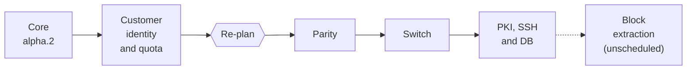

Design work in sluis follows one method. It keeps the maintainer's time for the questions only the maintainer can answer, and it keeps the records, the pages and the issues telling the same story. The rules for writing a record are in [Decisions, requirements and research](/contributing/decisions/); this page is the order of thinking before you write one.

## Principles first

Check every question against the [design principles](/principles/) and the accepted [decision records](/decisions/) before you ask anyone. If they settle it, write the answer, cite the principle or the record, and move on. Do not ask a question the repository already answers.

The principles that come up most in design work:

| Principle | In practice |
|---|---|
| 1. A key is born in its store and never leaves it | A transition makes a new key that the old one vouches for; it never moves the old key |
| 2. Redundancy is not a defence against compromise | Copies protect against loss; a compromise is answered by revocation and a transition |
| 3. Keys are shared, rotated and given to tenants by rule | Asymmetric keys are never shared across purposes or algorithms; a tenant has data keys, never an authority key |
| 4. Verify; never trust a claim | A proof is checked; a check that cannot run is reported as not run, never as passed |
| 8. Nothing without a consumer | See [below](#nothing-without-a-consumer) |
| 9. Measure before deciding, and date the measurement | See [below](#measure-and-date) |
| 16. Few credential holders | A work actor holds nothing at rest |
| 18. Plaintext lives only where it is used, behind two independent checks | The store never seals or opens |

Roots live in the separate project ritueel, and sluis holds intermediates only ([ADR 0024](/decisions/0024-root-custody-and-the-signing-api/)).

## Ask only real conflicts

The maintainer decides, but only three kinds of question reach the maintainer:

- two principles pull apart;
- a principle does not reach the question;
- a product, legal or finance fact that nobody in the repository can know.

Every question comes with the options, the pros and cons of each, and a recommendation. A question with no recommendation is not ready. A batch of questions ends the design pass; it does not interrupt it.

## Generalise before detail

For a milestone or a large topic, do not start from the issues. First list the high-level questions: topology, trust and custody, data ownership, failure, operations and compatibility. Mark each one settled, partly settled or open, with the principle or record behind it, and only then map the issues and records under those questions. A question that several milestones share is answered once, in one place. The [design-review skill](/contributing/agents/#skills) walks through this.

## Roads not taken

Record the options that lost, with the reason, in the record or the reference page ([Roads not taken](/contributing/decisions/#roads-not-taken)). Git keeps the text that merged, never the reasoning that was dropped.

## Measure and date

Every external fact carries a source and an "as of" date. Label each claim in a result or a draft:

- **READ**: you read it in a named source, at a version or a date.
- **MEASURED**: you ran it; say where, with which versions, and when.
- **UNVERIFIED**: anything else.

Fetch tools summarise pages, so check any exact quotation against the source before you publish it. An unverified item stays off the site, or is marked "to be confirmed". Results follow [The shape of a result](/contributing/decisions/#the-shape-of-a-result).

## Nothing without a consumer

A store, a driver, an endpoint or an option arrives with its first real installation or caller. Until then it is a "planned" line and an issue, not code and not a page that promises it. A page states what it is for, and a design that no installation uses yet does not get a place in the target state.

## State each rule once

A decision lives in one place: a record, or a reference page with test vectors that a record links. The other pages link to it and do not restate it. When you find the same rule in two places, keep the one that owns it and replace the other with a link ([Where a page lives](/contributing/pages/#where-a-page-lives)).

## Records change until the first release

Until the first v2 release, a record may be rewritten, merged and renumbered; after it, records are append-only and a changed mind gets a new record that supersedes the old one. While records are still rewritable:

- keep `docs/decisions/renumbered.json` current, so each old address redirects to the record that took it over;
- a rewritten record carries no history lines, and an accepted record has no open part.

The steps are in "Design phase" of `docs/decisions/README.md`, and the `new-decision` skill carries them.

## Records and issues stay in step

- Every requirement names an open issue of the right milestone.
- Every issue that a page or a record references exists.
- The [roadmap](/roadmap/) matches the board.
- The `check-*` recipes enforce what they can ([Tools, checks and verification](/contributing/tools/)). The rest is a bookkeeping pass at the end of each design batch: read the records, the requirements and the board side by side and fix the gaps.

## Milestones are an order

The phases are an order, not a wish list. Each opens when the one before it is done: the core (cut as `v2.0.0-alpha.2` before the installations), then customer identity and quota, then a re-plan that decides what parity needs, then parity with v1, then the switch of the platform from v1 to v2, then the PKI, SSH and database add-on. Block extraction stays last and is not scheduled. The phases and their exit tests are on the [roadmap](/roadmap/#phases); older records name them P0 to P4, and the roadmap maps those names to these.

Design is finished phase by phase, and the code for a phase starts after its design is. Nothing after customer identity and quota is planned in detail before the re-plan. Inside the core, the installations (local, boards, Lambda and Kubernetes) are built in the order of the roadmap's [Delivery order](/roadmap/#delivery-order), and [ADR 0011](/decisions/0011-runtimes-and-installations/#delivery-order) records any change to it.

## Do not make a later screen harder

The console is part of the core layer but is built in the Parity phase, so it has no pages yet, and a shortcut in its API reaches every screen built later. Before you write a console call, read [Before the pages exist](/decisions/0027-the-console/#before-the-pages-exist): eleven things the first console leaves out, such as an owner that cannot verify the operator, a page-shaped call, an unpaged list and a destructive write in one call.
