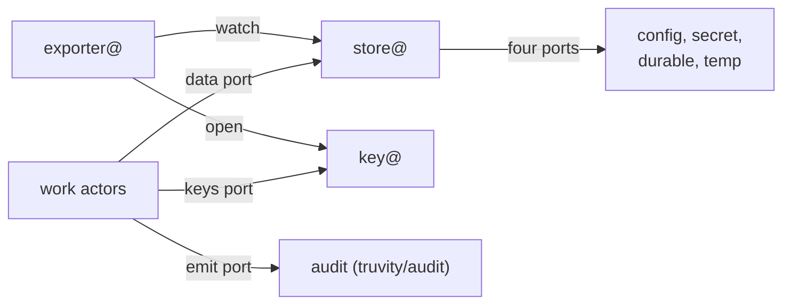

# 0002 — Actors form three families: work actors hold no credential at rest, and only the data and keys families hold credentials

**Status:** Accepted
**Date:** 2026-11-21

Proposal: [issue #901](https://github.com/truvity/sluis/issues/901).

## Context

sluis v1 is one issuer function that serves sign-in, machine token exchange and downstream minting, and it touches 25 resources; least privilege cannot be expressed for something that broad. v1 later split its parts by credential holder (v1 ADR 0071, on `master`), kept the signer and the console inside the issuer (v1 ADR 0072), and serves its contracts as Protobuf over Connect (v1 ADR 0064). This record is the v2 successor of all three, for the method.

v2 is several processes, and every one of them needs data and keys. If each process holds the credential of its own storage and its own key permission, a flaw in the code that parses an internet request reaches long-lived credentials, and an installation has as many credentials to protect, rotate and review as it has actors. The check that an actor may touch a value would also differ per backend.

Three units hold credentials: `store@` for data, `exporter@` for destinations outside sluis, and `key@` for keys. Every other actor holds nothing at rest, and the three run no request-parsing code. They are thin hosts around blocks of [atoom](https://github.com/truvity/atoom), the public repository of ports, drivers and blocks ([atoom 0008](https://github.com/truvity/atoom/blob/master/docs/decisions/0008-blocks.md)): `store@` around `state`, `key@` around `seal` and `exporter@` around `export`. The block holds the mechanics; sluis supplies the rules (which kinds exist, who may do what) and the placement. The rules over data are written once, in the kind registry ([0004](/decisions/0004-the-data-model/)), and the store applies them in the same way on every installation ([0005](/decisions/0005-the-store/)). The cost is a hop to `store@` for every data access and a hop to `key@` for every seal and open, which [0003](/decisions/0003-units-transports-and-fusion/) and [0037](/decisions/0037-capacity-is-measured-before-it-is-promised/) keep in view.

Audit is not part of sluis. It is the product of [truvity/audit](https://github.com/truvity/audit), built on atoom's ports. sluis emits audit records through audit's emitter, maps its boundary to an audit scope, and its console embeds audit's page ([0027](/decisions/0027-the-console/)). The pieces of audit hold their own credentials under audit's own rules ([audit 0002](https://github.com/truvity/audit/blob/master/docs/decisions/0002-pieces-and-holders.md)), so they are not a family here.

## Decision

### The families

- **Every actor belongs to exactly one family: work, data or keys.** A port is never shared between two families. A family is a set of actors that share one kind of authority, and the family tells a reader what an actor may hold.
- **An actor is a program with one responsibility,** run as its own unit in each boundary it serves ([0003](/decisions/0003-units-transports-and-fusion/)). These are the actors:

  | Family | Actor | Layer | Built | Responsibility |
  |---|---|---|---|---|
  | work | `entry` | core | yes | Parses each request, validates it against closed parameter lists generated from the contracts, and routes it to the actor that owns the step. It sits behind the edge connector and is the only actor reachable from outside. |
  | work | `signin` | core | yes | Sign-in, sign-in sessions, the session cookie and the freshness of each person's authentication per boundary (step-up). It asks `key@` to seal and open the cookie on every request. |
  | work | `console` | core | planned | The operator API, as the browser's backend ([The console](/decisions/0002-families-of-actors/#the-console)). |
  | work | `exchange` | core | yes | Token exchange (RFC 8693), enrolment, the front of the signing API, and the verifiers of proofs. |
  | work | `policy` | core | yes | The decision point. A declared Cedar policy maps facts to grants, and `policy` asks `key@` to seal them ([0007](/decisions/0007-policy-and-sealed-grants/)). It has no outbound network. |
  | work | `signer` | core | yes | Signs tokens under a signing policy, and artifacts for a grant that `policy` sealed ([0024](/decisions/0024-root-custody-and-the-signing-api/)). It asks `key@` to sign and is not a pure signing oracle. |
  | work | `kv` | core | planned | Versioned static secrets in stores that no tenant owns, with no credential at rest ([0047](/decisions/0047-kv-is-a-core-service-of-stores-that-no-tenant-owns/)). |
  | work | `ca` | add-on | v0, off in the core | The X.509 certificate authority ([0023](/decisions/0023-certificate-authorities/)). |
  | work | `ssh-ca` | add-on | planned | The SSH certificate authority, for user and host certificates ([0023](/decisions/0023-certificate-authorities/)). |
  | work | `adapter-<vendor>` | core | `adapter-upstream-oidc`; the others planned | The work actor of an integration, for example `adapter-upstream-oidc`, `adapter-slack` and `adapter-github` ([0025](/decisions/0025-integrations/)). `adapter-github` belongs to the GitHub add-on. |
  | data | `store@` | core | yes, with its own implementation | The only holder of storage credentials. It hosts atoom's `state` block and serves the one generic store service, with four ports downward, one per storage class ([0005](/decisions/0005-the-store/)). |
  | data | `exporter@` | core | yes, with its own implementation | Publishes the kinds marked exportable to destinations outside sluis ([0009](/decisions/0009-export/)). It hosts atoom's `export` block. |
  | keys | `key@` | core | yes, with its own implementation | Holds the card PIN or the KMS permission of its boundary, and offers Seal, Open, Sign and Mac ([0006](/decisions/0006-keys-and-sealing/)). It hosts atoom's `seal` block. |

  The executable of `signin` keeps its old name, `session`, until a planned step renames it. The product `session` of [truvity/session](https://github.com/truvity/session) is a different thing: browser sessions for websites.

  The three holders are built today with sluis's own code on atoom's ports. Moving them onto the blocks as thin hosts is planned in atoom's [plan](https://github.com/truvity/atoom/blob/master/docs/plan.md).
- **There is no limits actor and no quota actor.** The limit check of [0046](/decisions/0046-limits-on-the-request-path-and-usage-in-audit/) is part of the request path, next to the policy decision, and adds no unit.
- **There is no audit family.** Every actor has an emit port that hands its audit records to audit's emitter library ([Ports of a work actor](/decisions/0002-families-of-actors/#ports-of-a-work-actor)).

### The foundation and the layers

- **The data and keys families are the foundation.** `store@`, `exporter@` and `key@` run in every installation, and their binaries do not change with what runs above them.
- **A layer says what an installation may leave out.** Each actor row names its layer, and [0044](/decisions/0044-sluis-is-a-core-and-add-ons/) says what each layer contains. A layer is a grouping, not a fourth family: each actor stays in one family, which says what it may hold.

### Work actors

- **A work actor holds no credential at rest.** It reaches data, keys and audit only through its ports ([Ports of a work actor](/decisions/0002-families-of-actors/#ports-of-a-work-actor)), so a flaw in a work actor yields what it is using at that moment and nothing it could replay later ([principle 16, few credential holders](/principles/)).
- **`signer` and `policy` are split.** The actor that signs does not decide, and the actor that decides cannot sign.
- **`ca` and `ssh-ca` are two actors.** An SSH CA is a different authority from an X.509 CA, with a different key, format and relying parties, so a flaw in one does not sign for the other. An installation does not fuse them, because that would undo the separation ([0003](/decisions/0003-units-transports-and-fusion/)).
- **`signer`, `policy`, `ca` and `ssh-ca` run per boundary** ([0008](/decisions/0008-boundaries-and-tenants/)). `entry` only routes and does nothing else.
- **`entry` is hardened as the edge it is.** It is written in a memory-safe language ([0012](/decisions/0012-the-language-follows-the-executable/)), is fuzzed against its closed parameter lists, loads no plugins and runs on a read-only file system. It has no outbound network. Its listener is in [0003](/decisions/0003-units-transports-and-fusion/).
- **An adapter is the work actor of an integration.** It returns facts or carries out effects that core authorised, never decides, and serves one vendor, opening each tenant's connection credential at `key@` for each call ([0025](/decisions/0025-integrations/)).

### Credential holders

- **The credential holders are exactly three kinds of unit:** `store@` and `exporter@` (data) and `key@` (keys). No work actor is one, and no other unit of sluis is one.

  | Holder | Credential at rest | What it does with it |
  |---|---|---|
  | `store@` | The credentials of its four storage ports: the config source, the secret source, the durable engine and the temp engine | Reads and writes items through its drivers for callers whose rule allows it |
  | `exporter@` | The credentials of its export destinations | Writes the exportable kinds to the destinations |
  | `key@` | The card PIN on boards, the KMS permission on AWS | Seals, opens, signs and makes keyed hashes |

- **A holder never shares a unit with a work actor,** and `key@` never shares one with `entry` ([0003](/decisions/0003-units-transports-and-fusion/)). A holder's unit runs its own code and its drivers and parses no unauthenticated input.
- **On Lambda every function has a role, and only the holders' roles reach storage, keys or export destinations.** The role of a work function lets it invoke other functions and hand records to audit's transport through its emit port, and nothing else.
- **Processes follow the owner of a credential, not the port.** There is a unit per holder, never a unit per port.
- **A holder's compromise is bounded by what it holds.** A flaw in `store@` yields ciphertext, hashes, plain values and the values of secret sources, but no plaintext of a sealed value, because `store@` never seals or opens ([principle 18](/principles/)). A flaw in `key@` yields keys but not the data they protect, since the data is in `store@` ([threat model](/security/threat-model/)).

### Ports of a work actor

- **A work actor has exactly three ports in common:** a **data port** to `store@`, a **keys port** to `key@` and an **emit port** to audit's emitter. It also has the ports of its own job: an HTTP listener (`entry` only), provider APIs (adapters) and outbound fetch.
- **The data port is the one generic store service, used through typed clients** ([0005](/decisions/0005-the-store/)). Configuration, secrets and data all reach an actor as kinds through it. An actor has no configuration loader, no secret source and no storage driver of its own, and it never sees a driver.
- **The keys port is Seal, Open, Sign and Mac at `key@`** ([0006](/decisions/0006-keys-and-sealing/)). The actor registry says which key purposes and operations each actor may use.
- **The emit port hands an audit record to audit's emitter library** (Go and Rust), which sends it through audit's transport ([audit 0002](https://github.com/truvity/audit/blob/master/docs/decisions/0002-pieces-and-holders.md)). Every flow is audited, so every actor has the port. A usage record uses a blocking emit and a security record never blocks ([audit 0005](https://github.com/truvity/audit/blob/master/docs/decisions/0005-the-security-class.md), [0006](https://github.com/truvity/audit/blob/master/docs/decisions/0006-the-usage-class.md)).
- **A holder has ports of its own downward.** `store@` has four, one per storage class; `exporter@` has one per destination; `key@` has one for its card or KMS. A driver sits behind each of them. Drivers are atoom's: sluis consumes atoom's driver binaries and libraries and writes none of its own ([atoom 0010](https://github.com/truvity/atoom/blob/master/docs/decisions/0010-distribution-per-driver-and-lambda.md)).
- **The ports are the same on every installation.** What differs is the transport of each hop ([0003](/decisions/0003-units-transports-and-fusion/)) and the driver behind a holder's port.

### Names

- **Every actor is named `<actor>@<boundary>`,** for example `ca@prod` or `store@prod`. The name is generated from the actor registry, and the same name appears in every layer that enforces it:

  | Layer | Example for `ca@prod` |
  |---|---|
  | systemd unit | `sluis-ca@prod.service` |
  | Unix user | `sluis-ca-prod` |
  | socket | `/run/sluis/ca/prod.sock` |
  | Lambda function and IAM role | `sluis-ca-prod` |
  | Kubernetes pod and service account | `ca-prod` |
  | audit field | `actor=ca@prod` |
  | first part of the id of a self-scoped kind | `ca` |
  | SPIFFE ID | `spiffe://prod.<td>/sluis/ca`, in the boundary's own trust domain |

- **An adapter is named `adapter-<vendor>@<boundary>`,** for example `adapter-github@prod`. It serves one vendor, and [0025](/decisions/0025-integrations/) says how the instances of one vendor are told apart.
- **In prose, `store@`, `key@` and `exporter@` mean the holder of the boundary under discussion.**
- **A rename is a change of the actor registry,** and the matching names in every layer follow from it.

### The console

- **The console is its own work actor,** the browser's backend. The session is an HttpOnly cookie that `signin` has `key@` seal ([0006](/decisions/0006-keys-and-sealing/)); there are no tokens in the browser. The operator API is a different responsibility from `entry`'s, which stays the thin parser.
- **The console checks the operator's delegation and routes each write to the owning actor,** which validates it with its own logic. The store refuses any writer but the owner ([0004](/decisions/0004-the-data-model/)). Every operator change is authorised for a named person and audited under that name.
- **The console itself writes exactly two kinds, `Switch` and `LogLevelOverride`.** No actor has domain logic for either, so the store checks their schema, bounds and direction from the kind registry ([0027](/decisions/0027-the-console/)).
- **The console's single-page application is a separate artifact,** served same-origin by each runtime's static host ([0013](/decisions/0013-release-train-packaging-and-distribution/)). Its pages follow the storage class and profile of what they show, and its audit page is audit's ([0027](/decisions/0027-the-console/)).

### Contracts

- **Every contract is Protobuf served over ConnectRPC, even when caller and callee share a process.** In-process calls use an in-memory transport, so moving a component into its own unit changes configuration, not code. The same contract travels over a Unix socket, a Lambda invoke or an in-cluster gRPC call ([0003](/decisions/0003-units-transports-and-fusion/); [atoom 0009](https://github.com/truvity/atoom/blob/master/docs/decisions/0009-connectrpc-in-process.md)). The one exception is Cedar, which `policy` uses as a library ([atoom 0011](https://github.com/truvity/atoom/blob/master/docs/decisions/0011-cedar-as-a-library.md)).
- **The `proto/` directory is the source of every contract,** and a contract change is reviewed there first. Other descriptions, such as OpenAPI, are generated from it ([0004](/decisions/0004-the-data-model/)).

### Three zoom levels

The design is described at three levels, and the output of each is the input of the next:

- **The black box:** what sluis does, for whom, and which resources each use case touches.
- **The components:** which actor owns each operation, through which contract and which of its ports, the call graph, and one writer per kind.
- **The units:** the actors and holders as units, their rules, their packaging, and the enforcement on each installation.

### Registries generate the enforcement

- **Two registries are the spine.** The kind registry holds the rules over kinds: which actor may get, list, create, update, delete or watch which kind, and the one writer of each ([0004](/decisions/0004-the-data-model/)). The actor registry names every actor, its family, layer, language, placement, the actors it calls, its egress hosts and the key purposes it uses ([reference](/reference/actors/)). The kind registry is an extension of atoom's `state` registry, which any product extends.
- **Nothing that enforces least privilege is written by hand.** The registries generate, for every installation:
  - the store's rule table and the grant checks at `key@`;
  - the IAM and trust policies of the holders' roles and the invoke permissions between functions;
  - the KMS key policies, one holder per key;
  - the systemd units, sandbox drop-ins and per-uid egress rules, the Kubernetes service accounts and NetworkPolicies;
  - the call graph, default deny, enforced by one interceptor in every process and again by each transport: the socket groups and sandboxes on boards, the invoke resource policies on Lambda, the NetworkPolicies on Kubernetes ([0003](/decisions/0003-units-transports-and-fusion/));
  - the backup list, the telemetry allowlist and the redaction of audit fields, from the kinds' treatment and storage class.
- **Enforcement is checked and tested.** `sluis config check` refuses an installation that gives a work unit a credential or puts a holder in a unit with a work actor, and the build runs it again. The deny matrix is generated from the same data: for every pair of actors, X is denied Y's kinds, keys and sockets, and a test proves it. The blast-radius report of every actor is checked in, so a pull request shows what a change grants.

### Platform pieces

- **A platform piece is a program an installation runs that is not an actor of any family:** the edge connector, the host's card service, the engine processes, and the node agent `sluis-node`.
- **The edge connector is key-less.** It is `cloudflared` on boards, the pinned Lambda Web Adapter on Lambda and an edge relay container on Kubernetes ([0003](/decisions/0003-units-transports-and-fusion/)).
- **The card is reached only through `key@`.** The card service of the host talks to `key@` alone ([0006](/decisions/0006-keys-and-sealing/)).
- **The engines are reached only through `store@`'s drivers.** The engine is chosen per installation among `rqlite`, `dynamodb` and, on Kubernetes, `postgres` through CloudNativePG ([0005](/decisions/0005-the-store/)).
- **`sluis-node` holds no key credential.** It issues each unit a short-lived workload token and asks `key@` to sign it, with a key purpose of its own on boards ([0022](/decisions/0022-workload-identity-and-host-enrolment/), [0006](/decisions/0006-keys-and-sealing/)).

## Consequences

- A flaw in request parsing in `entry` reaches no key and no storage credential, and `entry` cannot send anything out. To obtain a credential an attacker needs a grant that `policy` sealed and a holder that accepts it.
- An installation has few credentials to protect, rotate and review: one set per holder, not one set per actor. A work actor needs no cloud role beyond invoke and emit, no storage user and no key permission.
- Every data access crosses `store@` and every seal or open crosses `key@`. The cost is a call on every installation, accepted for the isolation ([0037](/decisions/0037-capacity-is-measured-before-it-is-promised/), [0003](/decisions/0003-units-transports-and-fusion/)). Their availability bounds the availability of the work actors, and their code is the code to review hardest.
- The rules over data are in one registry and one enforcement point, so a backend that cannot tell callers apart needs no special case, and a new engine changes a driver and no actor. One generated name per actor lets a unit, a role, a service account and an audit fact be matched without a lookup table.
- The generators are a large piece of work and a single point of failure: a wrong generator grants what the registries do not say. Each generator needs golden tests and the deny matrix, and review of the registries and the blast-radius report is where the design is held to account.
- A component can start inside another unit and move out later. The cost is a contract, a generated client and server, and a ConnectRPC kit and conformance suite for every language in use.
- More units (`ca` and `ssh-ca`, `signer` and `policy`, the console and `entry` are split) cost small boards memory. Routing operator writes to the owner keeps the console without write access to other actors' kinds; each owner needs validation and tests for the writes it accepts.
- Moving `store@`, `key@` and `exporter@` onto atoom's blocks leaves sluis with the rules and the placement. A change to a block is a change in atoom first.

## Roads not taken

- **Each actor holds the credential of its own storage, through a driver of its own, and only the card has a mediator.** Credentials multiply with actors, a flaw in any actor yields a long-lived credential, and the check that an actor may touch a value differs per backend. Three holders and one registry give one check and few credentials.
- **One process everywhere.** A flaw in any part holds every credential the others use; v1 ADR 0071 already replaced it for that reason.
- **A broad `entry` that runs the OpenID Connect protocol, sessions, token exchange and the console API.** The actor that parses internet input would hold every session, enrolment and operator write, and a parsing flaw would reach them all.
- **The console as part of `entry`.** It would widen the one actor reachable from outside; fusing the two on a small board stays an installation choice ([0003](/decisions/0003-units-transports-and-fusion/)).
- **A console that writes every operator and tenant-admin kind.** It would lose the validation of the owner for clients, connections and links; the two kinds it writes have no owner with domain logic.
- **The signer inside `entry`, as in the v1 issuer.** The right to sign would sit beside the internet-facing listener, and a split deferred is a split that becomes a rewrite.
- **One `ca` actor with two key purposes for X.509 and SSH.** It saves a unit on a 2 GB board, but `key@`'s purpose check would be the only separation between two authorities with different formats and relying parties.
- **A decision point with network access.** An actor that can be made to read or exfiltrate anything is a target, and its grants could no longer be reviewed as a file.
- **A process per port.** A process that serves many owners holds many credentials, which defeats the split.
- **A separate actor for limits or quota.** It would add a unit and a hop to every request for a check that sits beside the policy decision.
- **Audit as a family of sluis.** Audit serves other products and works without sluis; its pieces hold their own credentials in their own repository, and sluis only emits to it.
- **`sluis-node` holding a signing key of its own.** `key@` has exclusive access to the card, and a second holder of a key credential would open the card to a second program.
- **A manifest of permissions per actor as the spine.** A third file per actor would restate the two registries and could drift from them.
- **Hand-written policies per runtime.** The IAM policy, key policy, unit and network rule of one actor would drift apart.
- **Plain interfaces inside a process, contracts only between processes.** Moving a component into its own unit would become a rewrite.
- **Hand-written OpenAPI, or gRPC only.** OpenAPI drifts from the code (v1 ADR 0064), and gRPC alone is not reachable from a browser or a function gateway.
- **Keep the word "role" for an actor.** It already means a user role in scopes and a cloud role in IAM, so a process called a role is ambiguous in every sentence about access.

## Follow-ups

- Open: the step that renames the executable of `signin`; no issue yet.
- Moving `store@`, `key@` and `exporter@` onto atoom's `state`, `seal` and `export` blocks: atoom's [plan](https://github.com/truvity/atoom/blob/master/docs/plan.md).
