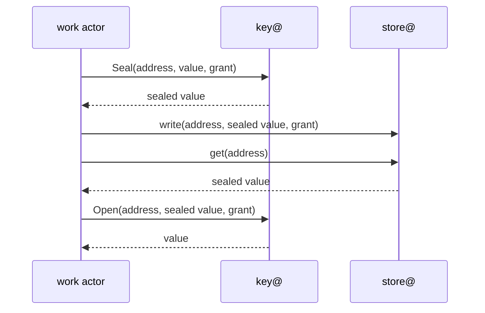
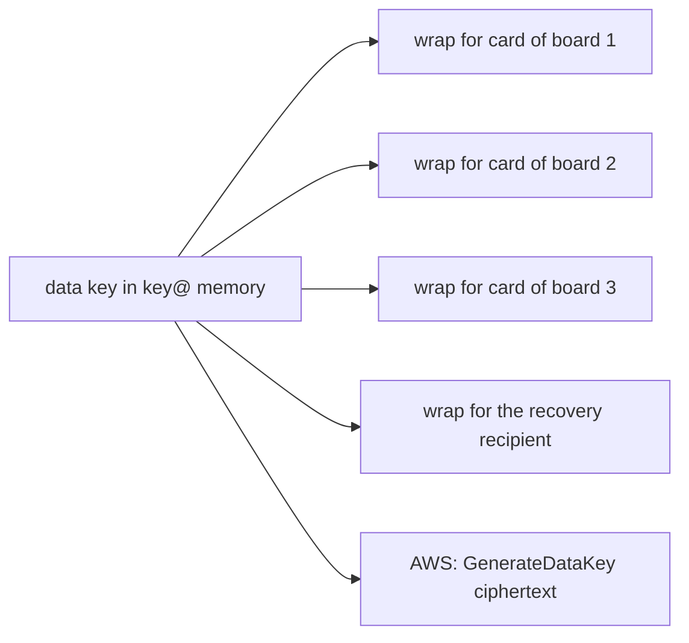

# 0006 — key@ holds a boundary's keys: it seals, opens and signs in place, with five data keys per tenant and one key per purpose and algorithm

**Status:** Accepted
**Date:** 2026-11-04

Proposal: [issue #909](https://github.com/truvity/sluis/issues/909).

## Context

Every token, certificate and signed log head that sluis makes is signed, and every secret it keeps is sealed. Three groups of readers constrain the algorithms: verifiers that do not belong to sluis (many OIDC libraries were written for RS256), standards that fix a set (the FAPI 2.0 Security Profile, section 5.4.1, names PS256, ES256 and EdDSA; checked 2026-10-29), and drivers (a cloud key service, a hardware key and a software key support different algorithms at very different speeds).

The keys are worth more than anything they sign. sluis holds the token-signing keys, the keys of its certificate authorities, the log key and the keys that protect every tenant's data, and it publishes a key for each workload identity it issues. The volume is low: a production installation of v1 saw about 25,000 tokens in 7 days, a peak of 0.8 a second, 95 % of them token exchange. Hardware fails, is lost and is stolen, and installations differ: AWS with a key service, small boards with a YubiKey in each board, a workstation with software keys for development.

The data model adds three demands. The store keeps sealed values as ciphertext and never opens one ([0005](/decisions/0005-the-store/#the-store-api)), so a plaintext exists only in the actor that uses it ([principle 18](/principles/#18-plaintext-lives-only-where-it-is-used-behind-two-independent-checks)), and someone has to hold the keys that seal and open: `key@`, the one holder of the keys family ([0002](/decisions/0002-families-of-actors/#credential-holders)), one per boundary from level L1 of the ladder ([0008](/decisions/0008-boundaries-and-tenants/#the-ladder)). A tenant has to be erasable by deleting a key, while the audit evidence of that tenant outlives its personal data. And a card does about seven ECDH operations a second, so a card cannot be asked once per value; a software data key, wrapped for the card and opened once per cache entry, can.

v1 ADR 0005 made ES384 the default, and v1 ADR 0009 added a per-audience RS256 exception with a separate key; this record keeps both. sluis holds no root: roots are [ritueel](https://ritueel.id)'s, and the hand-off is [0024](/decisions/0024-root-custody-and-the-signing-api/#the-hand-off). Who may ask `key@` for what is decided by the rules of [0007](/decisions/0007-policy-and-sealed-grants/#two-independent-checks).

## Decision

### Algorithms

- **EC P-384 with ES384 is the default** and what sluis chooses for itself, with one exception: the checkpoints of the audit log are signed with P-256 and SHA-256 ([Named exceptions](/decisions/0006-keys-and-sealing/#named-exceptions)). The checkpoints of the issuance log are C2SP signed notes with a P-384 key. One curve means one key type in the key set, one verifier path and one wrapping scheme.
- **sluis supports the FAPI 2.0 set: PS256, ES256 and EdDSA (Ed25519).** ES384 stays the default.
- **Everything sluis signs, seals, wraps, hashes, derives or encrypts stays within the FIPS-approved set:** P-384 ECDSA and ECDH, AES-256-GCM, AES key wrap, HKDF-SHA384, HMAC-SHA384 (for `Mac` and for audit pseudonyms, [0029](/decisions/0029-the-audit-log/#pseudonyms)) and SHA-384, plus the named exceptions below (P-256 ECDSA with SHA-256 is approved too). There is no FIPS mode and no certified build in 2.0: Go keeps the standard library's defaults (`GOFIPS140` and `fips140` unset), and Rust uses current crates and rustls with no FIPS pin. Keeping to the approved set means a FIPS build can be added later as a build option without changing a format or a stored value. The Rust build facts are in [0012](/decisions/0012-the-language-follows-the-executable/#per-actor-table).
- **AES-256-GCM takes its nonce from the cryptographic library**, never from the caller (in Rust, `RandomizedNonceKey` of `aws-lc-rs`).
- **TLS follows the libraries' defaults**, which may negotiate X25519 or ChaCha20-Poly1305. Nothing sluis stores or publishes depends on them.
- **The only source of randomness is the operating system's CSPRNG**, through Go's `crypto/rand` (tests use `testing/cryptotest.SetGlobalRandom`) or, in Rust, the generator of the cryptographic library. Nothing is mixed into it from a key service or a card. On AWS a data key is made by `GenerateDataKey` and used as it comes. `sluis doctor` checks the platform: kernel 5.18 or newer (a cloned virtual machine reseeds), a hardware generator present or deliberately absent, and the entropy pool initialised before the first key.
- **Driver support is checked per algorithm** when the installation is checked, not at the first token. PS256 on a YubiKey takes about 2.3 seconds per signature, so it suits a low-volume audience only; Ed25519 in PIV needs firmware 5.7 or newer.
- **Tokens are standard JWS and JWT**, verified with any language's standard libraries against the published key set. The algorithms sluis accepts from others, such as passkey assertions, are set with those features ([0017](/decisions/0017-identity-and-sign-in/#passkeys)). How a client or audience selects a non-default algorithm is client-profile configuration.

### Named exceptions

"No RSA" and "P-384 only" have exactly these exceptions. Each has its own key, which serves no other purpose, and each is a purpose that is enabled on use ([Key purposes](/decisions/0006-keys-and-sealing/#key-purposes)).

1. **FAPI 2.0:** PS256, ES256 and EdDSA, as above.
2. **Cloud federation:** a key that signs a workload token for a cloud uses the algorithm that cloud requires: ES384 for AWS, ES256 for GCP, RS256 (RSA-2048) for Azure Entra.
3. **Per-audience RS256:** for an audience configured to need RS256, sluis signs that audience's tokens with a separate RSA key, published beside the EC keys. The audience, not the caller, decides.
4. **NATS decentralized authentication.** NATS fixes Ed25519 for its operator, account and user keys (nkeys), and its JWTs are signed with them. sluis follows that:
   - **one Ed25519 key per purpose:** the operator identity, an operator signing key per environment, a scoped signing key per role and account, and the callout account's key. None of them serves another purpose;
   - **the keys live in the cloud key service or on the card, behind `key@`,** whose rule for them names only the minter of NATS credentials. A user's own nkey is generated by the workload and never leaves it;
   - **no xkey.** The X25519 key that NATS can use to seal callout requests is not used, because X25519 alone is not an approved algorithm under FIPS 140-3. TLS on the client port protects the request instead;
   - Ed25519 is approved (FIPS 186-5) and is in Go's FIPS 140-3 module, so this exception stays within the approved set.
5. **Formats that fix their own algorithm are followed:** the C2SP tlog-cosignature witness keys use Ed25519 or ML-DSA-44 as that specification requires ([0029](/decisions/0029-the-audit-log/#witnesses)); a witness key authorises nothing and serves no other purpose.
6. **The audit checkpoint key is P-256 and signs SHA-256** (decided 2026-11-04, [REQ-KEYS-081](/requirements/keys/#REQ-KEYS-081)). The `audit-log` purpose follows the C2SP `signed-note` signature type 0x02 (ECDSA), which the witness implementation of transparency-dev verifies, so that a generic witness or checkpoint verifier accepts a checkpoint without sluis code. In AWS KMS it is `ECC_NIST_P256` with `ECDSA_SHA_256`; on a board it is a P-256 key in the PIV slot of the purpose. The key serves no other purpose, and every other key stays P-384. The issuance log is not part of this exception ([0029](/decisions/0029-the-audit-log/#tiled-log)).

### Key purposes

A key is shared between two uses only when all of these are equal: **the audience** (who verifies or decrypts), **the required lifetime**, **revocation coupling** (one use would never be disabled without the other), **the callers** (the blast radius of a misuse), and **the key store itself separates the uses** (an encryption context under a key policy). If any one differs, the uses get separate keys.

- **There is one key per purpose and per algorithm.** An asymmetric key never serves two purposes, and a key that issues certificates never signs tokens. Several audiences of one purpose share its key: two audiences of the token purpose need one ES384 key, and an audience that needs RS256 gets a key of its own because the algorithm differs.
- **The signing purposes are separate keys:** the token-signing key; an X.509 intermediate for each trust domain; the SSH user CA and the SSH host CA; the log key of each audit log. Each is a P-384 key, except the log key of the audit log, which is P-256 ([Named exceptions](/decisions/0006-keys-and-sealing/#named-exceptions)).
- **A boundary's one symmetric KMS key is shared by all its data keys,** each wrap under its own encryption context ([Keys per boundary on AWS](/decisions/0006-keys-and-sealing/#keys-per-boundary-on-aws)). Sharing is safe there because the context names the boundary, the tenant and the purpose, and the key policy lets only `key@` use the key.
- **A tenant has no authority key and no wrapping key of its own by default.** It has five data keys ([Data keys](/decisions/0006-keys-and-sealing/#data-keys)). A tenant that is declared to keep its keys in a customer account has wrapping keys and an issuer signing key in that account ([Where a tenant's keys live](/decisions/0006-keys-and-sealing/#where-a-tenants-keys-live)); any other party that needs authority keys of its own is a boundary ([0008](/decisions/0008-boundaries-and-tenants/#tenants)).
- **Boundaries never share keys.** Two boundaries on one engine are separated by wrapping keys of their own, for example a second card per board ([0008](/decisions/0008-boundaries-and-tenants/#the-ladder)).
- **Purposes outside the baseline are enabled on use,** each a dedicated key. A purpose an installation does not enable gets no key and no slot, and `sluis config check` refuses an enabled purpose with no key or slot and a collision of two purposes on one slot.

| Purpose enabled on use | Algorithm | Where | Asked by |
|---|---|---|---|
| Issuance log of `ca` | P-384 | Every boundary with `ca` | The audit writer, which signs the issuance log's checkpoints ([0029](/decisions/0029-the-audit-log/)) |
| Release signing | P-384 | The release boundary only | `signer` |
| Enrolment key of `exchange`, which hosts encrypt to ([0022](/decisions/0022-workload-identity-and-host-enrolment/#host-enrolment)) | P-384 (ECDH) | Every boundary with host enrolment | `exchange` |
| Witness key, one per format | As the format requires | A boundary that runs a witness | The witness, which signs its cosignatures through `key@` |
| Backup archive key | AES-256-GCM, wrapped by a dedicated KMS key on AWS and by ECDH P-384 on a board | Where an installation takes backups | `exporter@` wraps and the restore of `store@` opens ([0010](/decisions/0010-backup-and-recovery/#the-archive-key)) |
| Workload issuer of `sluis-node` | P-384 | Boards only | `sluis-node`, which signs through `key@` |
| PIN release key | P-384 | Boards only | The card driver of the locked board, which signs its `PinReleaseRequest` with it, and the unlocked peer's, which signs its `PinRelease` ([Touch and PIN](/decisions/0006-keys-and-sealing/#touch-and-pin)) |
| Each named exception: PS256, RS256, ES256, Ed25519 and the NATS nkeys | As named | Where the exception is configured | The actor that signs for it |

The generated [keys page](/reference/keys/) lists every purpose with its algorithm, its key type on AWS, its slot on a board and the actor that asks for it.

### Keys sign in place

- **An authority key is born in its key store, signs in place and cannot be exported** ([principle 1](/principles/#1-a-key-is-born-in-its-store-and-never-leaves-it)). The store signs each digest itself. There are no derived signing keys, no burst key and no short-lived online key certified by an intermediate. There is no software signing for an authority key.
- **Every key whose public half is trusted through the PKI chain is a hardware-held child key,** attested where the hardware can attest and certified through a root that ritueel holds: the CA intermediates and the OpenPGP signing subkeys. Hardware-held means a key service such as AWS KMS or a card such as a YubiKey. KMS cannot attest where a key was born, so for it the checks are the key's description, its policy, the record of its creation and a match between the public key and the request.
- **SSH CA keys are anchors, not a chain.** The `ssh-user` and `ssh-host` keys are held behind `key@`; hosts trust a list of SSH CA keys that ritueel publishes, signed by a root ([0023](/decisions/0023-certificate-authorities/#ssh)).
- **Ephemeral and symmetric keys are outside the rule:** session keys, ephemeral ECDH keys, data keys and derived keys are neither hardware-held nor certified. A data key is not an authority key: `key@` makes it, keeps it only wrapped, and opens it only in its own memory ([Data keys](/decisions/0006-keys-and-sealing/#data-keys)).
- **`key@` signs after it checks what it signs.** Signing is content-aware per purpose. The X.509 purpose signs only a TBSCertificate that parses and stays within its constraints, the SSH purposes only an OpenSSH certificate body, a token purpose only a JWS signing input, and the release-signing purpose only an OpenPGP signature input. A sign call therefore carries the content, not only its digest, and a mistake in a parser refuses a signature instead of signing the wrong thing. Every signature is rate-limited and is an audit fact.
- **`key@` writes `KeyCertificate`,** the chain the root custodian returned for a purpose, which `sluis key install` hands to it; `ca` writes `TrustBundle` ([0022](/decisions/0022-workload-identity-and-host-enrolment/#the-trust-bundle)).
- **CA serial numbers are random and 128 bits long.** No serial ledger is kept.
- **The first version supports three key stores:** YubiKey PIV, AWS KMS, and software keys for development and CI. PKCS#11 drivers for devices such as YubiHSM 2 and Nitrokey HSM 2, more drivers and post-quantum keys come later ([#1029](https://github.com/truvity/sluis/issues/1029)). The card and KMS driver is a separate binary private to `key@` ([0005](/decisions/0005-the-store/#drivers) states the rule for all drivers).

### Keys per boundary on AWS

A boundary needs **1 symmetric key and 5 asymmetric keys** in KMS (4 P-384 keys and the audit log's P-256 key), with one trust domain and one audit writer instance. Each further trust domain adds one P-384 key and each further writer instance one P-256 key. The lambda and kubernetes installations use this layout alike ([0011](/decisions/0011-runtimes-and-installations/#installations)).

| Key | Type | Purpose |
|---|---|---|
| Symmetric | AES-256 | Wraps every data key of the boundary: the tenants' `data`, `pseudonym`, `pairwise`, `evidence` and `chain` keys, and the boundary's `grant`, `cookie`, `mac` and `data` keys |
| Token signing | P-384 | ES384 tokens ([The token-signing key](/decisions/0006-keys-and-sealing/#the-token-signing-key)) |
| X.509 intermediate | P-384 | One per trust domain, for `ca` |
| SSH user CA | P-384 | `ssh-ca` |
| SSH host CA | P-384 | `ssh-ca` |
| Audit log | P-256 | One per writer instance, for its audit log and its usage log, signing SHA-256 (`ECC_NIST_P256`, `ECDSA_SHA_256`); a log key rotates only on compromise ([Rotation](/decisions/0006-keys-and-sealing/#rotation)) |

- **The symmetric key's policy names `key@`'s role alone.** `kms:Sign` takes no encryption context, so an asymmetric key is protected by its key policy, which also names `key@` only. Every other actor reaches a key through `key@`, whose rules say who may ask for which purpose ([0007](/decisions/0007-policy-and-sealed-grants/#two-independent-checks)). On Lambda only the role of the `key@` function may reach KMS ([principle 16](/principles/#16-few-credential-holders)).
- **A data key is made with `GenerateDataKey` under the symmetric key,** with the encryption context {boundary, tenant, purpose}, and only the wrapped copy is stored ([DataKeyWrap](/decisions/0006-keys-and-sealing/#datakeywrap)). The tenant is `-` for the boundary's own purposes. The data key is not a KMS key, so a new tenant costs no KMS key and no key policy.
- **KMS automatic rotation** applies to the symmetric key.
- **The topology is a KMS intermediate per environment boundary,** certified through a root that ritueel holds.
- **The key that wraps a backup archive is not the symmetric key.** It is a dedicated KMS key, enabled on use, that may live in another account, and only the restore role may decrypt with it. `key@` calls `GenerateDataKey` under it for `exporter@`, and the archive is encrypted with AES-256-GCM under the key it returns ([0010](/decisions/0010-backup-and-recovery/#the-archive-key)). It adds a seventh KMS key where an installation takes backups and does not change the baseline of 1 + 5.

### Where a tenant's keys live

The design supports two locations, chosen per tenant by a declaration on its `Tenant` item. Which one a customer gets is a contract or legal choice made outside the design, and nothing in the design waits on it.

- **Operator-held is the default** ([REQ-KEYS-074](/requirements/keys/#REQ-KEYS-074)). The tenant's keys sit under the installation's own KMS keys, as in [Keys per boundary on AWS](/decisions/0006-keys-and-sealing/#keys-per-boundary-on-aws), and its issuer signs with the token-signing key of its boundary.
- **Customer account.** The KMS keys that wrap the tenant's `data`, `pseudonym`, `evidence`, `pairwise` and `chain` keys, and the tenant's issuer signing key, live in an AWS account dedicated to that customer. The account can be registered in the operator's AWS organisation, or belong to the customer. `key@` uses those keys cross-account, through the key policy or a grant that covers exactly the operations it needs: Encrypt, Decrypt, GenerateDataKey, Sign and GetPublicKey, and no other ([REQ-KEYS-068](/requirements/keys/#REQ-KEYS-068)). sluis holds no long-lived credential for that account ([REQ-KEYS-069](/requirements/keys/#REQ-KEYS-069)).
- **Moving a tenant into a customer account re-wraps its keys** under the customer's KMS key during the move ceremony ([REQ-KEYS-070](/requirements/keys/#REQ-KEYS-070)). Its issuer host and its `pairwise` key stay the same, so its subjects survive the move ([0032](/decisions/0032-customer-identity-installations/#moving)).
- **Revocation fails closed, for that tenant only.** If the customer revokes or disables the grant, that tenant's seals, opens and signs stop and its calls answer `unavailable`; the other tenants are unaffected ([REQ-KEYS-071](/requirements/keys/#REQ-KEYS-071)). `key@` drops that tenant's cached data keys as soon as it sees the grant lost ([The cache](/decisions/0006-keys-and-sealing/#the-cache)). This is the customer's kill switch, so a lost grant is audited and alerted and never worked around ([REQ-SEC-032](/requirements/sec/#REQ-SEC-032), [REQ-SEC-033](/requirements/sec/#REQ-SEC-033)).
- **Crypto-shredding.** Deleting the customer's key shreds that tenant's data and evidence, which is the customer's retention lever ([0029](/decisions/0029-the-audit-log/#encryption-and-crypto-shredding)).
- **Scope.** This applies to installations on AWS, serverless and EKS. The three-board installation keeps its keys on the cards.

### Keys per board

- **Each board has a card of its own, and every key of the board is born on that card.** The same purposes as on AWS sit in separate card slots, one slot per purpose and per algorithm ([The slot plan](/decisions/0006-keys-and-sealing/#the-slot-plan)). A card belongs to one boundary.
- **The X.509 intermediate of a board is born on its card, attested, certified for about 13 months and re-signed every year over the same key.** The root is ritueel's. The token-signing key is a second key on the same card, certified by the board's intermediate ([The token-signing key](/decisions/0006-keys-and-sealing/#the-token-signing-key)).
- **Data keys are not on the card.** `key@` generates a data key in software and wraps it for the key-agreement key of each board's card, so any board opens it with its own card ([DataKeyWrap](/decisions/0006-keys-and-sealing/#datakeywrap)).
- **A lost or stolen board is replaced, not restored:** a new key on a new card, a new certificate, and ritueel revokes the old one. The card's PIN policy limits the exposure only where the board cannot reach its peers; while it can, the PIN policy is not the control. A lost or stolen board is removed at once: its recipient and keys are revoked, a peer releases a PIN only to a board that the `KeyPlan` lists and `KeyRevocation` does not revoke, its wraps are deleted, and the other boards rewrap every data key for the new card ([ADR 0041](/decisions/0041-a-compromised-key-is-revoked-then-replaced/#boards)).
- **Signing speed is set by the card.** A YubiKey 5 Nano signs P-384 in about 147 ms with yubikit (measured 2026-10-31, firmware 5.8.0) and in 161 to 166 ms through the card driver (the median of 50 signatures on each of the three boards, measured 2026-11-04): the driver adds piv-go's command handling, one Connect call and a check of each signature with the public key. That is about 6 signatures a second per card and about 18 a second for three boards, against a measured peak of 0.8 tokens a second in v1.

### The slot plan

A documented, versioned map says which card slot serves which purpose: one slot per purpose and per algorithm, and a shared spare range. This is the default map, version 1. It covers PIV slots `9a`, `9c`, `9d`, `9e` and the retired slots `82` to `95`. Every board slot is generated with a PIN policy and a touch policy that the map states, and the attestation of the slot shows them.

| Slot | Purpose |
|---|---|
| `9c` | X.509 intermediate |
| `9a` | Token signing |
| `9d` | Key agreement (ECDH): unwraps data keys, the boundary's `grant` data key among them |
| `82` | `ssh-user` CA |
| `83` | `ssh-host` CA |
| `84` | Log key of an audit writer instance (a further project's writer instance takes a spare slot) |
| `85` | OpenPGP release-signing subkey (release boundary only) |
| `86` | Workload issuer, for `sluis-node` (enabled on use) |
| `87` | PIN release key: signs the `PinReleaseRequest` of a locked board; PIN policy never, touch never |
| `88` to `95` | Spare (fourteen slots, hex), shared by every purpose |
| `9e` | Not used: the card-authentication slot signs without a PIN by default |

- **Slot `9d` is the key-agreement slot, and it is the only one.** Grants do not use it directly: they are sealed under a boundary data key, so a grant costs a memory operation and not an ECDH on the card ([Seal and open](/decisions/0006-keys-and-sealing/#seal-and-open)).
- **A second purpose or a second algorithm takes a spare slot.** A further trust domain gets another X.509 intermediate, an exception such as PS256 gets its own key, and the purposes of [Key purposes](/decisions/0006-keys-and-sealing/#key-purposes) that are enabled on use each take one. The installation names the slot in its `KeyPlan`; the default map is built in. **Today the card driver serves the default map only, and no spare slot is served:** a purpose outside the map cannot be enabled on a card, and `key@` refuses a `KeyPlan` that names one (or another slot for a purpose of the map) with the entry named.
- **The spare range holds the new key of an event rotation** while the old one finishes, and the older key-agreement key until every wrap is rewrapped.
- **The map records each slot's attestation,** the policies it shows included: PIN once and touch never for every slot but `87`, PIN never and touch never for `87`. The slot map of root cards is ritueel's. The keys page shows the map.
- **The release subkey lives in a PIV slot reached through `key@`,** which also makes the subkey's back-signature on the card. The OpenPGP applet is not used on a board.
- **A second card per board serves a further L1 boundary** on the same engine, so that the boundaries are separated by wrapping keys of their own ([0008](/decisions/0008-boundaries-and-tenants/#the-ladder)).

### Seal and open

**The store never seals or opens.** It keeps a sealed value as ciphertext and a compare-only value as a hash. A sealed value's plaintext exists only in the actor that uses it, for that call. Plain kinds are stored as they are, and values from secret sources pass through `store@` in memory ([0005](/decisions/0005-the-store/#secret-sources)).

- **To write, the actor asks `key@` for `Seal(address, value, grant)`, then writes the result.** The actor validates a sealed field before it seals it, because the store cannot read it.
- **To read, the actor asks for `Open(address, sealed, grant)`.** `key@` returns the plaintext to the caller only.
- **The value is sealed under the data key of the address's boundary, tenant and purpose** ([Data keys](/decisions/0006-keys-and-sealing/#data-keys)), with AES-256-GCM and the full address as authenticated data. A value copied to another row, kind, tenant or boundary does not open, and a value that has to move to another address is opened and sealed again. The byte layout of the envelope is on the store API page.
- **`key@` checks three things on every Seal and Open:** the caller's identity, by the transport ([0003](/decisions/0003-units-transports-and-fusion/#transports)); the caller's rule for the purpose and the operation, generated from the actor registry ([0002](/decisions/0002-families-of-actors/#registries-generate-the-enforcement)); and the grant, which must be sealed for the address's tenant, name the operation and not be expired ([0007](/decisions/0007-policy-and-sealed-grants/#two-independent-checks)). The grant is required for a tenant's `data` and `evidence` keys; the tenant's `chain` key is checked by rule alone ([Data keys](/decisions/0006-keys-and-sealing/#data-keys)). A refusal is an audit fact.
- **Opens are batched.** A call may carry many opens, so that a request that needs several values, such as a session cookie and a person's records, pays one hop. The per-request cost of opening session cookies at `key@` was measured in the Lambda latency spike ([#1179](https://github.com/truvity/sluis/issues/1179)): on 2026-11-03, a whole warm sign-in takes about 0.40 s at p50 and 0.49 s at p99, and about 0.29 s and 0.36 s with concurrent reads.
- **Session cookies are sealed and opened at `key@` on every request,** under the boundary's `cookie` data key. `session` never holds that key ([0018](/decisions/0018-sessions/)).

### Sign and Mac

- **`Sign(purpose, content, grant)` signs in place** with the key of the purpose ([Keys sign in place](/decisions/0006-keys-and-sealing/#keys-sign-in-place)). A purpose that carries an authorised effect, a mint or an artifact signature, needs the grant of [0007](/decisions/0007-policy-and-sealed-grants/#sealed-grants).
- **`Mac(purpose, input, grant)` makes a keyed hash with HMAC-SHA384** over a data key: `mac` (boundary) for link ids, upstream session ids and the hashed index entries of sealed kinds, `pseudonym` (tenant) for audit pseudonyms, or `pairwise` (tenant) for pairwise subjects. The caller names a label for each use, and `key@` binds the label into the input, so two uses never produce the same hash for the same input. The key never leaves `key@`.
- **There is no `LinkKey` kind and no extra KMS key for hashing.** A KMS `GenerateMac` key would need one key for each purpose and boundary because it takes no encryption context, and would make two mechanisms for one operation.
- **The `mac` key has no new generation in place.** Link ids and upstream session ids are made under it, so a new key would change them all; replacing it is a migration that makes them again ([0019](/decisions/0019-person-and-upstream-link/#the-records)).
- **A pairwise subject is `Mac(pairwise, the person's stable id)` over the tenant's `pairwise` key and is never rotated** ([REQ-KEYS-072](/requirements/keys/#REQ-KEYS-072), [0034](/decisions/0034-end-users-and-upstream-signals/#subjects-and-sectors)). The key moves with its tenant, re-wrapped and never replaced ([REQ-KEYS-073](/requirements/keys/#REQ-KEYS-073), [0032](/decisions/0032-customer-identity-installations/#moving)). A pseudonym epoch is a generation of the tenant's `pseudonym` key ([0029](/decisions/0029-the-audit-log/#pseudonyms)).

### Data keys

A data key is a software AES-256 key. `key@` makes it, keeps it only wrapped, and opens it only in its own memory.

| Purpose | Scope | Protects |
|---|---|---|
| `data` | One per tenant | Personal and operational data of the tenant |
| `pseudonym` | One per tenant, rolled by epoch | Keyed hashes of the tenant: audit pseudonyms |
| `pairwise` | One per tenant, never rotated | Pairwise subjects of the tenant |
| `evidence` | One per tenant | Audit and usage evidence of the tenant |
| `chain` | One per tenant | Facts of a session chain that `session` seals and opens and `exchange` opens |
| `grant` | One per boundary | Sealed grants |
| `cookie` | One per boundary | Session cookies and the sign-in cookie |
| `mac` | One per boundary | Keyed hashes of link ids, upstream sessions and the hashed index entries of sealed kinds |
| `data` | One per boundary, tenant `-` | The sealed kinds that have no tenant in their address |

- **Each tenant has five data keys, one per purpose, and each boundary has four: `grant`, `cookie`, `mac` and `data`.** The purposes never share a key, so a tenant's exit can delete the personal data and keep the evidence ([Erasing a tenant](/decisions/0006-keys-and-sealing/#erasing-a-tenant)). A tenant that exists in several boundaries has separate data keys in each.
- **`chain` seals the facts of a session chain, and it is a tenant's key** (decided 2026-11-04, [REQ-KEYS-082](/requirements/keys/#REQ-KEYS-082)). The facts are the person's accounts and personal data (`SignInFacts`). `session` seals them and opens them again at a refresh and at the end of the chain; `exchange` opens them and nothing else; no other actor may do either. `cookie` stays `session`'s alone, so `exchange` never holds the key that opens a browser's cookie, and a tenant's `data` key stays out of the sign-in path. The name follows the purposes above: one word, the thing that is sealed.
- **`chain` is checked by `key@` by rule, with no grant.** A grant is a decision of `policy`, and `policy` needs these facts to decide, so a grant would be circular. This is the same check as for `pairwise` and `pseudonym`, which a tenant's key already has by rule alone ([Sign and Mac](/decisions/0006-keys-and-sealing/#sign-and-mac)). The rule takes the key in its scope: a right to the tenant's `chain` key is no right to any other key, and the address must carry the tenant of the chain. A value sealed for one tenant does not open with another tenant's key, because the full address is bound into it and the key is the tenant's own.
- **A tenant's exit deletes its `chain` wraps with the rest of its personal data,** so the accounts of a departed tenant's people stop opening at once. A chain row is a temp item and stays in the temp store until its time to live, which is up to 90 days for an agent chain ([0018](/decisions/0018-sessions/#session-chains)), and a chain is not in the backup archive ([0010](/decisions/0010-backup-and-recovery/#what-the-archive-holds)), so the exposure is the live store and any copy of it that operations keep; a boundary-wide key would leave the accounts of a tenant's people openable for that time after its exit ([Erasing a tenant](/decisions/0006-keys-and-sealing/#erasing-a-tenant), [REQ-KEYS-036](/requirements/keys/#REQ-KEYS-036)).
- **There is one copy of the facts.** `SessionChain` holds them once, sealed under the tenant's `chain` key; `session` opens that copy for its own refresh, so the `cookie` key never seals the facts of a chain. The sealed sign-in facts of an `AuthCode` may stay under `cookie`: an authorization code lives for minutes ([0018](/decisions/0018-sessions/)), so it outlives a tenant's exit by no more than that. No chain exists yet, so nothing is migrated.
- **A generation of `chain` is kept for the lifetime of the longest chain.** A new generation is made by count like any data key ([Rotation](/decisions/0006-keys-and-sealing/#rotation)); an older generation keeps opening what it sealed, and is deleted when the longest time to live of a chain has passed since it last sealed, which is 90 days, the built-in maximum of an agent chain ([0018](/decisions/0018-sessions/#session-chains)). The time is kept per tenant, because each tenant's `chain` key has its own generations. Nothing sealed under it outlives its chain, so nothing is lost by the deletion ([REQ-KEYS-083](/requirements/keys/#REQ-KEYS-083)).
- **A sealed kind is sealed under the `data` key of its address's tenant.** The directory kinds and the connections and apps made through a UI or API flow (`DirectoryUser`, `DirectoryGroup`, `DirectoryMembership`, `DirectoryConnection`, `MinterConnection`, `GitHubApp`, `SlackConnection`, `EntraConnection` and the desired state) belong to a tenant, the operator's own company included ([0008](/decisions/0008-boundaries-and-tenants/#tenants)), so a tenant's exit shreds them with the rest of its personal data. The desired state is sealed for the tenant that owns the container it describes, even when people of another company are in it ([0026](/decisions/0026-reconcilers/#the-desired-state)). Config is never sealed and has no tenant.
- **A sealed kind that has no tenant in its address is sealed under the boundary's `data` key** (tenant `-`). In the registry that is `EnrolmentToken`, the key of a host's enrolment token, and `PendingEnrolment`, a host's request waiting for approval, and nothing else. The wrap has the same purpose name as the tenant's `data` key and a different address, so the two never meet.
- **A data key is not a KMS key.** On AWS it is made by `GenerateDataKey` under the boundary's one symmetric key; on boards `key@` generates it in software. Either way only the wrapped copy is stored, and the unwrapped key lives in `key@`'s memory ([The cache](/decisions/0006-keys-and-sealing/#the-cache)).
- **A generation counts a data key's rotations.** The envelope of every sealed value names the purpose and the generation that sealed it, so an older generation keeps opening what it sealed ([Rotation](/decisions/0006-keys-and-sealing/#rotation)).
- **Which actor may use which purpose is a rule of `key@`:** the rules say who may Seal, Open or Mac with each. The audit pieces use `pseudonym` and `evidence` through the same rules ([0029](/decisions/0029-the-audit-log/#encryption-and-crypto-shredding)).

### DataKeyWrap

`DataKeyWrap` is the durable kind that holds one data key wrapped for one recipient. `key@` is its only writer and the only actor that opens a wrap; the backup job of exporter@ copies the items as ciphertext ([0010](/decisions/0010-backup-and-recovery/#what-the-archive-holds)). It is scoped to the boundary and the tenant (`-` for the boundary's own purposes), and its id is `<purpose>/<generation>/<recipient>`. The value is already ciphertext, so the kind's treatment is plain, and it is backed up with the authoritative kinds ([0010](/decisions/0010-backup-and-recovery/#what-the-archive-holds)).

- **On AWS there are two wraps,** the ciphertext that `GenerateDataKey` returned under the encryption context {boundary, tenant, purpose}, and a wrap for the recovery recipient, so that disabling a compromised KMS key does not make the old archives unreadable ([ADR 0041](/decisions/0041-a-compromised-key-is-revoked-then-replaced/#wrapping-keys-recipients-and-archives)).
- **On boards there is one wrap per recipient:** each board's card (its key-agreement key, slot `9d`) and the recovery recipient ([The recovery recipient](/decisions/0006-keys-and-sealing/#the-recovery-recipient)). `key@` makes an ephemeral P-384 key, agrees a secret with the recipient's public key (ECDH), derives a wrapping key with HKDF-SHA384 and wraps the data key with AES key wrap. The wrap is bound to the wrap's own address. Making a wrap needs only the recipient's public key, so no card is touched; opening one needs the recipient's private key, which is the card's ECDH.
- **A new data key is written with conditional creates,** all its wraps in one atomic write. If two `key@` instances make a key at once, one wins and the other discards its key and reads the winner's.
- **A new card or board is a rewrap.** An existing `key@` opens each data key, wraps it for the new recipient's public key and writes the new item. The data is not touched. **The recipients are the signed list in the `KeyPlan` config kind** ([Who may receive a wrap](/decisions/0006-keys-and-sealing/#who-may-receive-a-wrap)).
- **The wrap for a lost recipient is deleted.** A lost or stolen board's wraps are deleted and its card is revoked ([Keys per board](/decisions/0006-keys-and-sealing/#keys-per-board)).
- **Measured on two boards' cards on 2026-11-03:** an ECDH takes a median of 143 ms, about 7 a second per card. Cached afterwards ([The cache](/decisions/0006-keys-and-sealing/#the-cache)).

### Who may receive a wrap

- **`KeyPlan` carries a signed list of wrap recipients,** each a node key id: the RFC 7638 thumbprint of the node's wrapping public key (decided 2026-11-04). The list is signed config, like the rest of `KeyPlan` ([0005](/decisions/0005-the-store/#signed-config-documents)), so changing it takes a reviewed commit and a publisher's signature.
- **`key@` wraps a data key to the recipients of that list and to no one else.** It never takes a recipient from the `KeyCertificate` items that sit in the store, because those are not signed: a compromised `store@` could add a certificate of its own and receive every data key. A `KeyCertificate` only supplies the public key of a recipient the list already names, and `key@` uses it only when its thumbprint equals the listed id ([REQ-KEYS-075](/requirements/keys/#REQ-KEYS-075)).
- **`key@` verifies the `KeyPlan` itself.** It asks store@ for the signed document (`GetSignedConfig`, [Store API](/reference/store-api/#getsignedconfig)) and takes the signature, the pinned publisher key, the kind and the sequence from the bytes, under the `publishers` block of its own copy of the bootstrap file ([Signed config](/reference/signed-config/#verifying-a-document)). It reads the recipients, the purposes and the time to live from the payload it verified and from nothing else; the decoded item that store@ would give is never used. A document that fails is refused with its step, audited once, and the `KeyPlan` key@ already verified stays in force; at a start there is none, so key@ does not start ([REQ-KEYS-110](/requirements/keys/#REQ-KEYS-110)).
- **key@ remembers the highest `seq` it verified,** per kind (`KeyPlan`, `Boundary`), in durable state of its own and never in store@'s: the board's state directory for key@ (`/var/lib/sluis-state/<boundary>/key`, 0700) and the local volume (`--state-dir`). It saves the mark (`keyplan.mark`, `boundary.mark`) before it uses a document, and a document whose mark cannot be saved is not used. After a restart it refuses a lower `seq` than the mark of its kind and a second payload under the same `seq`, and takes the same document again or a newer one (decided 2026-11-04).
- **What this guarantees, and what it does not.** On a node that has its state, key@ never takes an older `KeyPlan` than the highest it verified there, in a running process or after a restart, and never a second payload under that `seq`. A node whose state is gone (a first start, a new disk, a purged volume) has no mark and takes the newest validly signed document the store gives it, as store@ does ([0005](/decisions/0005-the-store/#freshness-at-a-cold-start)); so does a runtime with no durable local state, such as a function on Lambda, at every cold start. There a compromised store@ can serve a validly signed older list, a commit the publisher did sign. It cannot write a list of its own. A damaged mark stops the start with its cause, because a guessed mark is a mark a thief could choose. The start fact names the `seq` and the SHA-384 of the `KeyPlan` it verified, so a reviewer sees a lag. Removing a recipient's wraps is the key-compromise work, not this check.
- **Withholding is not covered.** A compromised store@ can keep serving plan N, or garbage, to withhold the plan that removes a recipient, so that new data keys keep going to the recipient that was removed. Verification stops store@ from writing a list, not from refusing to show one. The mitigation is the compromise path: a revoked board is refused by `KeyRevocation` whatever the `KeyPlan` shows ([REQ-KEYS-093](/requirements/keys/#REQ-KEYS-093), [REQ-KEYS-094](/requirements/keys/#REQ-KEYS-094), [0041](/decisions/0041-a-compromised-key-is-revoked-then-replaced/)).
- **When a mark is ahead of everything store@ serves,** for example after a restore of the store or a reset of the `seq`, key@ does not start and the error names the mark file (`keyplan.mark` or `boundary.mark` in its state directory), the `seq` it holds and the two ways out: publish a document of that kind with a higher `seq` (preferred, because it keeps rollback protection), or remove that mark on purpose, knowing that key@ then takes the newest validly signed document store@ shows and has no rollback protection until the next document of that kind is verified. The runbook is in [Bare-metal](/runtimes/bare-metal/#a-mark-that-is-ahead-of-the-store).
- **The recovery recipient is in the list too,** under its own id ([The recovery recipient](/decisions/0006-keys-and-sealing/#the-recovery-recipient)).

### The recovery recipient

- **The recovery recipient is an offline P-384 key held under ritueel's custody.** On boards every data key is also wrapped for it, so that the loss of all cards does not lose the data; on AWS too, so that a KMS key can be disabled after a compromise ([ADR 0041](/decisions/0041-a-compromised-key-is-revoked-then-replaced/#wrapping-keys-recipients-and-archives)).
- **It opens every wrap and rewraps an archive for another installation** ([0010](/decisions/0010-backup-and-recovery/#restore)). Its public key is in the `KeyPlan`, in the signed list of recipients; its private key is never in sluis.
- **Using it is a ceremony,** not a run-time path. No actor, not even `key@`, can open a wrap for it.

### The cache

- **`key@` caches opened data keys in memory,** each entry with its own time to live. A cached key opens and seals without a card operation or a KMS call, so the card's seven operations a second serve cache misses and not requests.
- **The time to live is set in the `KeyPlan` under a built-in maximum.** A longer value is refused when the configuration loads.
- **The entry is also the erasure delay.** On boards and on Kubernetes `key@` watches `DataKeyWrap` and drops an entry when its wrap is deleted. On Lambda nothing is pushed: a warm `key@` function keeps its entries until they expire, so the time to live is the longest time a deleted tenant's data can still be opened ([Erasing a tenant](/decisions/0006-keys-and-sealing/#erasing-a-tenant)).
- **The cache holds data keys only.** It never holds an authority key or a wrapping key; those stay in their key store.
- **Memory holding a key is locked and is not written to disk or to a core file.**

### Erasing a tenant

- **A tenant's exit deletes its `data`, `pseudonym`, `pairwise` and `chain` wraps at once,** every generation and every recipient, and `key@` drops the cached entries. Every value sealed for the tenant stops opening, because the wrap was the only route to the key. A backup holds the sealed values and the wraps as they were; a restore re-applies each erasure that audit records after the archive was taken ([0010](/decisions/0010-backup-and-recovery/#roll-forward)), and an archive's own copy of a wrap leaves with the archive's retention.
- **Its `evidence` wrap is deleted when the evidence retention ends.** Evidence never shares a key with personal data and outlives it: a bill can be disputed after the customer has left, and finance keeps usage for years. The retention is declared in audit's configuration, the `AuditLog` config kind ([0029](/decisions/0029-the-audit-log/#retention)).
- **The boundary's keys are not touched.** None of them seals a tenant's personal data for longer than minutes: the boundary's `data` key seals only kinds that have no tenant, and the one exception is the sealed facts of an `AuthCode`, under `cookie`, which live for minutes. A tenant that leaves one boundary and stays in another keeps its keys in the other.
- **An erasure is an audit fact,** and the tenant lifecycle is in [0008](/decisions/0008-boundaries-and-tenants/#tenant-lifecycle).
- **On Lambda the erasure takes effect within the cache's time to live,** because warm functions hold the entry ([The cache](/decisions/0006-keys-and-sealing/#the-cache)).

### Compromise of a data key

A data key declared compromised ends its generation ([ADR 0041](/decisions/0041-a-compromised-key-is-revoked-then-replaced/#data-keys)). The rule is stated there once; in short:

- **`key@` makes a new generation and refuses every seal under the compromised one.** The integrity keys, `grant`, `cookie` and `chain`, also stop opening it at once, so forged values stop working; the confidentiality keys keep opening it: `data` until the re-seal job has rewritten every value, `evidence` for its retention (it is append-only and is never re-sealed), and `pseudonym` seals nothing, so a new epoch is all it needs ([REQ-KEYS-095](/requirements/keys/#REQ-KEYS-095), [REQ-KEYS-101](/requirements/keys/#REQ-KEYS-101), [REQ-KEYS-102](/requirements/keys/#REQ-KEYS-102), [REQ-KEYS-103](/requirements/keys/#REQ-KEYS-103)).
- **`cookie` ends every browser session, `chain` ends that tenant's chains, `pseudonym` starts a new epoch.** `grant` needs no re-seal.
- **`mac` and `pairwise` are accepted risks,** and so is what `evidence` already sealed ([Accepted risks](/decisions/0041-a-compromised-key-is-revoked-then-replaced/#accepted-risks)).
- **An archive keeps the wraps and values it held,** and on Lambda the cache's time to live is the delay, as for erasure.

### Rotation

- **The yearly cycle re-signs.** An X.509 intermediate gets a new certificate over the same key at the yearly ceremony; an OpenPGP subkey gets a new binding that extends its expiry. A renewal makes no new key.
- **Key material rotates by the rule of [principle 3](/principles/#3-keys-are-shared-rotated-and-given-to-tenants-by-rule).** A software key is replaced every three years, within the one to three years that NIST SP 800-57 gives for a signing key, which also keeps the rotation path exercised. A key on a card or in a cloud KMS is replaced on events, with a review of advisories at the yearly ceremony: an advisory affecting the device or firmware, deprecation of its algorithm, loss or end of life, and also a suspected compromise, a change of store and a change of custody. The rule for roots is ritueel's, and the principle links it.
- **Log keys are the one exception to the rule above: they rotate only on compromise.** This covers the log key of the audit writer and the issuance-log key. A log is one continuous history, and its signatures must verify for the life of the log. A log key that is replaced on compromise is replaced by a key-change record, and a verifier trusts the old key up to the last size a witness cosigned ([ADR 0041](/decisions/0041-a-compromised-key-is-revoked-then-replaced/#log-keys)).
- **The symmetric KMS key uses KMS automatic rotation.**
- **A data key rotates by generation, before its AES-GCM usage limit.** `key@` counts the seals under each data key and makes a new generation before the limit for random nonces (2^32 seals). A busy kind therefore rotates its key by count, and a new seal uses the newest generation while older ones keep opening what they sealed. A generation is retired when nothing sealed under it remains. A new generation is also made after an event that touches the wrapping key.
- **A rotation makes the new key first and retires the old one after.** On a card the new key goes into a free spare slot while the old one finishes; in KMS it is a new key under the same alias, and the control-plane actions on that alias (`kms:CreateAlias`, `kms:UpdateAlias`, `kms:DeleteAlias`) are held to the named key administrators in the key policy, with no delegation to IAM through the account root, because whoever can retarget an alias sends new writes to a key of their choice ([REQ-KEYS-119](/requirements/keys/#REQ-KEYS-119)). Because key@ calls KMS by the key ARN that the signed KeyPlan names and refuses to start on another ([REQ-KEYS-121](/requirements/keys/#REQ-KEYS-121), [REQ-KEYS-170](/requirements/keys/#REQ-KEYS-170)), a new KMS key under the same alias is used only after a new signed KeyPlan names its ARN: every rotation under an alias needs one. A new intermediate is requested like the first one ([0024](/decisions/0024-root-custody-and-the-signing-api/#the-hand-off)).
- **A token-signing key moves through four states:** `pre-published`, `active` and `retiring`, in this order and never back, and `revoked`, which is reachable from any state and is terminal; it is what a compromise causes, and the pre-publication and the retention below do not apply to it ([ADR 0041](/decisions/0041-a-compromised-key-is-revoked-then-replaced/#the-token-signing-key)). A new key is **pre-published for 30 minutes**: it is in the published key set and signs nothing, so every cache between sluis and a relying party has the key before the first token carries it. A key that stops signing is **retained for 65 minutes**: the access-token cap of one hour plus 5 minutes of clock skew, so a token signed just before the change still verifies for its whole life. Then the key leaves the key set. The 30 minutes are derived below; the 65 minutes are the lesson of v1 ([REQ-KEYS-076](/requirements/keys/#REQ-KEYS-076), [REQ-KEYS-078](/requirements/keys/#REQ-KEYS-078)).
- **The lead time is derived from the cache budget that sluis publishes** (decided 2026-11-04, [REQ-KEYS-076](/requirements/keys/#REQ-KEYS-076)). The key set is to be served with `Cache-Control: public, max-age=300`, and the edge cache is to keep it for no longer than that ([REQ-KEYS-016](/requirements/keys/#REQ-KEYS-016), [REQ-KEYS-084](/requirements/keys/#REQ-KEYS-084), [#1338](https://github.com/truvity/sluis/issues/1338)). Today this is true of the live `/jwks` of `entry` only; the static key set that exporter@ publishes through the edge cache is planned and not built ([Publishing public material](/decisions/0009-export/#publishing-public-material)), and until it is, the edge term of the sum below does not apply. A verifier that follows HTTP caching (RFC 9111) and OpenID Connect Core section 10.1.1 (fetch `jwks_uri` again when a token names an unfamiliar `kid`) needs, at worst, the sum of these:

  | Part | Figure |
  |---|---|
  | `max-age` of the key set, in the verifier's cache | 300 s |
  | Time to live of the edge cache, at most `max-age` | 300 s |
  | Allowance for a verifier that throttles its fetch on an unknown `kid` | 10 min |
  | Clock skew | 5 min |
  | **Sum** (300 s + 300 s + 600 s + 300 s = 1500 s) | **25 min** |
  | **Lead time**, the sum rounded up to leave a margin | **30 min** |

  The lead time is therefore `max-age` + edge time to live + the refetch allowance + the clock skew: 25 minutes, rounded up to 30 minutes to leave a margin. A change of `max-age` or of the edge time to live moves the lead time with it; the figure is not chosen on its own.

  The 30 minutes is the default, not a constant: the lead time is an installation setting ([REQ-KEYS-120](/requirements/keys/#REQ-KEYS-120)), `sluis config check` refuses a value below the derived sum of 25 minutes ([REQ-KEYS-169](/requirements/keys/#REQ-KEYS-169)), and a cutover from v1 raises it to the longest key-set cache found in the inventory of relying parties ([REQ-OPS-030](/requirements/ops/#REQ-OPS-030)). v1 found on 2026-11-03 that relying parties of its own estate hold the key set for an hour and do not fetch it again on an unknown `kid`; those are the first to move at a cutover, and the budget above does not cover them.
- **The lead time runs from the moment the key is seen in every published key set, not from the write to the store** (decided 2026-11-04, [REQ-KEYS-085](/requirements/keys/#REQ-KEYS-085), [principle 4](/principles/#4-verify-never-trust-a-claim)). exporter@ publishes the static key set later than `signer` writes the `SigningRing`: it acts on a change when it sees it, a missed change waits for the daily reconcile, and the edge cache has a stale-if-error window of at most 65 minutes ([0009](/decisions/0009-export/#the-edge)). A key that went active 30 minutes after the write could therefore sign while the published set still lacks it. `signer` moves a key to `active` only after it has seen the key in every published key set and the lead time has passed since then. For the static set the observation is a read back from its public URL, which exporter@ reports in the temp kind `ExportReport` ([0009](/decisions/0009-export/#the-order-and-the-time)); for the live `/jwks` of `entry`, which reads the store, it is the write. A delay in publication delays activation and never breaks a correct verifier. `signer` reads the reports ([REQ-KEYS-116](/requirements/keys/#REQ-KEYS-116)) through the `ExportManifest`, the one item in which exporter@ writes the documents it is configured to publish and whether each has a public address, and counts the entries with a public address only: an entry with no report is not published, a report that no entry names (a destination that was removed) is not read, and exporter@ removes it at its start. A directory with no public address reports `written` and is not counted, and a boundary with no counted entry keeps the lead time from the write. The manifest is durable and the reports expire, so a publisher that has gone quiet keeps holding activation and is never forgotten into "nothing to wait for". The local installation has no counted entry (its forwarder serves the directory, which declares no public address); the first destination with a public address is the bucket of the boards ([#1454](https://github.com/truvity/sluis/issues/1454)). `signer` reads the manifest only when a key is about to become active, and a read it cannot make holds the key and never stops the signing of the keys it already has.
- **A verifier that holds the key set for longer than `max-age` and does not fetch it again on an unknown `kid` is broken, and sluis detects it instead of accommodating it** (decided 2026-11-04). v1 published a key for 12 hours before it signed, because such a verifier broke every daily rotation. v2 rotates rarely, so a rotation can be announced and the stragglers can be found: the relying-party contract is documented ([Verifying tokens](/integrations/applications/#verifying-tokens)), each fetch of the key set is a metric by user-agent product and AS number, measured at the edge ([REQ-OBS-018](/requirements/obs/#REQ-OBS-018)), and a rotation drill in a staging installation lists the verifiers that fail ([REQ-OPS-078](/requirements/ops/#REQ-OPS-078)); a staging drill sees only the verifiers that are pointed at staging, and the metric covers the others.
- **A retiring or revoked key never becomes active again** ([REQ-KEYS-079](/requirements/keys/#REQ-KEYS-079)). To keep a key in use, make a new one.

### The token-signing key

- **Token-signing and workload-issuer keys are hardware-held, separate from the CA key and from each other, one of each per board.** `signer` uses the token-signing key and `sluis-node` the workload-issuer key, each in a slot of its own through `key@`; the two are never shared, because their callers and their blast radius differ. The board's own intermediate certifies each with a **non-CA certificate that allows digital signatures only**, issued on the board without a ceremony under the profile of [0023](/decisions/0023-certificate-authorities/), so a key that signs tokens cannot issue a certificate.
- **`sluis-node` signs its workload tokens through `key@`** (purpose `workload-issuer`, boards only), because `key@` has exclusive access to the card ([Exclusive card access](/decisions/0006-keys-and-sealing/#exclusive-card-access)). `sluis-node` holds no key credential.
- **Each key-set entry carries an `x5c` chain:** the token certificate, the board's intermediate, then up to the root. A standard client ignores it and fetches the key over TLS; a verifier that wants to can check custody down to a root it trusts. The chain is in the key set, not in each token.
- **Each node rotates only its own key.** `SigningKey.node` names the node whose `key@` holds the key, and only that node's `signer` moves the key through `pre-published`, `active` and `retiring`. A node never changes the key of another node, so one node's rotation cannot retire the key that another node is signing with ([REQ-KEYS-077](/requirements/keys/#REQ-KEYS-077)).
- **Any node's `signer`, and the operator, may revoke any node's key, but only a person declares:** the operator's declaration, signed with a publisher key and naming the keys, is delivered by the command to the admin socket of `key@`, and a `signer` may relay it when the owner is down; a `signer` never asks on its own initiative. A revocation is a `KeyRevocation` item that `key@` writes and `store@` never updates, deletes or applies on; the publishers omit the key at once and `signer` never signs with it ([REQ-KEYS-090](/requirements/keys/#REQ-KEYS-090), [ADR 0041](/decisions/0041-a-compromised-key-is-revoked-then-replaced/#the-token-signing-key)).
- **A key declared compromised leaves the key set at once, and its replacement signs at once** when no other key is active, with its key set published and purged at the edge before its first token. Only a person declares, and `sluis key revoke` reports a revocation as not confirmed until the published key set and the live key set of `entry` both lack the key ([REQ-KEYS-087](/requirements/keys/#REQ-KEYS-087), [REQ-KEYS-088](/requirements/keys/#REQ-KEYS-088), [REQ-KEYS-089](/requirements/keys/#REQ-KEYS-089), [REQ-EXPORT-021](/requirements/export/#REQ-EXPORT-021), [ADR 0041](/decisions/0041-a-compromised-key-is-revoked-then-replaced/#the-replacement)).
- **On a first deploy a node's first key is active at once,** while no key in the key set is older than 15 minutes, because there is nothing yet for a relying party to have cached. Once any key is older, a new node's key is pre-published for the lead time like any other ([REQ-KEYS-080](/requirements/keys/#REQ-KEYS-080)).
- **The key set carries every pre-published, active and retiring token key.** It carries a pre-published key only while the 30 minutes run and a retiring key only for the 65 minutes.

### Touch and PIN

- **Board cards are touch never and PIN once,** except the `pin-release` slot, whose PIN policy is never. A board signs unattended, including the back-signature of its subkey. The policies are fixed at key generation and visible in the attestation.
- **A board starts locked.** `key@` does not have the PIN when it starts:
  - `sluis node unlock <node>` delivers the PIN over an authenticated channel: an SSH certificate from sluis's own CA, or the admin API ([REQ-KEYS-086](/requirements/keys/#REQ-KEYS-086); today the command runs as root on the node, reached over SSH);
  - a peer that is already unlocked releases the board's PIN through the store, sealed to a one-time key of the locked board's card driver, so no flow is added between boards (below); this covers a reboot of one board and a rolling update;
  - after a full power loss one manual unlock is needed, and the first board then unlocks the others;
  - the PIN is never stored in plaintext on disk, and `key@` never retries a wrong PIN, because the card blocks after three attempts and then needs the PUK.
- **The PIN lives in the locked memory of `key@`'s card driver,** which is private to `key@`, and reaches the card through that driver only. It never leaves the driver process: not to `key@`, not to the store. The unlock call is served by the driver on a local admin socket that only root reaches.
- **A card keeps a firmware floor of 5.7.** A YubiKey of a board runs firmware 5.7 or newer, which fixes the EUCLEAK flaw and adds Ed25519 in PIV ([Algorithms](/decisions/0006-keys-and-sealing/#algorithms)); `key@` refuses a card whose attestation shows older firmware.
- **A boundary has one PIN** (decided 2026-11-04): every card of the boundary is given the same PIN, so a peer releases the PIN it holds. A PIN per card would make every peer hold the PIN of every other card.
- **The release of a PIN goes through the store.** The locked `key@` writes a `PinReleaseRequest`, and an unlocked peer answers with a `PinRelease` under the same id. Both are temp kinds written by `key@` alone, with a default of 5 minutes and a maximum of 15; a request that expires is made again, and `key@` polls both kinds until the store's watch has a client in Go.
  - **The request is a signed text** (settled 2026-11-04): `sluis-pin-release-v1`, the boundary, the node, the request id and an ephemeral P-384 public key, each field a 4-octet big-endian length and its octets ([`kits/go/pinrelease`](https://github.com/truvity/sluis/tree/main/kits/go/pinrelease), with its vectors). The request id is a UUIDv7 ([RFC 9562](https://www.rfc-editor.org/rfc/rfc9562)), whose time the peer checks for freshness. The locked card driver makes the ephemeral key for this one request and keeps its private half, writes the text from its own configuration (`key@` gives the request id) and signs it with ES384 and the board's `pin-release` key.
  - **The `pin-release` key is the one card key that signs while the board is locked.** It sits in slot `87`, a slot whose PIN policy is never and whose touch policy is never, so no PIN is needed to sign. It signs the requests of its board and the answers its board gives, and nothing else: the card driver signs with it only the texts it writes itself, and its `Sign` refuses the purpose, because a digest from `key@` could be of a request with an ephemeral key of `key@`'s own.
  - **The slot map is part of the `KeyPlan`** (decided 2026-11-04), under the publisher's signature: for each node, each slot's purpose, public key and attestation ([The slot plan](/decisions/0006-keys-and-sealing/#the-slot-plan)). There is no separate document. The `check` command of a node's `key@` prints its entry, and the harness that signs the `KeyPlan` takes it in, as it takes the recipients.
  - **The unlocked peer checks the request before it answers.** The text names this boundary; the node is in the slot map and its wrapping key is in the recipients ([REQ-KEYS-093](/requirements/keys/#REQ-KEYS-093)); no `KeyRevocation` names its `pin-release` key, its wrapping key or its recipient ([ADR 0041](/decisions/0041-a-compromised-key-is-revoked-then-replaced/#boards)), read at each check and failing closed; the request id is fresh and was not answered before; the slot's attestation shows slot `87`, PIN never, touch never and the key of the slot map; and the signature verifies with that key. The peer's `key@` makes every check, and hands the parsing of the attestation to its own card driver, because the YubiKey attestation reader and the pinned Yubico anchors live in the driver only (`key@` is built without cgo). A request that fails a check is refused and is an audit fact, so a request written by anyone else, a compromised `store@` included, gets no PIN.
  - **The peer's card driver seals the PIN it holds** to the ephemeral key: ECDH P-384 with a fresh key of its own, HKDF-SHA384 with the request text as info, AES-256-GCM with the library's random nonce and the request text as additional data. Only the locked driver can open it.
  - **The answer is signed too** (decided 2026-11-04): `sluis-pin-release-answer-v1`, the boundary, the releasing node, the requesting node, the request id, the SHA-384 of the request text, the releaser's ephemeral key and the sealed PIN, length-prefixed as the request, written by the releaser's card driver and signed with ES384 by its `pin-release` key. A forged answer would burn the card's PIN tries, which on a tier-0 card is a denial of service. So the locked `key@` checks the answer as the peer checked the request (a listed, unrevoked peer, attested, signed, for this very request) before its driver sees it, and never gives the driver an answer that did not verify. The driver then opens it with the one-time key, which it uses once, and gives the PIN to the card once, through the same floor as an unlock. A released PIN that the card refuses stops the release on that board, and a person unlocks it: the driver keeps the stop in its state directory and makes no request and tries no released PIN while it is there, after a restart too, and a successful unlock on the admin socket removes it. A stop it cannot save ends the driver, which does not start on a state directory it cannot write.
  - **The card driver checks the release itself** (decided 2026-11-05, [#914](https://github.com/truvity/sluis/issues/914)), with its own crypto, so that `key@`'s word alone releases nothing:
    - **The `KeyPlan`.** `key@` hands the driver the signed document it verified. The driver verifies the publisher signature with the same pinned publisher keys, read from the boundary's bootstrap file through its own configuration (no new trust root), and the kind and the `seq`. It keeps the highest `seq` in `keyplan.mark` in a state directory of its own, and reads the slot map from the bytes it verified, with the one slot map reader `key@` uses.
    - **The `pin-release` key.** It signs without the PIN, so the driver signs with it only what it writes itself, from its own configuration: the request in `BeginPinRelease` (its boundary and node, the id `key@` gives, its one-time key) and the answer in `SealPin` (its boundary and node, the PIN it holds). `Sign` refuses the purpose.
    - **The request** (the releasing side). The driver seals only to the exact signed text: a request of its own boundary, from a node other than its own, whose ES384 signature verifies with the `pin-release` key, slot `87`, that the verified slot map lists for that node. It seals to the ephemeral key inside that text.
    - **The answer** (the requesting side). The driver keeps the request text it wrote with the one-time key. It opens only an answer for that text (its id and its SHA-384), from another node of its boundary, whose signature verifies with that node's `pin-release` key from the slot map. It verifies before it opens, so an answer that fails is never a PIN attempt.
  - **What it guarantees, and what it does not** (stated 2026-11-05):
    - The PIN never leaves the card driver in clear.
    - A compromised `key@` cannot obtain the PIN or spend tries without a request or answer that a listed peer's card driver wrote and signed. Its own keys, its own card's signatures and a node the slot map does not list are refused, and its card signs no text of its choosing.
    - The driver cannot read the store, so the checks that need it stay with `key@`: a `KeyRevocation` of the peer, and the freshness and reuse of a request id. A compromised `key@` can still use a peer key that is revoked but still listed, until the `KeyPlan` drops it; re-signing the `KeyPlan` without the peer is the remedy. A replayed request gets the PIN sealed to a one-time key that its driver has already dropped.
    - A `KeyPlan` older than the driver's mark is refused with the reason `key_plan`. A driver whose state is gone takes the newest validly signed `KeyPlan` it is given, as `key@` does ([Freshness at a cold start](/decisions/0005-the-store/#freshness-at-a-cold-start)).
    - An answer carries the PIN that the releasing card took, since its driver writes it. A card set up with another PIN refuses it once; the driver then stops, durably or by exiting, until a person unlocks the board, and never sends a PIN below the floor of one attempt left.
  - **A card-only feature.** The software key driver has no PIN and attests nothing, so it refuses the five calls by reason and its node takes no part in the release.
  - **A `KeyPlan` without a slot map is valid and releases nothing:** every peer refuses every request as unlisted, so an older `KeyPlan` fails closed.
  - The PIN crosses only the Raft port, inside the store's replication, so the flow adds no listener and no inter-node port ([0003](/decisions/0003-units-transports-and-fusion/#calls-between-nodes)). The sealed PIN is ciphertext in an ordinary temp kind: the store sees nothing it could use, and no archive holds it.

### Exclusive card access

`key@` has exclusive access to its card. Its card driver runs as a dedicated user, the card service accepts only that user, and no other software that talks to cards runs on the board. Measured 2026-10-31 on a YubiKey 5 Nano: the PIN state belongs to the powered card and not to the connection, so while it is unlocked any local process can sign, any client's default disconnect resets the card, and wrong PINs from any local user block it. Exclusive access is a requirement of the board.

- **`key@` listens on Unix sockets only, one per caller,** each in a directory only its caller can open, and it checks the peer uid of every connection ([0003](/decisions/0003-units-transports-and-fusion/#transports)). On a board this check comes before `key@`'s own rules; on AWS the key policy and the transport's role check take its place.
- **The directory of each caller has a group of its own, which only that caller joins.** A group shared with another actor would open the directory to it, and the caller's own group is shared: every caller of that caller joins it to reach its socket. The group's number is the caller's uid plus 700, in the uid block of the boundary (`tools/gen/registry/uids.yaml`), the same in Compose and on a board, where its name is `sluis-keyc-<ordinal>-<boundary>`. Measured on 2026-11-04 by the deny matrix on the local installation: every caller but its own is refused at the directory of each key@ socket, and only `key@`, which owns the directories, opens them; `key@`'s check of the one caller of each socket is the second lock.
- **On a board `key@` has no network, runs under seccomp and keeps the PIN in locked memory (in its card driver).** Its language is in the table of [0012](/decisions/0012-the-language-follows-the-executable/#per-actor-table).
- **Everything that signs on a board signs through `key@`.** No other process uses the card.

### Floors in code

- **The software driver of `key@` refuses to start when the boundary's environment is `production`.** It is allowed in development and staging, with a warning in staging. Configuration chooses only among the modes the floor allows, so a development configuration loaded on the wrong board cannot make a software key a production authority key.
- **The floor reads the environment of a `Boundary` that `key@` verified.** `key@` asks store@ for the signed `Boundary` document and verifies it as it verifies the `KeyPlan` ([Who may receive a wrap](/decisions/0006-keys-and-sealing/#who-may-receive-a-wrap)): the signature, the pinned publisher key, the kind and the `seq`, with a mark of its own in `boundary.mark`. A compromised store@ cannot serve `environment: development` to relax the floor in production: a forged or replayed document stops the start, and an item that store@ would decode is never read ([REQ-KEYS-111](/requirements/keys/#REQ-KEYS-111)).
- **The cache's time to live, the algorithms and the approved set have floors and maxima in code.** `KeyPlan` may shorten a limit and never lengthen it past the built-in maximum.

## Consequences

- **A seal or an open costs a hop to `key@`,** which the cache makes a memory operation after the first use of a data key. On Lambda the hop is an invoke; its cost for session cookies was measured in [#1179](https://github.com/truvity/sluis/issues/1179): on 2026-11-03, a whole warm sign-in takes about 0.40 s at p50 and 0.49 s at p99, and about 0.29 s and 0.36 s with concurrent reads.
- **`key@` is the one place where keys are used.** A flaw in a work actor yields what the actor is using now, not a key it could replay later. A compromised `key@` yields its cached data keys and the use of the cards or KMS, and not the stored data, which `store@` holds ([principle 16](/principles/#16-few-credential-holders)).
- **A tenant is erased by deleting four wraps,** and the evidence outlives it by a retention that audit declares. The evidence retention must be declared and at least as long as the longest duty, and the evidence key outlives the personal-data keys by that difference.
- **A tenant's directory and connections go with it.** The directory facts and the connections and apps a tenant made, such as its directory, its account at a provider that sluis mints for and its chat workspace, are sealed under its `data` key, so its exit shreds them with its other personal data; only `EnrolmentToken` is sealed under the boundary's `data` key.
- **The backup archive is encrypted under a key of its own,** in the approved set. Stock `age` and similar tools no longer open it, so the archive format has a reference page with test vectors. It adds a KMS key where an installation takes backups on AWS and none on a board.
- **Each tenant adds five wraps per recipient** (on AWS one under the KMS key and one for the recovery recipient, and on boards a card plus the recovery recipient per board; [ADR 0041](/decisions/0041-a-compromised-key-is-revoked-then-replaced/#wrapping-keys-recipients-and-archives)). A new board costs one rewrap pass over every data key.
- **KMS sees a request per cache miss,** not per sealed value, so the KMS request volume follows the number of active (tenant, purpose) pairs and the cache's time to live.
- **A signing key service is faster than a card.** A software key is for development and CI only.
- **A client that needs RS256 or PS256 is served** without moving the installation off ES384, at the cost of an RSA key to hold, rotate and publish for each exception and a larger token for that audience. PS256 on a card costs seconds per signature.
- **No FIPS mode means no FIPS claim:** v2.0 does not say it uses a validated module, and the standards register says so. The approved-set rule is kept by review: a new algorithm, a crate that brings its own primitive or a caller-supplied GCM nonce is a regression even when every test passes.
- **NATS keys add Ed25519** to the key types that the cloud key service and the card driver must offer. Each connection costs a few signatures, far below the key service's quotas at the volumes measured. Without the xkey, a callout request is protected by TLS only, so TLS on every client connection is a requirement, not an option.
- **No authority key can be exported, so a backup never holds one.** A restore on new hardware means new keys and new certificates; a backup holds sealed values and wrapped data keys ([0010](/decisions/0010-backup-and-recovery/#what-the-archive-holds)).
- **A card uses eight slots in the default map and keeps fifteen spare slots** (`87` to `95` in hex), shared by event rotations, older key-agreement keys and purposes outside the default map; `9e` stays empty.
- **A full power loss needs a person for one unlock.** A wrong PIN is never retried, so a bad unlock cannot lock the card.
- **`sluis config check` has to know the key modes, the floor, the slot plan and the purposes.** Tests need a virtual card or a software stand-in, and rehearsals on a real card.
- **Platforms with a weak generator are caught by `sluis doctor`,** not compensated for.

## Roads not taken

- **RSA as the default.** It taxes every relying party for the least capable one; the per-audience exception serves that verifier and costs the others nothing.
- **P-256 (ES256) as the default.** A 128-bit security level for a speed that low volume does not need; ES256 stays supported where required, and signs the audit checkpoints.
- **SHA-384 on a P-384 checkpoint key.** One curve and one hash everywhere, and KMS signs a SHA-384 digest of a P-384 key; but C2SP signature type 0x02 signs SHA-256, so a generic witness or checkpoint verifier cannot check the signature (decided against 2026-11-04).
- **A signature type of sluis's own for checkpoints.** No witness would cosign a format it does not know.
- **Ed25519 as the default.** Not every key mode offers it (PIV needs firmware 5.7 or newer) and fewer verifiers accept it than ES384.
- **FIPS mode and a certified build now, in Go or in both languages.** The cost lands on every build before any installation needs it, and a Go-only mode would be a half claim; the approved set keeps a later variant possible.
- **NATS keys under the format rule, without a named exception.** That rule is written for witness keys, which authorise nothing; NATS keys authorise access to accounts and subjects, so they get the scrutiny of a named exception with one key per purpose.
- **Keep the NATS xkey.** X25519 alone is not approved under FIPS 140-3, and NATS creates no xkey in its own FIPS mode; TLS on the client port carries the request.
- **Mix randomness from a key service or a card into the system's.** More code in the path that makes every key, for a failure that a startup check catches.
- **Derived signing keys, a burst key, or a short-lived online key certified by the intermediate.** Three boards sign about 21 signatures a second and a key service more, far above the load; a key in memory can be copied.
- **The intermediate signs the tokens itself.** One key would both issue certificates and sign every token, so a flaw in token handling would reach the CA.
- **A pair of slots per signing purpose, used in turn.** The yearly cycle re-signs the same key, so most pairs would stay empty for years; one shared spare range serves the rare event rotation.
- **Yearly rotation of key material.** A new key and a ceremony per board every year adds exposure and work and exercises the path no better than the rotation rule of principle 3.
- **A separate usage-log key or a signing key for grants.** Each adds keys, policies and slots for uses that share an audience and writer (usage) or have no outside verifier (grants).
- **`age` for the backup archive.** Stock tools read it, but X25519 and ChaCha20-Poly1305 are outside the approved set and the recovery recipient is P-384, so a second offline key would be needed.
- **The archive key made under the boundary's symmetric KMS key.** The restore role would become a second principal on the key that only `key@` may use, and the archive would be lost with the account.
- **`key@` seals and opens the released PIN itself.** The PIN would then sit in the memory of `key@`, outside the locked page of the driver, and the driver would need an unlock call on `key@`'s socket beside the admin socket (decided against 2026-11-04).
- **`key@` reads the attestation itself.** It would need a second reader of YubiKey attestations, a parser outside the approved list, or cgo in `key@`; its own driver already holds the reader and the anchors (decided against 2026-11-04).
- **An unsigned answer.** The sealed PIN only opens with the one-time key, but anyone who can write the kind could make the locked card try a wrong PIN (decided against 2026-11-04).
- **A PIN per card, or the slot map as a document of its own.** Each peer would hold every card's PIN; a second signed document would need its own sequence and mark for no gain (decided against 2026-11-04).
- **The card driver takes `key@`'s verdict on a PIN release.** The first form, until 2026-11-05: a compromised `key@` could have the boundary PIN sealed to a key of its own and spend the card's tries, where the driver's own check costs one signature and one `KeyPlan` verification per release.
- **`key@` signs the request and the answer through `Sign`.** The `pin-release` key needs no PIN, so a compromised `key@` could have its card sign a request with an ephemeral key of its own, which a peer would answer with the PIN (decided against 2026-11-05).
- **A slot map reader of the driver's own.** Two readers of one signed document could read it two ways; the driver and `key@` share one (`kits/go/pinrelease`), tied to store@'s by the shared vectors.
- **A second flow between boards for the PIN release, or none at all.** A listener from `key@` to `key@` is a second inter-node port against [0003](/decisions/0003-units-transports-and-fusion/#calls-between-nodes); dropping the release needs a person at every reboot and rolling update, against [principle 7](/principles/#7-a-person-only-where-a-person-adds-safety).
- **A boundary-wide key for the directory and connection kinds.** An exit would not shred a tenant's directory, and `GitHubApp` of the operator would have no natural owner; a company, the operator's included, is a tenant.
- **A KMS key, or a card slot, for every tenant.** Keys and slots are few and each needs a policy; a software data key wrapped under the boundary's key gives the same erasure for no new key and no new policy. A tenant gets KMS keys of its own only when it is declared to keep them in a customer account.
- **One data key per tenant.** An exit would shred the evidence that has to outlive the personal data, so there are five, one per purpose.
- **Pairwise subjects under the tenant's `pseudonym` key.** That key rolls every epoch, so every subject would change at each roll.
- **Pairwise subjects under the boundary's `mac` key.** That key is shared by every tenant of the boundary, so it cannot move with one tenant without handing over the other tenants' subjects, and a promoted tenant would get new subjects.
- **A tenant's keys in a customer account for every tenant.** It costs an account, a key policy and a cross-account call path for each tenant, and most tenants need none of it; the operator-held location is the default.
- **A long-lived credential for a customer account.** It would be a secret that sluis holds and a customer cannot revoke by one act; a key policy or grant that the customer can withdraw is the kill switch.
- **Working around a revoked grant.** A fallback to operator-held keys would defeat the customer's control; the tenant's calls answer `unavailable` until the customer restores the grant.
- **Evidence under a boundary-wide key.** A tenant's evidence could never be shredded alone when its retention ends.
- **Grants sealed with the card's key-agreement key.** Every grant would cost an ECDH on the card, about 7 a second per card; a boundary data key is cached and costs a memory operation.
- **A KMS HMAC key for keyed hashes on AWS, and a data key on boards.** Two mechanisms for one operation, and `GenerateMac` takes no encryption context, so each purpose and boundary would need a key.
- **Keyed hashes as a `LinkKey` kind opened by `session`.** A plaintext MAC key in the memory of a work actor, against principle 18.
- **Session-chain facts under the tenant's `data` key, with a grant for `exchange`.** `exchange` would hold a key that opens all of a tenant's personal data to read a few facts of a chain, and a grant would need a decision of `policy` that needs these facts.
- **`exchange` asking `session` for the facts.** A hop from `exchange` to `session` on every exchange, and a call edge that the call graph does not otherwise need.
- **The facts under the `cookie` key.** `exchange` would then open anything a browser cookie carries.
- **The facts under a boundary key (`chain` as a boundary purpose, with a second copy for `session`, decided against 2026-11-04).** A tenant's exit does not erase a boundary key, so the accounts of a departed tenant's people would stay openable for up to a chain's lifetime, 90 days for an agent chain, from the chain row and any copy of the temp store. The cost of the tenant key is one more wrap per tenant and recipient.
- **`session` holding the opened cookie key.** The same: a data key outside `key@`; it returns only as a named exception, and only on a measurement.
- **Software signing for authority keys.** A key in memory can be copied; the software driver is for development and CI and refuses production.
- **The PIN on disk, automatic PIN retries, or touch always on board cards.** A PIN on disk is open to anyone who reads the disk, three wrong attempts block the card, and touch would stop a board from signing unattended.
- **Activate a new token key as soon as it is published (a lead time of 0).** It breaks correct verifiers behind the edge cache and a throttled refetch on an unknown `kid`: a relying party with a cached key set would meet tokens it cannot verify for as long as its cache lives (the v1 lesson; decided against 2026-11-04).
- **12 hours, sized for verifiers that ignore the cache header.** It is v1's figure and covers a verifier that never fetches again on an unknown `kid`, but it holds every rotation back for half a day to serve a verifier that breaks the standard; sluis finds such verifiers instead (decided against 2026-11-04).
- **A key set with no `x5c`.** Custody could then be checked only in the audit log; standard clients ignore the member anyway.

## Follow-ups

- More card and KMS drivers (PKCS#11 for YubiHSM 2 and Nitrokey HSM 2) and post-quantum tokens and certificates: Later, [#1029](https://github.com/truvity/sluis/issues/1029).
