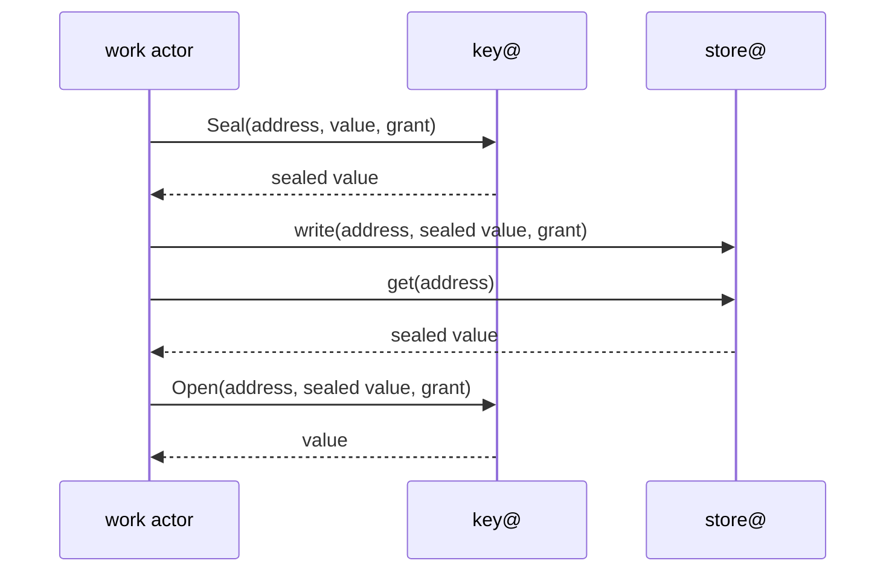
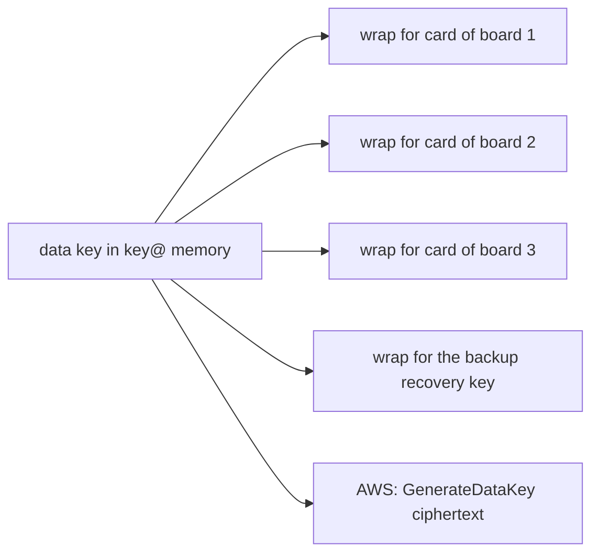

# 0006 — key@ hosts atoom's seal block: it holds a boundary's keys, seals, opens and signs in place, with five data keys per tenant and one key per purpose and algorithm

**Status:** Accepted
**Date:** 2026-11-21

Proposal: [issue #909](https://github.com/truvity/sluis/issues/909).

## Context

Every token, certificate and signed log head that sluis makes is signed, and every secret it keeps is sealed. Three groups of readers constrain the algorithms: verifiers that do not belong to sluis (many OIDC libraries were written for RS256), standards that fix a set (the FAPI 2.0 Security Profile, section 5.4.1, names PS256, ES256 and EdDSA), and key stores (a cloud key service, a hardware key and a software key support different algorithms at very different speeds). The volume is low: a production installation of v1 saw about 25,000 tokens in 7 days, a peak of 0.8 a second, 95 % of them token exchange. Installations differ: AWS with a key service, small boards with a YubiKey in each board, a workstation with software keys for development.

The keys are worth more than anything they sign. The store keeps sealed values as ciphertext and never opens one ([0005](/decisions/0005-the-store/)), so a plaintext exists only in the actor that uses it (principle 18 on the [principles](/principles/) page), and `key@` holds the keys that seal and open: the one holder of the keys family ([0002](/decisions/0002-families-of-actors/)), one per boundary from level L1 of the ladder ([0008](/decisions/0008-boundaries-and-tenants/)). A tenant has to be erasable by deleting a key, while the audit evidence of that tenant outlives its personal data. And a card does about seven ECDH operations a second, so a card cannot be asked once per value; a software data key, wrapped for the card and opened once per cache entry, can.

The mechanics of sealing are not sluis's. atoom holds them in its `seal` block, which is built from atoom's key and store ports, and in its key drivers ([atoom 0008](https://github.com/truvity/atoom/blob/master/docs/decisions/0008-blocks.md), the [key port](https://github.com/truvity/atoom/blob/master/key/docs/key-port.md)). The block declares the purposes it holds keys for and takes the rules about who may do what from its host. `key@` is that host. This record states what sluis decides on top of the block: which keys a boundary and a tenant get, which algorithms sluis uses, which purposes it declares, where the keys live in each runtime, who may receive a wrap, and what happens on erasure and compromise. The block is planned and not yet extracted (step B4 of [atoom's plan](https://github.com/truvity/atoom/blob/master/docs/plan.md)); the code that becomes the block runs today in `key@`.

v1 ADR 0005 made ES384 the default, and v1 ADR 0009 added a per-audience RS256 exception with a separate key; this record keeps both. sluis holds no root: roots are [ritueel](https://ritueel.id)'s, and the hand-off is [0024](/decisions/0024-root-custody-and-the-signing-api/). Who may ask `key@` for what is decided by the rules of [0007](/decisions/0007-policy-and-sealed-grants/#two-independent-checks).

## Decision

### Algorithms

The algorithms the key port names, which key store supports which, and the formats and timings are on [atoom's algorithms page](https://github.com/truvity/atoom/blob/master/key/docs/algorithms.md). sluis chooses among them as follows.

- **EC P-384 with ES384 is the default** and what sluis chooses for itself. The checkpoints of the audit logs are the one exception: they are signed with P-256 and SHA-256 ([Named exceptions](/decisions/0006-keys-and-sealing/#named-exceptions)). The checkpoints of the issuance log are C2SP signed notes with a P-384 key. One curve means one key type in the key set, one verifier path and one wrapping scheme.
- **sluis supports the FAPI 2.0 set: PS256, ES256 and EdDSA (Ed25519).** ES384 stays the default.
- **Everything sluis signs, seals, wraps, hashes, derives or encrypts stays within the FIPS-approved set:** P-384 ECDSA and ECDH, AES-256-GCM, AES key wrap, HKDF-SHA384, HMAC-SHA384 and SHA-384, plus the named exceptions below (P-256 ECDSA with SHA-256 is approved too). There is no FIPS mode and no certified build: Go keeps the standard library's defaults and Rust uses current crates with no FIPS pin. Keeping to the approved set means a FIPS build can be added later as a build option without changing a format or a stored value. No FIPS claim is made, and the standards register says so. The rule is kept by review: a new algorithm, a crate that brings its own primitive or a caller-supplied GCM nonce is a regression even when every test passes.
- **The only source of randomness is the operating system's CSPRNG.** Nothing is mixed into it from a key service or a card. `sluis doctor` checks the platform: kernel 5.18 or newer (a cloned virtual machine reseeds), a hardware generator present or deliberately absent, and the entropy pool initialised before the first key.
- **Support is checked per algorithm** when the installation is checked, not at the first token. Ed25519 in PIV needs firmware 5.7 or newer.
- **Tokens are standard JWS and JWT,** verified with any language's standard libraries against the published key set. The algorithms sluis accepts from others, such as passkey assertions, are set with those features ([0017](/decisions/0017-identity-and-sign-in/)). How a client or audience selects a non-default algorithm is client-profile configuration ([0021](/decisions/0021-clients/)).

### Named exceptions

"No RSA" and "P-384 only" have exactly these exceptions. Each has its own key, which serves no other purpose, and each is a purpose that is enabled on use ([Key purposes](/decisions/0006-keys-and-sealing/#key-purposes)).

1. **FAPI 2.0:** PS256, ES256 and EdDSA, as above.
2. **Cloud federation:** a key that signs a workload token for a cloud uses the algorithm that cloud requires: ES384 for AWS, ES256 for GCP, RS256 (RSA-2048) for Azure Entra. On a board the federation keys for GCP and Azure are not card keys: they live in the key service, outside the board installation, and no slot is pinned for them.
3. **Per-audience RS256:** for an audience configured to need RS256 (`signing_alg` of its client, [0021](/decisions/0021-clients/)), sluis signs that audience's **ID tokens** with a separate RSA key (RSA-2048, RSASSA-PKCS1-v1_5 with SHA-256), published beside the EC keys. The audience, not the caller, decides: `signer` reads the setting from the audience's client, and a request to `signer` carries no algorithm.
   - **Access tokens stay ES384.** OpenID Connect names the algorithm of the ID token per client; the access token is opaque to a relying party, the bearer check of `signin` accepts ES384 only, and an RS256 access token would double the signing work of every sign-in and refresh, which on a card is seconds.
   - **No `x5c`.** The key-set entry of the RSA key carries no certificate chain: no verifier asks for a chain of the RSA key, and its trust is the fetch of the key set over TLS.
   - **Discovery lists RS256 only while an RS256 key is active** in the key set. An installation without one deviates from OpenID Connect Discovery 1.0 section 3 ("RS256 MUST be included"): the document lists what is served, and a config that asks for RS256 enables the purpose in its `KeyPlan`, which `sluis config check` holds it to.
   - **On a card the key is in slot `88`** of the reference slot map ([The slot plan](/decisions/0006-keys-and-sealing/#the-slot-plan)). `key@` limits the purpose on a card to 2 signatures a second with a burst of 4, one bucket shared by every RS256 audience of the board, so that the card keeps a third of its time for other keys. The card driver admits four at once and refuses the rest as busy ([atoom's algorithms page](https://github.com/truvity/atoom/blob/master/key/docs/algorithms.md)).
4. **NATS decentralized authentication** (planned: the keys are in the registry, the adapter that mints NATS credentials is not built). NATS fixes Ed25519 for its operator, account and user keys (nkeys). sluis uses one Ed25519 key per purpose, in the key service or on the card behind `key@`, with a rule that names only the minter of NATS credentials. A user's own nkey is generated by the workload and never leaves it. The NATS xkey is not used, because X25519 alone is not an approved algorithm under FIPS 140-3; TLS on every client connection protects callout requests instead.
5. **Formats that fix their own algorithm are followed:** the C2SP tlog-cosignature witness keys use Ed25519 or ML-DSA-44 as that specification requires ([audit 0009](https://github.com/truvity/audit/blob/master/docs/decisions/0009-witnesses-and-verification.md)); a witness key authorises nothing and serves no other purpose.
6. **The audit checkpoint key is P-256 and signs SHA-256** (REQ-KEYS-081). The `audit-log` purpose follows the C2SP `signed-note` signature type 0x02 (ECDSA), which the witness implementation of transparency-dev verifies, so that a generic witness or checkpoint verifier accepts a checkpoint without sluis code ([audit 0008](https://github.com/truvity/audit/blob/master/docs/decisions/0008-the-log.md)). In AWS KMS it is `ECC_NIST_P256` with `ECDSA_SHA_256`; on a board it is a P-256 key in the slot of the purpose. The key serves no other purpose, and every other key stays P-384. The issuance log of `ca` is not part of this exception.

### Key purposes

A key is shared between two uses only when all of these are equal: **the audience** (who verifies or decrypts), **the required lifetime**, **revocation coupling** (one use would never be disabled without the other), **the callers** (the blast radius of a misuse), and **the key store itself separates the uses** (an encryption context under a key policy). If any one differs, the uses get separate keys.

- **There is one key per purpose and per algorithm.** An asymmetric key never serves two purposes, and a key that issues certificates never signs tokens. Several audiences of one purpose share its key: two audiences of the token purpose need one ES384 key, and an audience that needs RS256 gets a key of its own because the algorithm differs.
- **sluis declares these purposes to `seal`.** The signing purposes are the token-signing key; an X.509 intermediate for each trust domain; the SSH user CA and the SSH host CA; the log key of each audit writer instance. Each is a P-384 key, except the log key, which is P-256. The generated [keys page](/reference/keys/) lists every purpose with its algorithm, its key type on AWS, its slot on a board and the actor that asks for it.
- **A boundary's one symmetric KMS key is shared by all its data keys,** each wrap under its own encryption context ([Keys per boundary on AWS](/decisions/0006-keys-and-sealing/#keys-per-boundary-on-aws)). Sharing is safe there because the context names the boundary, the tenant and the purpose, and the key policy lets only `key@` use the key.
- **A tenant has no authority key and no wrapping key of its own by default.** It has five data keys ([Data keys](/decisions/0006-keys-and-sealing/#data-keys)). A tenant that is declared to keep its keys in a customer account has wrapping keys and an issuer signing key in that account ([Where a tenant's keys live](/decisions/0006-keys-and-sealing/#where-a-tenants-keys-live)); any other party that needs authority keys of its own is a boundary ([0008](/decisions/0008-boundaries-and-tenants/)).
- **Boundaries never share keys.** Two boundaries on one engine are separated by wrapping keys of their own, for example a second card per board.
- **Purposes outside the baseline are enabled on use,** each a dedicated key. A purpose an installation does not enable gets no key and no slot, and `sluis config check` refuses an enabled purpose with no key or slot and a collision of two purposes on one slot.

Purposes enabled on use are: the issuance log of `ca` (P-384, asked by the audit writer; [0023](/decisions/0023-certificate-authorities/)); release signing (P-384, the release boundary only, `signer`); the enrolment key of `exchange` that hosts encrypt to (P-384 ECDH; [0022](/decisions/0022-workload-identity-and-host-enrolment/)); a witness key per format; the backup archive key (AES-256-GCM, wrapped by a dedicated KMS key on AWS and by ECDH P-384 on a board; [0010](/decisions/0010-backup-and-recovery/)); on boards the workload issuer of `sluis-node` and the PIN release key ([Touch and PIN](/decisions/0006-keys-and-sealing/#touch-and-pin)); and each named exception.

### Keys sign in place

- **An authority key is born in its key store, signs in place and cannot be exported** (principle 1 on the [principles](/principles/) page). The store signs each digest itself. There are no derived signing keys, no burst key and no short-lived online key certified by an intermediate. There is no software signing for an authority key, outside development and CI ([Floors in code](/decisions/0006-keys-and-sealing/#floors-in-code)).
- **Every key whose public half is trusted through the PKI chain is a hardware-held child key,** attested where the hardware can attest and certified through a root that ritueel holds: the CA intermediates and the OpenPGP signing subkeys. Hardware-held means a key service such as AWS KMS or a card such as a YubiKey. KMS cannot attest where a key was born, so for it the checks are the key's description, its policy, the record of its creation and a match between the public key and the request.
- **SSH CA keys are anchors, not a chain.** The `ssh-user` and `ssh-host` keys are held behind `key@`; hosts trust a list of SSH CA keys that ritueel builds and signs ([0023](/decisions/0023-certificate-authorities/)).
- **Ephemeral and symmetric keys are outside the rule:** session keys, ephemeral ECDH keys, data keys and derived keys are neither hardware-held nor certified. A data key is not an authority key: `key@` makes it, keeps it only wrapped, and opens it only in its own memory.
- **`key@` signs after it checks what it signs.** Signing is content-aware per purpose: the X.509 purpose signs only a TBSCertificate that parses and stays within its constraints, the SSH purposes only an OpenSSH certificate body, a token purpose only a JWS signing input, and the release-signing purpose only an OpenPGP signature input. A mistake in a parser refuses a signature instead of signing the wrong thing. Every signature is rate-limited and is an audit fact.
- **`key@` writes `KeyCertificate`,** the chain the root custodian returned for a purpose, which `sluis key install` hands to it; `ca` writes `TrustBundle` ([0022](/decisions/0022-workload-identity-and-host-enrolment/)). CA serial numbers are random and 128 bits long; no serial ledger is kept.
- **Three key stores are supported:** the YubiKey over PIV, AWS KMS, and software keys for development and CI. They are atoom's drivers. PKCS#11 stores for devices such as YubiHSM 2 and Nitrokey HSM 2, more drivers and post-quantum keys are planned ([#1029](https://github.com/truvity/sluis/issues/1029)).

### Keys per boundary on AWS

On AWS, in the Lambda and the Kubernetes installations alike ([0011](/decisions/0011-runtimes-and-installations/)), `key@` uses atoom's `awskms` key driver as a library in its own process. A boundary needs **1 symmetric key and 5 asymmetric keys** in KMS (4 P-384 keys and the audit log's P-256 key), with one trust domain and one audit writer instance. Each further trust domain adds one P-384 key and each further writer instance one P-256 key.

| Key | Type | Purpose |
|---|---|---|
| Symmetric | AES-256 | Wraps every data key of the boundary: the tenants' `data`, `pseudonym`, `evidence`, `chain` and `credential` keys, and the boundary's `grant`, `cookie`, `mac` and `data` keys |
| Token signing | P-384 | ES384 tokens ([The token-signing key](/decisions/0006-keys-and-sealing/#the-token-signing-key)) |
| X.509 intermediate | P-384 | One per trust domain, for `ca` (only when the PKI add-on is on) |
| SSH user CA | P-384 | `ssh-ca` |
| SSH host CA | P-384 | `ssh-ca` |
| Audit log | P-256 | One per writer instance, for its audit log and its usage log, signing SHA-256; a log key rotates only on compromise ([Rotation](/decisions/0006-keys-and-sealing/#rotation)) |

- **The symmetric key's policy names `key@`'s role alone.** `kms:Sign` takes no encryption context, so an asymmetric key is protected by its key policy, which also names `key@` only. Every other actor reaches a key through `key@`, whose rules say who may ask for which purpose. On Lambda only the role of the `key@` function may reach KMS (principle 16 on the [principles](/principles/) page).
- **A data key is made with `GenerateDataKey` under the symmetric key,** with the encryption context {boundary, tenant, purpose}, and only the wrapped copy is stored ([DataKeyWrap](/decisions/0006-keys-and-sealing/#datakeywrap)). The tenant is `-` for the boundary's own purposes. The data key is not a KMS key, so a new tenant costs no KMS key and no key policy.
- **KMS automatic rotation** applies to the symmetric key.
- **The key that wraps a backup archive is not the symmetric key.** It is a dedicated KMS key, enabled on use, that may live in another account, and only the restore role may decrypt with it. `key@` calls `GenerateDataKey` under it for `exporter@`, and the archive is encrypted with AES-256-GCM under the key it returns ([0010](/decisions/0010-backup-and-recovery/)). It adds a seventh KMS key where an installation takes backups and does not change the baseline of 1 + 5.

### Where a tenant's keys live

The design supports two locations, chosen per tenant by a declaration on its `Tenant` item. Which one a customer gets is a contract or legal choice made outside the design, and nothing in the design waits on it.

- **Operator-held is the default** (REQ-KEYS-074, planned as a declaration; every tenant is operator-held today). The tenant's keys sit under the installation's own KMS keys, as in [Keys per boundary on AWS](/decisions/0006-keys-and-sealing/#keys-per-boundary-on-aws), and its issuer signs with the token-signing key of its boundary.
- **Customer account** (planned). The KMS keys that wrap the tenant's `data`, `pseudonym`, `evidence`, `chain` and `credential` keys, and the tenant's issuer signing key, live in an AWS account dedicated to that customer. The account can be registered in the operator's AWS organisation, or belong to the customer. `key@` uses those keys cross-account, through the key policy or a grant that covers exactly the operations it needs: Encrypt, Decrypt, GenerateDataKey, Sign and GetPublicKey, and no other (REQ-KEYS-068). sluis holds no long-lived credential for that account (REQ-KEYS-069).
- **Moving a tenant into a customer account re-wraps its keys** under the customer's KMS key during the move (REQ-KEYS-070). Its issuer host stays the same ([0032](/decisions/0032-customer-identity-installations/)), and a person's `sub` is not touched by it, because it is the person's own subject and made of no tenant key ([0020](/decisions/0020-grant-vocabulary-and-token-claims/)).
- **Revocation fails closed, for that tenant only.** If the customer revokes or disables the grant, that tenant's seals, opens and signs stop and its calls answer `unavailable`; the other tenants are unaffected (REQ-KEYS-071). `key@` drops that tenant's cached data keys as soon as it sees the grant lost ([The cache](/decisions/0006-keys-and-sealing/#the-cache)). This is the customer's kill switch, so a lost grant is audited and alerted and never worked around.
- **Crypto-shredding.** Deleting the customer's key shreds that tenant's data and evidence, which is the customer's retention lever ([audit 0011](https://github.com/truvity/audit/blob/master/docs/decisions/0011-evidence-encryption-and-pseudonyms.md)).
- **Scope.** This applies to installations on AWS, serverless and EKS. The three-board installation keeps its keys on the cards.

### Keys per board

On a board `key@` uses atoom's YubiKey PIV driver over the board's own card ([atoom's card driver](https://github.com/truvity/atoom/blob/master/key/yubikeypiv/README.md)).

- **Each board has a card of its own, and every key of the board is born on that card.** The same purposes as on AWS sit in separate card slots, one slot per purpose and per algorithm ([The slot plan](/decisions/0006-keys-and-sealing/#the-slot-plan)). A card belongs to one boundary.
- **Data keys are not on the card.** `key@` generates a data key in software and wraps it for the key-agreement key of each board's card, so any board opens it with its own card ([DataKeyWrap](/decisions/0006-keys-and-sealing/#datakeywrap)).
- **A lost or stolen board is replaced, not restored:** a new key on a new card, a new certificate where there is one, and ritueel revokes the old one. The card's PIN policy limits the exposure only where the board cannot reach its peers; while it can, the PIN policy is not the control. A lost or stolen board is removed at once: its recipient and keys are revoked, a peer releases a PIN only to a board that the `KeyPlan` lists and `KeyRevocation` does not revoke, its wraps are deleted, and the other boards rewrap every data key for the new card ([0041](/decisions/0041-a-compromised-key-is-revoked-then-replaced/)).
- **Signing speed is set by the card.** A card signs about 6 P-384 signatures a second and three boards about 18, against a measured peak of 0.8 tokens a second in v1 ([timings](https://github.com/truvity/atoom/blob/master/key/docs/algorithms.md)).
- **The software driver is for development and CI.** `key@` runs it only where [Floors in code](/decisions/0006-keys-and-sealing/#floors-in-code) allows.

### The slot plan

sluis uses atoom's reference slot map, version 2, as its default. It says which card slot serves which purpose, with a PIN and touch policy for each ([the map](https://github.com/truvity/atoom/blob/master/key/slotplan/docs/slot-plan.md), [the slot plan check](https://github.com/truvity/atoom/blob/master/key/slotplan/docs/README.md)). The map's purposes are sluis's. sluis decides these rules on top of it:

- **One slot per purpose and per algorithm, and the map is pinned.** Every board of a version has the same layout, so enabling a purpose later never renumbers the keys of a live card. A purpose that the map holds has its slot, and a purpose enabled on use takes that slot and no other. A `KeyPlan` that lists a purpose of the map without a slot gets the slot of the map, and `key@` checks a slot that the `KeyPlan` names against the other purposes.
- **Slot `9d` is the only key-agreement slot.** Grants do not use it directly: they are sealed under a boundary data key, so a grant costs a memory operation and not an ECDH on the card ([Seal and open](/decisions/0006-keys-and-sealing/#seal-and-open)).
- **Six slots, `90` to `95`, are rotation spares.** They hold the new key of an event rotation while the old one finishes, and the older key-agreement key until every wrap is rewrapped. A purpose that the map does not hold, such as a further trust domain's intermediate or a third audit writer instance, is named in the `KeyPlan` with one of them, and then a rotation has one slot fewer.
- **The `KeyPlan` holds each node's slot map** with each slot's purpose, public key and attestation. It is signed by the publisher, so a slot map is reviewed like any config ([Touch and PIN](/decisions/0006-keys-and-sealing/#touch-and-pin)). The `check` command of a node's `key@` prints its entry.
- **A slot is generated only when its purpose is enabled.** A card holds the keys of the enabled purposes and nothing in the other pinned slots. Slot `f9`, the Yubico attestation slot, is never touched, and slot `9e` is not used. The slot map of root cards is ritueel's.
- **The release subkey lives in a PIV slot reached through `key@`,** which also makes the subkey's back-signature on the card. The OpenPGP applet is not used on a board.
- **A second card per board serves a further L1 boundary** on the same engine, so that the boundaries are separated by wrapping keys of their own ([0008](/decisions/0008-boundaries-and-tenants/)).
- **Built and planned.** The card driver serves the ten rows `9a`, `9c`, `9d` and `82` to `88`. Serving `89` to `8f` is planned with the boards work on the [roadmap](/roadmap/): `key@` refuses a `KeyPlan` that enables a purpose of those slots on a card, naming the entry.

### Seal and open

**The store never seals or opens.** It keeps a sealed value as ciphertext and a compare-only value as a hash. A sealed value's plaintext exists only in the actor that uses it, for that call. Plain kinds are stored as they are, and values from secret sources pass through `store@` in memory ([0005](/decisions/0005-the-store/)).

The envelope, the wrapping of data keys, the authenticated data and the key cache are the block's. The rules are sluis's:

- **The actor validates a sealed field before it seals it,** because the store cannot read it.
- **A value is sealed under the data key of the address's boundary, tenant and purpose** ([Data keys](/decisions/0006-keys-and-sealing/#data-keys)), with the full address as authenticated data. A value copied to another row, kind, tenant or boundary does not open, and a value that has to move to another address is opened and sealed again.
- **`key@` checks three things on every Seal and Open:** the caller's identity, by the transport ([0003](/decisions/0003-units-transports-and-fusion/)); the caller's rule for the purpose and the operation, generated from the actor registry ([0002](/decisions/0002-families-of-actors/)); and the grant, which must be sealed for the address's tenant, name the operation and not be expired ([0007](/decisions/0007-policy-and-sealed-grants/#two-independent-checks)). The grant is required for a tenant's `data` and `evidence` keys; the tenant's `pseudonym`, `chain` and `credential` keys are checked by rule alone ([Data keys](/decisions/0006-keys-and-sealing/#data-keys)). A refusal is an audit fact.
- **Opens are batched.** A call may carry many opens, so that a request that needs several values, such as a session cookie and a person's records, pays one hop. On Lambda the hop is an invoke; a whole warm sign-in took about 0.40 s at p50 and 0.49 s at p99 with it in the Lambda latency spike ([#1179](https://github.com/truvity/sluis/issues/1179), measured 2026-11-03).
- **Session cookies are sealed and opened at `key@` on every request,** under the boundary's `cookie` data key. `signin` never holds that key ([0018](/decisions/0018-sign-in-sessions/)).

### Sign and Mac

- **`Sign(purpose, content, grant)` signs in place** with the key of the purpose ([Keys sign in place](/decisions/0006-keys-and-sealing/#keys-sign-in-place)). A purpose that carries an authorised effect, a mint or an artifact signature, needs the grant of [0007](/decisions/0007-policy-and-sealed-grants/#sealed-grants).
- **`Mac(purpose, input)` makes a keyed hash with HMAC-SHA384** over a data key: `mac` (boundary) for link ids, upstream session ids, the tag of a refresh token ([0018](/decisions/0018-sign-in-sessions/)) and the hashed index entries of sealed kinds, or `pseudonym` (tenant) for audit pseudonyms. Neither takes a grant: both are checked by rule alone.
- **The caller names a label for each use,** and `key@` binds the label into the input, so two uses never produce the same hash for the same input. A label whose output is a credential, not an identifier (`sluis-refresh-tag-v1`, the tag that is the secret of a refresh token), is reserved to one actor, `signin`: `key@` refuses every label that begins `sluis-refresh-` to any other caller that holds the rule for the key. The key never leaves `key@`.
- **There is no `LinkKey` kind and no extra KMS key for hashing.** A KMS `GenerateMac` key would need one key for each purpose and boundary because it takes no encryption context, and would make two mechanisms for one operation.
- **The `mac` key has no new generation in place.** Link ids and upstream session ids are made under it, so a new key would change them all; replacing it is a migration that makes them again ([0019](/decisions/0019-person-and-upstream-link/)).
- **A pseudonym epoch is a generation of the tenant's `pseudonym` key** ([audit 0011](https://github.com/truvity/audit/blob/master/docs/decisions/0011-evidence-encryption-and-pseudonyms.md)).

### Data keys

A data key is a software AES-256 key. `key@` makes it, keeps it only wrapped, and opens it only in its own memory. On AWS it is made by `GenerateDataKey` under the boundary's one symmetric key; on boards `key@` generates it in software. It is not a KMS key and not a card key.

| Purpose | Scope | Protects |
|---|---|---|
| `data` | One per tenant | Personal and operational data of the tenant |
| `pseudonym` | One per tenant, rolled by epoch | Keyed hashes of the tenant: audit pseudonyms |
| `evidence` | One per tenant | Audit and usage evidence of the tenant |
| `chain` | One per tenant | Facts of a session chain that `signin` seals and opens and `exchange` opens |
| `credential` | One per tenant | The `StaffPasskey` kind: `signin` seals and opens it, and nothing else uses the key |
| `grant` | One per boundary | Sealed grants |
| `cookie` | One per boundary | Session cookies and the sign-in cookie |
| `mac` | One per boundary | Keyed hashes of link ids, upstream sessions and the hashed index entries of sealed kinds |
| `data` | One per boundary, tenant `-` | The sealed kinds that have no tenant in their address |
| `secret` | One per KV store, tenant `-` | The values and metadata of one KV store ([0047](/decisions/0047-kv-is-a-core-service-of-stores-that-no-tenant-owns/)) |

- **Each tenant has five data keys, one per purpose, and each boundary has four: `grant`, `cookie`, `mac` and `data`. Each KV store has one more, `secret`, with the store as its scope.** The purposes never share a key, so a tenant's exit can delete the personal data and keep the evidence ([Erasing a tenant](/decisions/0006-keys-and-sealing/#erasing-a-tenant)). A tenant that exists in several boundaries has separate data keys in each.
- **A person's subject is made of no key.** `signin` and `exchange` give the person's own subject as the `sub` of every token ([0020](/decisions/0020-grant-vocabulary-and-token-claims/)), so staff who work across vendors are one person across the vendors' apps, audit and access review. Vendors are kept apart by grants and separate installations.
- **`chain` seals the facts of a session chain, and it is a tenant's key** (REQ-KEYS-082). The facts are the person's accounts and personal data. `signin` seals them and opens them again at a refresh and at the end of the chain; `exchange` opens them and nothing else. `cookie` stays `signin`'s alone, so `exchange` never holds the key that opens a browser's cookie, and a tenant's `data` key stays out of the sign-in path. The facts are held once, in `SessionChain`, under the `chain` key. The sealed sign-in facts of an `AuthCode` may stay under `cookie`: an authorization code lives for minutes.
- **`credential` seals the `StaffPasskey` kind, and it is a tenant's key** (REQ-KEYS-263). A passkey sign-in has no username: `signin` must open the credential, to verify the signature against its public key, before it knows whose it is. The credential holds the person's subject and accounts, so no grant could come first. The rule is `signin`'s alone, for the kind `StaffPasskey` alone: `key@` refuses the purpose for any other kind, and `store@` accepts the purpose on no other kind. `chain` could not do the work, because a generation of it lives only 90 days after it last sealed, and a passkey lives for years. The decision, the check that the person is not held and every write that follows keep their grants.
- **`chain` and `credential` are checked by rule, with no grant, once their key exists.** A grant is a decision of `policy`, and `policy` needs these facts to decide, so a grant for every use would be circular. The first `data`, `evidence`, `chain` or `credential` key of a tenant is the exception: `key@` makes it only under a grant that names the tenant (REQ-KEYS-260), so that `signin` cannot plant a key for a tenant name it invents. A grant is not bound to a purpose, so what stops a key for a name that is no tenant is the decision of `policy` that issued the grant. The first `pseudonym` key is made without a grant, because every actor's audit emitter makes it and none holds a grant (a follow-up below).
- **A compromised `signin` could open** every `StaffPasskey` envelope and every sealed chain fact of the tenants it can name, and seal a `StaffPasskey` of its own for a tenant that already has a credential key. It cannot open another kind, and no other actor can open these. That is the reach `signin` has for a person's data at a sign-in, and smaller than its tenant `data` key, which needs a grant.
- **A tenant's exit deletes its `chain` wraps with the rest of its personal data,** so the accounts of a departed tenant's people stop opening at once. A chain row stays in the temp store until its time to live, up to 90 days for an agent chain ([0018](/decisions/0018-sign-in-sessions/)), so the exposure is the live store and any copy of it that operations keep; a boundary-wide key would leave those accounts openable for that time after the exit.
- **A generation of `chain` is kept for the lifetime of the longest chain** (planned, REQ-KEYS-083): an older generation keeps opening what it sealed, and is deleted 90 days, the built-in maximum of an agent chain, after it last sealed. The time is kept per tenant.
- **A sealed kind is sealed under the `data` key of its address's tenant.** The directory kinds and the connections and apps made through a UI or API flow (`DirectoryUser`, `DirectoryGroup`, `DirectoryMembership`, `DirectoryConnection`, `MinterConnection`, `GitHubApp`, `SlackConnection`, `EntraConnection` and the desired state) belong to a tenant, the operator's own company included ([0008](/decisions/0008-boundaries-and-tenants/)), so a tenant's exit shreds them with the rest of its personal data. The desired state is sealed for the tenant that owns the container it describes, even when people of another company are in it ([0026](/decisions/0026-reconcilers/)). Config is never sealed and has no tenant.
- **A sealed kind that has no tenant in its address is sealed under the boundary's `data` key** (tenant `-`). In the registry that is `EnrolmentToken`, the key of a host's enrolment token, and `PendingEnrolment`, a host's request waiting for approval, and nothing else. The wrap has the same purpose name as the tenant's `data` key and a different address, so the two never meet.
- **Which actor may use which purpose is a rule of `key@`:** the rules say who may Seal, Open or Mac with each. The audit pieces use `pseudonym` and `evidence` through the same rules ([audit 0011](https://github.com/truvity/audit/blob/master/docs/decisions/0011-evidence-encryption-and-pseudonyms.md)).

### DataKeyWrap

`DataKeyWrap` is the durable kind that holds one data key wrapped for one recipient. `key@` is its only writer and the only actor that opens a wrap; the backup job of exporter@ copies the items as ciphertext ([0010](/decisions/0010-backup-and-recovery/)). It is scoped to the boundary and the tenant (`-` for the boundary's own purposes), and its id is `<purpose>/<generation>/<recipient>`; for a KV store it is `secret/<store>/<generation>/<recipient>`. The value is already ciphertext, so the kind's treatment is plain, and it is backed up with the authoritative kinds. The wrapping format and the generation counter are the block's.

- **On AWS there are two wraps:** the ciphertext that `GenerateDataKey` returned under the encryption context {boundary, tenant, purpose}, and a wrap for the backup recovery key, so that disabling a compromised KMS key does not make the old archives unreadable (the second wrap is planned, REQ-KEYS-100; [0041](/decisions/0041-a-compromised-key-is-revoked-then-replaced/)).
- **On boards there is one wrap per recipient:** each board's card (its key-agreement key, slot `9d`) and the backup recovery key ([The backup recovery key](/decisions/0006-keys-and-sealing/#the-backup-recovery-key)). `key@` agrees a secret with the recipient's public key by ECDH, derives a wrapping key and wraps the data key. Making a wrap needs only the recipient's public key, so no card is touched; opening one needs the recipient's private key, which is the card's ECDH.
- **A new data key is written with conditional creates,** all its wraps in one atomic write. If two `key@` instances make a key at once, one wins and the other discards its key and reads the winner's.
- **A new card or board is a rewrap.** An existing `key@` opens each data key, wraps it for the new recipient's public key and writes the new item. The data is not touched. The recipients are the signed list in the `KeyPlan` ([Who may receive a wrap](/decisions/0006-keys-and-sealing/#who-may-receive-a-wrap)).
- **The wrap for a lost recipient is deleted.** A lost or stolen board's wraps are deleted and its card is revoked ([Keys per board](/decisions/0006-keys-and-sealing/#keys-per-board)).

### Who may receive a wrap

- **`KeyPlan` carries a signed list of wrap recipients,** each a node key id: the RFC 7638 thumbprint of the node's wrapping public key. The list is signed config, like the rest of `KeyPlan` ([0005](/decisions/0005-the-store/)), so changing it takes a reviewed commit and a publisher's signature.
- **`key@` wraps a data key to the recipients of that list and to no one else** (REQ-KEYS-075). It never takes a recipient from the `KeyCertificate` items that sit in the store, because those are not signed: a compromised `store@` could add a certificate of its own and receive every data key. A `KeyCertificate` only supplies the public key of a recipient the list already names, and only when its thumbprint equals the listed id.
- **`key@` verifies the `KeyPlan` itself** (REQ-KEYS-110): the signature, the pinned publisher key, the kind and the sequence, from the bytes `store@` gives it, under the `publishers` block of its own copy of the bootstrap file ([Signed config](/reference/signed-config/)). It reads the recipients, the purposes and the time to live from the payload it verified and from nothing else. A document that fails is refused and audited once, and the `KeyPlan` it already verified stays in force; at a start there is none, so `key@` does not start.
- **`key@` remembers the highest sequence it verified,** per kind (`KeyPlan`, `Boundary`), in durable state of its own and never in `store@`'s. It saves the mark before it uses a document. After a restart it refuses a lower sequence and a second payload under the same sequence. A damaged mark stops the start, because a guessed mark is a mark a thief could choose.
- **What this guarantees, and what it does not.** On a node that has its state, `key@` never takes an older `KeyPlan` than the highest it verified there. A node whose state is gone, and a runtime with no durable local state such as a function on Lambda, takes the newest validly signed document the store gives it, as `store@` does ([0005](/decisions/0005-the-store/)). There a compromised `store@` can serve a validly signed older list, a commit the publisher did sign; it cannot write a list of its own.
- **Withholding is not covered.** A compromised `store@` can keep serving plan N to withhold the plan that removes a recipient, so that new data keys keep going to the recipient that was removed. The mitigation is the compromise path: a revoked board is refused by `KeyRevocation` whatever the `KeyPlan` shows ([0041](/decisions/0041-a-compromised-key-is-revoked-then-replaced/)).
- **When a mark is ahead of everything the store serves,** for example after a restore of the store, `key@` does not start and the error names the mark file and the two ways out: publish a document of that kind with a higher sequence (preferred), or remove the mark on purpose and accept that `key@` has no rollback protection until the next document of that kind is verified. The runbook is in [Bare-metal](/runtimes/bare-metal/).
- **The backup recovery key is in the list too,** under its own id ([The backup recovery key](/decisions/0006-keys-and-sealing/#the-backup-recovery-key)).

### The backup recovery key

- **The backup recovery key is sluis's own P-384 key, a cloud KMS key in the boundary's anchor account, one for each environment.** It is not a ritueel object: ritueel does not make, hold or replace it. On boards every data key is also wrapped for it, so that the loss of all cards does not lose the data; on AWS too, so that a KMS key can be disabled after a compromise ([0041](/decisions/0041-a-compromised-key-is-revoked-then-replaced/)).
- **It opens every wrap and rewraps an archive for another installation** ([0010](/decisions/0010-backup-and-recovery/)). Its public key is in the `KeyPlan`, in the signed list of recipients; its private key is never in sluis and never leaves the KMS (REQ-KEYS-056).
- **Using it is a recovery step of the operator in the anchor account,** not a run-time path. No actor, not even `key@`, can open a wrap for it.

### The cache

- **`key@` caches opened data keys in memory,** each entry with its own time to live. A cached key opens and seals without a card operation or a KMS call, so the card's seven operations a second serve cache misses and not requests. The cache holds data keys only. It never holds an authority key or a wrapping key; those stay in their key store. Memory holding a key is locked and is not written to disk or to a core file.
- **The time to live is set in the `KeyPlan` under a built-in maximum.** A longer value is refused when the configuration loads (`sluis config check` too).
- **The entry is also the erasure delay.** On boards and on Kubernetes `key@` watches `DataKeyWrap` and drops an entry when its wrap is deleted. On Lambda nothing is pushed: a warm `key@` function keeps its entries until they expire, so the time to live is the longest time a deleted tenant's data can still be opened ([Erasing a tenant](/decisions/0006-keys-and-sealing/#erasing-a-tenant)).
- **KMS sees a request per cache miss,** not per sealed value, so the KMS request volume follows the number of active (tenant, purpose) pairs and the cache's time to live.

### Erasing a tenant

- **A tenant's exit deletes its `data`, `pseudonym`, `chain` and `credential` wraps at once,** every generation and every recipient, and `key@` drops the cached entries. Every value sealed for the tenant stops opening, because the wrap was the only route to the key. A later `Seal` for that tenant, with a grant, makes a new key (there is no "erased" state), and a new key opens nothing sealed under the erased one. A backup holds the sealed values and the wraps as they were; a restore re-applies each erasure that audit records after the archive was taken ([0010](/decisions/0010-backup-and-recovery/)), and an archive's own copy of a wrap leaves with the archive's retention.
- **Its `evidence` wrap is deleted when the evidence retention ends** (planned, REQ-KEYS-037). Evidence never shares a key with personal data and outlives it: a bill can be disputed after the customer has left, and finance keeps usage for years. The retention is declared in audit's configuration ([audit 0010](https://github.com/truvity/audit/blob/master/docs/decisions/0010-lock-modes-retention-and-compliance-floors.md)) and must be at least as long as the longest duty.
- **The boundary's keys are not touched.** None of them seals a tenant's personal data for longer than minutes: the boundary's `data` key seals only kinds that have no tenant, and the one exception is the sealed facts of an `AuthCode`, under `cookie`, which live for minutes. A tenant that leaves one boundary and stays in another keeps its keys in the other.
- **An erasure is an audit fact,** and the tenant lifecycle is in [0008](/decisions/0008-boundaries-and-tenants/).
- **On Lambda the erasure takes effect within the cache's time to live,** because warm functions hold the entry ([The cache](/decisions/0006-keys-and-sealing/#the-cache)).

### Compromise of a data key

A data key declared compromised ends its generation. The rule is stated once, in [0041](/decisions/0041-a-compromised-key-is-revoked-then-replaced/). In short:

- **`key@` makes a new generation and refuses every seal under the compromised one.** The integrity keys, `grant`, `cookie` and `chain`, also stop opening it at once, so forged values stop working. The confidentiality keys keep opening it: `data` and `credential` until the re-seal job has rewritten every value, `evidence` for its retention (it is append-only and is never re-sealed), and `pseudonym` seals nothing, so a new epoch is all it needs.
- **`cookie` ends every browser session, `chain` ends that tenant's chains, `pseudonym` starts a new epoch.** `grant` needs no re-seal.
- **`mac` is an accepted risk,** and so is what `evidence` already sealed.
- **An archive keeps the wraps and values it held,** and on Lambda the cache's time to live is the delay, as for erasure.

### Rotation

Rotation of data keys by generation, before the AES-GCM usage limit, is the block's mechanic. sluis decides the rest.

- **The yearly cycle re-signs.** An X.509 intermediate gets a new certificate over the same key at the yearly ceremony; an OpenPGP subkey gets a new binding that extends its expiry. A renewal makes no new key.
- **Key material rotates by the rule of principle 3** on the [principles](/principles/) page. A software key is replaced every three years, within the one to three years that NIST SP 800-57 gives for a signing key. A key on a card or in a cloud KMS is replaced on events, with a review of advisories at the yearly ceremony: an advisory affecting the device or firmware, deprecation of its algorithm, loss or end of life, a suspected compromise, a change of store and a change of custody. The rule for roots is ritueel's.
- **Log keys are the one exception: they rotate only on compromise.** This covers the log key of the audit writer and the issuance-log key. A log is one continuous history, and its signatures must verify for the life of the log. A log key that is replaced on compromise is replaced by a key-change record, and a verifier trusts the old key up to the last size a witness cosigned ([0041](/decisions/0041-a-compromised-key-is-revoked-then-replaced/)).
- **The symmetric KMS key uses KMS automatic rotation,** and a data key also gets a new generation after an event that touches the wrapping key.
- **A rotation makes the new key first and retires the old one after.** On a card the new key goes into a free spare slot while the old one finishes. In KMS it is a new key under the same alias. The control-plane actions on that alias (`kms:CreateAlias`, `kms:UpdateAlias`, `kms:DeleteAlias`) are held to the named key administrators in the key policy, with no delegation to IAM through the account root, because whoever can retarget an alias sends new writes to a key of their choice (REQ-KEYS-119). `key@` calls KMS by the key ARN that the signed `KeyPlan` names and refuses to start on another, so every rotation under an alias needs a new signed `KeyPlan`. A new intermediate is requested like the first one ([0024](/decisions/0024-root-custody-and-the-signing-api/)).
- **A token-signing key moves through four states:** `pre-published`, `active` and `retiring`, in this order and never back, and `revoked`, which is reachable from any state and is terminal. A compromise causes `revoked`, and the waits below do not apply to it ([0041](/decisions/0041-a-compromised-key-is-revoked-then-replaced/)). To keep a key in use, make a new one (REQ-KEYS-079). Signing, key set and rotation of tokens are atoom's `token` block in time ([atoom 0008](https://github.com/truvity/atoom/blob/master/docs/decisions/0008-blocks.md), planned); the figures below are sluis's.
- **A new key is pre-published for the lead time:** it is in the published key set and signs nothing, so every cache between sluis and a relying party has the key before the first token carries it. The default is 30 minutes (REQ-KEYS-076).
- **A key that stops signing is retained for 65 minutes:** the access-token cap of one hour plus 5 minutes of clock skew, so a token signed just before the change still verifies for its whole life. Then the key leaves the key set (REQ-KEYS-078).
- **The lead time is derived from the cache budget that sluis publishes.** The key set is served with `Cache-Control: public, max-age=300`, and the edge cache is to keep it for no longer than that (the edge limit is planned, REQ-KEYS-084). A verifier that follows HTTP caching (RFC 9111) and OpenID Connect Core section 10.1.1 (fetch `jwks_uri` again when a token names an unfamiliar `kid`) needs, at worst, 300 s of `max-age` in its cache, 300 s of edge cache, 10 minutes of allowance for a verifier that throttles its fetch on an unknown `kid`, and 5 minutes of clock skew. That is 25 minutes, rounded up to 30 to leave a margin. A change of `max-age` or of the edge time to live moves the lead time with it. The lead time is meant to be an installation setting, and `sluis config check` is meant to refuse a value below the derived sum (both planned, REQ-KEYS-120 and REQ-KEYS-169). A cutover from v1 raises it to the longest key-set cache found among the relying parties: v1's own relying parties hold the key set for an hour and do not fetch it again on an unknown `kid`.
- **The lead time runs from the moment the key is seen in every published key set, not from the write to the store** (REQ-KEYS-085). The static key set is published later than `signer` writes the key, and the edge cache has a stale-if-error window of at most 65 minutes ([0009](/decisions/0009-export/)). `signer` therefore moves a key to `active` only after it has seen the key in every published key set that has a public address, and the lead time has passed since then. The observation is a read back from the public URL that `exporter@` reports; for the live key set of `entry`, which reads the store, it is the write. A delay in publication delays activation and never breaks a correct verifier. The static key set is planned; until it is built, only the live key set of `entry` counts.
- **A verifier that holds the key set for longer than `max-age` and does not fetch it again on an unknown `kid` is broken, and sluis detects it instead of accommodating it.** v1 published a key for 12 hours before it signed, because such a verifier broke every daily rotation. v2 rotates rarely, so a rotation can be announced and the stragglers found: the relying-party contract is documented ([Verifying tokens](/integrations/applications/)), each fetch of the key set is a metric by user-agent product and AS number, measured at the edge (REQ-OBS-018), and a rotation drill in a staging installation lists the verifiers that fail (REQ-OPS-078).

### The token-signing key

- **Token-signing and workload-issuer keys are hardware-held, separate from the CA key and from each other, one of each per board.** `signer` uses the token-signing key and `sluis-node` the workload-issuer key, each in a slot of its own through `key@`; the two are never shared, because their callers and their blast radius differ. `sluis-node` signs its workload tokens through `key@` (purpose `workload-issuer`, boards only) and holds no key credential.
- **Each node rotates only its own key.** `SigningKey.node` names the node whose `key@` holds the key, and only that node's `signer` moves the key through `pre-published`, `active` and `retiring`. A node never changes the key of another node, so one node's rotation cannot retire the key that another node is signing with (REQ-KEYS-077).
- **Any node's `signer`, and the operator, may revoke any node's key, but only a person declares:** the operator's declaration, signed with a publisher key and naming the keys, is delivered by the command to the admin socket of `key@`, and a `signer` may relay it when the owner is down; a `signer` never asks on its own initiative. A revocation is a `KeyRevocation` item that `key@` writes and `store@` never updates, deletes or applies on; the publishers omit the key at once and `signer` never signs with it (REQ-KEYS-090, [0041](/decisions/0041-a-compromised-key-is-revoked-then-replaced/)).
- **A key declared compromised leaves the key set at once, and its replacement signs at once** when no other key is active, with its key set published and purged at the edge before its first token. `sluis key revoke` reports a revocation as not confirmed until the published key set and the live key set of `entry` both lack the key ([0041](/decisions/0041-a-compromised-key-is-revoked-then-replaced/)).
- **On a first deploy a node's first key is active at once,** while no key in the key set is older than 15 minutes, because there is nothing yet for a relying party to have cached. Once any key is older, a new node's key is pre-published for the lead time like any other (REQ-KEYS-080).
- **The key set carries every pre-published, active and retiring token key.** It carries a pre-published key only while the lead time runs and a retiring key only for the 65 minutes.

### The token certificate

The token certificate is optional per installation, and it is off in the core.

- **Off is the state of the core.** The key set carries no `x5c` for any key, and the ES384 key and the RSA key of an audience that needs RS256 are published alike. A standard client is not affected, because it ignores `x5c` and fetches the key over TLS. Custody is checked in the audit log until the certificate is on. An installation turns it on only when the PKI add-on ([0023](/decisions/0023-certificate-authorities/)) and a ritueel root exist. The core needs no intermediate, and the boards need no slot `9c` in the core.
- **The switch is `token_certificate` in the signed `Boundary`,** a plain `true` or `false` that is off when absent (REQ-PKI-057, REQ-PKI-058). The Boundary is the one document that `key@` verifies itself and that every actor may read. `key@` reads the value when it starts, and a change takes effect when it restarts. Off, `PublicKey` gives no chain for the token-signing key, `TokenKey` answers `ca` that there is nothing to certify, and `Sign` for the intermediate's purpose is refused as a purpose the installation does not enable. `sluis config check` refuses a Boundary that turns the certificate on while the `KeyPlan` lists no ES384 `x509-intermediate` and no ES384 `token-signing` key.
- **With the certificate on, each entry of the ES384 token key carries an `x5c` chain:** the token certificate, the board's intermediate, then up to the root. The RSA key never carries one. The board's intermediate is born on its card, attested, certified for about 13 months and re-signed every year over the same key; the root is ritueel's.
- **The certificate is a non-CA certificate that allows digital signatures only,** so a key that signs tokens cannot issue a certificate. `ca` builds it and `key@` signs only that structure: `key@` builds the same bytes again from what it knows (the installed intermediate as issuer, the token-signing key, a fixed subject, basic constraints with CA false, key usage `digitalSignature` only) and from the only two things `ca` chooses, a random 128-bit serial number and the start of the validity. It signs when the bytes are equal and the certificate would live an hour at least and the token key is not revoked, and refuses otherwise.
- **Withdrawal fails open, on purpose.** When `key@` holds a certificate and withdraws it (it has ended, or the intermediate or the key is revoked), `PublicKey` says so, and `signer` drops the chain from the key set. When `key@` cannot read `KeyCertificate` or `KeyRevocation` it cannot tell and says "not withdrawn", so an outage of `store@` does not take down a key set that is right. The chain is custody evidence for a verifier that wants it and is never what a token is checked with.

### Touch and PIN

The card driver's behaviour is atoom's ([slots, PIN and touch](https://github.com/truvity/atoom/blob/master/key/yubikeypiv/docs/slots-pin-touch.md)): the locked start, the admin socket, the PIN in locked memory, one attempt per PIN, the firmware floor of 5.7. sluis decides the policy and the host's part.

- **Board cards are touch never and PIN once,** except the `pin-release` slot, whose PIN policy is never. A board signs unattended. The policies are fixed at key generation and visible in the attestation.
- **A board starts locked.** `sluis node unlock <node>` delivers the PIN over an authenticated channel: an SSH certificate from sluis's own CA, or the admin API (REQ-KEYS-086; today the command runs as root on the node, reached over SSH). A peer that is already unlocked releases the board's PIN through the store, so a reboot of one board and a rolling update need no person. After a full power loss one manual unlock is needed, and the first board then unlocks the others.
- **A boundary has one PIN:** every card of the boundary is given the same PIN, so a peer releases the PIN it holds. A PIN per card would make every peer hold the PIN of every other card.
- **The release goes through the store.** The locked `key@` writes a `PinReleaseRequest`, and an unlocked peer answers with a `PinRelease` under the same id. Both are temp kinds written by `key@` alone, with a default of 5 minutes and a maximum of 15. The PIN crosses only the Raft port, inside the store's replication, so the flow adds no listener and no inter-node port ([0003](/decisions/0003-units-transports-and-fusion/)).
- **The wire format is atoom's** ([pinrelease](https://github.com/truvity/atoom/blob/master/key/pinrelease/docs/README.md)): two texts signed with the `pin-release` key in slot `87`, which signs while the board is locked, and the sealing of the PIN to a one-time key. The card driver checks the texts itself, so that `key@`'s word alone releases nothing.
- **The host's checks are sluis's.** The unlocked peer's `key@` refuses a request unless the node is in the slot map of the signed `KeyPlan` and its wrapping key is in the recipients; no `KeyRevocation` names its `pin-release` key, its wrapping key or its recipient (read at each check, failing closed); the request id is fresh and was not answered before; and the attestation of the slot shows slot `87`, PIN never, touch never and the key of the slot map. The locked `key@` checks the answer the same way before its driver sees it. A request that fails a check is refused and is an audit fact, so a request written by anyone else, a compromised `store@` included, gets no PIN. A `KeyPlan` without a slot map releases nothing, so an older `KeyPlan` fails closed.
- **A compromised `key@` cannot obtain the PIN or spend tries** without a request or answer that a listed peer's card driver wrote and signed. It can still use a peer key that is revoked but still listed, until the `KeyPlan` drops it; re-signing the `KeyPlan` without the peer is the remedy.

### Exclusive card access

`key@` is the only process that uses a board's card. atoom's card driver holds the card exclusively and the card service accepts only the driver's user ([atoom's card driver](https://github.com/truvity/atoom/blob/master/key/yubikeypiv/README.md)); no other software that talks to cards runs on the board. The PIN state belongs to the powered card and not to the connection, so while the card is unlocked any local process could sign, and wrong PINs from any local user could block it. Exclusive access is a requirement of the board.

- **`key@` listens on Unix sockets only, one per caller,** each in a directory only its caller can open, and it checks the peer uid of every connection ([0003](/decisions/0003-units-transports-and-fusion/)). On a board this check comes before `key@`'s own rules; on AWS the key policy and the transport's role check take its place.
- **The directory of each caller has a group of its own, which only that caller joins.** A group shared with another actor would open the directory to it. The group's number is the caller's uid plus 700, in the uid block of the boundary, the same in Compose and on a board. Every caller but its own is refused at the directory of each `key@` socket, and only `key@`, which owns the directories, opens them; `key@`'s check of the one caller of each socket is the second lock.
- **On a board `key@` has no network, runs under seccomp and keeps the PIN in locked memory (in its card driver).** Its language is in the table of [0012](/decisions/0012-the-language-follows-the-executable/).
- **Everything that signs on a board signs through `key@`.** No other process uses the card.

### Floors in code

- **The software driver of `key@` refuses to start when the boundary's environment is `production`.** It is allowed in development and staging, with a warning in staging. The floor is sluis's choice, and `key@` turns it on in atoom's software driver (`RefuseProduction`). Configuration chooses only among the modes the floor allows, so a development configuration loaded on the wrong board cannot make a software key a production authority key.
- **The floor reads the environment of a `Boundary` that `key@` verified.** `key@` asks `store@` for the signed `Boundary` document and verifies it as it verifies the `KeyPlan` ([Who may receive a wrap](/decisions/0006-keys-and-sealing/#who-may-receive-a-wrap)): the signature, the pinned publisher key, the kind and the sequence, with a mark of its own. A compromised `store@` cannot serve `environment: development` to relax the floor in production: a forged or replayed document stops the start, and an item that `store@` would decode is never read (REQ-KEYS-111).
- **The cache's time to live, the algorithms and the approved set have floors and maxima in code.** `KeyPlan` may shorten a limit and never lengthen it past the built-in maximum.
- **A card keeps a firmware floor of 5.7,** which atoom's card driver enforces: `key@` refuses a card whose attestation shows older firmware.

## Consequences

- **A seal or an open costs a hop to `key@`,** which the cache makes a memory operation after the first use of a data key. On Lambda the hop is an invoke.
- **`key@` is the one place where keys are used.** A flaw in a work actor yields what the actor is using now, not a key it could replay later. A compromised `key@` yields its cached data keys and the use of the cards or KMS, and not the stored data, which `store@` holds (principle 16 on the [principles](/principles/) page).
- **A tenant is erased by deleting four wraps,** and the evidence outlives it by a retention that audit declares. A tenant's directory and connections go with it, because they are sealed under its `data` key; only `EnrolmentToken` and `PendingEnrolment` are sealed under the boundary's `data` key.
- **The backup archive is encrypted under a key of its own,** in the approved set. Stock `age` and similar tools no longer open it, so the archive format has a reference page with test vectors. It adds a KMS key where an installation takes backups on AWS and none on a board.
- **Each tenant adds five wraps per recipient.** A new board costs one rewrap pass over every data key. KMS sees a request per cache miss, not per sealed value.
- **A client that needs RS256 or PS256 is served** without moving the installation off ES384, at the cost of an RSA key to hold, rotate and publish for each exception and a larger ID token for that audience.
- **No authority key can be exported, so a backup never holds one.** A restore on new hardware means new keys and new certificates ([0010](/decisions/0010-backup-and-recovery/)).
- **A card holds a key in each slot of the map whose purpose is enabled,** and keeps six rotation spares. Enabling a purpose later never renumbers the keys of a live card.
- **A full power loss needs a person for one unlock.** A wrong PIN is never retried, so a bad unlock cannot lock the card.
- **`sluis config check` has to know the key modes, the floor, the slot plan and the purposes.** Tests need a virtual card or a software stand-in, and rehearsals on a real card. `sluis doctor` catches platforms with a weak generator.
- **No FIPS mode means no FIPS claim.** NATS keys add Ed25519 to the key types that the key stores must offer.
- **The block moves to atoom.** When `seal` is extracted, `key@` becomes its thin host and keeps the rules, the purposes and the `KeyPlan` checks above; the behaviour does not change.

## Roads not taken

- **RSA as the default.** It taxes every relying party for the least capable one; the per-audience exception serves that verifier and costs the others nothing.
- **RS256 for every token of an audience.** It doubles the signing work of a sign-in and a refresh, and no relying party reads an access token's algorithm; the ID token is what a library verifies.
- **A certificate chain for the RSA key, or for every token key.** A second subject for `ca` and a second profile in `key@` for a chain that no verifier asks for; the core would also need the PKI add-on and a root before it could issue a token.
- **P-256, Ed25519 or SHA-384-on-P-256 as the default.** P-256 gives a lower security level for a speed that low volume does not need; Ed25519 is not offered by every key store (PIV needs firmware 5.7) and fewer verifiers accept it; ES256 stays supported where required.
- **SHA-384 on a P-384 checkpoint key, or a signature type of our own.** C2SP signature type 0x02 signs SHA-256, so a generic witness or checkpoint verifier could not check the signature, and no witness cosigns a format it does not know.
- **FIPS mode and a certified build now.** The cost lands on every build before any installation needs it, and a Go-only mode would be a half claim; the approved set keeps a later variant possible.
- **NATS keys under the format rule, or with the NATS xkey.** The format rule is written for witness keys, which authorise nothing; NATS keys authorise access, so they get a named exception. X25519 alone is not approved under FIPS 140-3.
- **Mix randomness from a key service or a card into the system's.** More code in the path that makes every key, for a failure that a startup check catches.
- **Software signing, derived keys, a burst key or a short-lived online key for authority keys.** Three boards sign about 18 signatures a second and a key service more, far above the load, and a key in memory can be copied.
- **The intermediate signs the tokens itself.** One key would both issue certificates and sign every token, so a flaw in token handling would reach the CA.
- **Leave the slots after the first ten spare and name each purpose's slot in the `KeyPlan`.** Boards of one version could differ, and enabling a purpose later could renumber keys on a live card; pinning costs seven of the thirteen spares.
- **A card slot for the keys of a cloud federation or NATS.** Cloud keys live outside the board installation, in the key service.
- **A pair of slots per signing purpose, or yearly rotation of key material.** The yearly cycle re-signs the same key, so most pairs would stay empty; a new key and a ceremony per board every year adds exposure and work.
- **A separate usage-log key or a signing key for grants.** Each adds keys, policies and slots for uses that share an audience and writer (usage) or have no outside verifier (grants).
- **`age` for the backup archive, or the archive key made under the boundary's symmetric KMS key.** `age` uses X25519 and ChaCha20-Poly1305, outside the approved set. A key under the boundary's key would make the restore role a second principal on the key that only `key@` may use, and the archive would be lost with the account.
- **`key@` handles the released PIN or reads the attestation itself.** The PIN would sit outside the locked page of the driver, and `key@` would need a second attestation reader or cgo; the driver already holds the reader and the anchors.
- **An unsigned PIN answer, a PIN per card, or the card driver trusting `key@`'s verdict.** Anyone who can write the kind could make the locked card try a wrong PIN; each peer would hold every card's PIN; a compromised `key@` could have the PIN sealed to a key of its own and spend the card's tries.
- **A second flow between boards for the PIN release, or none at all.** A listener from `key@` to `key@` is a second inter-node port against [0003](/decisions/0003-units-transports-and-fusion/); dropping the release needs a person at every reboot and rolling update, against principle 7 on the [principles](/principles/) page.
- **A boundary-wide key for the directory and connection kinds, or for evidence, or one data key per tenant.** An exit would not shred a tenant's directory, and a tenant's evidence could never be shredded alone when its retention ends; there are five tenant keys, one per purpose.
- **A KMS key, or a card slot, for every tenant.** A software data key wrapped under the boundary's key gives the same erasure for no new key and no new policy. A tenant gets KMS keys of its own only when it is declared to keep them in a customer account.
- **Customer-account keys for every tenant, a long-lived credential for the account, or a fallback when the grant is revoked.** Most tenants need none of it, a long-lived credential is a secret that the customer cannot revoke by one act, and a fallback would defeat the customer's control.
- **Grants sealed with the card's key-agreement key.** Every grant would cost an ECDH on the card, about 7 a second per card; a boundary data key is cached and costs a memory operation.
- **A KMS HMAC key for keyed hashes, or keyed hashes as a `LinkKey` kind opened by `signin`.** Two mechanisms for one operation, and `GenerateMac` takes no encryption context; a plaintext MAC key in a work actor goes against principle 18.
- **Session-chain facts under the tenant's `data` key, the `cookie` key or a boundary key, or fetched from `signin` by `exchange`.** `exchange` would open all of a tenant's personal data or any browser cookie, or a hop and a call edge would be added; a boundary key survives a tenant's exit.
- **`signin` holding the opened cookie key.** A data key outside `key@`; it returns only as a named exception, and only on a measurement.
- **The PIN on disk, automatic PIN retries, or touch always on board cards.** A PIN on disk is open to anyone who reads the disk, three wrong attempts block the card, and touch would stop a board from signing unattended.
- **A lead time of 0, or 12 hours.** Activating a key as soon as it is published breaks correct verifiers behind the edge cache and a throttled refetch (the v1 lesson). 12 hours is v1's figure for verifiers that ignore the cache header; it holds every rotation back for half a day to serve a verifier that breaks the standard, and sluis finds such verifiers instead.

## Follow-ups

- Extract the `seal` block into atoom and make `key@` its thin host: atoom's plan, step B4; the key port taking purposes that a host declares, step B13 ([atoom plan](https://github.com/truvity/atoom/blob/master/docs/plan.md)).
- Serve the slots `89` to `8f` on a card, and the rest of the boards work: the [roadmap](/roadmap/).
- Tenant keys in a customer account, the backup recovery wrap on AWS, evidence wrap deletion at the end of retention and deletion of old `chain` generations: planned, with the parity work on the [roadmap](/roadmap/).
- Open: the first `pseudonym` key of a tenant is made without a grant, because every actor's audit emitter makes it and none holds a grant. A rule that makes the first key under a grant, or by one actor, is not settled.
- More key stores (PKCS#11 for YubiHSM 2 and Nitrokey HSM 2) and post-quantum tokens and certificates: planned, [#1029](https://github.com/truvity/sluis/issues/1029).
