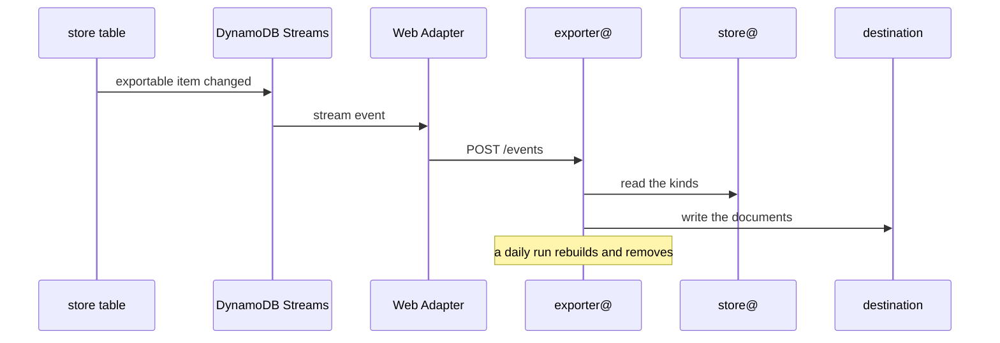

# 0009 — exporter@ publishes the kinds marked exportable to destinations outside sluis, never to a secret source

**Status:** Accepted
**Date:** 2026-11-21

Proposal: [issue #1014](https://github.com/truvity/sluis/issues/1014).

## Context

Some of what sluis holds must reach something outside it that has its own identity: a relying party that needs the key set, a host that needs a revocation list, a workload that needs a trust bundle. Secrets are a separate case. sluis keeps static secrets in KV ([0047](/decisions/0047-kv-is-a-core-service-of-stores-that-no-tenant-owns/)) and never publishes one.

Three rules from the data model bound the design.

- **Where a thing is written decides its class** ([principle 17](/principles/)). A secret source is written by infrastructure code and is read-only for sluis. If sluis wrote into one, a value would have two writers and two classes.
- **Few credential holders** ([principle 16](/principles/)). A destination needs a credential. That credential belongs to one holder of the data family, exporter@, and to no work actor ([0002](/decisions/0002-families-of-actors/)).
- **Nothing without a consumer** ([principle 8](/principles/)). A kind leaves sluis only when someone is named who reads it.

The mechanics of publishing are not specific to identity. They become atoom's `export` block, and the destination port and its directory driver are atoom's. This record keeps what is sluis's: which kinds may leave, who holds the credentials, and the rules for the key set.

## Decision

### The host and the block

- **exporter@ is the host of atoom's `export` block.** The block holds the mechanics: watch the exportable kinds from a resume point, reconcile at start and once a day, write, purge, read back and report. The block depends on the `destination` port and the `state` block ([atoom 0008](https://github.com/truvity/atoom/blob/master/docs/decisions/0008-blocks.md)). sluis plugs in the kinds, the rules and the credentials.
- **The block is planned.** Today exporter@ (`actors/exporter`) carries the mechanics itself and is built for the directory driver and the static key set. It moves into atoom at its second consumer.
- **The destination port and the directory driver are atoom's:** [the port](https://github.com/truvity/atoom/blob/master/destination/docs/destination-port.md) (`Put`, `Delete`, `List`, `Purge`, `ReadBack`, and its rules) and [the directory driver](https://github.com/truvity/atoom/blob/master/destination/dir/docs/dir.md). sluis consumes atoom's driver binaries and keeps a thin host, `drivers/exporter/dir`, for its socket and registry. This record does not restate the port.

### What is exportable

- **Only a kind marked exportable in the kind registry may leave sluis.** The mark is a property of the kind ([0004](/decisions/0004-the-data-model/)), so what may leave is decided in review and not at run time. exporter@ refuses any other kind.
- **The exportable kinds are public material:** `SigningRing` (the key set), `KeyCertificate` (the certificate chains), `TrustAnchors` (input to the trust bundle), `Crl`, `Krl` and `TrustBundle`. `ClientSecretExport` is retired; removing its mark from the registry is planned.
- **A kind is marked only when a consumer is named.** A new exportable kind needs the mark, a consumer and a rule that lets exporter@ read it, in that order.
- **A secret leaves sluis by a KV read, not by an export.** A secret that sluis generates or receives for a named consumer is written by its owner actor into a KV entry. The consumer reads it with its own sluis identity under policy, and each read is an audit fact. A generated secret that is not for a consumer keeps only its hash ([0004](/decisions/0004-the-data-model/)). exporter@ carries no KV value, and no `kv` destination exists. KV itself is planned.
- **No export carries a secret for a vendor that sluis could mint for.** sluis mints a scoped credential instead ([0025](/decisions/0025-integrations/)).

### Destinations

- **A destination is a config kind, `ExportDestination`,** with one driver per destination type. exporter@ holds the destination credentials; no work actor does, and store@ does not. Until store@ serves the kind, exporter@ reads the destinations from a file the operator keeps.
- **A directory** receives public material at static paths on a file system. A forwarder serves the files. The local and the board installations use it. It is built.
- **A bucket** receives public material at static addresses and may sit behind an edge cache. The bucket driver, the edge purge and the credentials for them belong to the Cloudflare add-on ([0044](/decisions/0044-sluis-is-a-core-and-add-ons/)), and are planned. The core holds no Cloudflare credential.
- **No destination is made for secrets.** A bucket or a directory never receives a sealed kind, and the configuration check refuses that pairing.
- **A destination that writes a Kubernetes Secret is planned,** for a single cluster, written by exporter@ alone and only when an installation chooses the direct path, with public material only. exporter@'s cluster credential is limited to the named Secrets in the named namespaces, and the threat model lists it. Apart from that Secret, sluis writes no Kubernetes object: cert-manager, trust-manager and External Secrets stay its clients and distributors.
- **A destination may not overlap a secret source.** The configuration check refuses a destination whose address is also read as a secret source ([0005](/decisions/0005-the-store/)), so sluis never reads back what it wrote and no value has two writers.
- **Every board of a boundary runs exporter@ with the same destination files.** The `ExportManifest` is one item for the boundary and each exporter@ writes it at its start, so boards with different files would overwrite each other's manifest and `signer` would wait for whichever was written last.

### Watch and reconcile

- **exporter@ watches the exportable kinds from a resume point** ([0005](/decisions/0005-the-store/)) and keeps the resume point of each destination in a temp kind, `ExportCursor`. Losing it costs a full reconcile, not data.
- **Public material is read and written as it is.** Every write is an audit fact.
- **A full reconcile runs at start and once a day.** It writes what is missing or different at the destination and removes what exporter@ wrote for a value that no longer exists, so a missed change or an edit made at the destination is corrected within a day.
- **A refusal is an audit fact and an alarm,** not a retry loop. exporter@ refuses a kind that is not marked and a destination that is not configured. The next reconcile tries again.

### Publishing public material

The key set is the first public document, and the other public kinds follow the same rules. Built today: one issuer, and so one key set, for each boundary, written to a directory. Planned: the other kinds and the other destinations ([#1714](https://github.com/truvity/sluis/issues/1714)).

- **A published document is one object at an address that `ExportDestination` declares,** with its content type and its `max-age`. The address is never derived from the kind. It is written whole and atomically, so a reader never sees half a document.
- **The key set is the JSON Web Key Set of RFC 7517,** built by the rule that `entry` uses for its live key set, with `Content-Type: application/json`, `Cache-Control: public, max-age=300` and `Access-Control-Allow-Origin: *` ([REQ-KEYS-016](/requirements/keys/#REQ-KEYS-016)). <!-- terms-allow: origin (the CORS header name) -->
- **exporter@ leaves out every `kid` that `KeyRevocation` lists** ([REQ-EXPORT-020](/requirements/export/#REQ-EXPORT-020)). It watches `KeyRevocation` and `SigningRing` and rebuilds on a change at once, not at the daily reconcile.

#### The edge

Every production shape sits behind the Cloudflare edge. The edge's settings are delivered by infrastructure code and not by sluis, so `sluis config check` cannot see them.

- **In the core the edge is set by documented rules.** The shared rules make the key set and the discovery document cacheable with a cache time below the pre-publish time of a key, so a new key is in every cache before it signs. A revoked key leaves the key set of `entry` and of the directory at once. A copy held at the edge expires with its cache time ([REQ-KEYS-084](/requirements/keys/#REQ-KEYS-084)). The time a revoked key stays verifiable in the core is measured by the drill of [0041](/decisions/0041-a-compromised-key-is-revoked-then-replaced/), and no figure is claimed here.
- **A bucket destination has an `edge` setting: `none` or a named edge.** `none` is what the directory uses. The first named edge is Cloudflare in front of R2, and it belongs to the add-on. Another edge arrives with the first installation that needs it ([principle 11](/principles/)).
- **Where a bucket destination exists, the static document is the public `jwks_uri`,** and the edge falls back to the live key set of `entry` when the bucket cannot be read ([REQ-EXPORT-025](/requirements/export/#REQ-EXPORT-025)). Both filter revoked kids, and `entry`'s fails closed ([REQ-KEYS-107](/requirements/keys/#REQ-KEYS-107)). An installation without a bucket destination serves `entry`'s key set alone.
- **If the bucket and `entry` both fail, the edge may serve a cached copy for at most 65 minutes after it expired** ([REQ-EXPORT-023](/requirements/export/#REQ-EXPORT-023)). That is the access-token cap of one hour plus five minutes of clock skew, the same figure as the retention of a retiring key ([0006](/decisions/0006-keys-and-sealing/)). With both back ends down no token is signed, and a longer window would serve a key set that no live token needs. A purge evicts stale copies too.
- **exporter@ alone holds a purge credential,** and it can purge only the public addresses of its destinations' documents, nothing else ([REQ-EXPORT-026](/requirements/export/#REQ-EXPORT-026)). The threat model lists it ([T-39](/security/threat-model/#export-and-backup)). It belongs to the add-on.
- **Planned: measure the edge.** Whether a purge by address evicts a stale copy, whether the stale window can be bounded at 65 minutes and whether the fallback to `entry` can be set are measured on the first edge, with the 60 seconds of the next part ([#1454](https://github.com/truvity/sluis/issues/1454)). The result fills the rows of the [incident page](/security/incident-response/#measured-times).

#### The order and the time

After a change of `KeyRevocation` or `SigningRing`, exporter@ does four things in this order ([REQ-EXPORT-021](/requirements/export/#REQ-EXPORT-021)).

1. **Write** the new document to the destination.
2. **Purge** its public address, where an edge is declared. One purge covers the cached copy, whichever back end, the bucket or `entry`, filled it.
3. **Read back** the public address the way a verifier does: no credential and no cache-buster. The answer must be 200 with the written digest.
4. **Report** by writing the temp kind `ExportReport` ([REQ-EXPORT-022](/requirements/export/#REQ-EXPORT-022)): the state, the digest, for a key set the kids it lists, and the times of the write, the purge and the read back.

The state is `published` when the read back matches, `purge-pending` while a purge or a read back is being retried, `written` when the destination cannot read back, and `unverified` when exporter@ could not tell. `published` needs a purge that was accepted (or no edge to purge) before the read back, because a read back after a failed purge says nothing about the other copies of the edge. A destination with no public address answers `unsupported` to `ReadBack`; its report says `written` and carries no purge or read back time, and `signer` does not count that document as published. A configuration that gives a public address to a destination whose driver cannot read it back is refused.

Where there is no edge to purge, step 2 does not exist, and `published` needs the write and the read back. The purge, the 60-second target and the 65-minute window belong to an installation that has the add-on: the write, the purge and the read back finish within 60 seconds of the moment exporter@ sees the change ([REQ-EXPORT-028](/requirements/export/#REQ-EXPORT-028)). That is a target, not a measurement. The first drill replaces it with the measured figure ([REQ-OPS-080](/requirements/ops/#REQ-OPS-080)). A step that fails is retried with a back-off, and past the 60 seconds it raises an alarm. The daily reconcile runs the same steps, so a report that nothing refreshes expires with its time to live, and a reader treats an absent report as "not seen".

`signer` makes a token key active only after the report of every published key set has the state `published`, lists the key's `kid` and has a read back at most 26 hours old (a day of the reconcile and a margin, [REQ-KEYS-116](/requirements/keys/#REQ-KEYS-116)), and the lead time has passed since that read back ([REQ-KEYS-085](/requirements/keys/#REQ-KEYS-085)). A replacement for a revoked key signs only after the report shows the key published ([REQ-KEYS-089](/requirements/keys/#REQ-KEYS-089)).

#### When exporter@ cannot tell

- **When exporter@ cannot read `KeyRevocation` or `SigningRing`, it leaves the published object as it is, raises an alarm and reports `unverified`** ([REQ-EXPORT-024](/requirements/export/#REQ-EXPORT-024)). It does not delete or empty the object. A blip of store@ would then stop verification for every relying party, and exporter@ cannot learn of a revocation it cannot read in any case ([0010](/decisions/0010-backup-and-recovery/#a-regional-outage)).
- **The one change it makes is a removal.** A key that a `KeyRevocation` event has just named is taken out of the last good document, because removal is monotone (no revocation puts a key back) and needs nothing that cannot be read. Nothing is added, and the state stays `unverified`. The alarm repeats every five minutes while the state lasts, and each way into and out of the state is one audit fact.
- **`signer` holds activation while a report does not list the key as `published` within the 26 hours, and `sluis key revoke` prints "not confirmed"** ([REQ-KEYS-116](/requirements/keys/#REQ-KEYS-116), [REQ-KEYS-088](/requirements/keys/#REQ-KEYS-088)). The live key set of `entry` goes on failing closed. No command and no setting lets `signer` activate a key before every report lists it as `published`: an operator who needs the key waits, repairs the destination or removes it from the declared files.
- **exporter@ down leaves the object as it was.** Its reports expire, so `signer` holds, and the start reconcile runs the four steps again.

#### Confirmation

`sluis key revoke` does not trust the report. It checks, and it reports "not confirmed" until both of these lack the revoked `kid` ([REQ-KEYS-088](/requirements/keys/#REQ-KEYS-088), [principle 4](/principles/)):

- the public `jwks_uri`, fetched through the edge as a verifier fetches it;
- the live key set of `entry`, fetched from `entry`'s own listener, which is what the edge falls back to. How the command reaches it on each runtime is in [`sluis key revoke`](/reference/cli/#sluis-key-revoke).

### On Lambda

exporter@ runs behind the Lambda Web Adapter like every function ([0003](/decisions/0003-units-transports-and-fusion/)). Nothing on Lambda is pushed to it by store@, so it has two triggers. The Lambda shape is planned, so both are planned.

- **DynamoDB Streams on the store's table wake it** when an exportable item changes. The stream is a wake-up of the function and not a second path to the data: exporter@ still reads the kinds through store@ and publishes as it does after any change.
- **A daily scheduled run** does what the daily reconcile does everywhere: it rebuilds the documents and removes what is gone, so a missed wake-up or an edit made at a destination is corrected within a day.
- **A revoked key still leaves the key set at once.** The stream wakes exporter@ on the change of `KeyRevocation`, and the daily run is the safety net, not the path.

How a stream-woken function fits the adapter is the same as for the audit writer, which SQS wakes ([audit 0016](https://github.com/truvity/audit/blob/master/docs/decisions/0016-distribution-and-the-lambda-shape.md)). The adapter passes a non-HTTP event to the application as an HTTP request to a configured path, `/events` by default, with the event as the body, and returns the application's response. exporter@ serves `/events` on Lambda, ignores the body (the stream says when to look, never what changed) and reads the kinds itself. Built: nothing of this, since exporter@ serves no HTTP route today. Planned: the route, the stream filter and the schedule. To be tested: that a stream batch and a scheduled event pass through the adapter cleanly.

The directory driver has no Lambda form, because Lambda has no lasting disk ([atoom 0010](https://github.com/truvity/atoom/blob/master/docs/decisions/0010-distribution-per-driver-and-lambda.md)). On Lambda exporter@ therefore publishes through a bucket driver, which is the add-on's. The merged drivers layer carries that driver where its language differs from the function's. A Lambda installation without the add-on serves the key set from `entry` alone.

Open: which items the stream's filter lets through, how long a wake may run and how a failed publication is retried inside the function's time limit. They are decided with the first Lambda exporter ([#1714](https://github.com/truvity/sluis/issues/1714)).

## Consequences

- What leaves sluis is a short, reviewed list, and a reader of the registry can see every export and its consumer.
- A secret is readable outside sluis only through a KV read under policy, each read an audit fact. An operator who wants a cloud console to show a value keeps it outside sluis.
- exporter@ is one more unit in every installation that exports. It shares its family with store@ and never shares a unit with a work actor.
- The mechanics of publishing live in one block that other products can use, and sluis keeps the kinds, the credentials and the key-set rules.
- In the core a revoked key leaves `entry`'s key set and the directory at once, and a verifier's own copy expires within `max-age`. With the add-on a revoked key leaves the edge within 60 seconds by target. If the purge fails, the edge copy lives for its time to live on top of that. The first drill measures both.
- exporter@ holds one more credential with the add-on, the purge. It is narrow: it can evict named public addresses and write nothing. A compromised exporter@ can already write the key set, and the purge adds the power to make an edge forget it.
- The key set has two back ends behind one address where a bucket exists, so a revocation has two places to be checked, and the confirmation checks both.
- exporter@ is part of the foundation with store@ and key@ ([0002](/decisions/0002-families-of-actors/)).

## Roads not taken

- **Always go through a store of record and External Secrets.** One rule instead of two, but a board installation would need a cloud for its consumers, and a secret would be held in a second place.
- **Write into the secret source.** sluis would read back what it wrote, and the same value would be written by infrastructure code and by sluis.
- **Each work actor exports its own kinds.** Work actors would hold destination credentials, against principle 16.
- **store@ does the exporting.** It would hold destination credentials beside its storage credentials and mix serving with publishing.
- **Export any kind on request.** Whether a value may leave sluis would become a run-time choice instead of a property of the kind, and the rules could not be generated from the registry.
- **A drop of files encrypted to a consumer's own recipient.** No consumer is named for it, so none is built.
- **A general-purpose secrets engine with dynamic secrets, leases and transit.** It is the product of another team and widens the trusted base. Static KV serves secrets ([0047](/decisions/0047-kv-is-a-core-service-of-stores-that-no-tenant-owns/)) and this road stays closed for the rest.
- **Export a secret for a vendor sluis can mint for.** A long-lived copy would exist where a short-lived scoped credential is possible.
- **No purge: the edge never caches the key set.** It needs no purge credential, but every fetch of a verifier reaches the back end, and the key set no longer outlives an outage of the bucket's region ([0010](/decisions/0010-backup-and-recovery/#a-regional-outage)).
- **Purge by hand.** It needs no code, and it is slow at the worst moment; the confirmation and the replacement could not rely on it.
- **A versioned address for the key set.** The discovery document names one `jwks_uri`, and relying parties cache that document, so a new address would reach them slower than the key set itself.
- **Delete or empty the published key set when `KeyRevocation` cannot be read.** `entry` answers 503 then, but a blip of store@ would become an outage of verification for every relying party.
- **Only the live key set, with exporter@ just purging.** Verification would depend on the compute of the issuer, against [0017](/decisions/0017-identity-and-sign-in/).
- **Only the static key set, with no fallback to `entry`.** One back end instead of two, but a failed bucket would leave the edge's stale window as the only protection.
- **Confirm from the report of exporter@.** It proves what exporter@ saw and not what a verifier sees, against principle 4.
- **An override that activates a key before its report says `published`.** An operator under pressure would defeat the check that protects every verifier.
- **Reuse the audit blob port.** Its writes are create-if-absent, and a key set must be overwritten, removed and purged.
- **The stream as a second path to the data.** The exporter would trust an event's content, and a missed event would make a document wrong and not only late.

## Follow-ups

- Build of the bucket driver, the Cloudflare purge and the measurement of the edge, with the 60-second and 65-minute figures: [#1454](https://github.com/truvity/sluis/issues/1454). They serve the static discovery and key set ([#962](https://github.com/truvity/sluis/issues/962)), the header and the edge time to live ([#1338](https://github.com/truvity/sluis/issues/1338)) and the confirmation of `sluis key revoke` ([#1362](https://github.com/truvity/sluis/issues/1362)).
- The rest of exporter@: the other destination drivers, the other exportable kinds, the Lambda trigger and the conformance suite: [#1714](https://github.com/truvity/sluis/issues/1714).
- Moving the mechanics into atoom's `export` block, step B11 of [atoom's plan](https://github.com/truvity/atoom/blob/master/docs/plan.md).
- Open: removing the `ClientSecretExport` mark and the requirements that name it (REQ-EXPORT-008, REQ-EXPORT-011, REQ-EXPORT-013, REQ-DATA-022) in favour of the KV rules (REQ-KV-028 to REQ-KV-030).
