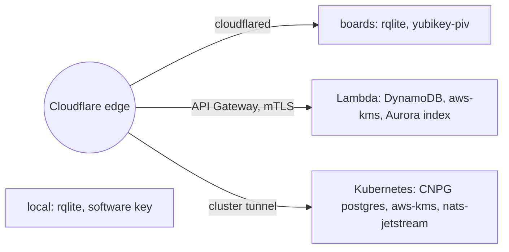

# 0011 — Runtimes are three kinds, four installations are tested, and every Lambda function runs behind the Web Adapter

**Status:** Accepted
**Date:** 2026-11-21

Proposal: [issue #902](https://github.com/truvity/sluis/issues/902).

## Context

Earlier designs listed "deployment shapes": local, single node, cluster, a single virtual machine, a serverless function and Kubernetes. A shape mixed three things: the runtime kind, the number of nodes, and the outside services a deployment needs. Each new platform added shapes, and a name such as "board + cluster" hid which part differed.

The runtime kind decides what a process can rely on: whether it runs for a long time, whether it has a persistent disk, whether processes can connect to each other. The node count and the outside services do not change that; they change which drivers fit. "Environment" already means development, staging or production to nearly every reader, so it keeps that meaning and does not name the runtime kind.

Every installation runs the same actors ([principle 11](/principles/#11-one-product-many-installations)): the foundation (store@, key@ and exporter@) and the modules it needs ([0002](/decisions/0002-families-of-actors/)). What an installation chooses is the runtime, the transport of each hop ([0003](/decisions/0003-units-transports-and-fusion/)), the engine behind store@, and the key store behind key@. The drivers are [atoom's](https://github.com/truvity/atoom/blob/master/docs/decisions/0010-distribution-per-driver-and-lambda.md): sluis consumes them and decides which ones an installation runs.

Every combination cannot be built and tested, and v2 has to take the place of v1 ([0001](/decisions/0001-v1-and-v2-lines/)).

## Decision

### Runtime kinds

- **A runtime is only the runtime kind.** There are three:
  - **bare-metal**: physical hosts, virtual machines (EC2 and similar) and local Docker, supervised by systemd or by a container runtime;
  - **serverless**: AWS Lambda and similar. It runs per event: no long-running processes, no local disk, no inbound connections between processes. It always comes with a provider, so the provider is part of the runtime;
  - **kubernetes**: supervised by the kubelet. A persistent disk exists only with a per-pod volume.
- **An environment is development, staging or production.** It says where an installation is used, not what a driver needs.
- **Nodes and dependencies are attributes of an installation.** The node count (1, N, or elastic on serverless) belongs to the installation. A provider need, such as a cloud account, a hardware key or a message service, is a dependency that a driver declares.
- **An installation is one concrete deployment:** a runtime, nodes, the available dependencies, the engine behind store@, the key store behind key@ and its fusion choices ([0003](/decisions/0003-units-transports-and-fusion/)), for example "bare-metal, 3 nodes, AWS account". "Installation" is not a configuration key. The bootstrap file and the signed config documents are the installation's configuration ([0005](/decisions/0005-the-store/)); the tested installations ship as example bootstrap files; and `sluis config check` refuses a driver that does not fit the runtime. No file names the runtime, so the caller of the check does (`--runtime`).
- **There are no presets.** An installation is a runtime plus choices, not an id.

What each runtime provides:

| Capability | bare-metal | kubernetes | serverless |
|---|---|---|---|
| Long-running processes | Yes | Yes | No (runs per event) |
| Persistent local disk | Yes | Only with a per-pod volume | No |
| Same-host Unix sockets | Yes, on the node | Yes, within a pod | Yes, within one function |
| Inbound connections between processes | Yes (between nodes, only the engine's cluster port) | Yes (Service) | No (only triggers or a gateway) |
| Hardware devices | Yes | Partly (a pod pinned to its node) | No |
| Nodes | 1 or N | 1 or N | Elastic, with no node identity |
| Supervisor | systemd, or a container runtime | kubelet | The platform |

### Installations

Four installations are tested: documented and kept in the test matrix. Any other combination is a possible installation: the rules allow it and `sluis config check` accepts it, but it is not tested. EC2 is not a test target; an EC2 installation is a possible bare-metal installation.

| Installation | Runtime and nodes | Must be provided | key@ driver | store@: engine, config source, secret source | State |
|---|---|---|---|---|---|
| **local** | bare-metal, 1 node | A workstation with Docker | `software` (a development card is opt-in) | `rqlite` with one node; `file`; credential files | Built |
| **boards** | bare-metal, 3 nodes | Three single-board computers (arm64, 2 GB RAM, eMMC) with a YubiKey in each, and a Cloudflare account for the tunnel to the public hostname | `yubikey-piv`, one card per node | `rqlite`, one cluster over the three nodes; `file`; systemd credentials | Deploy and smoke test built; hardening and rehearsals planned |
| **lambda** | serverless, elastic | An AWS account with Lambda, API Gateway, KMS, DynamoDB, SQS, S3, SSM, AppConfig and Aurora Serverless v2 | `aws-kms` | `dynamodb`; `appconfig` or `file` from a layer; SSM | Planned |
| **kubernetes** | kubernetes, N nodes | A Kubernetes cluster (EKS for the tested installation) with NATS JetStream and CloudNativePG, and an AWS account with KMS, S3 and SSM | `aws-kms` | `postgres` through CloudNativePG; `file` from a mounted ConfigMap or `appconfig`; SSM | Planned |

The audit blob, transport and index of each installation are audit's drivers, chosen by [audit's distribution record](https://github.com/truvity/audit/blob/master/docs/decisions/0016-distribution-and-the-lambda-shape.md) and its [log record](https://github.com/truvity/audit/blob/master/docs/decisions/0008-the-log.md). An installation needs a blob store with create-if-absent, a transport the writer reads, and an index; the local and boards installations use the local disk, lambda uses S3, SQS and a PostgreSQL index on Aurora, kubernetes uses S3, NATS JetStream and PostgreSQL on CloudNativePG.

Built means the code and the proof are in the repository: the smoke tests of local run in CI on every pull request, and the boards deploy and smoke test pass on three boards over one three-node rqlite cluster. Planned means no deploy code exists yet. The order and the done-when of each are on the [roadmap](/roadmap/).

- **The reference installations.** The design is checked against three: a self-hosted installation on three boards, an internal installation for a company's own staff on serverless, and a customer installation on Kubernetes on AWS ([0008](/decisions/0008-boundaries-and-tenants/)). The local installation is for development and serves no real user.
- **The engine and the key store are the two choices that differ.** Every installation has one engine for the durable and temp kinds, which may share it, and one key store behind key@ ([0006](/decisions/0006-keys-and-sealing/)). A work actor sees neither.
- **Leases are temp kinds in the engine everywhere:** `rqlite` on local and boards, `dynamodb` on Lambda, `postgres` on Kubernetes. There is no Kubernetes Lease and no lock outside the store.
- **An installation runs in one region of one cloud provider, or on one set of boards.** Its engine, blobs, queues, compute and keys are there. A region is not an attribute of a tenant: a second region is a second installation with its own keys, store and issuer, because boundaries never share keys ([0006](/decisions/0006-keys-and-sealing/), [0008](/decisions/0008-boundaries-and-tenants/)). The region guard and the one replica that may live in another region are in [0010](/decisions/0010-backup-and-recovery/); a regional outage is accepted.
- **Every installation provides audit's pieces.** On the boards each node keeps its own log and the other nodes are its peer witnesses (planned). On Lambda the audit writer runs behind the Web Adapter with a reserved concurrency of 1; correctness comes from the write-once fence on the bucket, and audit tests the SQS path ([audit 0016](https://github.com/truvity/audit/blob/master/docs/decisions/0016-distribution-and-the-lambda-shape.md)).

### The Cloudflare edge

Every production installation sits behind the Cloudflare edge.

- **Lambda:** Cloudflare proxies to an API Gateway custom domain with mutual TLS, with Cloudflare's authenticated-pull CA as the truststore. The API's default `execute-api` endpoint is disabled.
- **Kubernetes:** the cluster's own Cloudflare tunnel and gateway route to the key-less edge relay of `entry`, by an HTTPRoute or an Ingress. That is the chart's default. A `cloudflared` sidecar in `entry`'s pod is an optional value for a cluster without its own tunnel.
- **Boards:** `cloudflared`.
- **Shared rules:** the key set and the discovery document are cacheable, with a cache time below the key pre-publish time. `/token` and the recovery paths are rate limited. WAF rules cover the MCP and agent connectors. `entry` keeps its own limits behind the edge ([0036](/decisions/0036-volumetric-abuse/)).
- **sluis does its own side and documents the rest.** Its deploy code sets what is inside the installation: on Lambda the default endpoint off, the truststore and the cache headers; in the chart the edge relay's route and the optional sidecar. The Cloudflare records, rules and rate limits are documented, and each installation's own infrastructure code applies them. sluis holds no Cloudflare credential in the core.

### The local installation

- **Docker Compose, one container per actor and per driver.** The platform starts every service and nobody execs a driver ([0003](/decisions/0003-units-transports-and-fusion/)); Compose is that platform. A holder's drivers run as containers beside it, and only the holder mounts their socket volume. It is for development, continuous integration and integration tests, and it proves behaviour, not availability.
- **The same socket layout and identities as everywhere.** Unix sockets live on shared volumes under `/run/sluis/<actor>/`; each container mounts only the socket directories the actor registry allows and runs as its actor's uid, so the peer-credential checks work as on a host. key@ serves each caller on a socket of its own, mounted only into that caller's container.
- **rqlite is reached through its network namespace.** The driver's container joins the namespace of the rqlite container, so rqlite's client API stays on the loopback address and the driver is its only client, as on a board.
- **The same configuration path as everywhere.** store@ loads signed config documents from a directory and verifies them against a publisher key pinned in its bootstrap file. A development installation differs from the others by configuration only.
- **The plain-http floor accepts loopback only.** The URLs of an upstream and of a callback are `https`. A redirect is `https`, or `http` on a loopback IP literal (`127.0.0.1` or `[::1]`, any port; RFC 8252 sections 7.3 and 8.3), never a name and never another address, in every environment (REQ-AUTHN-004). In a boundary whose environment is `development`, and nowhere else, an `http` URL is accepted when its host is a loopback IP literal: store@ refuses any other at load, and the adapter and exchange refuse to fetch one (REQ-SEC-037). A staging or production boundary refuses every `http` URL except the loopback redirect of a public client with the `native` profile ([0021](/decisions/0021-clients/)). It is a floor in code, like the software key's: configuration cannot lift it. A development upstream behind plain HTTP is reached by its loopback form through a forwarder of the harness.
- **The published images.** Local runs the release's images, one per process, which carry the packages' binaries byte for byte ([0013](/decisions/0013-release-train-packaging-and-distribution/#packaging-per-runtime)). A local run tests the images Kubernetes runs, not a development build.
- **Software keys by default.** The `software` driver needs no hardware; it refuses to start in production and warns in staging ([0006](/decisions/0006-keys-and-sealing/)). A dedicated development card is opt-in: the key@ container, and only it, reaches the card through the host's smart-card service, and key@ has the card to itself. Sharing the card with other card software is not set up, because gpg then asks for the PIN on every operation.
- **People sign in through a real identity provider, never a hand-written fake,** because the product carries no test code and a fake proves only what its author expected. sluis holds no accounts, even in tests. The generic OpenID Connect upstream is tested in three layers:
  - **every pull request:** Keycloak (OpenID certified) in a container, started from a reviewed realm-import file, with users and groups created per test through its admin API and the sign-in driven over plain HTTP by the harness. The realm sends `amr`, with `mfa` after a one-time-password step, so the multi-factor rule passes on every pull request. The upstream's subject claim is `sub`, as on any installation, and its policy binds a test user by the `sub` the realm gave the user; the local installation keeps the rule against mutable subject claims with no exception ([0019](/decisions/0019-person-and-upstream-link/));
  - **optionally on pull requests:** Dex, as an upstream that sends no `acr`, `amr` or `auth_time`, to prove that an absent value is treated as unknown;
  - **nightly and before a release:** two free cloud tenants, Google Cloud Identity Free and Microsoft Entra ID Free, on the private runner group ([#891](https://github.com/truvity/sluis/issues/891)), for what no container shows: vendor claim shapes, the vendors' own `amr` values and logout behaviour. Entra sends `amr` only when the app registration adds it as an optional ID-token claim. Google sends `amr` and `auth_time` only when the request carries a `claims` parameter, which the generic upstream cannot yet send ([#1154](https://github.com/truvity/sluis/issues/1154)).
- **Host names are `.test` names, except for the nightly runs.** Local and pull-request runs use `.test` names behind the harness's forwarder, so a browser and a container see the same names. Google accepts a redirect host only under a public suffix, which `test` is not, so the nightly runs use the same hosts under a configurable dev domain with a public default, so anyone can reproduce the run against their own tenants. The project's own CI sets its own domain through CI configuration.
- **Passkeys are tested with a browser's virtual authenticator and a software authenticator library,** driving the released images.
- **`entry`'s container has no network.** Its public API is a Unix socket on a shared volume. A developer or a test harness reaches it through a Compose service that mounts the socket and publishes a port.
- **The audit log is part of local:** the emitter in every actor, the writer on the `fs` blob, and search with the indexer, the `sqlite` index and the reader. Every flow is audited from the first build, and the integration tests assert an "audited" claim by reading the record back through the reader. There is no witness, and `sluis config check` warns about it as for any installation without one. The `direct` transport falls back to a local spool when the writer is down; local has a disk, so `direct` and `spool` both work.

### Boards and the bare-metal runtime

- **The unit is a systemd unit with its own uid.** An actor's drivers are units beside it, and a call is a Unix socket call between processes of one node. The packages ship template units, and a generator creates the instances ([0013](/decisions/0013-release-train-packaging-and-distribution/#packaging-per-runtime)).
- **One engine cluster spans the nodes.** The only inbound connection between nodes is the engine's cluster port. A host firewall limits the engine's ports to the peer nodes (built). Mutual TLS on the cluster port, and a firewall that fails closed, are planned ([#1584](https://github.com/truvity/sluis/issues/1584)); they are a gate before any real PIN or real data goes on a board ([REQ-DEPLOY-047](/requirements/deploy/#REQ-DEPLOY-047)).
- **A card in each node.** key@ owns the node's card exclusively. A card signs about 7 times a second on a YubiKey 5 Nano, so the cards limit token signing before the engine limits writes ([0037](/decisions/0037-capacity-is-measured-before-it-is-promised/); measured 2026-10-31).
- **Unit credentials are encrypted at rest** under the host key on every supported platform ([0013](/decisions/0013-release-train-packaging-and-distribution/#supported-platforms)).
- **The audit blob is `fs` on each node's disk.** Object storage for the logs belongs to the Cloudflare add-on.

### Kubernetes

- **Kubernetes keeps its keys on AWS.** Its store engine is PostgreSQL through CloudNativePG (one cluster for the store and for the audit index, in separate databases and roles), its keys are AWS KMS with the layout of every AWS installation ([0006](/decisions/0006-keys-and-sealing/)) and its blobs are S3. A key driver for a cluster without AWS is not part of the core. Planned.
- **The unit is the pod.** Every actor and every holder runs in a pod of its own with its own service account, and a driver is a native sidecar container in its holder's pod. A generated check proves that no container holding a cloud token exposes a listener ([0003](/decisions/0003-units-transports-and-fusion/)).
- **Cloud identity is a projected service-account token, mounted only into the driver container** and exchanged there for a cloud role by web identity. A work pod has no cloud identity at all. `sluis-node` serves as a fallback only ([0022](/decisions/0022-workload-identity-and-host-enrolment/)).
- **Drivers:** AWS KMS for key@, PostgreSQL through CloudNativePG for the engine, SSM for secrets, a mounted ConfigMap or AppConfig for config, NATS JetStream for the audit transport (SQS stays possible), S3 for blobs. The reference installation proves the pod transport and the `nats-jetstream` transport; the Lambda installation proves `sqs` and the invokes between functions. It runs the OpenID Connect and FAPI 2.0 conformance plans ([0038](/decisions/0038-fapi-2-profile/)).
- **The edge is a key-less edge relay container in `entry`'s pod.** It listens on the pod address and forwards to `entry`'s Unix socket; `entry` stays socket-only.
- **Adapters are pods like any actor,** each with its own egress NetworkPolicy to its vendor. Cells keep most calls on one node ([0003](/decisions/0003-units-transports-and-fusion/)).
- **Baseline:** native sidecars, the `restricted` Pod Security level and a CNI that enforces NetworkPolicy are required. Cilium is optional, for egress by FQDN. OpenShift and sandboxed runtimes (gVisor, Kata) are not supported.
- **One chart, with the presets `install` and `kubernetes-dev`, and no subcharts** ([0013](/decisions/0013-release-train-packaging-and-distribution/#packaging-per-runtime)). `kubernetes-dev` allows software keys on the same terms as the local installation, for the smoke test on a kind cluster. There is no quota preset.
- **sluis writes no Kubernetes object, except an exported Secret written by exporter@ when an installation chooses the direct path** ([0009](/decisions/0009-export/)). Cluster tools such as cert-manager, trust-manager and External Secrets stay its clients and distributors. The chart renders no Role for leases.
- **Continuous integration reaches the development cluster's API through a short-lived runner inside the VPC,** against a private endpoint. The cluster has no public API endpoint.

### The Lambda shape

- **Every function runs behind the Lambda Web Adapter,** vendored and pinned in sluis's build. No function has a native handler. A function runs the same HTTP application as on a host or in a container.
- **A function is an app zip, sluis's layer with the vendored Web Adapter and a config layer,** plus one merged drivers layer only where a driver's language differs from the function's. The drivers layers are [atoom's extension zips](https://github.com/truvity/atoom/blob/master/docs/decisions/0010-distribution-per-driver-and-lambda.md), and the install tooling merges the extensions one function needs into one layer, so a function stays within Lambda's limit of five layers. A driver in the function's own language is linked in process and needs no layer. For example, key@ is Go and atoom's AWS drivers are Go, so key@'s function links the KMS driver; store@ is Rust and its DynamoDB driver is Go, so store@'s function carries the DynamoDB extension in a drivers layer.
- **One function per actor instance and per holder, one zip per executable.** Each instance, `actor@boundary`, has its own Lambda function and IAM role. Only `entry` takes requests from outside; every other function is invoke-only. A hop between functions is a Lambda invoke, and the adapter hands the event to the function's application as an HTTP request. Zip only: a container image is not used on Lambda. Zips are built for `arm64` (the default) and `x86_64`, and sluis publishes no public layer ARNs: an installation verifies the zips and publishes the layers into its own account.
- **A work function carries no driver and holds no credential.** Its role lets it invoke other functions and send to the audit transport, and nothing else. Only the holders' roles reach storage, keys, export destinations or the audit blob ([0002](/decisions/0002-families-of-actors/)). No function links store@ or its drivers into a work actor's process: a read or write is an invoke of store@'s function, and the latency was measured fast enough ([0037](/decisions/0037-capacity-is-measured-before-it-is-promised/), [#1179](https://github.com/truvity/sluis/issues/1179)).
- **The call graph is enforced twice.** Each callee's resource policy grants `lambda:InvokeFunction` only to the roles of its allowed callers, and the callee reads the caller's role and alias and applies the call graph, default deny. Roles, functions, schedules and invoke grants are generated from the actor registry.
- **Keys:** AWS KMS only. The key policy of every KMS key names the role of the key@ function alone. There is no card and no software key on Lambda. On Lambda the cache's time to live in key@ is also the longest time a deleted tenant's data can still be opened.
- **Data:** DynamoDB behind store@, one table per engine; every sealed value is ciphertext before it reaches the table. Configuration comes from a layer (`file`) or the AppConfig API; a layer never changes under a running function, so a config that must change without a deploy comes from AppConfig. Secrets come from SSM.
- **Exporter:** DynamoDB Streams on the store's table wake exporter@ when an exportable item changes, and a daily scheduled run rebuilds the documents and removes what is gone.
- **`entry` listens on `127.0.0.1` inside the sandbox,** and the adapter connects to it. Every other function's process also listens on `127.0.0.1` for the adapter only ([0003](/decisions/0003-units-transports-and-fusion/#listeners)); no function listens on any other address. API Gateway is in front, and the console's single-page application is served from the bucket behind the same gateway ([0027](/decisions/0027-the-console/)). There is no node agent on Lambda: the token for a cloud federation comes from the `signer`.
- **Built and planned.** None of the shape is built: there is no Lambda deploy code, no vendored adapter and no zip. In atoom, the `dynamodb` and `aws-kms` drivers exist as libraries, and `appconfig`, `ssm`, `s3`, `sqs` and the Lambda extension zips are planned.

## Consequences

- Adding a platform adds one runtime at most, and often none. A new driver changes which installations are possible, not which runtimes exist; `sluis config check` reports which ones work.
- The test matrix is four installations wide. Combinations outside it can break without a test noticing, and the docs say so.
- The local installation exercises the same call graph, socket layout and per-actor identity as the boards, so a socket or access-list mistake is found on a workstation. Several containers instead of one cost start-up time and memory, accepted for fidelity. The Compose file is generated from the registries like the systemd units, and the uids are pinned, the same in Compose and in the chart, because the peer-uid check relies on them.
- Every installation runs store@ and key@. Local proves them with `rqlite` and the software driver; DynamoDB, PostgreSQL and KMS are proved only by the Lambda and Kubernetes installations.
- The local installation and CI need no hardware. The card path is proved on three boards with a card in each; the platform controls (IAM and key policies, systemd sandboxing, a replicated engine, a compliance lock) are exercised only by boards, Lambda and Kubernetes.
- A software key can be read by anyone who can read its volume. It is for development data only.
- On a card, PIV signing is about 7 signatures a second on a YubiKey 5 Nano and about 21 for three boards (measured 2026-10-31). Unwrapping a data key is an ECDH of about 143 ms on a card (median on two boards' cards, measured 2026-11-03), paid once while the key stays in key@'s cache ([0006](/decisions/0006-keys-and-sealing/)). Load tests run on installations with cloud keys.
- Sign-in tests depend on a Keycloak container of about 1.5 GiB that starts in about 10 seconds (measured on a workstation on 2026-11-01), so one instance serves a whole test job, with a realm or users per test. Keycloak sends `amr` only through its Authentication Method Reference protocol mapper and only when each authentication execution carries a reference value and a `maxAge`; the realm import sets both.
- Until the other installations are built, v2 has no production installation, because local is not one. Checks that need a cloud account, a cluster or the board hardware wait for it.
- Lambda has limits that bound the design. Five layers and 250 MB unzipped, code and layers together, bound a function. A request that crosses several functions chains cold starts; provisioned concurrency on `entry`, `signer` and the holders is the lever. Outside a VPC egress is unrestricted, and inside a VPC egress rules work by IP, not by name. One zip and one IAM role per actor and per holder raise the number of artifacts; the generator derives them all from the registries. The vendored adapter is part of the supply chain: it is pinned to a version and built into the release.
- Kubernetes depends on more cluster features than the other runtimes, and the cluster must meet the baseline before the chart installs. A pod per actor and per holder is more pods than a fused layout; the cells keep their calls on one node.

## Roads not taken

- **Seven fixed shapes, or numbered presets, as the tested set.** Each new platform multiplied them, and the ids said nothing about what they contained.
- **"Environment" for the runtime kind.** The word already means development, staging or production, and the two meanings would meet in one sentence.
- **A virtual-machine cluster on EC2 as a test target.** It would depend on a cloud account and leave the key hardware, the hardest part, untested.
- **Identical behaviour with v1 as the goal.** It would carry v1's mistakes forward and bind v2 to v1's shape; the bridge is the wiring: the workloads that use v1 can be wired to v2, possibly in a different way.
- **One local container with every actor under a supervisor.** The supervisor puts back the right to start processes, and local would no longer be shaped like the other installations.
- **A different engine for the local installation, such as an embedded file database.** It would be a second engine to keep conformant, and local would no longer exercise the replicated engine path of the boards.
- **A hardware key for every local run.** It would make a card a precondition for building and testing; the card path is proved on the boards and on an opt-in development card.
- **A small fake upstream identity provider in the harness.** It would be test-only code that proves what its author expected; a certified provider in a container is as fast to seed and tests the real protocol.
- **Keycloak without the `amr` mapper, with `amr` checked only by the nightly run.** The local multi-factor rule would never pass on a pull request, and a break in `amr` pass-through would surface a day later in a cloud tenant.
- **The user name as the local subject claim.** The development installation would need an exception to the rule that a subject claim does not change for a person, and its configuration would fail the check every other installation passes.
- **Cloud identity-provider tenants on every pull request.** Every run would depend on a secret, a rate limit and an account that can be deleted; it runs nightly instead.
- **A Kubernetes Lease as the lease.** It needs RBAC for lease objects that sluis does not write, and a lease on the engine already carries a fencing token on every runtime.
- **Several actors as containers of one pod.** The containers of a pod share its network and egress rules, so every actor would share one allow-list, and a pod with several actors is fusion by default.
- **A Kubernetes cluster without AWS keys.** It would need a second key mode with no consumer yet.
- **EKS Pod Identity for a holder's pod.** Its credentials reach every container of the pod; a projected token mounted into the driver container keeps the cloud credential away from the holder's own process.
- **A public EKS API endpoint limited to the runner's address.** A runner inside the VPC needs no public endpoint at all.
- **A native Lambda handler for any function, or only `entry` behind the adapter.** Two entry points per function would have to be kept in step, and a function would no longer run the same application as on a host.
- **A container image for Lambda.** Layers do not apply to images, so the adapter and extensions would be baked into every image.

## Follow-ups

- The test installations harness, including the identity providers it runs and the generated Compose file: [#877](https://github.com/truvity/sluis/issues/877).
- The generic OpenID Connect upstream sends a configured `claims` request parameter, which Google needs to send `amr` and `auth_time`: [#1154](https://github.com/truvity/sluis/issues/1154).
- Integration tests on a private runner group for the boards and the AWS installations: [#891](https://github.com/truvity/sluis/issues/891).
- The Helm chart: [#844](https://github.com/truvity/sluis/issues/844) and [#876](https://github.com/truvity/sluis/issues/876).
- AWS KMS signing latency from Lambda, for the load-test plan: [#1713](https://github.com/truvity/sluis/issues/1713).
- Open: the adapter's pass-through of a Lambda invoke between two functions and of SQS events is to be tested on real Lambda; audit tests the SQS path first.
- Open: the design of a mixed shape, where some sluis parts run on Kubernetes beside another installation: [#926](https://github.com/truvity/sluis/issues/926).
- Open: the auto-pause and resume time of Aurora Serverless v2 under the Lambda installation's audit index are not measured; measure them when the installation is built.
