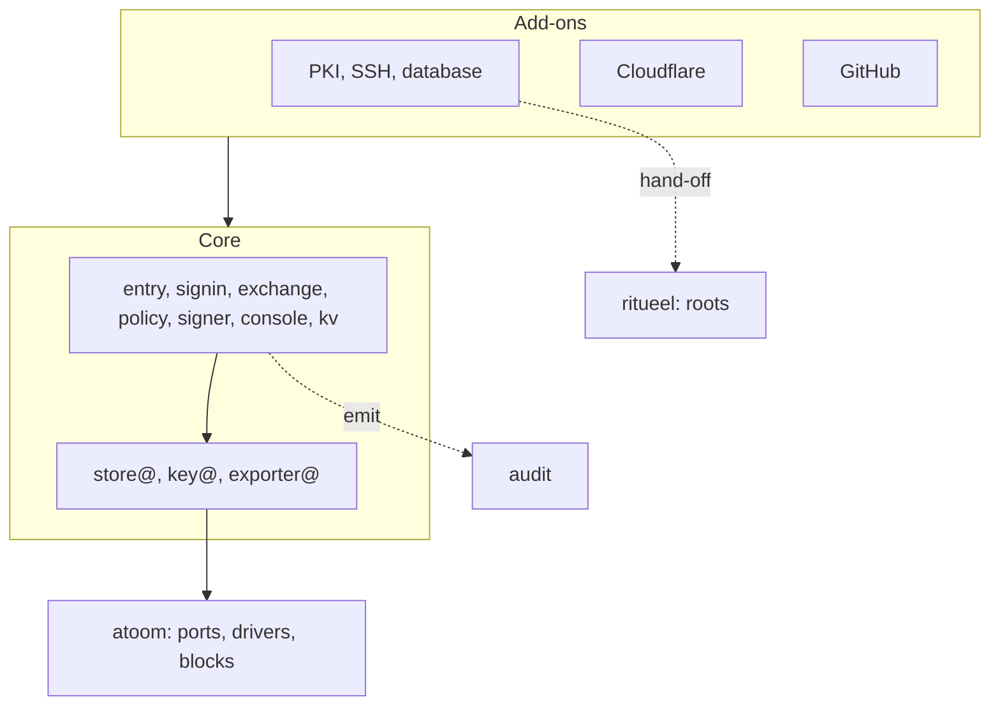

# 0044 — sluis is a core and add-ons, and no core actor calls an add-on

**Status:** Accepted
**Date:** 2026-11-21

Proposal: [issue #1017](https://github.com/truvity/sluis/issues/1017).

## Context

sluis is an identity product with several jobs: sign-in for staff and customers, token exchange for machines, grants, keys, secrets, and certificates for hosts and databases. An installation does not need all of them. A board installation for a small team needs sign-in, tokens and secrets and no certificate authority. An installation for a regulated customer may need all of it.

Two things make the shape clear. First, the parts that other products can reuse no longer live in sluis. The ports, the drivers and the blocks built from them are in [atoom](https://github.com/truvity/atoom). The audit product is in [truvity/audit](https://github.com/truvity/audit). Root custody is in [ritueel](https://ritueel.id/). Second, what remains has a natural order: a core that every installation runs and passes its tests without, and optional add-ons that each bring their own actors, kinds and key purposes.

This record says what the core is, what each add-on is, and where sluis meets its neighbours. The order in which the layers are built and the dates are on the [roadmap](/roadmap/) and nowhere else.

## Decision

### The layers

- **sluis has a core and add-ons.** Each decision record says in its `Layer` line which one it describes: `core` (no line means core), `add-on`, or `customer identity`.
- **No core actor calls an add-on.** The core installs, runs and passes its tests without any add-on. An add-on brings its own actors, kinds, key purposes, routes and call-graph edges into the registries ([0002](/decisions/0002-families-of-actors/)), and only an installation that runs the add-on has them. A core actor never calls an add-on to do its own job.
- **An add-on may use the core, and the core never needs it.** An add-on reaches `store@`, `key@` and `policy` through the same ports as a work actor of the core.

### The core

The core is everything an installation needs. It is built in part today (the local installation and the boards); the roadmap says what is planned.

| Part | What it holds | State |
|---|---|---|
| Sign-in and tokens | `entry`, `signin`, `exchange`, `policy` and `signer`: sign-in, sign-in sessions, token exchange, grants and the issuer ([0017](/decisions/0017-identity-and-sign-in/), [0018](/decisions/0018-sign-in-sessions/), [0007](/decisions/0007-policy-and-sealed-grants/)) | built |
| Customer identity | The exchange of a customer's upstream token for a sluis token that carries the customer, the organisation and the product ([0020](/decisions/0020-grant-vocabulary-and-token-claims/), [0032](/decisions/0032-customer-identity-installations/)) | planned |
| The hosts of atoom's blocks | `store@` around `state`, `key@` around `seal`, `exporter@` around `export` ([0005](/decisions/0005-the-store/), [0006](/decisions/0006-keys-and-sealing/), [0009](/decisions/0009-export/)) | built with sluis's own implementation; the move onto the blocks is planned |
| The console | The operator API, which embeds audit's page ([0027](/decisions/0027-the-console/)) | planned |
| KV | Versioned static secrets in stores that no tenant owns, read by External Secrets ([0047](/decisions/0047-kv-is-a-core-service-of-stores-that-no-tenant-owns/)) | planned |
| Limits | The limit check on the request path ([0046](/decisions/0046-limits-on-the-request-path-and-usage-in-audit/)) | planned |
| Integrations and reconcilers | Adapters for upstream providers and vendors, and the reconcilers that keep outside systems in line ([0025](/decisions/0025-integrations/), [0026](/decisions/0026-reconcilers/)) | `adapter-upstream-oidc` built |
| Hardening | The FAPI 2.0 profile for the core issuer, refresh-token reuse detection, logout, passkey tiers and abuse limits ([0038](/decisions/0038-fapi-2-profile/), [0036](/decisions/0036-volumetric-abuse/), [0041](/decisions/0041-a-compromised-key-is-revoked-then-replaced/)) | partly built |

- **The token certificate is optional per installation and off in the core.** `ca` issues it and its code is built, but the core runs without an intermediate certificate, without a test certifier and without a certificate chain in the key set. An installation turns it on together with the PKI add-on ([0023](/decisions/0023-certificate-authorities/), [0006](/decisions/0006-keys-and-sealing/)).
- **The core has no vendor at run time.** It holds no Cloudflare, GitHub or other vendor credential, and an installation on boards serves its consumers from KV with no cloud account.
- **The console is core, not an add-on,** because an operator needs it to run any installation.

### The add-ons

An add-on is optional and has a scope of its own.

- **PKI, with SSH and database access.** `ca` issues leaf certificates and revocation lists, `ssh-ca` turns a sluis token into a short-lived SSH user certificate and issues host certificates, under an SSH CA that ritueel lists, and PostgreSQL clients get certificates ([0023](/decisions/0023-certificate-authorities/), [0024](/decisions/0024-root-custody-and-the-signing-api/)). It turns the token certificate on. The host needs no token verifier, only the SSH CA key list and the principals that the host agent writes. `ca` is built as a v0 that is off in the core; the rest is planned.
- **Cloudflare.** The exporter's bucket driver, the edge purge and the R2 credentials ([0009](/decisions/0009-export/)). Planned.
- **GitHub.** GitHub Actions OpenID Connect as a workload proof in `exchange` and `policy`, and `adapter-github` ([0025](/decisions/0025-integrations/)). Planned. Two records about GitHub are proposals that wait in the backlog: the sync of company-issued OpenPGP keys to staff accounts ([0042](/decisions/0042-sluis-syncs-company-issued-openpgp-keys-to-staff-github-accounts/)) and the binding of a person's own keys ([0043](/decisions/0043-a-person-binds-their-own-keys-to-their-identity-in-sluis/)).

**Shared clients are a place, not a layer.** The Cloudflare, AWS and GitHub clients and minters that add-ons and drivers reuse have a name and a home, and no core actor calls them. Nothing without a consumer is built: a client or a minter is written with its first consumer, so the place holds code only when an add-on needs it.

### Neighbours

sluis is one of several products. Each fact has one home, and sluis links to it.

| Neighbour | What it owns | How sluis relates to it |
|---|---|---|
| [atoom](https://github.com/truvity/atoom) | Ports, drivers, blocks and kits. A block is a contract built from other ports and blocks, with no backend code ([atoom 0008](https://github.com/truvity/atoom/blob/master/docs/decisions/0008-blocks.md)). The first blocks are `seal`, `state`, `token` and `export`. | `store@` and `key@` are thin hosts around `state` and `seal`, and `exporter@` around `export`. sluis consumes atoom's drivers and writes none of its own. A block moves into atoom at its second consumer, which is why they are there. |
| [audit](https://github.com/truvity/audit) | The audit product: emitter, transport, writer, witness, indexer, reader, the record format, the security class and the usage class ([audit 0001](https://github.com/truvity/audit/blob/master/docs/decisions/0001-purpose-scope-and-neighbours.md)). | sluis emits through audit's emitter and maps a boundary to an audit scope. The console embeds audit's page. audit works without sluis. |
| [ritueel](https://ritueel.id/) | Root custody: the roots, the root list, the CA bundle and the revocation lists. | They meet only through the hand-off contract (see The ritueel boundary). |
| [session](https://github.com/truvity/session) | Browser sessions for websites behind Envoy, nginx or API Gateway. | A separate product on atoom. It is not the sign-in session of `signin`. |

### The ritueel boundary

ritueel owns the roots, the root list, the CA bundle, the revocation lists, its keyring file and the SSH CA. sluis owns the intermediates and the request and install side. They meet only through the hand-off contract. The vocabulary of the roots, the trust files and the hand-off, and the signing API, are in [0024](/decisions/0024-root-custody-and-the-signing-api/).

## Consequences

- An installation runs the core and the add-ons it needs. A board installation has no Cloudflare dependency and no certificate authority until it asks for them.
- The core is the larger part of the work, and it is built and polished on every installation before an add-on is.
- Moving the blocks and the audit out of sluis leaves sluis with the rules, the placement and the identity product. A change to a block is a change in atoom first, and a change to the audit format is a change in audit first.
- An add-on that needs a core change cannot get it by a private call: it adds a kind, a route or a key purpose through the registries, and the core stays free of it.
- The records say which layer they describe, so a reader can tell core design from an optional add-on.

## Roads not taken

- **Make the console an add-on.** An operator needs it to run any installation, so it belongs to the layer every installation has.
- **Keep KV an add-on.** A board installation would need a cloud parameter store for its consumers, which the core is meant to avoid.
- **One product with audit inside.** Audit serves other products and works without sluis; keeping it inside would make every product that wants an audit trail depend on an identity product.
- **Leave the blocks in sluis.** session and ritueel need the same sealing and layered reads, and a block moves into atoom at its second consumer, which now exists.
- **Core actors that call add-ons directly.** The core would carry dependencies on vendors and authorities that an installation does not run, and the core's tests would need them.
- **A named layer for the shared clients.** A layer with no code and no consumer is a name to maintain; a place that is filled by the first add-on that needs it is enough.
- **Root keys inside sluis.** The roots are used only in a ceremony and are kept apart so that a flaw in a running service cannot reach them.

## Follow-ups

- The SSH CA key list reader and `sluis key request` for an SSH CA key: [#925](https://github.com/truvity/sluis/issues/925), [#1369](https://github.com/truvity/sluis/issues/1369).
- The boards keep the test certifier until a ritueel certifier is built, when the token certificate or the PKI add-on is on: [#1071](https://github.com/truvity/sluis/issues/1071).
- PostgreSQL client certificates for CloudNativePG, with the open design of a mixed shape where some sluis parts run on Kubernetes beside another installation: [#926](https://github.com/truvity/sluis/issues/926).
