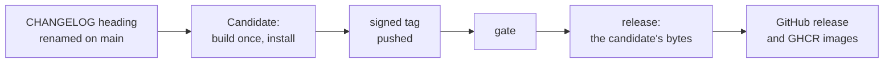

A sluis release is one version of the whole repository, published as archives, packages, Lambda zips, images and a chart, with checksums and SBOMs. Today a release publishes archives, checksums and SBOMs on GitHub Releases and images on GHCR. Packages are built and tested but no release has published them; the distribution site, the Lambda zips and the chart are not built. The design is [0013](/decisions/0013-release-train-packaging-and-distribution/). How to check what you downloaded is [Release signing](/distribution/release-signing/).

sluis packages its own executables only: the actors, the command-line tool, the node agent and the console's single-page app. The drivers are [atoom's](https://github.com/truvity/atoom/blob/master/docs/packages.md), and so are the audit pieces' packages ([audit 0016](https://github.com/truvity/audit/blob/master/docs/decisions/0016-distribution-and-the-lambda-shape.md)).

## At a glance

- **One version for the repository.** Every artifact of a release carries it. A release is built with GoReleaser v2 (open-source edition, Rust builds included) from one candidate, and the tag run publishes the candidate's bytes ([0013](/decisions/0013-release-train-packaging-and-distribution/#one-version)).
- **Packaging follows the runtime,** for amd64 and arm64. There are no build profiles, and `dev` is not a build; it is the local installation, which runs the published images ([Packaging per runtime](#packaging-per-runtime)).
- **Packages follow the holders.** A host installs the foundation (store@, key@, exporter@), the work actors it runs, and the atoom driver packages it uses ([Packages](#packages-by-holder-and-module)).
- **Checksums and SBOMs from the first alpha, no signed artifact.** Signing is in Backlog ([Release signing](/distribution/release-signing/)).
- **Nothing is stable before v2.0.0.** Releases until then are `v2.0.0-alpha.N` pre-releases, with no `latest` tag on images or charts.
- **The website is separate** ([0014](/decisions/0014-the-site-is-static-on-cloudflare-workers/)).

## Supported platforms

| Distribution | Version | systemd | Packages from |
|---|---|---|---|
| Ubuntu | 26.04 LTS | 259 | the apt repository |
| Rocky Linux | the latest stable, 10.x | 257 (10.2) | the dnf repository |
| Amazon Linux | 2023 | 252 | the dnf repository |

- **All of them on amd64 and arm64.** Serverless and Kubernetes have no host distribution.
- **The systemd floor is 252,** the version in Amazon Linux 2023. Generated units may rely on what it provides, such as `LoadCredentialEncrypted=` and `ExecPaths=`. The boards deploy refuses a system below it.
- **No FIPS build in v2.0.** Every platform gets the same build, and the algorithms stay in the FIPS-approved set so that a variant can be added later ([0006](/decisions/0006-keys-and-sealing/#algorithms)).

## Packaging per runtime

| Runtime | Packaging of sluis's actors | State |
|---|---|---|
| [bare-metal](/runtimes/bare-metal/) | `.deb` and `.rpm` packages, in apt and dnf repositories, and a tarball | Packages and tarballs built; repositories planned |
| [serverless](/runtimes/serverless/) | An app zip per executable and a config layer, behind the Lambda Web Adapter | Planned |
| [kubernetes](/runtimes/kubernetes/) | One multi-arch OCI image per process, and one Helm chart with the images pinned by digest | Images built; chart planned |

The install directory is the same in a package, a tarball and an image:

```text
/usr/libexec/sluis/{actors,node,vendor}/<short-name>
```

The adapters are actors. atoom's drivers install at `/usr/bin/atoom-<id>`.

## Packages by holder and module

| Package | Holds | State |
|---|---|---|
| `sluis-cli` | The command-line tool at `/usr/bin/sluis`. No dependency on systemd, so a workstation installs it alone | Built |
| `sluis` | The foundation's `policy` and `entry` with both units of `entry`, the timer of `sluis trust sync` ([Identity](/concepts/identity/)) and their units; depends on `sluis-cli` and on systemd | Built |
| `sluis-store`, `sluis-key`, `sluis-exporter` | The foundation: each holder with its units | Built |
| `sluis-identity` | The work actors other than `policy` and `entry`, the first-party adapters included | Built |
| `sluis-console` | The console's static bundle | Planned |
| `sluis-node` | The node agent | Planned |
| `sluis-host` | The root host service, mainly for [SSH](/integrations/infrastructure-access/#ssh); it never listens on the network | Planned |
| `sluis-install-boards` | The meta-package of the boards installation | Planned |

- **No package carries a driver.** A driver is a package of atoom, `atoom-driver-<port>-<driver>`, and the unit of its holder starts it; only the holder can open its socket ([0003](/decisions/0003-units-transports-and-fusion/#units)). The one sluis package that depends on atoom packages is a meta-package, which lists the driver packages its installation runs. For the boards that is, for example, `atoom-driver-store-rqlite`, `atoom-driver-key-yubikeypiv` and the file and credential source drivers. A KMS-only host installs no card driver and no pcscd. The system dependencies of a driver are its package's ([atoom packages](https://github.com/truvity/atoom/blob/master/docs/packages.md)).
<!-- terms-allow: sluis-driver -->
- **Open:** until the switch to atoom's packages, the tree still builds and packages its driver host executables as `sluis-driver-*`. After the switch, sluis's package list has no driver in it ([0013](/decisions/0013-release-train-packaging-and-distribution/#consequences)).
- **A package that holds work actors depends on the foundation packages and on no other such package.** A host that runs the foundation only installs no work actor.
- **The audit pieces are audit's packages.** The console embeds audit's page bundle ([0027](/decisions/0027-the-console/)).
- **Meta-packages exist only for bare-metal installations that install from packages.** The local installation runs images and has none.
- **Template units only.** A package ships `sluis-<actor>@.service` and `sluis-<actor>@.socket` and a systemd generator that creates the instances ([Bare-metal](/runtimes/bare-metal/#what-runs-where)). sluis generates no per-installation packages.
- **The trust bundle reaches hosts through the `sluis` package.** `sluis trust enroll` turns on the sync timer ([0013](/decisions/0013-release-train-packaging-and-distribution/#packaging-per-runtime)). On Kubernetes the bundle reaches pods through a trust-manager source or a ClusterTrustBundle.
- **Ceremonies are not part of sluis.** They belong to [ritueel](https://ritueel.id). The keyring package that apt and dnf verify with (ritueel's OpenPGP keyring) is built with ritueel's tools once the roots exist ([Release signing](/distribution/release-signing/#the-openpgp-release-key)).

Every dependency of every form, with the package names per family, is in the [runtime dependency matrix](/distribution/dependencies/).

## The distribution site

The distribution site serves the same files as GitHub Releases, with no redirect: apt and dnf handle redirects unreliably, and a redirect is one more place to point a repository elsewhere. When a file on the site and on the release differ, the release is right. **Planned** ([#873](https://github.com/truvity/sluis/issues/873), v1 parity), at `https://distribution.sluis.id/`:

```text
apt/       dists/stable/..., pool/
dnf/       {x86_64,aarch64}/{repodata/, packages}, sluis.repo
bin/       <version>/<component>_linux_{amd64,arm64}.tar.gz
lambda/    <version>/sluis-<kind>-<name>_<version>_{arm64,x86_64}.zip
checksums/ <version>/SHA256SUMS
keys/      the release keyring, once the roots exist
latest     pointer to the newest version; pin a version in anything you automate
```

Until releases are signed, the repository metadata is not signed and a repository cannot be verified by its signature. Download the packages and `SHA256SUMS` from the GitHub release and check them ([Release signing](/distribution/release-signing/#a-release-before-it-is-signed)).

### apt (Debian and Ubuntu)

One suite, `stable`, one component, `main`. Once the metadata is signed:

```sh
# Example
echo "deb [arch=$(dpkg --print-architecture) signed-by=/usr/share/keyrings/sluis-release.gpg] https://distribution.sluis.id/apt stable main" \
  | sudo tee /etc/apt/sources.list.d/sluis.list
sudo apt update && sudo apt install sluis
```

### dnf (Rocky Linux and Amazon Linux)

```ini
# Example: /etc/yum.repos.d/sluis.repo
[sluis]
name=sluis
baseurl=https://distribution.sluis.id/dnf/$basearch
enabled=1
repo_gpgcheck=1
gpgcheck=0
gpgkey=file:///etc/pki/rpm-gpg/sluis-release.asc
```

`repo_gpgcheck=1` verifies the signed `repomd.xml`, which carries each package's checksum. Header signatures on each rpm come later ([0024](/decisions/0024-root-custody-and-the-signing-api/#the-signing-api)); then the file sets `gpgcheck=1` as well.

## How the packages are built

`tools/release/packages` builds the `.deb` and `.rpm` of every package with the nfpm library, from the executables of the archives of the same run, byte for byte (`just release-packages`; `just check-packages` checks the code). It is a Go module of its own, so nfpm is in no other build. GoReleaser's own `nfpms` step is not used: it writes dependencies with `{{ .Version }}` unexpanded, so both formats then ship a dependency that is never met (measured 2026-11-07, GoReleaser 2.20.0).

- **The packages come from the image list and the actor registry.** An executable of `deploy/release/images.yaml` joins its package without anyone listing it. A package with no executable is not built.
- **One version, mapped once.** `2.0.0-alpha.1` is `2.0.0~alpha.1` in both formats, because a tilde sorts before the release. A dependency on another package of the release is exact (`= 2.0.0~alpha.1`). File names keep the dash: `<name>_<version>_<arch>.deb` and `.rpm`.
- **One `.deb` serves Ubuntu 26.04, and one `.rpm` serves Rocky Linux 10 and Amazon Linux 2023,** whose rpm 4.16 is the floor: gzip payload, SHA-256 file digests, and no feature that 4.16 lacks.
- **Units, users and directories** are generated by `tools/gen/units` and shipped per package: the template units of the executables it holds, a `sysusers.d` file and a `tmpfiles.d` file named after it. A package declares every group its units join (`g <name> <gid>` with the number of the uid plan), so a unit starts without the packages that own those groups; the callee owns its sockets. A user is made by exactly one package. The uid plan, the bootstrap file and the credentials are installation data, and no package writes them.
- **Maintainer scripts** start nothing, enable nothing and delete nothing. `postinst` makes users and directories and restarts instances that already run, `prerm` stops instances on a removal, and `postrm` tells systemd. A removal keeps `/etc/sluis`, the state and every user.
- **Files:** executables 0755, everything else 0644, owned by root, no setuid bit, nothing in `/opt`, `/usr/local`, `/etc/sluis` or the state directory. The same inputs give the same bytes.

`tools/release check-packages` reads the built files back with its own reader and holds them to the plan: the version and the dependencies (exact, and only the external ones [the matrix](/distribution/dependencies/) lists), modes and owners, that each executable is the archive's file, the layering of the dependencies (the CLI depends on nothing of the release, `sluis` on the CLI, the foundation on `sluis`, a work-actor package on `sluis` and the foundation only), that a host with the foundation installs no work actor, the group declarations, the maintainer scripts, and that a `.deb` and an `.rpm` of one package hold the same files. The readers cap every archive size, so a crafted package is an error and not an exhausted job.

### A throwaway repository for tests

`just release-repo` builds an apt and a dnf repository of `dist/packages` in `dist/repo` with Go code from the packages themselves, `just release-repo-serve` serves them on a loopback address, and `just release-repo-smoke` installs `sluis-cli` and `sluis` from them in containers on Ubuntu 26.04, Rocky Linux 10 and Amazon Linux 2023. **They are not the distribution site.** The trees are unsigned and say so, and the builder refuses a package whose SHA-256 is not in the `SHA256SUMS` beside it. The code is outside the job that publishes, and nothing in it needs a token.

### The install tier

`deploy/verify` installs the packages from the throwaway repository into systemd containers on Ubuntu 26.04, Rocky Linux 10 and Amazon Linux 2023, on amd64 and arm64, in the job `install` of `candidate.yaml`. Its evidence is part of the release's report (REQ-TEST-017).

- **The steps:** install, serve (the standalone drivers start and answer on their sockets; every unit passes `systemd-analyze verify`), remove, reinstall, downgrade, and in separate containers upgrade from the previous release and a minimal install of `sluis` and `sluis-store` alone. A step ends `pass`, `fail`, `refused` (the package manager or service says why) or `not_run`. A failure, or a refusal that names nothing, blocks. Between alphas no compatibility is promised, so an upgrade may refuse with a reason.
- **The evidence** is `evidence-<arch>.json` (`deploy/verify/evidence.schema.json`): the digest of every package file and, per system, the result of every step.
- **The test bites.** `mutants.sh` breaks one `.deb` at a time in the ways a maintainer script must not, and the job fails if the lifecycle lets one through.
- **It runs in GitHub CI only.** The containers need systemd's cgroup, so the scripts refuse to run elsewhere unless `SLUIS_VERIFY_EPHEMERAL_VM=1` names a machine that is thrown away.
- **What it does not prove:** the kernels and SELinux of the systems, `LoadCredentialEncrypted=` on Rocky and Amazon Linux in a container, a signed repository, or a mixed three-node cluster.

## Binaries

Each executable is a tarball per architecture, with its checksum beside it. Use a tarball when you manage the units yourself.

| Part | Value |
|---|---|
| Name | `sluis-<kind>-<name>_<version>_linux_<arch>.tar.gz`, for example `sluis-actor-store_2.0.0-alpha.1_linux_arm64.tar.gz`; the command-line tool is `sluis_<version>_linux_<arch>.tar.gz` |
| `<kind>-<name>` | The name of the [image](#oci-images) of the same executable |
| Contents | The executable and `LICENSE` |
| Beside it | A `.sha256` file; all of them are listed in the release's `SHA256SUMS` |

The executables are static: Go with cgo off, Rust as musl through cargo-zigbuild. The one build that links a C library is key@'s, which links `piv-go` and talks to the card service; it is built in a native job per architecture, in a pinned older userland, and a test fails the job when an executable asks for a glibc symbol newer than 2.34 (REQ-DEPLOY-032). A tarball does not yet place the executable at its install path; the packages and the images do.

The build is `.goreleaser.yaml`, which `just release-gen` writes from the tree; CI fails while the file differs. GoReleaser only builds (`just release-build`, with no token). `tools/release check-dist` fails on an executable that holds the workspace path, is not a static ELF of its architecture, or lacks the release version.

## Lambda zips

**Planned.** Every function runs behind the vendored, pinned Lambda Web Adapter, and no function has a native handler ([0011](/decisions/0011-runtimes-and-installations/#the-lambda-shape)). A function is:

- **an app zip,** one per executable, named `sluis-<kind>-<name>_<version>_<arch>.zip`, holding the package's binary; arm64 is the default;
- **a config layer;**
- **one merged drivers layer,** only where a driver's language differs from the function's. The layer is made from atoom's extension zips ([atoom 0010](https://github.com/truvity/atoom/blob/master/docs/decisions/0010-distribution-per-driver-and-lambda.md)); a driver in the function's own language is linked in.

Functions, schedules, roles and invoke grants are derived from the actor registry ([0002](/decisions/0002-families-of-actors/)). The build fails when a function needs more layers than Lambda allows. sluis publishes no public layer ARNs: an installation verifies the zips and publishes the layers into its own account. What a layer bundles is in the [runtime dependency matrix](/distribution/dependencies/). Drivers that need a disk or a long-running process have no Lambda form ([Serverless](/runtimes/serverless/)).

**Open:** the zips, the vendored Web Adapter and the layer merge are not built; atoom's extension zips are step B9 of its [plan](https://github.com/truvity/atoom/blob/master/docs/plan.md).

## OCI images

One image per process, so a container runs its one executable only. Multi-arch images are on GHCR as `ghcr.io/truvity/sluis/<kind>-<name>`, for example `ghcr.io/truvity/sluis/actor-entry`, since `v2.0.0-alpha.1`. No image is named `sluis`: that name belongs to v1. The tag is the release version, with no `latest`; pull by digest, and find every digest of a release in its `release-images.txt`. Driver images are [atoom's](https://github.com/truvity/atoom/blob/master/docs/packages.md).

- The base is distroless `static`, or distroless with glibc for a cgo executable. What an image installs, and what stays on the host, is in the [runtime dependency matrix](/distribution/dependencies/).
- The executable sits at the package's path, byte for byte, and a label names its source package. A release test compares the images' binaries with the packages' files by hash.
- One image set serves the local installation and Kubernetes.

| Image | Holds |
|---|---|
| `actor-<name>` | The actor's executable |
| `vendor-rqlite` | `rqlited`, the engine of the local installation's rqlite store, at `/usr/libexec/sluis/vendor/rqlited`, from the release archive that `just rqlite-fetch` checks against its SHA-256 |

```sh
# Example
docker pull ghcr.io/truvity/sluis/actor-entry@sha256:<digest>
```

### How the images are built and tested

GoReleaser does not build the images. `tools/release publish-images` builds each one with `docker buildx` from the archive of the same run and pushes it under the release version, in the job that holds the credentials. `deploy/release/images.yaml` and the Dockerfiles in `deploy/release/` are generated: one `COPY` of one executable and an `ENTRYPOINT`, on a base pinned by digest. Nothing about an image is signed.

`just release-rehearsal` runs both halves of a release, minus the GitHub release, against a registry it starts on a loopback port. Before the first push, `tools/release preflight` fails if an image already has the release version as a tag that this run did not push. After the push, `tools/release check-images` reads the registry and fails unless, for every image:

- the release version is a tag and no tag floats, and no repository is named `sluis`;
- the index holds `linux/amd64` and `linux/arm64` only, and its digest is the one recorded;
- every manifest, config and layer is the bytes of its digest, the base's included;
- the image is the pinned base plus the build, with the entrypoint, user and labels the release sets;
- the layers the build added hold regular files only, the files the list names, and the executable is the archive's file, hash for hash.

`release-images.txt` lists `<repository>:<tag>@sha256:<digest>` per image. It and the SBOM of every image are added to `SHA256SUMS`.

### SBOMs

Each archive has an SPDX 2.3 JSON SBOM beside it, `<archive>.sbom.spdx.json`, and each image has one made from the registry by digest. syft makes them: Go modules from the build information, Rust crates from the list that `cargo auditable` records in the executable. `tools/release check-sboms` validates each document structurally and requires at least one crate or Go module, so a build that recorded nothing fails.

## Helm charts

**Planned** ([#876](https://github.com/truvity/sluis/issues/876)). The chart is an OCI artifact at `ghcr.io/truvity/sluis/charts/sluis`, packaged by truvity/ocictl from the same build, at the release version. It pins every image by digest.

- **One `sluis` chart** with a piece selector and the presets `install` and `kubernetes-dev`, and no subcharts, so a holder and its callers always come from one release. A holder's pod runs the holder's image with atoom's driver images as native sidecar containers. The console runs as its own Deployment behind the same route as `entry`.
- **The cert-manager issuer** has a chart of its own, with its CRDs and RBAC.

```sh
# Example
helm pull oci://ghcr.io/truvity/sluis/charts/sluis --version <version>
```

## Releasing

A release is a tag `v2.<minor>.<patch>` or `v2.0.0-alpha.<n>` that the maintainer signs and pushes. Nothing else makes one, and a pull request never runs the release workflow. The release workflow holds no `id-token` permission, so nothing is signed beyond the tag; `SHA256SUMS` is the trust anchor of the files and digests ([Release signing](/distribution/release-signing/)). The flow:



1. Rename `## Unreleased` in `CHANGELOG.md` to the version, in a pull request that merges to `main`. The push starts the candidate; wait until `Checks` and `Candidate` are green on that commit. The changelog section is the release's notes.
2. Tag that commit and push the tag, one tag per push (GitHub starts no workflow for a push of more than three tags).
3. The `Release` workflow runs two jobs and builds nothing. The **gate** refuses a ref that is not a release tag, a commit that is not an ancestor of `main`, one whose `Checks` run is not green ([REQ-SUPPLY-032](/requirements/supply/#REQ-SUPPLY-032)), and one without a green candidate that still holds its three artifacts ([REQ-SUPPLY-048](/requirements/supply/#REQ-SUPPLY-048)). The **release** job downloads the candidate's artifacts and trusts none except by hash: it holds every file to the candidate's evidence, pushes the images that are not at this version yet, runs the image checks against the registry, makes the image SBOMs, brings a GitHub draft to hold exactly the files of the release, pulls every image by digest with no credential ([REQ-SUPPLY-046](/requirements/supply/#REQ-SUPPLY-046)), and only then makes the release public (a pre-release for an alpha). It refuses a tag that already has a public release, and fails when it cannot establish that the release will be immutable.
4. Check the result: the release holds the archives, `SHA256SUMS`, a `.sha256` and an SBOM per archive, `release-images.txt`, an SBOM per image, `audit-catalogue.yaml`, the `.deb` and `.rpm` files with `SHA256SUMS.packages`, and `evidence.json`.

The workflow has an empty permission block at its top, and only its `release` job can write ([REQ-SUPPLY-033](/requirements/supply/#REQ-SUPPLY-033), [REQ-SUPPLY-041](/requirements/supply/#REQ-SUPPLY-041)); its checkouts keep no credential ([REQ-SUPPLY-042](/requirements/supply/#REQ-SUPPLY-042)); no cache is restored, so a release builds from the sources and locked dependencies alone.

### The release candidate

`candidate.yaml` builds the release once, installs it as packages and keeps it; the tag run builds nothing. So the bytes that were installed are the bytes that ship, and a failed install costs no version number ([REQ-SUPPLY-048](/requirements/supply/#REQ-SUPPLY-048)).

- **When it runs.** On a push to `main` that changes the first `## ` heading line of `CHANGELOG.md` to a release version with no tag. It also runs as a rehearsal (`rehearsal: true`) on every pull request that can affect the packaging, the units, the install tier, the release tools or the workflows, and on every push to `main`.
- **What it does.** The job `build` runs GoReleaser and builds the packages, then uploads `release-dist`, `release-packages` and the inputs of the install tier. The job `install` runs the install tier on an amd64 and an arm64 runner. The job `candidate` joins the two reports, requires every blocking suite to have passed on every system, uploads `evidence.json`, and breaks its own files on purpose (one byte, an added or removed file, another commit, another version) to show that the gate refuses each.
- **Building it again.** A failed install job is run again with `gh run rerun <run id> --failed`. Anything else (a failed build, an expired candidate, a fix) needs a new commit that changes the first `## ` heading line, for example by appending a date. The tag is always the commit of the run that passed. A candidate is kept 30 days.
- **What the evidence is.** A defect gate, not a supply-chain control: it names every file by digest with the result of every suite, and the jobs that run dependency build code hold `contents: read` and nothing else. With nothing signed, nothing stronger exists.

**What a failure leaves.** Before the tag, a failed candidate leaves nothing. After it, a failure before the first image push leaves nothing; one after it leaves images on GHCR and a draft release. Nothing is announced. A tag is never moved: if the cause is in the code, the next attempt is the next version. Running the failed job again (`gh run rerun <run id> --failed`) reuses the same candidate, keeps only the images whose digests an earlier attempt of the same run recorded, uploads only the draft assets that are missing, and refuses an image tag that nobody recorded ([REQ-SUPPLY-037](/requirements/supply/#REQ-SUPPLY-037), partial until the chart exists).

**What a pull request runs.** `Checks` has a job `release` that runs `just release-rehearsal` and takes about 30 minutes warm, so it runs only when a changed file is on the list of the release machinery and its build inputs. A push to `main` always runs it in full, and the gate requires that run.

### The audit catalogue of a release

audit owns the catalogue and the rule that its writer quarantines a record of a release newer than the catalogue ([action table and catalogue](https://github.com/truvity/audit/blob/master/docs/reference/action-table-and-catalogue.md)). sluis ships the catalogue of its own actions: `audit-catalogue.yaml`, the action table of the tagged commit with the schema of every action's records and `release` set to the version. The build job makes it with `go run ./tools/gen/audit`, and the release job refuses a file that is not the local installation's catalogue with only the release replaced. It is listed in `SHA256SUMS` and not signed.

An operator takes the file from the release, checks it against `SHA256SUMS`, signs it as an `AuditCatalogue` document like any config document and publishes it to the config source. **Upgrade in this order:** publish the catalogue, restart the writer (it reads the catalogue at start), then roll the emitters. The table only grows within a major version, so the newest catalogue also holds for older releases' records ([0030](/decisions/0030-audit-records-and-the-usage-stream/)). The local installation from published images signs the release's catalogue with `SLUIS_RELEASE_CATALOGUE` ([Local](/runtimes/local/#images)).

## Compatibility

The artifacts of one release are built, tested and shipped together, and each also works with those of the previous release of the same major version, so a rolling deployment can run two neighbouring releases at once and a rollback needs no migration ([0001](/decisions/0001-v1-and-v2-lines/#n-and-n-1-inside-a-major-version)). Between releases compatibility follows semantic versioning ([0013](/decisions/0013-release-train-packaging-and-distribution/#compatibility-between-releases), [#1715](https://github.com/truvity/sluis/issues/1715)).

## atoom

sluis consumes atoom by release ([atoom 0015](https://github.com/truvity/atoom/blob/master/docs/decisions/0015-versioning-and-consumption.md)). `third_party/atoom/PIN` names the release, tag, commit and checksum of the vendored proto files. `just atoom-sync X.Y.Z` moves the pin and `just atoom-check` fails when `go.mod`, `Cargo.toml` and the pin disagree or atoom's CI is not green on the pinned commit. atoom's release flow is [atoom's](https://github.com/truvity/atoom/blob/master/docs/release.md).
