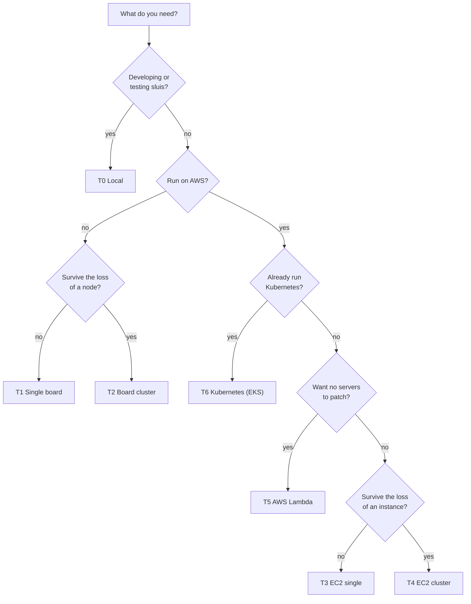

An **environment** is the runtime kind: how processes are started and what they can rely on. There are three, and the choice is agreed.

- **[bare-metal](/environments/bare-metal/)** covers physical hosts, virtual machines such as EC2, and local Docker. A supervisor (systemd, or a container runtime for local Docker) starts the processes.
- **[serverless](/environments/serverless/)** covers AWS Lambda and similar platforms. The platform runs a function per event.
- **[kubernetes](/environments/kubernetes/)** runs sluis as pods. The kubelet is the supervisor.

An environment is not the node count and not the cloud account. Both are attributes of an installation, described below. The [permission manifest](/architecture/deployment/) of every [actor](/concepts/actors/) is the same in all environments. The environment decides how it is turned into units, policies and ACLs, and sluis enforces its least-privilege rules in each one with the means that platform offers.

## What each environment provides

| Capability | bare-metal | kubernetes | serverless |
|---|---|---|---|
| Long-running processes | Yes | Yes | No (runs per event) |
| Persistent local disk | Yes | Only with a per-pod volume (StatefulSet) | No |
| Same-host Unix sockets | Yes, on the node | Yes, within a pod | Yes, within one function (extensions) |
| Inbound connections between processes | Yes | Yes (Service) | No (only triggers or a gateway) |
| Hardware devices | Yes | Partly (a pod pinned to its node) | No |
| Nodes | 1 or N | 1 or N | Elastic (no node identity) |
| Supervisor | systemd, or a container runtime for local Docker | kubelet | The platform |

**Serverless always comes with a provider** (AWS Lambda today), so for serverless the provider is part of the environment.

## Nodes and dependencies are not part of an environment

The words below are the vocabulary of an installation. It is agreed.

- **Nodes.** How many nodes an installation has: one, N, or elastic (serverless). A bare-metal installation can have one node or three, and the environment is the same.
- **Dependency.** Something outside sluis that a driver needs: an AWS account, a Cloudflare account, a YubiKey, a NATS service, a Postgres service. A [driver](/concepts/drivers/) declares its dependencies.
- **Installation.** One concrete deployment: an environment, a node count, the available dependencies and one driver per [port](/concepts/drivers/). For example, "bare-metal, 3 nodes, AWS account".
- **Preset.** A named, tested installation, used in the documentation, the tutorials and the test matrix. See [Presets](/environments/presets/).

In the design, `sluis config check` validates an installation against the requirements its drivers declare: a driver that needs a long-running process is refused on serverless, a driver that needs exactly one node is refused on a cluster, and a driver whose dependency is missing is refused everywhere. The requirements and the resulting driver and environment compatibility table are on [Ports and drivers](/concepts/drivers/).

Some actors declare **instances: exactly 1**: the audit writer, the FactsSource reconciler and the indexer. When there is more than one node, or the nodes are elastic, such an actor needs the lease port. On serverless, the platform's concurrency limit of 1 may stand in for it.

## Choosing a preset

The presets are the named installations. Pick by the failure you have to survive and the key custody you accept.

- **Learning or developing:** [T0](/environments/presets/#t0-local). It runs in Docker with software keys. The code refuses a software key on every other preset.
- **A small, cheap, on-premises install:** [T1](/environments/presets/#t1-single-board), the "poor man's choice". One board and one YubiKey hold everything. Losing the board loses the node until it is rebuilt.
- **On-premises with a spare:** [T2](/environments/presets/#t2-board-cluster). Three boards run rqlite, and a signing key lives on each node's YubiKey.
- **AWS, always on, minimal moving parts:** [T3](/environments/presets/#t3-ec2-single) for one instance, [T4](/environments/presets/#t4-ec2-cluster) for three. T4 is the first preset to be built, and the other presets follow its design.
- **AWS, no hosts to operate:** [T5](/environments/presets/#t5-aws-lambda). Each actor is a function. Zip packaging and the Lambda size limits shape the build.
- **You already run a cluster:** [T6](/environments/presets/#t6-kubernetes-eks) (proposed). A node pod and an audit pod hold the actors, each in a container with its own token audience. The first release is EKS with AWS KMS.

A key mode follows from the preset, not from a switch: KMS on the AWS presets, a YubiKey on the board presets, a software key only in development.

:::note[Proposed]
The code carries the floor (it refuses a software key in production) and configuration picks among the modes the floor allows. See [Keys](/concepts/keys/).
:::

Integration tests and the [tutorials](/tutorials/) run on the five presets T1 to T5. T6 is in test scope too, with the tests described on its page. Development uses T0.

## Pages in this section

- [Bare-metal](/environments/bare-metal/): physical hosts, virtual machines and local Docker, with one node or N.
- [Serverless](/environments/serverless/): AWS Lambda, a function per actor.
- [Kubernetes](/environments/kubernetes/): a node pod and an audit pod (proposed).
- [Presets](/environments/presets/): T0 to T6, the named installations, with the drivers each one picks.
