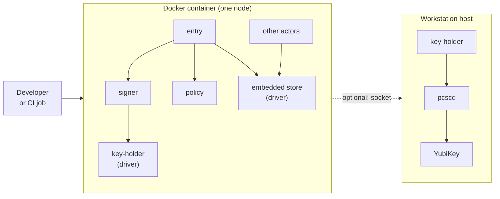
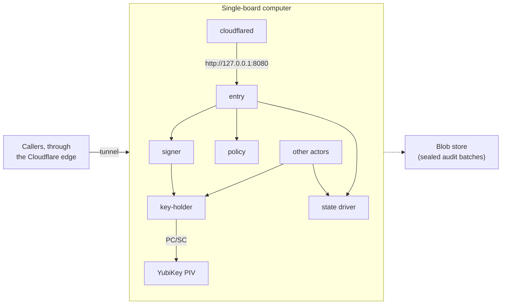
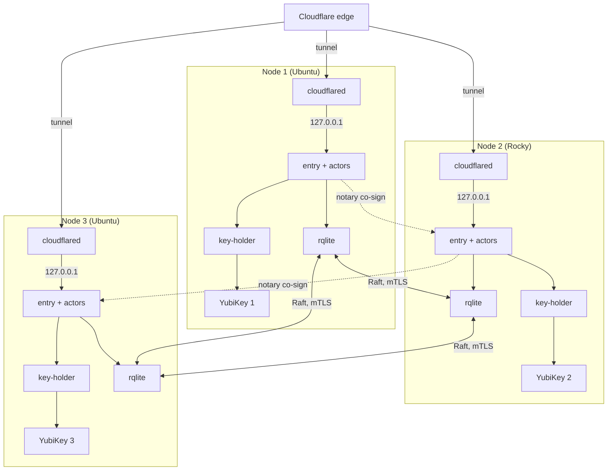
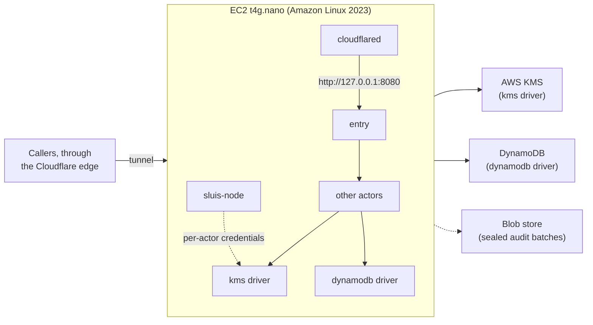
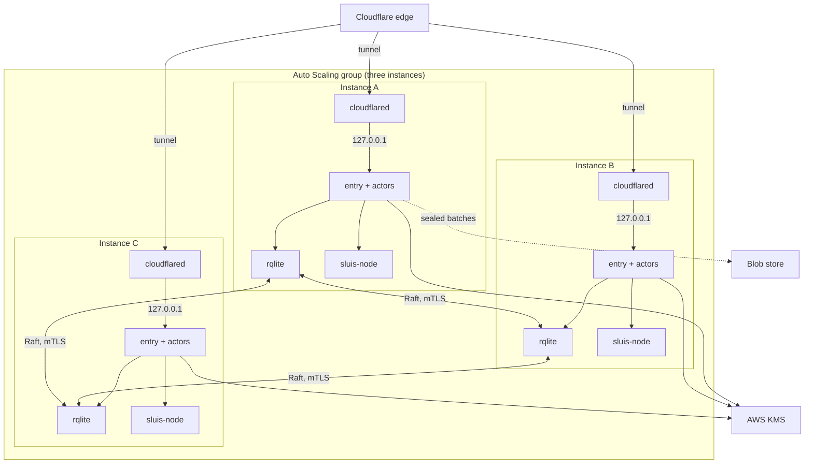

A **preset** is a named, tested [installation](/environments/#nodes-and-dependencies-are-not-part-of-an-environment): an [environment](/environments/), a node count, the available dependencies and one [driver](/concepts/drivers/) per port. The documentation, the tutorials and the test matrix refer to presets by their short id, T0 to T6. The ids are the old deployment-shape ids, kept short.

A preset is a choice of drivers, and a driver choice that used to be a per-shape decision now reads as "this preset's driver choice": the spool on the bare-metal presets and SQS on serverless ([OD-5](/open-decisions/#od-5)), SQS on Kubernetes ([OD-22](/open-decisions/#od-22)), KMS on Kubernetes ([OD-20](/open-decisions/#od-20)), and no index inside serverless ([OD-12](/open-decisions/#od-12)). The key mode follows the same rule: KMS on the AWS presets, a YubiKey on the board presets, a software key only on T0.

:::note[Proposed]
The configuration layers are defaults, then the environment, then the preset, then the install, then stage overrides, each overriding the one before. A stage is a development, staging or production boundary of one installation. See [Configuration](/concepts/configuration/).
:::

## The presets

| Id | Name | Environment | Nodes | keys | state | transport | blob | Dependencies | Notes |
|---|---|---|---|---|---|---|---|---|---|
| [T0](#t0-local) | Local | [bare-metal](/environments/bare-metal/) (Docker on a workstation) | 1 | software, or the host's YubiKey through `pcscd` | embedded | spool | fs | none | Development and CI |
| [T1](#t1-single-board) | Single board | bare-metal | 1 | yubikey-piv | embedded | spool | r2 | Cloudflare, a YubiKey | |
| [T2](#t2-board-cluster) | Board cluster | bare-metal | 3 | yubikey-piv, one per node | rqlite | spool | r2 | Cloudflare, a YubiKey per node | Peer witness (proposed) |
| [T3](#t3-ec2-single) | EC2 single | bare-metal (VM) | 1 | aws-kms | dynamodb | spool | s3 | AWS | |
| [T4](#t4-ec2-cluster) | EC2 cluster | bare-metal (VM), ASG | 3 | aws-kms, a key per node ([#886](https://github.com/truvity/sluis/issues/886)) | rqlite | spool | s3 | AWS | The first build target |
| [T5](#t5-aws-lambda) | AWS Lambda | [serverless](/environments/serverless/) | elastic | aws-kms | dynamodb | sqs | s3 | AWS | The writer runs with reserved concurrency 1 |
| [T6](#t6-kubernetes-eks) | Kubernetes (EKS) | [kubernetes](/environments/kubernetes/) | N | aws-kms ([OD-20](/open-decisions/#od-20)) | dynamodb | sqs ([OD-22](/open-decisions/#od-22)) | s3 | AWS | Kubernetes Lease; the test-matrix entry is open |

The ports are keys, state, lease, blob, transport, index, witness and cloud. What each driver requires, and which drivers fit which environment, is on [Ports and drivers](/concepts/drivers/). Which transport each preset uses, and where NATS JetStream fits, is open ([OD-34](/open-decisions/#od-34)).

The audit path in every preset is the one on [Audit](/concepts/audit/): every success is audited, records go through the transport to the writer, which seals them into batches, and the notary signs batch heads into a hash chain. The audit actors are being reconsidered ([OD-39](/open-decisions/#od-39)).

Integration tests and the [tutorials](/tutorials/) run on the five presets T1 to T5. T6 is in test scope too, with the tests described on [Kubernetes](/environments/kubernetes/#testing). Development uses T0.

## T0: Local

Docker on one workstation, one node, no cluster. It is the preset that CI uses, together with sluis v1 for GitHub OIDC to cloud permissions. It is not for production, and the code refuses a software key in production. Environment: [bare-metal](/environments/bare-metal/#local-docker).

The other actors are `ca`, `notary`, `audit-writer`, `audit-read` and `quota`. The `key-holder` in the container can optionally reach the `key-holder` on the host through a mounted Unix socket (the dashed arrow); the host `key-holder` talks to the host's `pcscd`, which talks to the YubiKey.

- **Drivers:** software keys (EC P-384, no production secret involved) by default; optionally the host's YubiKey. The state is an embedded single-node store, the audit transport a local spool, the blob a local files driver, and the index `sqlite`.
- **Host YubiKey:** the `key-holder` runs natively on the host, talks to the host's `pcscd`, and the container mounts only the `key-holder`'s Unix socket. The host keeps using the YubiKey too, because `pcscd` lets several programs share the card. The fallback is to mount the host's `pcscd` socket into the container; then the `key-holder` ACL does not apply, and the pcsc-lite protocol versions of the image and the host must match.
- **Verification** never trusts the index or the state, so a test can rebuild the index and still verify the chain.
- **Edge:** `entry`'s public API listens on TCP, bound to `127.0.0.1` inside the container, and a browser or a test harness reaches it through a published port. That published port is a development convenience; no other preset publishes it. See [Listeners](/architecture/listeners/).

:::note[Proposed]
How a developer reaches `entry` with the real edge in the loop is not yet decided. One candidate is an edge-connector container (`cloudflared` with an `http://127.0.0.1:<port>` service, as on the board presets) next to the sluis container.
:::

- **Limits:** software keys are extractable by anyone who can read the container's filesystem, so T0 is for development data only. With the host's YubiKey, any process in the container that can open the mounted `key-holder` socket can ask for a signature, subject to the `key-holder` ACL. One node has one failure domain: T0 proves behaviour, not availability. T0 does not exercise the platform controls of the other presets (IAM and KMS key policies, systemd sandboxing, Cilium policy); those are tested on T1 to T5.

## T1: Single board

The "poor man's choice": every actor runs on one arm64 single-board computer (2 GB RAM, eMMC) with a YubiKey in its USB port. It needs no cloud account for keys or state. The [single-board install tutorial](/tutorials/single-node-install/) walks through it. Environment: [bare-metal](/environments/bare-metal/), one node.

The callers are browsers, CLIs and relying parties. The tunnel ends at `cloudflared`, which connects to `entry` on `127.0.0.1:8080`. The `key-holder` reaches the YubiKey over PC/SC. The other actors are `ca`, `notary`, `audit-writer`, `audit-read` and `quota`; they use `key-holder` and the state driver. The `audit-writer` seals audit batches to the blob store.

- **Drivers:** yubikey-piv for keys, the embedded single-node store for state (no Raft), the spool for transport, an object store (Cloudflare R2) for the blob, `sqlite` for the index. The blob driver may be a local files driver; keep the blob store off the board if the audit trail has to outlive it.
- **Identity:** the actor's uid by peer credentials; the node agent (`sluis-node`) issues each actor a workload JWT.
- **Board OS:** the vendor's Ubuntu 22.04, a declared exception; see the [board OS exception](/environments/bare-metal/#board-os-exception).
- **Limits and residual risk:** one board is one failure domain, and losing it stops sign-in until the board is rebuilt and its state restored. The YubiKey is physical: whoever holds the board and the key, and knows the PIN, can sign. On Ubuntu 22.04 the credential files are not encrypted at rest. Signing speed is about 8 tokens per second, far above the measured load, but a burst beyond it queues. See also [bare-metal limits](/environments/bare-metal/#limits-and-residual-risk).

## T2: Board cluster

Three single-board computers (arm64, 2 GB RAM, eMMC), each with its own YubiKey. State is replicated by rqlite (Raft). The nodes may mix Ubuntu and Rocky Linux, because the package set is the same on both. Environment: [bare-metal](/environments/bare-metal/#n-nodes), three nodes.

- **Drivers:** yubikey-piv with one YubiKey per node and the T1 slot plan; rqlite for state and lease; the spool for transport on each node; an object store for the blob; `sqlite` on each node for the index.
- **Keys:** a node's key is its own. No key is shared between nodes, so losing a board loses one key, not the install's. Sealing uses ECDH plus HKDF with the node's `9d` key.
- **Audit:** each node's `audit-writer` drains its own spool. The `notary` co-signs batch heads 2 of 3 across the nodes, with no separate notary YubiKey, so one compromised node cannot extend the chain alone.
- **Identity and edge:** each node runs its own `cloudflared`, and each is its own issuer, `https://<issuer>/nodes/<node>/`.
- **Limits and residual risk:** Raft tolerates the loss of one node of three. A node's YubiKey and PIN guard its key; physical access to a board with its key and PIN allows signing as that node, which the 2-of-3 notary rule limits for the audit chain but not for tokens. Mixed distributions widen what has to be tested.

:::note[Proposed]
The 2-of-3 co-signing is expressed in the audit model as the peer witness driver, which needs two or more nodes. Whether the witness is optional or required is [OD-36](/open-decisions/#od-36).
:::

## T3: EC2 single

One `t4g.nano` instance on Amazon Linux 2023. Keys are AWS KMS keys, state is DynamoDB, and the instance runs every actor. It is the smallest AWS preset and has the same units as [T4](#t4-ec2-cluster). Environment: [bare-metal](/environments/bare-metal/#virtual-machines-ec2) (a virtual machine), one node.

The other actors are `signer`, `policy`, `ca`, `notary`, `audit-writer`, `audit-read` and `quota`. The `kms` and `dynamodb` drivers reach AWS KMS and DynamoDB, and the `sluis-node` agent gives the `kms` driver per-actor credentials (proposed).

- **Drivers:** aws-kms for keys, DynamoDB for state (conditional writes, one writer per record kind), the spool for transport, S3 for the blob, `sqlite` on the instance for the index.
- **Keys:** the KMS layout is on [bare-metal](/environments/bare-metal/#keys). Tokens are signed directly by the non-extractable KMS key; at the measured load that costs about $2.62 per month.
- **Audit:** the `audit-writer` seals batches and writes them to the bucket; the `notary` signs the batch heads with one KMS key. A reconciler compares the bucket listing with `audit_batches`. Verification never trusts the index or the state.
- **Limits and residual risk:** one instance is one failure domain. Replacing it loses the local spool and the local index; the blob store and DynamoDB keep the chain and the state. Records still in the spool when the instance dies are lost, so keep the spool small and drained.

## T4: EC2 cluster

An Auto Scaling group of three `t4g.nano` instances on Amazon Linux 2023. Keys are AWS KMS keys and state is replicated by rqlite (Raft). **T4 is the first build target**: the other presets are built after it, and its design is the reference for the units, the manifest and the tests. Environment: [bare-metal](/environments/bare-metal/#virtual-machines-ec2) (virtual machines), three nodes.

- **Drivers:** aws-kms with a key per node for the notary ([#886](https://github.com/truvity/sluis/issues/886)) and shared KMS keys for tokens, the CA and grants; rqlite for state and lease; the spool for transport on each instance; S3 for the blob; `sqlite` on each instance for the index.
- **Membership:** the ASG replaces a lost instance and the replacement joins the Raft cluster by discovery; an ASG lifecycle hook makes an instance leave cleanly when the group scales in. See [Virtual machines](/environments/bare-metal/#virtual-machines-ec2).
- **Audit:** each instance's `audit-writer` drains its own spool. The `notary` co-signs batch heads across the nodes, 2 of 3, with each node using its KMS key through the notary actor's IAM role. There is no separate notary key. The reconciler compares the bucket listing with `audit_batches`.
- **Edge:** every instance runs `cloudflared` (proposed), so the edge has three connectors and survives the loss of an instance.
- **Limits and residual risk:** Raft tolerates one lost instance. Two lost instances in one window stop writes, so spread the group over availability zones.

## T5: AWS Lambda

One Lambda function per actor, with KMS keys and DynamoDB state. The details, the request path and the audit path are on [Serverless](/environments/serverless/). Environment: [serverless](/environments/serverless/), elastic nodes.

- **Drivers:** aws-kms for keys, DynamoDB for state and lease, an SQS queue for transport (a function's disk does not outlive its sandbox), S3 for the blob. There is no index: a separate audit install holds it ([OD-12](/open-decisions/#od-12)).
- **Writer:** the audit writer runs with reserved concurrency 1.
- **Identity and edge:** the function's IAM role is its identity. API Gateway sits in front of `entry`, through the Lambda Web Adapter to `entry`'s loopback port.
- **Limits:** five layers and 250 MB unzipped bound a function; cold starts; egress is not name-restricted.

## T6: Kubernetes (EKS)

A node pod and an audit pod, a container per actor, on Amazon EKS with AWS KMS. T6 is in design and test scope now, and its design is proposed. The details and the open points are on [Kubernetes](/environments/kubernetes/). Environment: [kubernetes](/environments/kubernetes/), N nodes.

- **Drivers:** aws-kms for keys ([OD-20](/open-decisions/#od-20)), DynamoDB for state ([OD-21](/open-decisions/#od-21)), Kubernetes Lease for the lease, SQS for transport for now ([OD-22](/open-decisions/#od-22)), S3 for the blob, `postgres` for the index.
- **Identity:** projected ServiceAccount tokens, one audience per actor ([OD-19](/open-decisions/#od-19)).
- **Edge:** an edge relay or `cloudflared` ([OD-24](/open-decisions/#od-24)).
- **Tests:** a kind smoke test on every pull request, and a real EKS cluster nightly (proposed). The preset's entry in the test matrix is open.
