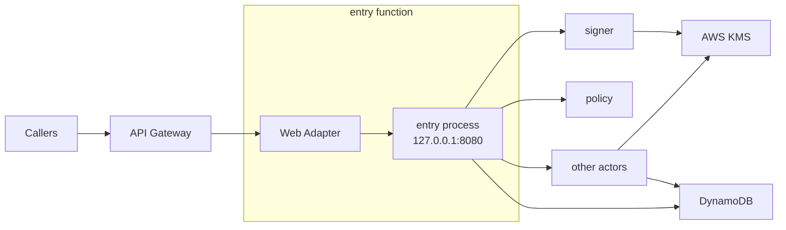
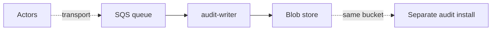

Serverless is the environment where the platform runs a function per event: no long-running process, no persistent local disk, and no inbound connection between processes except a trigger or a gateway. Same-host Unix sockets work within one function, through extensions. The nodes are elastic and have no identity. Serverless always comes with a provider, so the provider is part of the environment: AWS Lambda today. The named installation is the preset [T5](/environments/presets/#t5-aws-lambda).

sluis runs as one Lambda function per [actor](/concepts/actors/). v1 already runs as many Lambda functions, and the serverless environment keeps that lineage while moving to the v2 actor split.

## Topology

The environment is drawn in two steps: the request path, then the audit path.

### Step 1: the request path

The callers are browsers, CLIs and relying parties. The web adapter is the Lambda Web Adapter; it connects to the `entry` process on `127.0.0.1:8080` inside the sandbox. Each arrow from `entry` to an actor is a Lambda invoke. The other actors are `ca`, `notary`, `audit-writer` and `quota`.

### Step 2: the audit path

The other actors put their audit records into the queue, the SQS transport driver. The separate audit install, when the preset has no index of its own, runs `audit-read` and its index, and reads the same bucket.

## What runs where

- Each actor is its own Lambda function. Only `entry` takes requests from outside; every other function is invoke-only, and its resource policy names the caller's alias.
- **Zip only.** A function is a zip archive, so layers and extensions combine. A container image is not used on Lambda. Functions, layers and extensions are published as zips for `x86_64` and `arm64`; see [Packages](/distribution/packages/).
- **Drivers are Lambda extensions.** A driver is a platform-started service that speaks ConnectRPC over a Unix socket. On Lambda the platform that starts it is the extension mechanism, and the actor calls it over the socket inside the sandbox.
- **Lambda Web Adapter.** `entry` speaks HTTP, so the Lambda Web Adapter, pinned at v1.1.0, translates Lambda events into HTTP requests. The adapter is vendored into sluis's own layer, so the function does not reference the public AWS layer.
- **Limits.** A function has at most five layers and 250 MB unzipped, counting the function code, layers and extensions together. The zips are built to fit that.
- **Single instance.** An actor that declares exactly one instance (the audit writer) runs with a reserved concurrency of 1 on Lambda. The platform's concurrency limit of 1 may stand in for the lease port.

## Keys

- **KMS:** one symmetric key with encryption contexts for sealing, and one `ECC_NIST_P384` signing key per authority purpose. Each key policy names the one function role allowed to use it.
- A function's execution role is its identity to KMS. Only the `signer` function can use the token-signing key, and only `ca` the CA key.
- Tokens are signed directly with the non-extractable key. There is no software key on Lambda.

## State and audit

- **State:** DynamoDB, with conditional writes and one writer per record kind.
- **Audit transport:** an SQS queue, because a function's local disk does not outlive its sandbox. The `audit-writer` consumes the queue, seals batches and writes them to the blob store (S3); the `notary` signs batch heads with a single notary key, used only by the notary function's role. There is no co-signing; the function role is the isolation. Which transport each preset uses is [OD-34](/open-decisions/#od-34).
- **Index:** serverless may run the indexer and the reader with a `postgres` index ([OD-12](/open-decisions/#od-12), revised). On AWS the provisioning mode is `rds` or `aurora`, and the functions reach the database through RDS Proxy (proposed), so that short-lived functions do not exhaust its connections. The `external` mode takes a connection string only. The AWS Lambda preset's default index stays `none` (proposed); with no index, `audit-read` and its index run in a separate audit install in another environment that reads the same bucket: Kubernetes with Postgres (`cnpg`, or `external` with a connection string), or a server with `sqlite`. A small install can run `sluis audit search` from the CLI, which builds a local `sqlite` index from the chain. The index is a rebuildable cache; the chain in the bucket is the record. Where Search runs is derived from the port and driver rules ([OD-32](/open-decisions/#od-32)). See [The postgres index driver](/concepts/drivers/#the-postgres-index-driver).

## Identity and edge

- The function's IAM role is its identity. The platform injects the credentials only into that function's execution environment. A function calls another by `lambda:Invoke`, and the callee reads the invoked alias, which tells it the caller class, and a verified token, which tells it the caller actor.
- **Listener.** `entry`'s public API listens on TCP, bound to `127.0.0.1` inside the sandbox (`8080` in the example), and the Lambda Web Adapter connects to it. The sandbox holds only sluis's own processes, and the port is never reachable from outside it. The other functions have no TCP listener; their drivers use Unix sockets. See [Listeners](/architecture/listeners/).
- **Edge.** API Gateway sits in front of the `entry` function.
- There is no node agent: the JWT for a cloud federation has to come from the `signer`.

## Limits and residual risk

- Five layers and 250 MB unzipped bound what a function can carry. Rust or large SDKs push against it; link only the SDK packages an actor uses.
- Lambda has cold starts. The adapter and extensions add start-up work, and a larger zip starts slower.
- Outside a VPC, egress is unrestricted. In a VPC, egress rules work by IP, not by name, so a per-function allow-list by host name needs a proxy or firewall.
- Per-function granularity needs one zip and one IAM role per actor. It raises the number of artifacts and resources to keep in step; the generator derives them all from the manifest.
- The vendored adapter is part of the supply chain. It is pinned to a version, rebuilt into sluis's layer, and signed with the rest of the release.
- Search over the audit trail needs a `postgres` index, a separate audit install, or `sluis audit search` from the CLI. The default preset has no index of its own (proposed).
