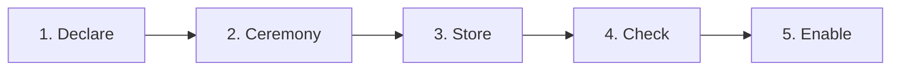
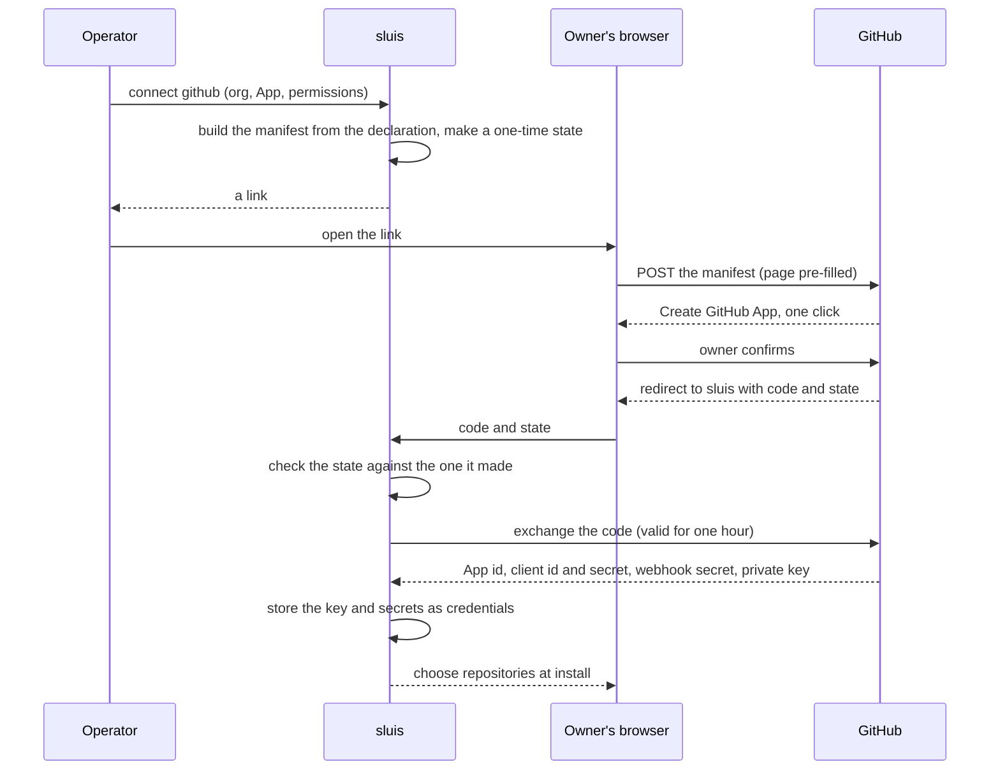

Every vendor wants a credential, and every vendor has its own ceremony for handing one over. The ceremonies repeat. This page describes each one as a pattern: what the vendor offers, what the operator does, what sluis does, and where the credential ends up. The integration pages link here from their *Setup* parts.

The command lines on this page are **examples of the shape**, not a decided command tree. Where v1 had a way to do the same thing, both are shown.

## The shape of every connection



1. **Declare.** The operator writes what the integration is allowed to be: the organisation, the permissions, the scopes, the domains. This is *declared* data, in a file under version control.
2. **Ceremony.** A person with authority at the vendor (an organisation owner, a workspace owner, a Super Admin) approves, once. This is the step that differs by vendor, and the step the rest of this page is about.
3. **Store.** What the vendor returns (a private key, a bot token, a client secret) is written by sluis straight into the credential store. This is a *learned secret*. It is never printed, never written into configuration, and never shown by `sluis config explain`, which shows the `cred:` reference only. Ids and installation numbers that come back are *learned* data, stored as records.
4. **Check.** `sluis integrations check <name>` compares what was declared with what the vendor actually granted (drift), and runs the integration as a dry run.
5. **Enable.** Nothing acts until the integration is enabled. A dry run lists what would change.

**Secrets are referenced, never inlined.** An operator secret in a configuration file is a reference such as `cred:sluis-int-github.example-org.publisher.app-key`, resolved at runtime from the credential store the environment provides ([Configuration](/concepts/configuration/)). The approver at the vendor and the operator of sluis are usually two people, which is a feature: neither alone can connect an integration.

| Task | Command shape (example) | In v1 |
|---|---|---|
| Connect an integration | `sluis integrations connect <name> …` | A button on the console's integration page |
| Check drift and run a dry pass | `sluis integrations check <name>` | The console's *Check* or *Re-check* |
| Disconnect | `sluis integrations disconnect <name>` | The console's *Disconnect* |
| Render vendor-side objects from the configuration | `sluis integrations render <name>` | Written by hand, or with the Pulumi library |

:::note[Proposed]
Whether the connect ceremony is a command, a console page or both is not decided. Both run through the same `entry` API, so they would share one implementation. In both, a vendor redirect has to reach `entry`'s public URL, which is why the examples use `https://sluis.example.com`.
:::

## GitHub App manifest flow

GitHub can create an App from a **manifest**: a JSON description of the App. The owner of an organisation (or a user) sees a pre-filled page and presses one button. GitHub then redirects to a URL the manifest names with a one-time code, and sluis exchanges the code for the App's credentials. The operator never copies a key.

```json
{
  "name": "example-org-publisher",
  "url": "https://sluis.example.com",
  "redirect_url": "https://sluis.example.com/connect/github/callback",
  "public": false,
  "default_permissions": { "contents": "write", "pull_requests": "write" },
  "default_events": [],
  "hook_attributes": { "url": "https://sluis.example.com/hooks/github", "active": false }
}
```



What the operator does, as steps:

1. Declare the App: its organisation, a short id, its permissions (GitHub's own names, at `read`, `write` or `admin`) and whether it receives events.
2. Run `sluis integrations connect github --org example-org --app publisher`. sluis prints a link.
3. An organisation owner opens it and confirms. GitHub returns to sluis.
4. The owner picks the repositories on GitHub's install page. GitHub returns to the setup URL with the installation id; sluis confirms with GitHub where the App is installed.
5. `sluis integrations check github` shows no difference between declared and granted permissions.

Details that matter:

- **The state is single-use and bound to the operator's session.** A callback with another state is ignored, so someone who has a link cannot complete a connection that another operator began.
- **GitHub has no API to change an App's permissions** after creation. To fix drift, an owner edits the App on GitHub (or you disconnect and recreate it), and the installation must accept a permission request. `metadata: read` is always present and is never drift.
- **Webhooks** are one URL per App, not per installation. sluis generates the secret; consumers read it as a credential. Rotation is two steps, and the old secret is restored if the receiver does not accept the new one within minutes.
- **`workflows: write`** is needed to push under `.github/workflows`. An App that approves reviews carries no administration permission, and an App that administers stays out of the approving path.

### Per organisation or per installation

An App is *registered once* under one owner and *installed* many times. That gives two designs.

| Design | One App per organisation (private) | One public App, installed on many organisations |
|---|---|---|
| Registered | Once per organisation, `public: false`. | Once, under one owner, `public: true`. |
| Private key | One per organisation. A leak reaches that organisation. | One. A leak reaches every installation. |
| Permissions | Chosen per organisation. | The same for every installation. |
| Install | Only on its owner. | By any account that accepts it. |
| Names | One name per App, global on GitHub. | One. |

:::note[Proposed]
The default is one private App per organisation, per job (organisation membership, a catalogue App for tokens, runner registration), because that is what v1 does, it limits a key's reach, and one job's permissions never widen another's. The one public App is only for the *link App*, which people authorise as themselves, and which is installed nowhere. Installing a single public App on several organisations is possible but is not the default.
:::

## Slack app manifests

Slack describes an App in a **manifest** too, in YAML or JSON. There is no one-click redirect flow like GitHub's, but the manifest can be sent to Slack's API, or pasted into the *Create app from manifest* page.

```yaml
display_information:
  name: example-sync
  description: Keeps channels in step with groups
features:
  bot_user:
    display_name: example-sync
    always_online: false
oauth_config:
  redirect_urls:
    - https://sluis.example.com/connect/slack/callback
  scopes:
    bot:
      - users:read
      - users:read.email
      - channels:read
      - groups:read
      - channels:manage
      - groups:write
      - channels:join
settings:
  org_deploy_enabled: false
  socket_mode_enabled: false
  token_rotation_enabled: false
```

The operator's flow:

1. In Slack, signed in to the owning workspace, generate an **App Configuration Token** (under *Your App Configuration Tokens*). It expires in 12 hours, and sluis uses it once, to create the App, then forgets it. It is never stored or logged.
2. Run `sluis integrations connect slack --workspace acme`. sluis builds the manifest from the declared scopes and asks Slack to create the App with the token. (Without a token, `--print-manifest` prints the manifest to paste into *Create app from manifest*.)
3. The App exists but is not installed. A workspace owner approves the install. Slack redirects to sluis with a code; sluis exchanges it for the bot token and stores the token, the client id and the client secret as credentials.
4. **The first team is pinned.** The team recorded at the first install is the only team the App may be installed into. An install into another workspace is refused, and its token revoked.
5. To add a scope, change the declaration, generate a fresh configuration token, and reinstall. Until then the integration shows *scopes missing*.

Slack has no token exchange, so a consumer that needs the bot token reads it from the credential store; sluis does not mint Slack tokens for others. There is no *disconnect* that deletes the App: sluis revokes its token and forgets the credential, and the App's owner deletes the registration in Slack.

:::note[Proposed]
One App per workspace is the model. How an Enterprise Grid organisation-wide install fits, and the extra manifest keys for the notification reply path (event subscriptions and interactivity), are not decided.
:::

## Google Workspace

sluis needs two things from Google, and they are separate credentials. **Sign-in** uses an OAuth client. **The directory** needs read access to users, groups and domains, as one of three methods.

### The sign-in client

In a Google Cloud project, create an OAuth client of type *Web application*. Its redirect URIs are the sign-in callback sluis prints and, for the admin-consent method, the connect callback. The consent screen asks for `openid`, `email` and `profile` only. For a single organisation the consent screen can be *Internal*; for several tenants it must be published (*In production*), because in testing a second tenant gets an access error and refresh tokens expire after seven days. The client id and secret are credentials.

### The directory: three methods

The four scopes are the same for all three, and read-only:

```text
https://www.googleapis.com/auth/admin.directory.user.readonly
https://www.googleapis.com/auth/admin.directory.group.readonly
https://www.googleapis.com/auth/admin.directory.group.member.readonly
https://www.googleapis.com/auth/admin.directory.domain.readonly
```

| | Workload Identity Federation with delegation | Service-account key with delegation | Admin consent |
|---|---|---|---|
| What sluis holds | Nothing long-lived | A JSON key | A Super Admin's refresh token |
| Who sets it up | A cloud admin and a Workspace Super Admin | The same | A Super Admin, at a consent screen |
| Fails when | The pool, provider or delegation is changed | The key is deleted, or key creation is forbidden by policy | The admin's account is suspended or loses the role |
| Rotation | None; nothing to rotate | Create a new key, replace, delete the old | Reconnect |
| State | New in v2 (Proposed) | v1 and v2 | v1 and v2 |

**Delegation** means a service account may act as a user in the tenant, for the scopes the tenant lists. It is granted in the Workspace Admin console under *API controls*, *Manage domain-wide delegation*, by the service account's numeric client id and the four scopes. The user it impersonates should be a dedicated admin account with a role that can read the directory and nothing more; the scopes limit the API, and that account's role limits it further.

**Keyless, with Workload Identity Federation.** An organisation can forbid creating service-account keys. Delegation then works without a key:

1. Create a service account, with no key, and grant it domain-wide delegation for the four scopes.
2. Create a workload identity pool and an OIDC provider that trusts sluis's node issuer (`https://<issuer>/nodes/<node>/`), mapping the token's subject to the role that reads the directory.
3. Let that pool principal impersonate the service account, and let the service account sign a delegation assertion for itself.
4. At run time the directory integration exchanges its workload token for a short-lived federated identity, impersonates the service account, has it sign an assertion naming the dedicated admin, and exchanges that for a short-lived access token for the Directory API.

No secret is stored on the node: the only long-lived thing is the node's hardware or KMS key, which already signs the workload token. This needs the ES256 exception for the GCP exchange ([Identity](/concepts/identity/)).

:::note[Proposed]
The keyless method is a design for the GCP exchange ([#871](https://github.com/truvity/sluis/issues/871)) and is not built. Until it is, a self-hosted install uses a key or admin consent. Which is the default is not decided.
:::

The operator's flow, for any method:

1. Create the project, enable the Admin SDK API (otherwise the first read is refused after consent), and create the sign-in client.
2. Grant the directory access by the method chosen.
3. Run `sluis integrations connect google-workspace --tenant example.org`.
4. Choose which domains the tenant serves. Unselected domains are never read.

In v1 these are console actions: *Connect Google Workspace* (admin consent), or *Upload key*, or a declaration in values (a service account key in a Secret).

## Cloudflare: the minting token

Cloudflare has no manifest or consent flow for this: the operator creates the credential by hand. The pattern is a **minting token** and **prototype tokens**.

1. Create an **account API token** whose only permission is to manage account API tokens (read and write). This is the minter. Set an expiry on it, and replace it on a schedule.
2. Store it as a credential from standard input, so it never reaches a shell history or a command line: `sluis credentials put cloudflare.main.minter` (an example).
3. Create a **prototype token** for each kind of access (DNS write on one zone, bucket item write on one bucket) and **disable** it by an update; creation ignores a disabled status. For an object-store bucket, scope it to the bucket's resource key.
4. Declare the preset with the prototype's id, a lifetime and, preferably, the permission groups the prototype may hold.

**The limit to know:** a token that can create tokens can create any token the account owner could. Cloudflare does not let you cap that on the minter, so sluis's refusal list is the guard: it refuses an active or missing prototype, and any prototype with token administration, billing, account settings, memberships or access-identity rights. Treat the minter as the most sensitive credential in the integration, keep it out of ordinary secret stores, service documents and infrastructure-as-code inputs, and let only the integration's own process read it.

In v1 the operator stores the minter in the secrets store (`aws ssm put-parameter` as an encrypted parameter) and declares presets in values.

## AWS: OIDC provider and role trust

Accounts trust sluis as a web identity provider. Two kinds of object are needed in each account, and both can be generated from the configuration that already declares the roles, so the trust cannot drift from the clients:

- An **IAM OIDC provider** for sluis's issuer URL (https, no port, no query). Its key set is fetched from the issuer's discovery.
- **One role per purpose** with a trust policy that allows `sts:AssumeRoleWithWebIdentity` for that provider, with a condition on the audience (`aud`) that sluis puts in the token for exactly that role, and a condition on `sub` when the role is for one workload.

```json
{
  "Effect": "Allow",
  "Principal": { "Federated": "arn:aws:iam::<account-id>:oidc-provider/sluis.example.com" },
  "Action": "sts:AssumeRoleWithWebIdentity",
  "Condition": { "StringEquals": { "sluis.example.com:aud": "aws:<account-id>:deployer" } }
}
```

1. Declare the account and its roles with their `requires` groups in the configuration.
2. Run `sluis integrations render aws --account example-prod`; it writes the provider and the trust policies as a template.
3. Apply the template with your infrastructure tool.
4. Check with `aws sts get-caller-identity` on a profile that `sluis aws-config` wrote. A mismatched `aud` fails as an access-denied error on the assume call.

For **sluis's own actors on a self-hosted node** the same pattern is generated per node: the provider is the node's issuer (`https://<issuer>/nodes/<node>/`), and an actor's cloud role trusts only the issuers of the nodes that run it ([Identity](/concepts/identity/)). AWS allows 100 providers per account and 100 EC keys in a key set.

For **AWS roles that call sluis**, each account turns on outbound identity federation, and the role's policy allows `sts:GetWebIdentityToken` for one audience, one algorithm and a short duration. The operator declares the account's issuer in the verifier block.

:::note[Proposed]
Generating the provider and trust policies from the configuration is a design. The output format (CloudFormation, Terraform or plain JSON) is not decided. In v1 they are written by hand or with the Pulumi library.
:::

## Generic OIDC upstream

For any provider that publishes OpenID Connect discovery:

1. Register sluis as a client at the provider. The redirect URI is the callback sluis prints for the connection. Choose client authentication: a secret, or, where the provider supports it, a signed assertion with a key sluis holds.
2. Run `sluis integrations connect oidc --issuer https://idp.example.org --domain partner.example`.
3. Store the client secret as a credential; the command prints the reference.
4. Prove the domain with a DNS TXT record (the command prints the name and value), so that nobody can claim a domain they do not control. Then run `sluis integrations check oidc partner`.
5. Choose what the connection's claims are worth: ignore asserted groups (the default), or map named ones.

sluis checks every returned ID token strictly: issuer, audience, `nonce`, signature, verified email, and the account's `sub` as first recorded. The general integration page is [Generic OIDC and peer sluis](/integrations/oidc-upstream/).

## Credentials without a ceremony

Some vendors have no flow at all. [Outline](/integrations/outline/), [GoAlert and Telegram](/integrations/oncall/) hand over a key or a token that an administrator creates by hand. The pattern then is only steps 1, 3, 4 and 5 of the shape above: the credential comes in through standard input or a protected file, is stored, and the integration is checked in a dry run before it acts.
