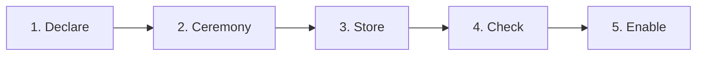
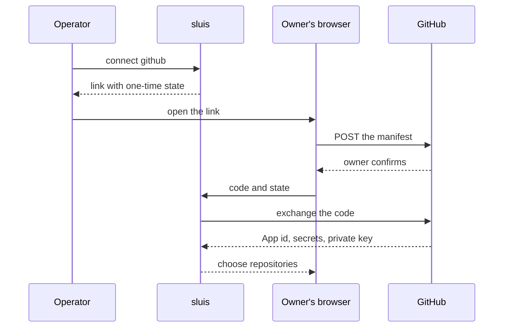

Every vendor has its own ceremony for handing over a credential. The ceremonies repeat, so this page describes each once: what the vendor offers, what the operator does, what sluis does, and where the credential ends up. The commands are [illustrative](/integrations/#examples-are-illustrative).

## The shape of every connection



1. **Declare.** The operator writes what the integration may be: the organisation, the permissions, the scopes, the domains. This is *declared* data, in a reviewed file.
2. **Ceremony.** A person with authority at the vendor (an organisation owner, a workspace owner, a Super Admin) approves, once. This step differs by vendor, and the rest of this page is about it.
3. **Store.** What the vendor returns (a private key, a bot token, a client secret) goes straight into sluis's credential store. It is a *vendor-issued secret*: sluis holds the only copy, so it is sealed and backed up ([ADR 0011](/decisions/0011-state-is-one-port-with-compare-and-set/#sealed-secrets)). It is never printed, never written into configuration, and `sluis config explain` shows only its `cred:` reference. Ids and installation numbers that come back are *issued* records (pins), checked on every later observation ([ADR 0010](/decisions/0010-configuration-and-data-pkl-schema-origins-and-sensitivities/#origins)).
4. **Check.** `sluis integrations check <name>` compares what was declared with what the vendor granted (drift), and runs the integration as a dry run.
5. **Enable.** Nothing acts until the integration is enabled.

A secret in a declared file is a reference such as `cred:sluis-int-github.example-org.publisher.app-key`, resolved at runtime through the `secrets` port ([Data and secrets](/concepts/data/)). The approver at the vendor and the operator of sluis are usually two people, so neither alone can connect an integration.

| Task | Command shape |
|---|---|
| Connect an integration | `sluis integrations connect <name> …` |
| Check drift and run a dry pass | `sluis integrations check <name>` |
| Disconnect | `sluis integrations disconnect <name>` |
| Render vendor-side objects from the configuration | `sluis integrations render <name>` |

The console and the command line run the ceremony through the same `entry` API, and a vendor redirect reaches `entry`'s public URL, here `https://sluis.example.com`.

## GitHub App manifest flow

GitHub can create an App from a **manifest**, a JSON description of the App. An organisation owner sees a pre-filled page and presses one button; GitHub redirects to the URL the manifest names with a one-time code, and sluis exchanges the code for the App's credentials. The operator never copies a key.

```json
{
  "name": "example-org-publisher",
  "url": "https://sluis.example.com",
  "redirect_url": "https://sluis.example.com/connect/github/callback",
  "public": false,
  "default_permissions": { "contents": "write", "pull_requests": "write" },
  "default_events": [],
  "hook_attributes": { "url": "https://sluis.example.com/hooks/github", "active": false }
}
```



1. Declare the App: its organisation, a short id, its permissions (GitHub's names, at `read`, `write` or `admin`) and whether it receives events.
2. Run `sluis integrations connect github --org example-org --app publisher`. sluis prints a link.
3. An organisation owner opens it and confirms. GitHub returns to sluis, which checks the state, exchanges the code (valid for one hour) and stores the key and secrets.
4. The owner picks the repositories on GitHub's install page. GitHub returns with the installation id, and sluis confirms with GitHub where the App is installed.
5. `sluis integrations check github` shows no difference between declared and granted permissions.

- **The state is single-use and bound to the operator's session**, so someone holding a link cannot complete a connection another operator began.
- **GitHub has no API to change an App's permissions.** To fix drift, an owner edits the App on GitHub (or you disconnect and recreate it), and the installation accepts the permission request. `metadata: read` is always present and is never drift.
- **Webhooks** are one URL per App. sluis generates the secret; rotation is two steps, and the old secret is restored if the receiver does not accept the new one within minutes.
- **`workflows: write`** is needed to push under `.github/workflows`.

### Per organisation or per installation

A public App installed on many organisations has one key that reaches every installation and the same permissions everywhere. sluis therefore uses one private App per organisation and per job (organisation membership, a catalogue App for tokens, runner registration), so a key's reach is one organisation and one job's permissions never widen another's. The one public App is the *link App*, which people authorise as themselves and which is installed nowhere.

## Slack app manifests

Slack describes an App in a **manifest** too, in YAML or JSON. There is no one-click redirect flow, but the manifest can be sent to Slack's API, or pasted into the *Create app from manifest* page.

```yaml
display_information:
  name: example-sync
features:
  bot_user:
    display_name: example-sync
oauth_config:
  redirect_urls:
    - https://sluis.example.com/connect/slack/callback
  scopes:
    bot: [users:read, users:read.email, channels:read, groups:read,
          channels:manage, groups:write, channels:join]
settings:
  org_deploy_enabled: false
  socket_mode_enabled: false
```

1. In Slack, signed in to the owning workspace, generate an **App Configuration Token**. It expires in 12 hours; sluis uses it once to create the App and never stores or logs it.
2. Run `sluis integrations connect slack --workspace acme`. sluis builds the manifest from the declared scopes and creates the App (or prints the manifest to paste).
3. A workspace owner approves the install. Slack redirects to sluis with a code, and sluis stores the bot token, client id and client secret as credentials.
4. **The first team is pinned.** An install into any other workspace is refused and its token revoked.
5. To add a scope, change the declaration, generate a fresh configuration token, and reinstall; until then the integration shows *scopes missing*.

Disconnecting revokes the token and forgets the credential; the App's owner deletes the registration in Slack.

## Google Workspace

sluis needs two separate credentials from Google: an OAuth client for **sign-in**, and read access to **the directory**.

### The sign-in client

In a Google Cloud project, create an OAuth client of type *Web application*, with the sign-in callback sluis prints (and, for admin consent, the connect callback) as redirect URIs. The consent screen asks for `openid`, `email` and `profile` only. For one organisation it can be *Internal*; for several tenants it must be *In production*, because in testing a second tenant gets an access error and refresh tokens expire after seven days.

### The directory: three methods

All three use the same four read-only scopes:

```text
https://www.googleapis.com/auth/admin.directory.user.readonly
https://www.googleapis.com/auth/admin.directory.group.readonly
https://www.googleapis.com/auth/admin.directory.group.member.readonly
https://www.googleapis.com/auth/admin.directory.domain.readonly
```

| | Workload Identity Federation with delegation | Service-account key with delegation | Admin consent |
|---|---|---|---|
| Fails when | The pool, provider or delegation changes | The key is deleted, or keys are forbidden by policy | The admin is suspended or loses the role |
| Rotation | None | New key, replace, delete the old | Reconnect |

**Delegation** lets a service account act as a user of the tenant for the listed scopes. A Super Admin grants it in the Admin console (*API controls*, *Manage domain-wide delegation*) by the service account's numeric client id. The impersonated user should be a dedicated admin whose role can only read the directory.

**Keyless, with Workload Identity Federation**, for organisations that forbid service-account keys:

1. Create a service account with no key, and grant it domain-wide delegation for the four scopes.
2. Create a workload identity pool and an OIDC provider that trusts the boundary's workload issuer, mapping the token's subject to the directory role.
3. Let the pool principal impersonate the service account, and let the service account sign a delegation assertion for itself.
4. At run time the directory integration exchanges its workload token for a federated identity, impersonates the service account, has it sign an assertion naming the dedicated admin, and exchanges that for a short-lived Directory API token.

No secret is stored on the node. The workload token for GCP is signed with ES256, under the cloud-federation exception ([ADR 0012](/decisions/0012-cryptography-and-authority-keys/#named-exceptions)). The keyless method needs the GCP exchange ([#871](https://github.com/truvity/sluis/issues/871)); until it is built, an installation uses a key or admin consent.

Whatever the method, enable the Admin SDK API in the project first (otherwise the first read is refused after consent); the remaining steps are on [Google Workspace](/integrations/google-workspace/#setup).

## Cloudflare: the minting token

Cloudflare has no manifest or consent flow; the operator creates the credential by hand, as a **minting token** and **prototype tokens**.

1. Create an **account API token** whose only permission is to manage account API tokens (read and write). This is the minter. Give it an expiry and replace it on a schedule.
2. Store it from standard input, so it never reaches a shell history: `sluis credentials put cloudflare.main.minter`.
3. Create a **prototype token** for each kind of access (DNS write on one zone, bucket item write on one bucket) and then **disable** it by an update; creation ignores a disabled status.
4. Declare the preset with the prototype's id, a lifetime and the permission groups the prototype may hold.

The minter can create any token the account owner could; sluis's refusal list is the guard ([Cloudflare](/integrations/cloudflare/)). Keep it out of ordinary secret stores and infrastructure-as-code inputs.

## AWS: OIDC provider and role trust

Accounts trust sluis as a web identity provider. Each account needs two kinds of object, both generated from the configuration that declares the roles, so trust cannot drift from the clients:

- an **IAM OIDC provider** for sluis's issuer URL (https, no port, no query), whose key set AWS fetches from the issuer's discovery;
- **one role per purpose**, whose trust policy allows `sts:AssumeRoleWithWebIdentity` for that provider with a condition on the audience sluis puts in the token for that role, and on `sub` when the role is for one workload.

```json
{
  "Effect": "Allow",
  "Principal": { "Federated": "arn:aws:iam::123456789012:oidc-provider/sluis.example.com" },
  "Action": "sts:AssumeRoleWithWebIdentity",
  "Condition": { "StringEquals": { "sluis.example.com:aud": "aws:example-prod:deployer" } }
}
```

1. Declare the account and its roles, with their `requires` groups.
2. Run `sluis integrations render aws --account example-prod`; it writes the provider and the trust policies as a template.
3. Apply the template with your infrastructure tool.
4. Check with `aws sts get-caller-identity` on a profile that `sluis aws-config` wrote. A mismatched `aud` fails as access denied on the assume call.

For sluis's own actors the provider is the boundary's workload issuer ([Identity](/concepts/identity/)). AWS allows 100 providers per account and 100 EC keys in a key set. The reverse direction, AWS roles that prove themselves to sluis, is on [AWS](/integrations/aws/).

## Generic OIDC upstream

For any provider that publishes OpenID Connect discovery:

1. Register sluis as a client at the provider, with the callback sluis prints. Choose client authentication: a secret or, where supported, a signed assertion with a key sluis holds.
2. Run `sluis integrations connect oidc --issuer https://idp.example.org --domain partner.example`.
3. Store the client secret as a credential; the command prints the reference.
4. Prove the domain with the DNS TXT record the command prints, then run `sluis integrations check oidc partner`.
5. Choose what the connection's claims are worth: ignore asserted groups (the default), or map named ones.

The checks on every ID token are on [Generic OIDC and peer sluis](/integrations/oidc-upstream/).

## Credentials without a ceremony

Some vendors have no flow at all: the wiki and on-call tools on [More integrations](/integrations/more/) hand over a key or token that an administrator creates by hand. The pattern is then steps 1, 3, 4 and 5: the credential comes in through standard input or a protected file, is stored, and is checked in a dry run before the integration acts.
