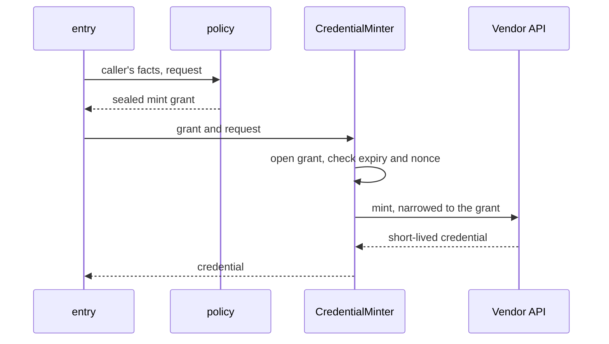

An **integration** connects sluis to something outside it: a sign-in provider, a directory, a cloud, a chat workspace. Each integration actor is its own process and holds only its own vendor credential: one process per vendor tenant and per credential, named `<vendor>[-<capability>]@<tenant>`. Sign-in and the directory of one workspace tenant are two credentials and so two processes, `google-signin@<company>` and `google-directory@<company>` ([ADR 0003](/decisions/0003-core-actors-with-one-responsibility-each/#names)).

This page is the model and the index; the [setup patterns](/integrations/connecting/) describe the vendor ceremonies once.

## Six kinds of integration

Five kinds are integration actors, each a ConnectRPC contract over one shared base contract. The sixth, the workload verifier, is a verifier driver of `exchange` that holds public material only ([ADR 0007](/decisions/0007-workload-identity-and-host-enrolment/#proofs-and-the-exchange)).

| Kind | It answers or does | Examples |
|---|---|---|
| `Upstream` | Sign-in with an upstream identity provider | A workspace identity provider, a generic OIDC provider |
| `FactsSource` | Supplies directory facts: users, groups, teams | A workspace directory, GitHub teams |
| `CredentialMinter` | Mints a downstream credential for a grant that core sealed | GitHub installation tokens, Cloudflare API tokens |
| `Provisioner` | Reconciles an external system to a desired state that core publishes | GitHub teams, Slack channels |
| `Notifier` | Sends a message | A chat app, an on-call tool |
| `WorkloadVerifier` | Verifies a token a workload presents and returns what it proves | GitHub Actions, Kubernetes ServiceAccounts, AWS roles |

Every vendor-shaped value travels as an opaque reference or a namespaced attribute (for example a subject in namespace `github` with an id only the integration understands). Core never parses what an integration returns. Each integration declares its attribute names and types, so a policy file is validated at load time without core knowing the vendor.

## Facts or core-authorized effects, never decisions

> Integrations return facts, or carry out effects that core has already authorized. They never decide.

[ADR 0003](/decisions/0003-core-actors-with-one-responsibility-each/#the-actors) states the rule; [ADR 0026](/decisions/0026-integrations-return-facts-or-carry-out-effects-that-core-authorised/) fixes the contract every integration is built against: what an integration may return, how core authorises an effect, and the split by credential.

- A **FactsSource** or **WorkloadVerifier** returns facts. Whether a fact entitles anyone to anything is `policy`'s question.
- A **CredentialMinter** carries out an effect. It receives a **mint grant that `policy` sealed under the sealing key**, opens it (which fails for a grant from any other environment), and mints exactly what the grant says. It decides nothing about whether to mint ([ADR 0012](/decisions/0012-cryptography-and-authority-keys/#grants-are-sealed-not-signed)).
- A **Provisioner** pulls a desired state **addressed by its digest** and reconciles to it. It does not choose what the state should be.

Caps and rate limits live in core, in `policy` and `quota`, so a minter never holds a rule about how much is too much.

## Core calls integrations, never the reverse

`session` calls its upstreams, `exchange` its verifiers, minters and notifiers, `console` the integrations that own operator-set kinds, and `entry` only routes a push notification. An integration never calls a core actor; what it needs from core, such as a provisioner's desired state, core publishes as data in a read-only prefix.

Three invariants are tested, so the rule survives changes: core packages never import vendor packages; there is no edge from an integration to a core component; policy matchers have no vendor-specific fields.

## Client profiles

Many things that look like integrations call no external system: databases, SSH hosts, cert-manager, GitOps consoles, MCP servers. They are clients of sluis, and sluis calls nothing outside for them. Each is a **client profile**: configuration for how that client signs in and what it may ask for, with no process, no credential and no manifest of its own, checked by [`sluis config check`](/concepts/configuration/) like the rest of the configuration.

The AWS and Kubernetes pages sit between the two: the integration part is the workload verifier, and the rest is configuring the account or cluster to trust sluis.

## Isolation and permissions

An integration declares its configuration block and the permissions it needs in a descriptor. The installer never grants more than the descriptor asks, and never accepts a descriptor above the installation's admission policy: no authority keys for a third-party integration, and outbound access only to the hosts it declares. Because each integration is a separate process with its own user and credential, a compromised connector to one vendor does not reach another vendor's token. On Kubernetes each integration is a pod with its own egress NetworkPolicy ([ADR 0018](/decisions/0018-runtimes-installations-and-delivery-order/#kubernetes)); the other runtimes are on [Runtimes](/runtimes/).

## The integrations

Every page has the same parts: what it's for, the kinds it plays, what sluis asks the vendor for, what policy controls, what is audited, and setup. v1 behaviour and the parity issues are on the [v1 parity checklist](/features/).

| Page | Kinds | The use cases it serves |
|---|---|---|
| [GitHub](/integrations/github/) | `WorkloadVerifier`, `FactsSource`, `CredentialMinter`, `Provisioner` | A CI job gets a token for one repository that lives minutes; teams follow the directory. |
| [Google Workspace](/integrations/google-workspace/) | `Upstream`, `FactsSource` | People sign in with the account they have; policy names directory groups. |
| [Generic OIDC and peer sluis](/integrations/oidc-upstream/) | `Upstream`, `FactsSource`; a peer adds `WorkloadVerifier` and `CredentialMinter` | A partner signs in with their own provider; another sluis vouches for its people. |
| [Cloudflare](/integrations/cloudflare/) | `CredentialMinter` | A job gets a DNS token for one zone, or R2 credentials for one bucket, for an hour. |
| [AWS](/integrations/aws/) | `WorkloadVerifier`, plus accounts that trust sluis | People and CI jobs assume roles without stored keys; a Lambda function proves itself. |
| [Kubernetes API server](/integrations/kubernetes/) | `WorkloadVerifier`, plus clusters that trust sluis | `kubectl` with directory groups in RBAC; a ServiceAccount calls another cluster. |
| [PostgreSQL](/integrations/postgresql/) | Client profile on `ca` | A database session with a short-lived client certificate. |
| [SSH](/integrations/ssh/) | Client profile on `ssh-ca` | Host logins with SSH certificates; clients trust a host CA. |
| [Applications and gateways](/integrations/applications/) | Client profiles | Consoles, applications, gateways and MCP servers trust sluis; cert-manager gets certificates. |
| [More integrations](/integrations/more/) | `Provisioner`, `FactsSource`, `Notifier` | Slack channels, a team wiki and an on-call tool follow the directory. |

## Examples are illustrative

The commands of the first working version are on [Commands](/reference/cli/) and the keys of the install file on [Install file](/reference/install-file/); those pages are decided. A command or a configuration key on these pages that they do not list belongs to the parity milestone: it shows the shape, not a decided name, until it is designed ([#1097](https://github.com/truvity/sluis/issues/1097)).
