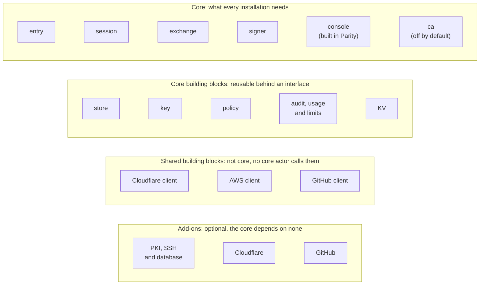

sluis is an open-source identity and access broker for people, robots and external systems. It sits between the identity providers that already know who someone is and the systems that need a credential before they let that someone in.

## Who it is for

sluis is for engineers who run the identity layer of a small organisation, a platform team or a self-hosted lab, and want it small, auditable and cheap to run. The mission is on the [home page](/).

sluis v2 is built in layers. The **core** is what every installation needs (`entry`, `session`, `exchange` and `signer`). It sits on the **core building blocks**: store, key, policy, audit with usage and limits, and KV. A separate layer of **shared building blocks** holds the Cloudflare, AWS and GitHub clients that drivers and add-ons reuse. The **add-ons** are optional: PKI with SSH and database access first, then Cloudflare and GitHub. The core installs and runs without any add-on ([roadmap](/roadmap/#a-core-building-blocks-and-add-ons), [ADR 0044](/decisions/0044-sluis-is-a-core-and-add-ons/)).

The console is part of the core layer, and it is built in the Parity phase. The `ca` actor is built and stays off until the PKI add-on turns the token certificate on. No core actor calls a shared building block, and a client or a minter is built with its first consumer.

An installation serves one boundary. Its staff and operators sign in with sluis's own passkeys; customers sign in through the upstream identity provider, and the sluis token carries the customer, the organisation and the product ([0045](/decisions/0032-customer-identity-installations/)).

Every installation runs the same **foundation**: store@ for data, exporter@ for export and key@ for keys. Identity and audit are **modules** on top of it, and an installation runs the modules it needs, such as the audit module alone ([Families](/concepts/families/#the-foundation-and-the-modules)).

The people who work with an installation are these.

- **Operators** install it on a workstation, on three single-board computers, as AWS Lambda functions or on Kubernetes. The same actors and configuration run on each; these four are the [tested installations](/runtimes/). Boards, Lambda and Kubernetes are the **shapes** a production installation takes, and the local installation is for development ([glossary](/concepts/#shape)).
- **Platform and security engineers** write the policy that says who may get which credential, and read the audit trail that says who did.
- **Integrators** add sign-in providers, directory sources and credential minters as adapters: work actors that implement one of the ConnectRPC contracts of [Integrations](/integrations/).

## What it does

Each line says where it stands as of 2026-11-18. "Built" means the core of alpha.1 runs it; "planned" names the phase that builds it ([roadmap](/roadmap/#phases)).

- It **federates sign-in** from upstream identity providers, so people use the accounts they already have. Built for a generic OpenID Connect provider.
- It **issues OIDC tokens** and **exchanges tokens** (RFC 8693): a person or a client presents a token and receives a sluis token for the system it wants to reach. Built. A robot or a CI job presenting a token from the system it runs on is planned (workload exchange, in part for KV in the core phase, the rest in Parity and the GitHub add-on).
- It **mints short-lived downstream credentials**, such as cloud credentials, GitHub installation tokens and certificates. Nothing it hands out is meant to outlive the task. Planned: cloud and GitHub minters are add-ons or shared building blocks, and certificates come with the PKI, SSH and database add-on after parity.
- It **reconciles directory facts** from workspace directories and GitHub teams, so that policy can say "members of this team" without sluis owning the team. Planned, and not scheduled (the reconcilers are in the backlog).
- It **writes a tamper-evident audit trail** of every flow, refusals included ([Audit](/concepts/audit/)). Built, with a search that runs on the local installation.

The part that holds a key is small and parses no internet input, and the part that decides is separate from the part that signs. Work actors hold no storage, key or audit credential at rest; only the data, keys and audit families do ([Families](/concepts/families/)).

## What it leaves out

- **It is not a general secrets engine.** It keeps the secrets it generates or receives as sealed or hashed data, reads the secrets an operator gives it from a secret source, and publishes a small typed set of public values. Its KV building block keeps versioned static secrets for others, readable by External Secrets, but it has no transit engine, lease system or dynamic secrets. Use a secrets manager for those ([Data](/concepts/data/), [ADR 0047](/decisions/0047-kv-is-a-core-service-of-stores-that-no-tenant-owns/)).
- **It has no users of its own and holds no roots.** It writes no Kubernetes object, except a Secret that exporter@ writes when an installation chooses the direct path. Roots belong to the sister product [ritueel](https://ritueel.id). The reasons are in [what sluis is, and is not](/principles/#what-sluis-is-and-is-not).

## v1 and v2

v1 is the sluis that runs in production today, a set of AWS Lambda functions on the `master` branch. v2 is a rewrite on `main` that shares no history with v1; its first alpha, `v2.0.0-alpha.1`, was published on 2026-11-08. The order of delivery is:

1. **Core.** The core with its security hardening (including FAPI 2.0 as a profile that a client declares), KV, and the four installations (local, boards, Lambda and Kubernetes), cut as `v2.0.0-alpha.2` before the installations. This is the phase being built.
2. **Customer identity and quota.** A narrow scope: the exchange of a trusted realm's token for a sluis token with the customer, organisation and product, and the usage stream with the limit check.
3. **A re-plan,** which decides what parity needs.
4. **Parity with v1** (the [features page](/features/) lists what that means), with the console.
5. **The switch** of the maintainer's platform from v1 to v2, to a new issuer of the platform installation, in waves.
6. **The PKI, SSH and database add-on,** after parity, which replaces OpenBao.

CIBA comes later, once a real consumer exists, in poll mode with a passkey on the approving device ([#980](https://github.com/truvity/sluis/issues/980)). The two lines coexist until the maintainer's own deployments run v2 ([ADR 0001](/decisions/0001-v1-and-v2-lines/)). The phases and their exit tests are on the [roadmap](/roadmap/), and [Project status](/status/) shows how far each milestone has got; the v1 documentation is at [/v1/](/v1/).

## Map of the documentation

| Section | What you find there |
|---|---|
| [Design principles](/principles/) | The yardstick the decision records follow. |
| [Concepts](/concepts/) | The model and its vocabulary: [families of actors](/concepts/families/), [data](/concepts/data/), [keys](/concepts/keys/), [boundaries](/concepts/boundaries/), [identity](/concepts/identity/) and [audit](/concepts/audit/). |
| [Integrations](/integrations/) | Every system sluis connects to, and how to set it up. |
| [Architecture](/architecture/) | The three zoom levels, the components and the deployment, and the registries behind them ([Kinds](/reference/kinds/), [Rules](/reference/rules/), [Actors](/reference/actors/)). |
| [Security](/security/threat-model/) | The threat model and break-glass recovery. |
| [Runtimes](/runtimes/) | Bare-metal, serverless and Kubernetes, and the four tested installations. |
| [Reference](/reference/) | The specifications the core is built against. |
| [Tutorial](/tutorials/single-node-install/) | A step-by-step install on a single node. |
| [Distribution](/distribution/packages/) | Packages, platforms and release signing. |
| [Standards](/standards/) | The specifications sluis follows and how conformance is proved. |
| [Decisions](/decisions/), [Roadmap](/roadmap/), [Project status](/status/) | The reasoning, the phases and where the work stands: what is built today is on the roadmap and the status page. |
| [Contributing](/contributing/) | How to work on sluis: the workflow, the design method, the tools and the rules for pages and records. |

A badge beside each title says whether the page describes a design not built yet, something partly built or something shipped. Plain prose is the design; a **Proposed** note names the open issue that will settle it. The rules are in [Target-state pages](/contributing/pages/).
